# 龙海（@longhaiqwe123）：万字长文（含配图），讲清楚育儿的第一性原理

> 从系统科学、发展心理学与进化生物学视角深潜育儿本质的万字思想长文：解构传统东亚家庭中焦虑反刍、过度控制与目标异化的症结；提出以安全依恋为底座、自主性支持为支柱、刻意留白为缓冲的第一性原理育儿体系，帮助现代父母在信息轰炸中建立从容笃定的家庭教育底层心法。

<!-- more -->

原谅我这次使用了如此“标题党”的一个标题。但这篇文章，比我之前写的任何一篇文章都重要，所以我必须引起你的关注。

一直想写“育儿第一性原理”这个话题，苦于不知道如何组织，所以动笔总是很艰难，尝试过把脑海中的想法丢给 AI，让它帮我成文，但就是不喜欢。

尝试的过程中，不断想起陈行甲老师《你，是孩子的前传》这本书中关于“根-干-枝-叶”的模型。这个模型，是否已经接近育儿的本质？何不就引用书中观点呢？

本文内容主要节选自陈行甲《你，是孩子的前传》原书“缘起”第 01—04 节。正文按完整原段选编，有部分删减，无改写；让 AI 学习《认知觉醒》的配图风格，为必要的知识新增图片辅助阅读。

再次感谢陈行甲和周岭两位老师的著作，强烈推荐购买两本纸质书详细阅读。请用心读完本文，不要用任何的 AI Agent 代劳！

## 01 方案：“根-干-枝-叶”的成长模型

什么叫“根-干-枝-叶”模型？你可以把孩子的成长想象成一棵大树：

“叶”，就是我们最容易看到的、最表面的那些问题。比如，厌学、网瘾、撒谎、情绪失控、早恋……这些都是树叶出现的枯黄、虫洞。

“枝”，是支撑这些叶子的枝条，代表着孩子的核心能力。比如，自信心、抗挫力、情绪管理能力、学习能力、社交能力。叶子出问题，往往是因为枝条不够强壮，输送不了养分。很多青春期问题，往往也是由于这些核心能力不够，拖垮了孩子。

“干”，是连接枝条与根系的主干，代表着我们的亲子关系模式。我们和孩子的沟通方式、我们给孩子制定的规则、我们给予孩子的陪伴和信任，都是这棵树的主干。如果主干本身是堵塞、扭曲的，养分就无法顺畅地向上传递，枝和叶的生长自然都会受影响。

最后是“根”。根深埋在土壤里，不容易被看见。它代表着整个家庭的氛围。夫妻关系、父母各自的原生家庭影响、父母自身的成长与情绪状态等，这些共同构成了这棵大树的土壤和根系。我们都知道，根系是否有活力，土壤是否肥沃，决定了整棵树的生命状态。

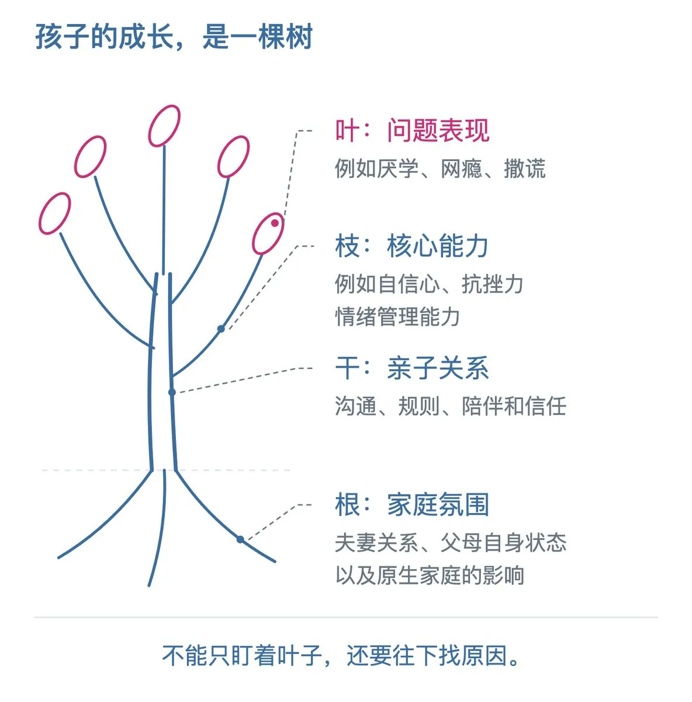

我们过去所有的努力，都花在了处理“叶子”上。我们试图用绿色的胶带遮住枯黄的叶子，用杀虫剂喷被虫子咬过的叶子。但一个有经验的园丁会告诉你，这样做用处不大。想要彻底解决叶子的问题，你就不能只盯着叶子，而要往下找原因。

这么讲可能有些抽象，我们选择一个常见的青春期问题——孩子沉迷网络游戏，按照这个模型来进行详细拆解。

从“叶”到“枝”

断网、没收手机、限制时间，和孩子斗智斗勇，搞得两败俱伤。这是典型的“治叶”思维。

但如果用“根-干-枝-叶”的模型来看，我们就要往下探一步：这片叫作“网络沉迷”的枯叶，长在哪根“枝条”上？

它可能长在一根叫作“价值感”的枝条上。如果在现实世界里，孩子从学习中找不到成就感，在和父母的互动中得不到肯定，他就会感到自己很失败，缺少价值感。但在游戏里，每一次升级、每一次胜利，都能给他带来即时的、正向的反馈，让他觉得自己“还不错”。于是，很多孩子会在游戏里寻找价值感。

它也可能长在一根叫作“社交能力”的枝条上。如果孩子存在社交障碍，在学校里不知道该如何与人交往，感到孤独、被排挤，但在虚拟的游戏世界里，他可以和队友并肩作战，有共同语言，甚至还能成为团队的核心，那他就愿意到游戏里体验归属感和被需要的感觉。

它还可能长在一根叫作“情绪调节能力”的枝条上。情绪调节能力存在欠缺的孩子，在现实中遇到挫折，感到焦虑、烦躁时，往往不知道该如何处理这些负面情绪。而进入游戏世界，仿佛穿越一样，他可以暂时忘记烦恼，得到麻痹和放松。

你看，当我们的视角从“叶”下沉到“枝”时，我们关注的焦点就变了。我们不再问“我该如何戒掉孩子的网瘾”，而是问“我该如何帮助孩子在现实世界中建立价值感、获得高质量的社交，并且学会管理自己的情绪”。

问题的性质，瞬间从一场行为争夺战变成了一个能力培养计划。方向对了，努力才不会白费。

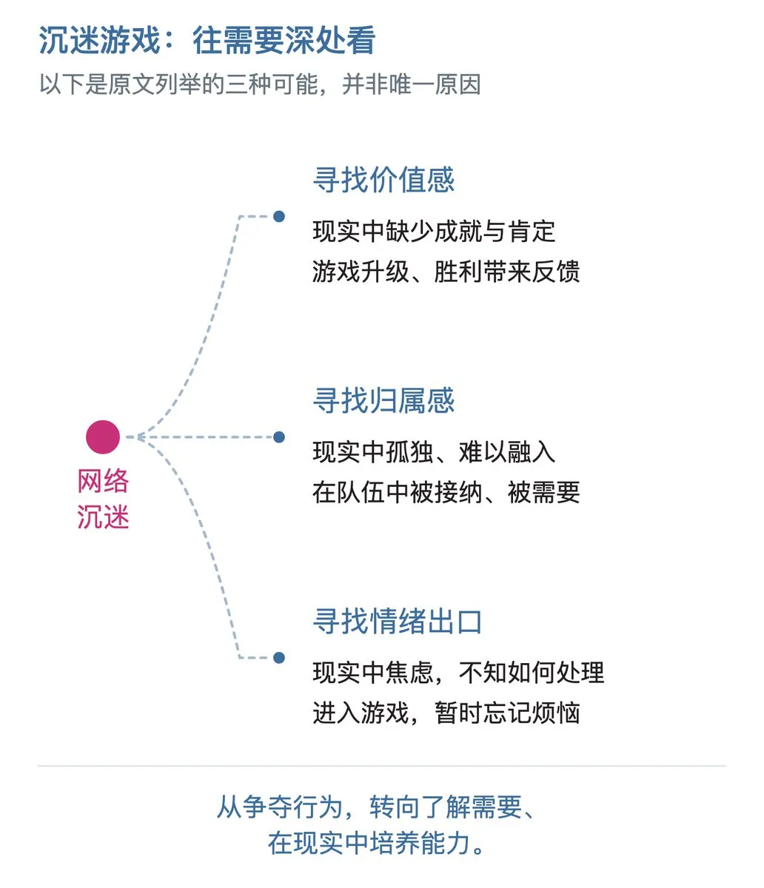

从“枝”到“干”

不过到这里还没完，我们可以接着往下追问：为什么孩子的这些“能力之枝”会如此脆弱？为什么他没有培养出足够的价值感和社交能力？

这就需要我们审视树的主干。这个“主干”，也就是亲子关系模式，是输送“爱”“安全感”“价值感”这些心理营养的唯一通道。如果这条通道堵塞了，孩子的核心能力就无从发展。

可能源于无效的沟通。当我们的沟通充满了说教、指责、评判、比较，比如“你就是很懒惰”“你看别人家孩子”，而不是倾听、理解和共情时，孩子就会关闭心门，不再愿意与我们分享真实的感受和困惑。交流和分享中断，这条通道就失去了最重要的情感流动。

也可能源于低质量的陪伴。我们可能每天都和孩子待在一起，但很多时候，我们的心却在手机上、工作上。这种“人在心不在”的无效陪伴，让孩子感受不到被看见、被重视，于是通道里流淌的就是稀薄的空气，而不是浓厚的爱。

还可能源于混乱的边界与规则。我们要么过度控制，侵入孩子的个人空间，替他做所有决定，让他失去成长的机会；要么过度溺爱，毫无原则和底线，让他无法学会为自己的行为负责。这就像树干如果被铁丝捆得死死的，或者被洪水泡得毫无土壤支撑，自然就无法健康生长。

所以你看，“枝”的问题，也就是孩子核心能力的缺失，往往是因为“干”，也就是我们的亲子关系模式出了问题。想让枝繁叶茂，就得疏通主干。

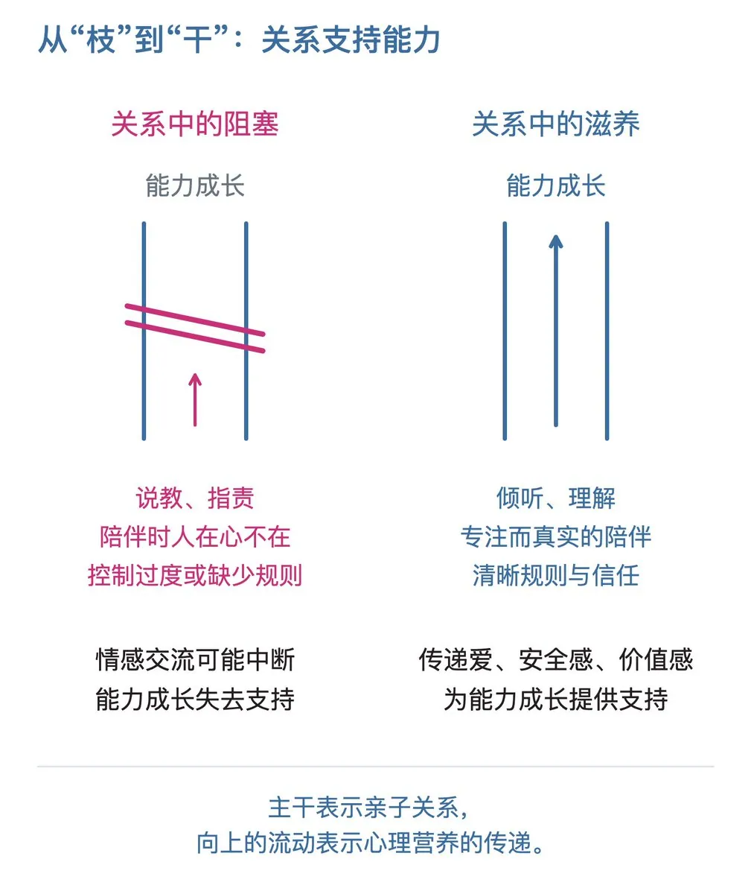

从“干”到“根”

到达树干这一层，已经很不容易了，不过我们还可以更进一步——为什么我们的亲子关系会是现在这个样子？为什么我们总是忍不住对孩子说教、发火？为什么我们明明爱孩子，却总是用错误的方式把他推开？

这么继续追问下去，你会发现，答案其实源于整个家庭的系统和氛围。放到大树这个比喻里，源头就是看不见的“根系”和“土壤”。

这片根系和土壤的构成，至少有三个核心要素：

首先是夫妻关系。这是孩子成长这棵大树的“主根”。

父母的关系，是孩子看到的第一种亲密关系范本，也是他安全感的最大来源。如果夫妻之间战火不断、冷漠疏离，或者一方长期缺位，整个家庭的土壤就是“盐碱地”，充满了不安全和不确定感。孩子需要耗费大量的心理能量去应对父母关系带来的压力。

其次是父母的自我成长状态。我们自己，就是土壤本身。

如果我们自身长期处于焦虑、抑郁的状态，如果我们身上原生家庭的创伤未曾疗愈，那我们就会像一片贫瘠、干涸的土地。内心缺爱的父母，很难教会孩子如何去爱；情绪不稳定的父母，也很难养育出内心平和的孩子。很多时候，我们对孩子的过度控制、我们因为孩子产生的焦虑，投射的其实是我们自己内心的恐惧和未被满足的需求。

最后是代际传承的影响。我们与自己父母的关系，以及祖辈的养育观念，也会潜移默化地影响这片土壤。

很多时候，我们会不自觉地重复我们父母对待我们的模式。那些我们曾经讨厌的、发誓绝对不会对自己孩子说出的话、做出的行为，却在某个瞬间由我们自己说了出来、做了出来。这就是代际传承的巨大力量。

上述三点——夫妻关系、父母的自我成长状态、代际传承，无论哪一点处理不好，都会影响整个家庭系统的运转，损害家庭整体的氛围。土壤和树根出了问题，怎么可能长出参天大树呢？

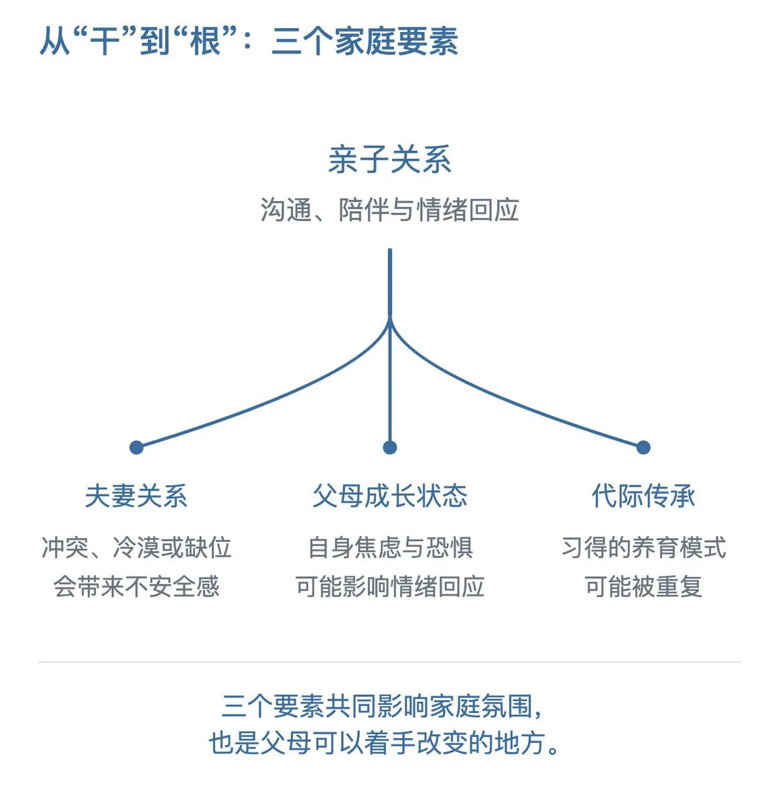

孩子沉迷网络（叶），可能是因为他缺乏价值感和社交能力（枝）；而他之所以缺乏这些能力，可能是因为我们的亲子沟通充满了指责和说教，让他感受不到爱与支持（干）；而我们之所以会用这样的方式沟通，又可能是因为我们的夫妻关系紧张，我们自己也长期处于焦虑状态，无力给予孩子高质量的情感回应（根）。

这样一根完整的链条看下来，你还会觉得孩子的问题仅仅是他一个人的问题吗？

我们才是那个“问题的根源”，但也正因如此，我们才成了那个“解决问题的希望”。

在这个过程中，有两个核心原则会贯穿全书，它们就像两条隐形的线，串联起每一个方法。

第一个原则，是共情。

什么是共情？共情不是同情，不是可怜孩子；共情也不是认同，不是说孩子做什么都对。共情，是站在孩子的角度，去理解他的感受，看见他的情绪。

第二个原则，是教练式提问。

我们习惯了给孩子答案、讲道理，但青春期的孩子最反感的就是被说教。教练式提问，是用问题来引导孩子自己思考、自己找到答案。

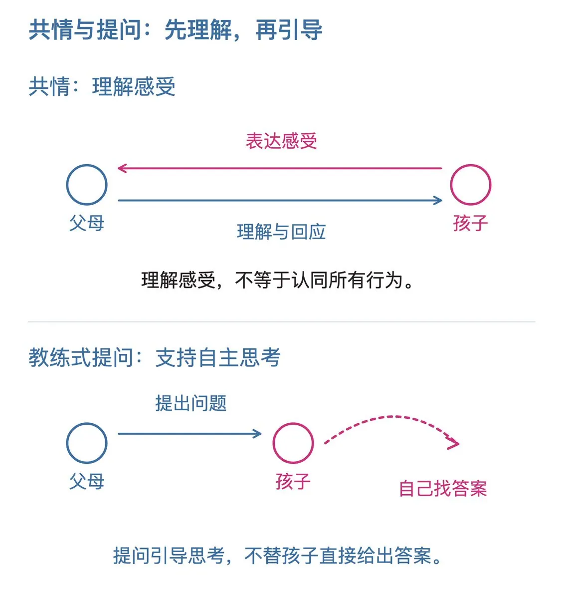

## 02 机制：青春期的孩子为何像变了个人

“知更鸟”项目中的一位妈妈曾经非常痛苦地问我：“陈老师，我儿子小学时那么乖巧、那么懂事，简直就是我的小棉袄。怎么一上初中，就像变了一个人？浑身长满了刺，处处跟我作对。这中间到底发生了什么？”

理解了孩子行为的底层机制，你就会发现，那个让你头疼的“坏”孩子，其实不是在变坏，而是在用一种笨拙、混乱，甚至让你心疼的方式，拼尽全力地成长。

硬件大升级

你可以把人的大脑想象成一辆无比精密的智能汽车。从出生到童年，这辆汽车的硬件配置基本稳定，软件也在平稳地运行。但是，一进入青春期，这辆汽车就迎来了一次史上最剧烈的硬件大升级。

这不是一次送进工厂的专业升级，而是一场“边开边换零件”的混乱施工。你可以想象一下：这辆车还在高速公路上跑着，但改装团队已经爬上来开始动手了。引擎盖被掀开，零件到处都是，油路时通时不通，新旧部件混装在一起，整台车在轰鸣、抖动、冒烟中艰难前行。

第一个特点，我叫它“油门踩到底”。

在这场大脑的硬件大升级中，负责情绪、奖赏和冲动的区域，也就是我们常说的“边缘系统”，会率先被激活和强化。这个区域就像汽车的油门。在青春期，受荷尔蒙的影响，这个油门被“改装”得异常灵敏，而且被一脚踩到了底。

首先，青春期的孩子对奖赏和刺激的渴望，被放大了很多倍。一点点好玩的事，比如打游戏过关，和朋友聊天，尝试新鲜事物，都能给他们带来巨大的快感。这就是他们对游戏、社交如此痴迷的原因之一。他们做这些事情时，大脑的这个“奖赏中心”在疯狂地分泌多巴胺。

其次，他们的情绪体验，也变得极为强烈和敏感。朋友的一句无心之言，可能会让他们伤心一整天；一次小小的成功，能让他们兴奋到彻夜难眠。他们的情绪就像过山车，大起大落，自己控制不了。

最后，同伴关系变得至关重要。大脑的这个区域，对社会评价也极其敏感。被同伴接纳和认可，能带来巨大的愉悦感；而被排斥，则会带来剧烈的痛苦。所以，朋友的重要性，在青春期第一次超越了父母的重要性。

也就是说，当你的孩子为了跟朋友出去玩而跟你撒谎时，当他因为一点小事就暴跳如雷或者痛哭流涕时，当他痴迷于某件事物到了废寝忘食的地步时，请先别急着评判他“不懂事”。你要知道，因为油门被踩到了底，他大脑里的“情绪发动机”正在超负荷地轰鸣运转，他自己也身不由己。

青春期孩子大脑发育的第二个特点，我叫它“刹车系统掉线”。

大脑中负责理性思考、冲动控制、规划未来、权衡利弊的区域——前额叶皮层，是这场“硬件大升级”中最晚完工的部分。它要到二十五岁左右才能完全成熟。

前额叶皮层就像汽车的刹车系统。在青春期，这套至关重要的刹车系统，正处在“拆了重装、线路不稳”的状态，时常会掉线。

孩子们极度缺乏自控力。他们知道不该玩手机，应该去写作业，但就是控制不住自己。这是因为“想玩”的冲动油门踩得太猛，“该学”的理智刹车又失灵了。

孩子们做事不计后果。那些危险的行为，比如抽烟、喝酒、打架，在他们看来，更多的是刺激和酷，他们很难去思考其长远的危害。

孩子们无法很好地管理情绪。当巨大的情绪洪流涌来时，负责疏导洪水的理智堤坝还没建好，所以情绪很容易就会决堤，表现为各种失控的言行。他们自己也常常后悔，但下一次还是控制不住。

一辆油门轰鸣、马力强劲的跑车，却配上了一套时灵时不灵的刹车，这就是青春期孩子的真实写照。

这不是他们的品格问题，而是他们所处的发展阶段的问题。

软件大更新

理解了“硬件”的混乱，我们再来看看，这辆混乱的智能汽车，正在运行一套怎样的人生“软件”。

心理学告诉我们，青春期孩子最重要的、压倒一切的核心任务只有一个，那就是搞清楚“我是谁”。他们需要完成从“某某某的孩子”到独立的“我”的转变。这场寻找“我是谁”的旅程，我们称之为“身份认同”。

为了完成这个伟大的任务，他们必须做两件“惊天动地”的大事。

第一件大事是心理断奶，也就是从“依赖你”到“脱离你”。

童年时期，孩子的自我认知完全建立在和父母的关系之上。“我是爸爸、妈妈的好孩子”，这就是他们的身份。

但到了青春期，他们要想成为一个独立的个体，就必须，也必然，和父母在心理上进行一次切割。他需要挣脱你的怀抱，站到你的对立面，才能看清楚“你是你，我是我”。

这个“心理断奶”的过程，表现在行为上，就是我们所说的“叛逆”。

他会开始挑战你的权威。你说的每一句话，他都要反驳，不是因为你说得不对，而是因为他需要通过否定你来肯定他自己的存在。

他会开始需要个人空间和隐私。他的房门锁上了，日记本加密了。这不是要隔绝你，而是他需要一个安全的“自我孵化器”，在里面慢慢地构建一个属于他自己的小世界。

他会把朋友看得比你重要。因为他需要在一个由同龄人组成的新世界里，去试炼自己的新身份，获得新的认可。

我知道这个过程非常伤人。那个曾经对你 100%依赖和崇拜的孩子，现在把你视作“落伍”的、需要反抗的对象。这会让你感到失落。但请你一定要换一个角度看。

这不是一场情感的背叛，而是一次生命必经的远航。孩子不是在推开你，而是在成为自己。就像火箭发射，它必须用力推开地面和发射架，才能飞向属于自己的星辰大海。我们作为父母，此刻要做的，不是把他死死地摁在发射架上，而是成为稳固的、让他可以放心借力的发射基地。

在和父母进行切割的同时，他们也向外、向整个世界，展开了一场轰轰烈烈的探索。“既然我不是父母眼中的我了，那我到底是谁？”这就是在青春期身份认同的旅程中，孩子要完成的第二件大事——自我探索，从“你塑造的我”到“我想成为的我”。

为了回答这个问题，他们会去疯狂地“试错”。

他们会尝试各种各样的形象和人设。今天可能想当个摇滚青年，明天又迷上了二次元文化，后天又立志成为商业精英。

他们的兴趣爱好会变得广泛而不稳定。你会发现他今天对这个充满热情，明天就弃之如敝屣。

他们会开始思考一些终极问题。人生的意义是什么？公平是什么？爱是什么？这些你可能觉得虚无缥缈的问题，对他们来说却至关重要，因为这关乎他们价值观的建立。

这个过程，在成年人看来可能显得非常幼稚、善变、不切实际。但对他们来说，这是构建自我身份的必经之路。就像我们要买一件合身的衣服，总要先去商场试衣间试穿很多件一样，他们是在人生的试衣间里，不断地“试穿”各种可能的自己，最终找到最适合的那一个。

写到这里，我想起了“知更鸟”项目中的一位父亲跟我分享的故事。

他的儿子辰辰，初二那年，因为沉迷滑板，成绩一路下滑。一次周考成绩出来，父亲看着那张惨不忍睹的数学卷子，压抑许久的火气终于爆发了。他指着儿子的鼻子吼道：“整天就知道玩那块破木板！你到底有没有脑子？你是不是成心想毁了你自己？”

那个一直沉默的少年突然间像变了个人，猛地掀翻了书桌，眼里的怒火几乎要喷出来。他大吼一声：“对！我就是没脑子！我就是想毁了自己！你满意了吧？！”说完，他摔门而出，在深夜的街头狂奔。

这位父亲当时气得浑身发抖，第一反应是想追出去大骂儿子一顿。但就在那一刻，看着儿子决绝而痛苦的背影，心底里那种爱儿子的本能突然拉了他一把。他猛地意识到，儿子刚才那一瞬间的暴怒，并不是在针对自己，而更像是一场儿子本人也无法应对的灾难。

成年人的理智开始拼命工作——他意识到，儿子这辆“跑车”此刻正处在油门踩死，刹车系统掉线的失控边缘，如果自己也跟着失控，只会造成惨烈的对撞。

他深吸一口气，穿上外套出门去找儿子。最后，他在公园的台阶上发现了满头大汗、正对着夜空发呆的辰辰。他没有像往常那样上去就讲道理，而是静静地坐在儿子身边，递过去一瓶水。

过了很久，辰辰闷声说了一句：“爸，其实我掀桌子的时候，心里特别害怕。我不知道自己为什么会那样，那一瞬间，我真的控制不住自己。”

父亲看着月光下儿子那张还带着稚气，却写满迷茫的脸，心疼不已。他拍了拍儿子的肩膀，轻声说：“儿子，爸爸懂的。刚才爸爸发脾气也不对。以后，咱们试着在对方生气时互相引导一下，好吗？”

那一晚，父子俩在月色下走了很久。辰辰第一次跟爸爸聊起，他之所以爱滑板，是因为在滑板腾空的那一秒，他能感觉到一种前所未有的“我是自由的、我有力量”的掌控感。

这就是青春期。辰辰对滑板的痴迷，是因为他在寻找“我是谁”的身份认同；而他的暴怒，则是因为大脑硬件升级时的施工混乱。

当你看清了这些行为背后的真相，愤怒就会被一种深切的慈悲和心疼取代。你会发现，孩子那带刺的伪装底下，其实藏着一个极度渴望被理解、被接纳的灵魂。

所以你看，青春期这场巨大的身心风暴，不是一个错误，也不是一种疾病，而恰恰是最旺盛的生命力的体现！这场风暴，本身就是成长的一部分，甚至是成长必需的“发动机”。他们的那些“坏”行为，本质上是他们在用尽全力，去完成“成为一个独立的人”这项无比艰巨而伟大的任务。

理解了这一点，我们父母要扮演的角色，就会发生根本性的转变。

我们不再是拿着喇叭追在车后大喊“慢一点”的警察，也不再是孩子一出问题就冲上去的消防员——

我们应该成为那辆失控的跑车旁边最坚固的“高速公路护栏”，为孩子守住安全底线，让他不至于冲出悬崖；

我们应该成为孩子迷路时可以随时停靠的“服务区”和“加油站”，为他提供无条件的爱与支持，让他休整之后再次出发；

我们更应该成为坐在副驾驶座上、经验丰富、内心沉稳的“领航员”。

作为这条路上曾经的驾驶者，我们不抢孩子的方向盘，而是以过来人的身份理解他、陪伴他，用我们的智慧和爱，指引他安全地驶过这段最危险，也最壮丽的人生旅程。

## 03 诊断：你的家庭究竟哪里“病”了

现在，我们理解了孩子内在的这场风暴。但是这场风暴的猛烈程度，以及它最终会把孩子带向何方，很大程度上取决于他所处的外部环境，也就是我们的家庭。

很多时候，家庭的问题就像我们身体的慢性病，不声不响中，已潜伏久矣。我们身处其中，早已习惯，甚至对其浑然不觉。但正是这些被我们忽视的、慢性的“功能失调”，在日积月累地消耗着孩子的生命能量，平时倒还好，一旦赶上青春期这个“压力测试期”，问题就会集中爆发出来。

请你先别抗拒“问题”或“病”这样的词。诊断从来不是为了贴标签和自我批判，而是为了获得觉知。觉知，是改变的开始。只有看清了问题的症结，我们才能找到精准的疗愈方向。

情感忽视型家庭

这种家庭的核心特征，是家庭成员之间缺乏真实的情感流动。

从物质条件的角度来看，这样的家庭往往什么都不缺。父母努力工作，为孩子提供了优越的生活条件，关心孩子的学业，安排好孩子的一切。在外人看来，这种家庭甚至是模范家庭。

但是，如果有机会和这种家庭相处，你会感到冰冷和安静。家庭成员之间的日常交流，往往集中在一些具体的事务上，缺少情感层面的沟通与回应。孩子的情感需求更是像空气一样被视而不见。

第一，父母是“事务管理者”，而不是“情感连接者”。

父母和孩子的交流，90%以上都围绕“事务”展开，常见的话语包括：“作业写完了吗？”“琴练了吗？”“这次考试考了多少分？”你看，父母关心的都是孩子“做了什么”“表现如何”，却很少关心孩子“感觉怎么样”“心里在想什么”。

第二，孩子的负面情绪是不被允许和接纳的。

当孩子哭泣、沮丧、愤怒时，他听到的往往是，“这有什么好哭的？”“坚强一点，别这么脆弱！”“为这点小事就发脾气，太不懂事了！”这样的父母会习惯性地压抑、否定孩子的情绪，因为他们自己也害怕且不懂得如何处理这些“麻烦”的情感。久而久之，孩子就学会了把所有的情绪都藏起来，戴上一副“乖巧”或“冷漠”的面具。

第三，家庭文化是“道理”大于“感受”。

遇到任何问题，父母的第一反应都是讲道理、分析对错、给解决方案。他们是优秀的“问题解决者”，却不是耐心的“情绪倾听者”。事实上，孩子向父母倾诉烦恼，是在与父母分享他的情感，这时候，他最需要的可能不是一个答案，而是一个共情的拥抱。但在这种家庭里，拥抱是稀缺的，道理却是过剩的。

总之，在这样的情感忽视型家庭里长大的孩子，渐渐地会得一种病，心理学上叫作“情感失语症”。他们可能内心波涛汹涌，却表达不出来。举个例子。他们分不清愤怒和悲伤，只能用模糊的词汇，比如“不舒服”来描述感受。因为从小就没人教过他们如何表达自己的情感，也没人倾听过他们的情感表达。渐渐地，他们连自己有什么感受都不知道了，变得麻木、空洞。

到了青春期，当他们内在的“情感发动机”轰鸣启动时，这种“情感被忽视”的痛苦会达到顶峰。于是，他们会用各种极端的方式去寻求情感的出口：

沉迷网络，是在虚拟世界里寻求现实中得不到的连接和看见；早恋，是把所有对亲密和理解的渴望都投射到另一个人身上；甚至自伤，是用身体的疼痛，来表达内心无法言说的痛苦。

读到这里，请你静下心来想一想：你和孩子上一次不谈学习、不谈事务，只是纯粹地聊聊彼此的心情、分享最近遇到的好玩的事情，是什么时候？当你看到孩子难过时，你的第一反应是“怎么了，宝贝”，还是“又怎么了”？

控制高压型家庭

这种家庭的核心特征，是父母将自己的焦虑和期待，以“爱”的名义，转化为对孩子的严密控制和高压要求。

这种家庭的父母，往往是极其负责和用心的。他们尽自己所能为孩子规划好一切，从学业到兴趣，从交友到未来，他们相信自己的人生经验可以帮助孩子少走弯路，在未来过上体面的生活。

他们的口头禅是：“我都是为你好。”但在这句温情的话语背后藏着一句冰冷的潜台词：“所以你必须听我的。”当然，我并不是说父母有意控制孩子都是父母的错，而是说，如果方法不对，浓烈的爱确实很容易变成压力，变成对孩子的束缚。

首先，成就导向，爱是有条件的。

在这种家庭里，孩子存在的价值，似乎就是取得优秀的成绩，满足父母的期待。对孩子的爱，是有条件的。考得好，全家喜气洋洋；考砸了，孩子则会面临失望、指责，甚至冷暴力。在这种情况下，孩子会慢慢内化一个信念：“我只有足够优秀，才配被爱。”

其次，边界模糊，过度干涉。

父母常常过多地介入孩子的个人生活。偷看日记、翻书包、监控社交平台……在他们看来，这些都是合理的，是出于“关心”孩子。孩子没有自己的空间，没有选择的权利，他的人生，仿佛是父母全程管理的一个“项目”。

最后，充满批评和比较。

为了激励孩子，父母会习惯性地使用批评和“别人家的孩子”来鞭策他。他们很少看到孩子已经付出的努力，目光总是停留在那些还不够好的地方。

他们就像被不断上紧发条的木偶，长期处在巨大的压力和焦虑中。他们就像父母的附属品，时刻都要按父母的要求行事。他们存在的价值似乎也只是取得好成绩，从而赢得父母的赞美。于是他们的“自我”被严重压抑，内在的生命力会慢慢枯萎。

到了青春期，当他们“自我意识”的软件开始运行时，巨大的冲突就爆发了。他们会用两种方式来反抗这种令人窒息的控制。

一种是“硬”反抗：激烈的叛逆。顶嘴、吵架、摔门，甚至离家出走。他们用尽一切力气去对抗父母的控制，家庭变成了争夺权力的战场，所有的沟通都变成了“你要我往东，我偏要往西”的斗争。

另一种是“软”反抗：消极的抵抗。表面上顺从，内心却极为抵触。他们用拖延、厌学、习得性无助的方式来表达无声的抗议。“既然我怎么做你都不满意，那我就干脆什么都不做了”。这种“软”反抗，比激烈的冲突更具毁灭性。

现在请你反思一下：你是否经常把“为你好”挂在嘴边，来要求孩子做他不想做的事？你是否会因为孩子的成绩而情绪大起大落？你是否觉得，孩子的成功是你人生价值最重要的证明？

混乱溺爱型家庭

这种家庭的核心特征，是缺乏规则和边界，父母以物质满足和过度包办来替代真正的引导和教育。新闻中某著名歌唱家的孩子年纪轻轻就犯下大罪入狱，他的家庭就是典型的这种家庭。

这种家庭的父母，可能是觉得亏欠孩子，也可能是害怕冲突，因此选择用最省事的方式来“爱”孩子。表面上，他们非常开明，像孩子的朋友一样，非常尊重孩子的选择。但这种“爱”，是一种失序的爱。

其一，规则失效，没有底线。家里制定的规则，常常因为孩子一哭二闹就作废。父母说的话没有权威，家庭缺乏清晰的是非对错标准。

其二，过度满足，予取予求。孩子的所有物质需求都会被立刻满足。父母用这种方式来表达爱，也用这种方式来避免处理孩子因愿望不能满足而产生的负面情绪。

其三，角色错位，放弃引导。父母把自己降格为孩子的朋友，甚至是“仆人”，放弃了作为引导者和权威的责任。他们害怕让孩子不高兴，一味地妥协，希望换来“和平”。

在这样的家庭里，孩子看似拥有了最大的自由，但实际上，他的内心是极度恐慌和迷茫的。因为缺乏有效的引导，他并不懂得这个世界的运行规则，也不知道具体的是非对错，更不会在规则内跟人相处，于是只能由着自己的性子来。

在没有堤坝的河道里，水流面对的不是自由，而是失控。在没有有效引导的家庭里，孩子也是如此。

这样的孩子，会变得极度以自我为中心，不懂得尊重他人和规则，也因为习惯于“只要一闹需求就能得到满足”，所以很容易缺乏责任感，缺少延迟满足的能力和抗挫力。

到了青春期，当需要独自面对更复杂的社交规则和学业挑战时，他们可能会显得格格不入，极其脆弱，因为他们从小就没有建立起内在的秩序感和力量。一旦遇到挫折，或者欲望无法得到满足，他们就很容易崩溃，甚至用极端的方式去索取。

请你想一想：在你的家里，是否经常出现“朝令夕改”的情况？你是否会因为害怕孩子生气而不敢对他说“不”？你是否习惯用“买买买”来解决和孩子之间的一切问题？

我猜，此刻你的心情可能会有些复杂，甚至有些沉重。你可能会发现，自己的家庭并不完全是其中某一种，但多多少少有着这三种模式的影子，甚至是两种或三种模式的混合体。比如，爸爸是高压控制型，妈妈是溺爱补偿型；或者，平时是情感忽视型，一说到孩子的学习就变成高压控制型。

不管诊断结果如何，我都希望你不要陷入自责的情绪。请记住，我们进行这场诊断，不是为了评判过去的对错，而是为了看清未来的方向。

看到问题，本身就是一种巨大的力量。

## 04 蓝图：什么样的土壤能写好这部前传

在我看来，家庭的健康，不是由豪华的装修和优越的物质条件决定的，而是由一些内在的、流动的品质决定的。我把它总结为四个核心特征。而这四个特征，恰好是前文所讲的三种问题家庭模式的“解药”。

情感的连接

第一个场景，我叫它“情绪的容器”。

想象一下，孩子考试没考好，回到家一脸沮丧，甚至开始掉眼泪。

如果是在一个情感忽视型的家庭里，父母很可能会第一时间否定孩子的情绪：“这有什么好哭的？”或者置孩子的情绪于不顾：“别哭了，让我们来看看错在哪儿了。”

而在一个拥有高质量情感连接的家庭里，父母会先放下手头的事，也许只是静静地陪着孩子，或者轻轻地拍拍孩子的背，然后用温和的语气说：“看起来你很难过，愿意和我说说吗？”

这个家庭允许情绪的出现，并把它看作一次沟通的机会。父母不急于讲道理，不急于给建议，而是会先用自己的“在场”和“共情”，为孩子汹涌的情绪提供一个安全的“容器”。他们传递的信息是：“无论你有什么样的感受，都是可以的，我在这里陪着你。”

第二个场景，则是“日常的看见”。

在一个健康的家庭里，一定会有一些固定的、没有任何功利目的的闲聊时光。也许是接孩子放学回家的路上，也许是晚餐时，也许是睡前。

父母会好奇地问：“今天学校里有什么好玩的事吗？”“最近让你觉得有点烦恼的是什么？”

当孩子分享时，无论他是兴奋还是失落，父母都会专注地倾听，用眼神、点头和“嗯”“后来呢”这样的回应方式，来表达“我在听，我对你的世界很感兴趣”。

这种家庭的文化，是“你的感受，比你做的事情更重要”。

在这样的家庭里，爱，不是停留在口头上的一个词语，而是一种可以被感受到的、流动的能量。在这种能量的滋养下，孩子会积累一种最宝贵的心理资源——安全感。他内心会有一个坚定的信念：“无论我在外面遇到什么困难和挫折，家，永远是我的退路，是我可以回来疗伤和充电的地方。”

这个安全基地，就是孩子未来敢于去探索世界、面对挑战的最大底气。正因如此，这样的孩子在进入青春期之后，虽然同样要面临青春期的矛盾与挑战，但通常会拥有更稳定的情绪、更健康的人际关系、更强的独立性和探索精神，往往能以更积极、成熟的方式去应对各种问题。

清晰的边界

前文谈到的第二种和第三种问题家庭模式，是“控制高压型”和“混乱溺爱型”。它们其实是一枚硬币的两面，其病根都在于边界不清。所以，健康家庭的第二个特征，就是拥有清晰而灵活的边界。这样的边界让父母不必被孩子的情绪或需求完全牵制；也让孩子在安全范围内享有自主探索的自由，而不必随时警惕，总是对抗父母的意志。

首先是“尊重”。父母要把孩子看作一个独立的、值得尊重的个体，而不是自己的附属品。因此，父母会尊重孩子的隐私，进他的房间会敲门，不会随意翻看他的个人物品。

父母会尊重孩子的想法，即使不同意，也会先听他把话说完，并尝试去理解他为什么这么想。

父母会给予孩子选择权，在合理范围内，让孩子为自己的决定做主，并承担选择的后果。

其次是“规则”。尊重不等于放任。一个健康的家庭，一定拥有清晰的规则。这些规则就像家庭的“宪法”，为所有人提供秩序感和安全感。

但别误会，这些规则不是父母单方面的命令，而是民主协商的结果。具体的制定方法，我会在后文详细介绍。

在这种边界清晰的家庭里，父母的角色，不是高高在上的“独裁者”，也不是卑微讨好的“仆人”，而是温和而坚定的“引路人”。他们眼中有方向，也就是明确的价值观导向；手中有地图，也就是清晰的规则。但他们不会拖着孩子走，而是与孩子并肩同行，引导孩子自己走出一条路。

在这种家庭长大的孩子，既能感受到自由，也能学会自律；既懂得尊重他人，也懂得保护自己。进入青春期后，他们通常也更容易保持心理健康，建立稳定的人际关系，并且在探索自我与独立的过程中，展现出更强的韧性与责任感。

成长的思维

简单来说，这种思维模式的核心信念是：能力是可以通过努力和学习不断提升的，过程比结果更重要，失败是学习的机会。

当孩子取得好成绩时，父母不会简单地说“你真聪明”，而是会说，“我看到你这段时间非常努力，方法也用得很好”。他们赞美的是孩子努力的过程，而不是先天的能力。原因就是上文讲的，他们认为能力可以通过努力和学习不断提升。这就是“成长的思维”的体现。同样，当孩子失败时，他们也不会说“你怎么这么笨”，而是会说，“这次我们遇到了困难，没关系，我们一起来看看能从中学到什么”。

遇到困难时，整个家庭都会秉持一种积极乐观的态度。父母不会互相抱怨和指责，而会把困难看作全家人一起解决问题的机会。

他们往往是终身学习者。他们会读书，会学习新东西，也会在孩子面前坦然地承认自己的无知和错误，然后通过学习来改进。

在这样的家庭氛围中，孩子会建立起强大的抗挫力和内驱力。他们不会害怕失败，因为他们知道，失败并不可怕，失败只是通往成功路上的一块垫脚石。他们之所以学习，不是为了取悦父母，也不是为了跟别人比较，而是为了自己内在的成长和探索世界的好奇心。

你看，我们父母在这里的角色，不是事先设计一切的“建筑师”，而是在建高楼时搭起的“脚手架”。我们不决定大楼最终的样子，但会提供稳固的保护，让孩子可以安全地、一层一层地向上构建他自己的人生大厦。

流动的爱

无论是连接、边界，还是成长，都需要在一个充满爱的环境中才能实现。这就是健康家庭的第四个特征，也是最重要的一点——在健康的家庭中，爱，是流动的。

爱，首先在夫妻之间流动。

一个孩子能收到的最好的礼物，就是看到他所深爱的两个人也深深地相爱着。父母彼此尊重、互相扶持、懂得表达爱意，这是孩子所有能量的源头。

我到现在都记得，我儿子小学三年级写的作文《妈妈的君子兰》，开头第一句是：“我家窗台上有几盆花，妈妈最喜欢那盆君子兰，是爸爸出差回来带给妈妈的……”老师的评语是：“好！这个孩子一看就知道是在爱的环境里长大的。”

在这样的家庭里，夫妻二人除了彼此尊重、互相扶持，也会时常审视自己的状态，照顾自己的情绪，疗愈自己的创伤。因为他们知道，只有自己这片土壤肥沃了，才能培育出健康的植物。

同时，爱，也向祖辈流动。

对祖辈，我们要在心里为他们留一个“首席”。我们要感恩他们用粗糙的双手托举起我们的童年，感恩他们在我们忙碌时，默默守在灶台边，为这个家留住一份人间烟火。这种感恩，不是为了还债，而是为了让生命里的暖意逆流而上。

但作为孩子的父母，我们也要清醒地意识到，自己才是家庭的第一责任人，需要与祖辈建立清晰的养育边界。清晰的边界，其实是对祖辈的一种体谅和减负。

当这种边界被温柔地确立，家里的空气就不会再因为“谁说了算”而变得凝重。孩子会看到一种和谐的代际关系：父母尊重祖辈的付出，却不丧失独立的思考；祖辈享有晚辈的关爱，却不背负过重的责任。

在这种有序的流动中，孩子学会了尊重的底色，也学会了独立的风骨。一个家庭最稳固的幸福，往往就藏在这种“亲密而有间，感恩而不依附”的智慧里。

爱，更是在整个家庭系统中无障碍地流动。

家庭成员之间要懂得表达感谢，也要懂得真诚地道歉。他们会一起庆祝成功，也会共同分担悲伤。各种家庭仪式，比如固定的家庭活动日、家人们的生日，都会成为爱流动的通道。

情感的连接、清晰的边界、成长的思维，以及这一切背后流动的爱，就是一个理想的健康家庭所应具备的四个重要特征，也是我们努力的蓝图。

改变，永远不会太晚。只要你开始学习，开始行动，你就在为家庭注入新的希望。你的每一次改变，都是在为你的孩子写下新的篇章。

写到这里，我想起了“知更鸟”项目中的一位父亲跟我分享的故事。

他的儿子辰辰，初二那年，因为沉迷滑板，成绩一路下滑。一次周考成绩出来，父亲看着那张惨不忍睹的数学卷子，压抑许久的火气终于爆发了。他指着儿子的鼻子吼道：“整天就知道玩那块破木板！你到底有没有脑子？你是不是成心想毁了你自己？”

那个一直沉默的少年突然间像变了个人，猛地掀翻了书桌，眼里的怒火几乎要喷出来。他大吼一声：“对！我就是没脑子！我就是想毁了自己！你满意了吧？！”说完，他摔门而出，在深夜的街头狂奔。

这位父亲当时气得浑身发抖，第一反应是想追出去大骂儿子一顿。但就在那一刻，看着儿子决绝而痛苦的背影，心底里那种爱儿子的本能突然拉了他一把。他猛地意识到，儿子刚才那一瞬间的暴怒，并不是在针对自己，而更像是一场儿子本人也无法应对的灾难。

成年人的理智开始拼命工作——他意识到，儿子这辆“跑车”此刻正处在油门踩死，刹车系统掉线的失控边缘，如果自己也跟着失控，只会造成惨烈的对撞。

他深吸一口气，穿上外套出门去找儿子。最后，他在公园的台阶上发现了满头大汗、正对着夜空发呆的辰辰。他没有像往常那样上去就讲道理，而是静静地坐在儿子身边，递过去一瓶水。

过了很久，辰辰闷声说了一句：“爸，其实我掀桌子的时候，心里特别害怕。我不知道自己为什么会那样，那一瞬间，我真的控制不住自己。”

父亲看着月光下儿子那张还带着稚气，却写满迷茫的脸，心疼不已。他拍了拍儿子的肩膀，轻声说：“儿子，爸爸懂的。刚才爸爸发脾气也不对。以后，咱们试着在对方生气时互相引导一下，好吗？”

那一晚，父子俩在月色下走了很久。辰辰第一次跟爸爸聊起，他之所以爱滑板，是因为在滑板腾空的那一秒，他能感觉到一种前所未有的“我是自由的、我有力量”的掌控感。

这就是青春期。辰辰对滑板的痴迷，是因为他在寻找“我是谁”的身份认同；而他的暴怒，则是因为大脑硬件升级时的施工混乱。

当你看清了这些行为背后的真相，愤怒就会被一种深切的慈悲和心疼取代。你会发现，孩子那带刺的伪装底下，其实藏着一个极度渴望被理解、被接纳的灵魂。

所以你看，青春期这场巨大的身心风暴，不是一个错误，也不是一种疾病，而恰恰是最旺盛的生命力的体现！这场风暴，本身就是成长的一部分，甚至是成长必需的“发动机”。他们的那些“坏”行为，本质上是他们在用尽全力，去完成“成为一个独立的人”这项无比艰巨而伟大的任务。

理解了这一点，我们父母要扮演的角色，就会发生根本性的转变。

我们不再是拿着喇叭追在车后大喊“慢一点”的警察，也不再是孩子一出问题就冲上去的消防员——

我们应该成为那辆失控的跑车旁边最坚固的“高速公路护栏”，为孩子守住安全底线，让他不至于冲出悬崖；

我们应该成为孩子迷路时可以随时停靠的“服务区”和“加油站”，为他提供无条件的爱与支持，让他休整之后再次出发；

我们更应该成为坐在副驾驶座上、经验丰富、内心沉稳的“领航员”。

作为这条路上曾经的驾驶者，我们不抢孩子的方向盘，而是以过来人的身份理解他、陪伴他，用我们的智慧和爱，指引他安全地驶过这段最危险，也最壮丽的人生旅程。

## 03 诊断：你的家庭究竟哪里“病”了

现在，我们理解了孩子内在的这场风暴。但是这场风暴的猛烈程度，以及它最终会把孩子带向何方，很大程度上取决于他所处的外部环境，也就是我们的家庭。

很多时候，家庭的问题就像我们身体的慢性病，不声不响中，已潜伏久矣。我们身处其中，早已习惯，甚至对其浑然不觉。但正是这些被我们忽视的、慢性的“功能失调”，在日积月累地消耗着孩子的生命能量，平时倒还好，一旦赶上青春期这个“压力测试期”，问题就会集中爆发出来。

请你先别抗拒“问题”或“病”这样的词。诊断从来不是为了贴标签和自我批判，而是为了获得觉知。觉知，是改变的开始。只有看清了问题的症结，我们才能找到精准的疗愈方向。

情感忽视型家庭

这种家庭的核心特征，是家庭成员之间缺乏真实的情感流动。

从物质条件的角度来看，这样的家庭往往什么都不缺。父母努力工作，为孩子提供了优越的生活条件，关心孩子的学业，安排好孩子的一切。在外人看来，这种家庭甚至是模范家庭。

但是，如果有机会和这种家庭相处，你会感到冰冷和安静。家庭成员之间的日常交流，往往集中在一些具体的事务上，缺少情感层面的沟通与回应。孩子的情感需求更是像空气一样被视而不见。

第一，父母是“事务管理者”，而不是“情感连接者”。

父母和孩子的交流，90%以上都围绕“事务”展开，常见的话语包括：“作业写完了吗？”“琴练了吗？”“这次考试考了多少分？”你看，父母关心的都是孩子“做了什么”“表现如何”，却很少关心孩子“感觉怎么样”“心里在想什么”。

第二，孩子的负面情绪是不被允许和接纳的。

当孩子哭泣、沮丧、愤怒时，他听到的往往是，“这有什么好哭的？”“坚强一点，别这么脆弱！”“为这点小事就发脾气，太不懂事了！”这样的父母会习惯性地压抑、否定孩子的情绪，因为他们自己也害怕且不懂得如何处理这些“麻烦”的情感。久而久之，孩子就学会了把所有的情绪都藏起来，戴上一副“乖巧”或“冷漠”的面具。

第三，家庭文化是“道理”大于“感受”。

遇到任何问题，父母的第一反应都是讲道理、分析对错、给解决方案。他们是优秀的“问题解决者”，却不是耐心的“情绪倾听者”。事实上，孩子向父母倾诉烦恼，是在与父母分享他的情感，这时候，他最需要的可能不是一个答案，而是一个共情的拥抱。但在这种家庭里，拥抱是稀缺的，道理却是过剩的。

总之，在这样的情感忽视型家庭里长大的孩子，渐渐地会得一种病，心理学上叫作“情感失语症”。他们可能内心波涛汹涌，却表达不出来。举个例子。他们分不清愤怒和悲伤，只能用模糊的词汇，比如“不舒服”来描述感受。因为从小就没人教过他们如何表达自己的情感，也没人倾听过他们的情感表达。渐渐地，他们连自己有什么感受都不知道了，变得麻木、空洞。

到了青春期，当他们内在的“情感发动机”轰鸣启动时，这种“情感被忽视”的痛苦会达到顶峰。于是，他们会用各种极端的方式去寻求情感的出口：

沉迷网络，是在虚拟世界里寻求现实中得不到的连接和看见；早恋，是把所有对亲密和理解的渴望都投射到另一个人身上；甚至自伤，是用身体的疼痛，来表达内心无法言说的痛苦。

读到这里，请你静下心来想一想：你和孩子上一次不谈学习、不谈事务，只是纯粹地聊聊彼此的心情、分享最近遇到的好玩的事情，是什么时候？当你看到孩子难过时，你的第一反应是“怎么了，宝贝”，还是“又怎么了”？

控制高压型家庭

这种家庭的核心特征，是父母将自己的焦虑和期待，以“爱”的名义，转化为对孩子的严密控制和高压要求。

这种家庭的父母，往往是极其负责和用心的。他们尽自己所能为孩子规划好一切，从学业到兴趣，从交友到未来，他们相信自己的人生经验可以帮助孩子少走弯路，在未来过上体面的生活。

他们的口头禅是：“我都是为你好。”但在这句温情的话语背后藏着一句冰冷的潜台词：“所以你必须听我的。”当然，我并不是说父母有意控制孩子都是父母的错，而是说，如果方法不对，浓烈的爱确实很容易变成压力，变成对孩子的束缚。

首先，成就导向，爱是有条件的。

在这种家庭里，孩子存在的价值，似乎就是取得优秀的成绩，满足父母的期待。对孩子的爱，是有条件的。考得好，全家喜气洋洋；考砸了，孩子则会面临失望、指责，甚至冷暴力。在这种情况下，孩子会慢慢内化一个信念：“我只有足够优秀，才配被爱。”

其次，边界模糊，过度干涉。

父母常常过多地介入孩子的个人生活。偷看日记、翻书包、监控社交平台……在他们看来，这些都是合理的，是出于“关心”孩子。孩子没有自己的空间，没有选择的权利，他的人生，仿佛是父母全程管理的一个“项目”。

最后，充满批评和比较。

为了激励孩子，父母会习惯性地使用批评和“别人家的孩子”来鞭策他。他们很少看到孩子已经付出的努力，目光总是停留在那些还不够好的地方。

他们就像被不断上紧发条的木偶，长期处在巨大的压力和焦虑中。他们就像父母的附属品，时刻都要按父母的要求行事。他们存在的价值似乎也只是取得好成绩，从而赢得父母的赞美。于是他们的“自我”被严重压抑，内在的生命力会慢慢枯萎。

到了青春期，当他们“自我意识”的软件开始运行时，巨大的冲突就爆发了。他们会用两种方式来反抗这种令人窒息的控制。

一种是“硬”反抗：激烈的叛逆。顶嘴、吵架、摔门，甚至离家出走。他们用尽一切力气去对抗父母的控制，家庭变成了争夺权力的战场，所有的沟通都变成了“你要我往东，我偏要往西”的斗争。

另一种是“软”反抗：消极的抵抗。表面上顺从，内心却极为抵触。他们用拖延、厌学、习得性无助的方式来表达无声的抗议。“既然我怎么做你都不满意，那我就干脆什么都不做了”。这种“软”反抗，比激烈的冲突更具毁灭性。

现在请你反思一下：你是否经常把“为你好”挂在嘴边，来要求孩子做他不想做的事？你是否会因为孩子的成绩而情绪大起大落？你是否觉得，孩子的成功是你人生价值最重要的证明？

混乱溺爱型家庭

这种家庭的核心特征，是缺乏规则和边界，父母以物质满足和过度包办来替代真正的引导和教育。新闻中某著名歌唱家的孩子年纪轻轻就犯下大罪入狱，他的家庭就是典型的这种家庭。

这种家庭的父母，可能是觉得亏欠孩子，也可能是害怕冲突，因此选择用最省事的方式来“爱”孩子。表面上，他们非常开明，像孩子的朋友一样，非常尊重孩子的选择。但这种“爱”，是一种失序的爱。

其一，规则失效，没有底线。家里制定的规则，常常因为孩子一哭二闹就作废。父母说的话没有权威，家庭缺乏清晰的是非对错标准。

其二，过度满足，予取予求。孩子的所有物质需求都会被立刻满足。父母用这种方式来表达爱，也用这种方式来避免处理孩子因愿望不能满足而产生的负面情绪。

其三，角色错位，放弃引导。父母把自己降格为孩子的朋友，甚至是“仆人”，放弃了作为引导者和权威的责任。他们害怕让孩子不高兴，一味地妥协，希望换来“和平”。

在这样的家庭里，孩子看似拥有了最大的自由，但实际上，他的内心是极度恐慌和迷茫的。因为缺乏有效的引导，他并不懂得这个世界的运行规则，也不知道具体的是非对错，更不会在规则内跟人相处，于是只能由着自己的性子来。

在没有堤坝的河道里，水流面对的不是自由，而是失控。在没有有效引导的家庭里，孩子也是如此。

这样的孩子，会变得极度以自我为中心，不懂得尊重他人和规则，也因为习惯于“只要一闹需求就能得到满足”，所以很容易缺乏责任感，缺少延迟满足的能力和抗挫力。

到了青春期，当需要独自面对更复杂的社交规则和学业挑战时，他们可能会显得格格不入，极其脆弱，因为他们从小就没有建立起内在的秩序感和力量。一旦遇到挫折，或者欲望无法得到满足，他们就很容易崩溃，甚至用极端的方式去索取。

请你想一想：在你的家里，是否经常出现“朝令夕改”的情况？你是否会因为害怕孩子生气而不敢对他说“不”？你是否习惯用“买买买”来解决和孩子之间的一切问题？

我猜，此刻你的心情可能会有些复杂，甚至有些沉重。你可能会发现，自己的家庭并不完全是其中某一种，但多多少少有着这三种模式的影子，甚至是两种或三种模式的混合体。比如，爸爸是高压控制型，妈妈是溺爱补偿型；或者，平时是情感忽视型，一说到孩子的学习就变成高压控制型。

不管诊断结果如何，我都希望你不要陷入自责的情绪。请记住，我们进行这场诊断，不是为了评判过去的对错，而是为了看清未来的方向。

看到问题，本身就是一种巨大的力量。

## 04 蓝图：什么样的土壤能写好这部前传

在我看来，家庭的健康，不是由豪华的装修和优越的物质条件决定的，而是由一些内在的、流动的品质决定的。我把它总结为四个核心特征。而这四个特征，恰好是前文所讲的三种问题家庭模式的“解药”。

情感的连接

第一个场景，我叫它“情绪的容器”。

想象一下，孩子考试没考好，回到家一脸沮丧，甚至开始掉眼泪。

如果是在一个情感忽视型的家庭里，父母很可能会第一时间否定孩子的情绪：“这有什么好哭的？”或者置孩子的情绪于不顾：“别哭了，让我们来看看错在哪儿了。”

而在一个拥有高质量情感连接的家庭里，父母会先放下手头的事，也许只是静静地陪着孩子，或者轻轻地拍拍孩子的背，然后用温和的语气说：“看起来你很难过，愿意和我说说吗？”

这个家庭允许情绪的出现，并把它看作一次沟通的机会。父母不急于讲道理，不急于给建议，而是会先用自己的“在场”和“共情”，为孩子汹涌的情绪提供一个安全的“容器”。他们传递的信息是：“无论你有什么样的感受，都是可以的，我在这里陪着你。”

第二个场景，则是“日常的看见”。

在一个健康的家庭里，一定会有一些固定的、没有任何功利目的的闲聊时光。也许是接孩子放学回家的路上，也许是晚餐时，也许是睡前。

父母会好奇地问：“今天学校里有什么好玩的事吗？”“最近让你觉得有点烦恼的是什么？”

当孩子分享时，无论他是兴奋还是失落，父母都会专注地倾听，用眼神、点头和“嗯”“后来呢”这样的回应方式，来表达“我在听，我对你的世界很感兴趣”。

这种家庭的文化，是“你的感受，比你做的事情更重要”。

在这样的家庭里，爱，不是停留在口头上的一个词语，而是一种可以被感受到的、流动的能量。在这种能量的滋养下，孩子会积累一种最宝贵的心理资源——安全感。他内心会有一个坚定的信念：“无论我在外面遇到什么困难和挫折，家，永远是我的退路，是我可以回来疗伤和充电的地方。”

这个安全基地，就是孩子未来敢于去探索世界、面对挑战的最大底气。正因如此，这样的孩子在进入青春期之后，虽然同样要面临青春期的矛盾与挑战，但通常会拥有更稳定的情绪、更健康的人际关系、更强的独立性和探索精神，往往能以更积极、成熟的方式去应对各种问题。

清晰的边界

前文谈到的第二种和第三种问题家庭模式，是“控制高压型”和“混乱溺爱型”。它们其实是一枚硬币的两面，其病根都在于边界不清。所以，健康家庭的第二个特征，就是拥有清晰而灵活的边界。这样的边界让父母不必被孩子的情绪或需求完全牵制；也让孩子在安全范围内享有自主探索的自由，而不必随时警惕，总是对抗父母的意志。

首先是“尊重”。父母要把孩子看作一个独立的、值得尊重的个体，而不是自己的附属品。因此，父母会尊重孩子的隐私，进他的房间会敲门，不会随意翻看他的个人物品。

父母会尊重孩子的想法，即使不同意，也会先听他把话说完，并尝试去理解他为什么这么想。

父母会给予孩子选择权，在合理范围内，让孩子为自己的决定做主，并承担选择的后果。

其次是“规则”。尊重不等于放任。一个健康的家庭，一定拥有清晰的规则。这些规则就像家庭的“宪法”，为所有人提供秩序感和安全感。

但别误会，这些规则不是父母单方面的命令，而是民主协商的结果。具体的制定方法，我会在后文详细介绍。

在这种边界清晰的家庭里，父母的角色，不是高高在上的“独裁者”，也不是卑微讨好的“仆人”，而是温和而坚定的“引路人”。他们眼中有方向，也就是明确的价值观导向；手中有地图，也就是清晰的规则。但他们不会拖着孩子走，而是与孩子并肩同行，引导孩子自己走出一条路。

在这种家庭长大的孩子，既能感受到自由，也能学会自律；既懂得尊重他人，也懂得保护自己。进入青春期后，他们通常也更容易保持心理健康，建立稳定的人际关系，并且在探索自我与独立的过程中，展现出更强的韧性与责任感。

成长的思维

简单来说，这种思维模式的核心信念是：能力是可以通过努力和学习不断提升的，过程比结果更重要，失败是学习的机会。

当孩子取得好成绩时，父母不会简单地说“你真聪明”，而是会说，“我看到你这段时间非常努力，方法也用得很好”。他们赞美的是孩子努力的过程，而不是先天的能力。原因就是上文讲的，他们认为能力可以通过努力和学习不断提升。这就是“成长的思维”的体现。同样，当孩子失败时，他们也不会说“你怎么这么笨”，而是会说，“这次我们遇到了困难，没关系，我们一起来看看能从中学到什么”。

遇到困难时，整个家庭都会秉持一种积极乐观的态度。父母不会互相抱怨和指责，而会把困难看作全家人一起解决问题的机会。

他们往往是终身学习者。他们会读书，会学习新东西，也会在孩子面前坦然地承认自己的无知和错误，然后通过学习来改进。

在这样的家庭氛围中，孩子会建立起强大的抗挫力和内驱力。他们不会害怕失败，因为他们知道，失败并不可怕，失败只是通往成功路上的一块垫脚石。他们之所以学习，不是为了取悦父母，也不是为了跟别人比较，而是为了自己内在的成长和探索世界的好奇心。

你看，我们父母在这里的角色，不是事先设计一切的“建筑师”，而是在建高楼时搭起的“脚手架”。我们不决定大楼最终的样子，但会提供稳固的保护，让孩子可以安全地、一层一层地向上构建他自己的人生大厦。

流动的爱

无论是连接、边界，还是成长，都需要在一个充满爱的环境中才能实现。这就是健康家庭的第四个特征，也是最重要的一点——在健康的家庭中，爱，是流动的。

爱，首先在夫妻之间流动。

一个孩子能收到的最好的礼物，就是看到他所深爱的两个人也深深地相爱着。父母彼此尊重、互相扶持、懂得表达爱意，这是孩子所有能量的源头。

我到现在都记得，我儿子小学三年级写的作文《妈妈的君子兰》，开头第一句是：“我家窗台上有几盆花，妈妈最喜欢那盆君子兰，是爸爸出差回来带给妈妈的……”老师的评语是：“好！这个孩子一看就知道是在爱的环境里长大的。”

在这样的家庭里，夫妻二人除了彼此尊重、互相扶持，也会时常审视自己的状态，照顾自己的情绪，疗愈自己的创伤。因为他们知道，只有自己这片土壤肥沃了，才能培育出健康的植物。

同时，爱，也向祖辈流动。

对祖辈，我们要在心里为他们留一个“首席”。我们要感恩他们用粗糙的双手托举起我们的童年，感恩他们在我们忙碌时，默默守在灶台边，为这个家留住一份人间烟火。这种感恩，不是为了还债，而是为了让生命里的暖意逆流而上。

但作为孩子的父母，我们也要清醒地意识到，自己才是家庭的第一责任人，需要与祖辈建立清晰的养育边界。清晰的边界，其实是对祖辈的一种体谅和减负。

当这种边界被温柔地确立，家里的空气就不会再因为“谁说了算”而变得凝重。孩子会看到一种和谐的代际关系：父母尊重祖辈的付出，却不丧失独立的思考；祖辈享有晚辈的关爱，却不背负过重的责任。

在这种有序的流动中，孩子学会了尊重的底色，也学会了独立的风骨。一个家庭最稳固的幸福，往往就藏在这种“亲密而有间，感恩而不依附”的智慧里。

爱，更是在整个家庭系统中无障碍地流动。

家庭成员之间要懂得表达感谢，也要懂得真诚地道歉。他们会一起庆祝成功，也会共同分担悲伤。各种家庭仪式，比如固定的家庭活动日、家人们的生日，都会成为爱流动的通道。

情感的连接、清晰的边界、成长的思维，以及这一切背后流动的爱，就是一个理想的健康家庭所应具备的四个重要特征，也是我们努力的蓝图。

改变，永远不会太晚。只要你开始学习，开始行动，你就在为家庭注入新的希望。你的每一次改变，都是在为你的孩子写下新的篇章。

## Media

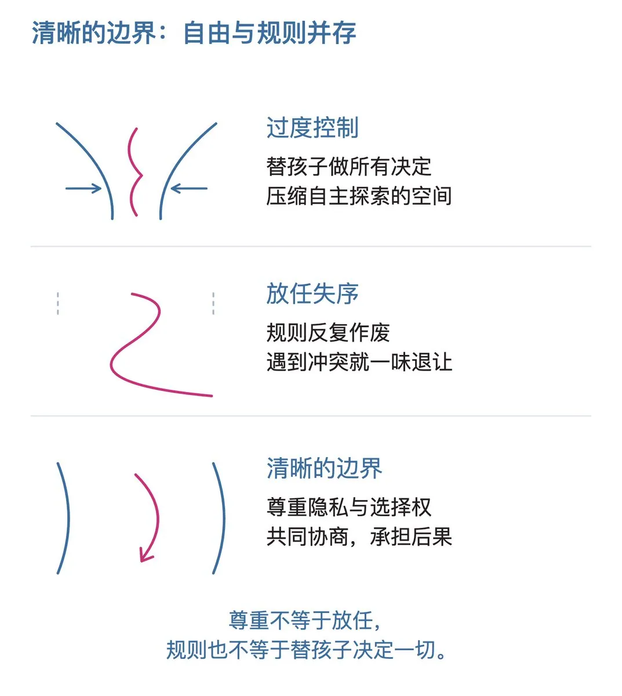

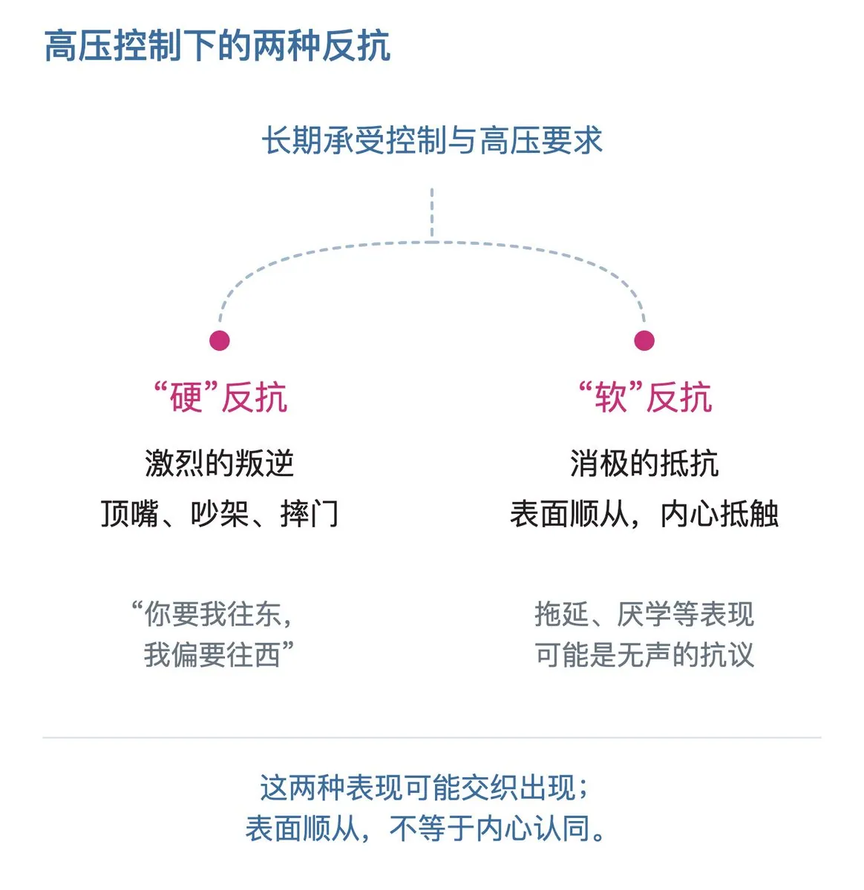

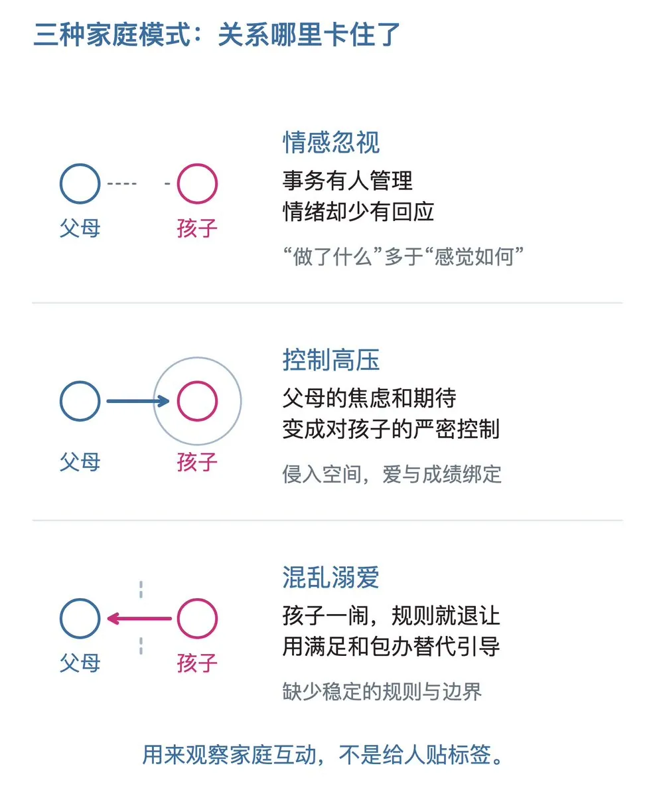

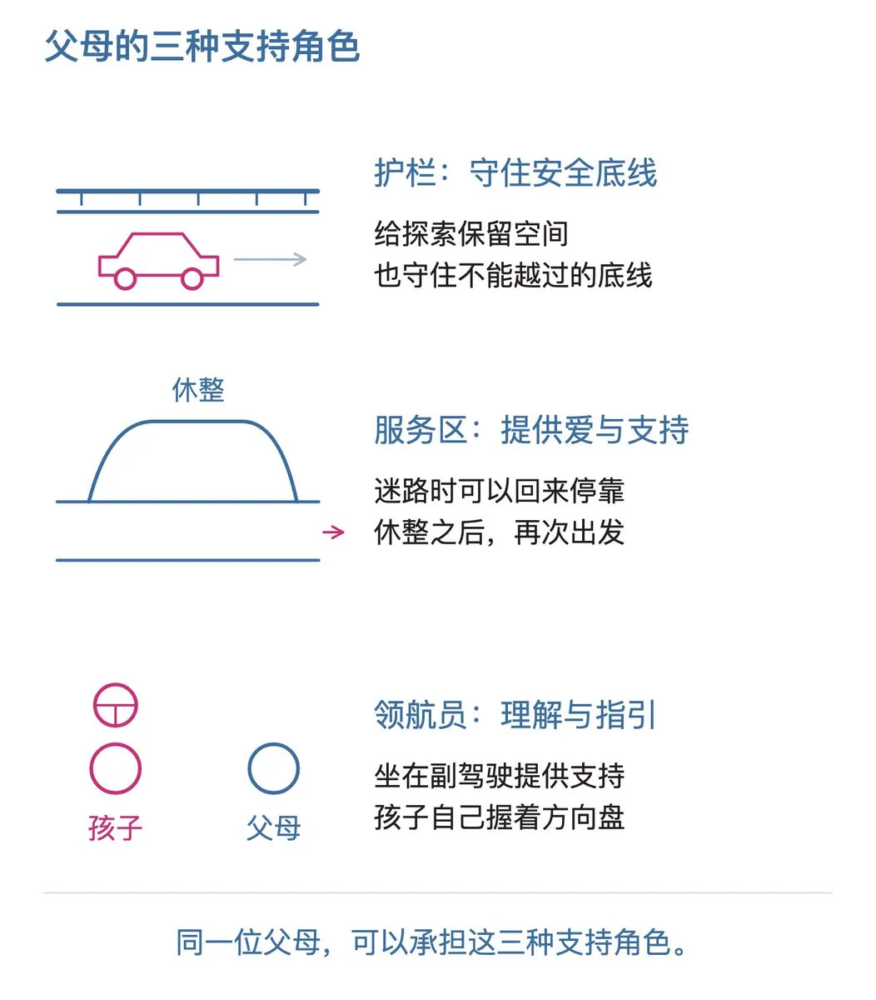

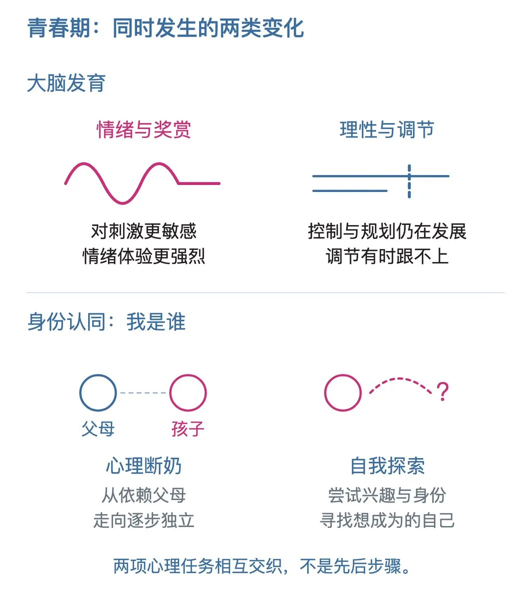

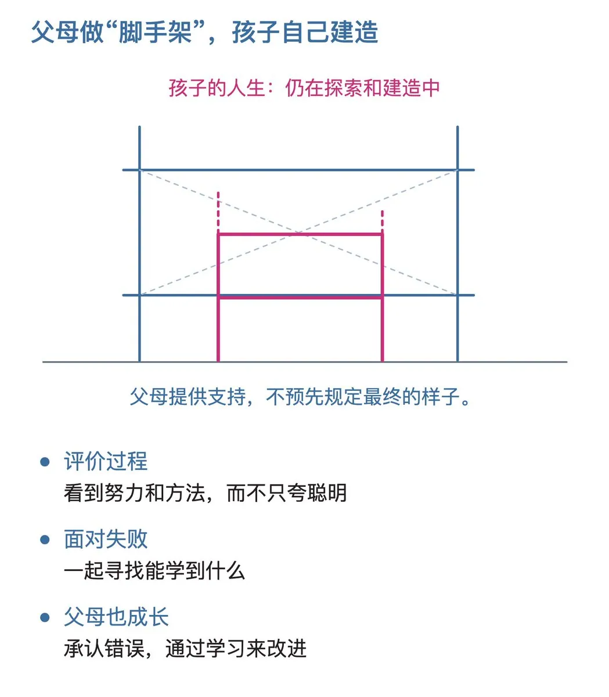

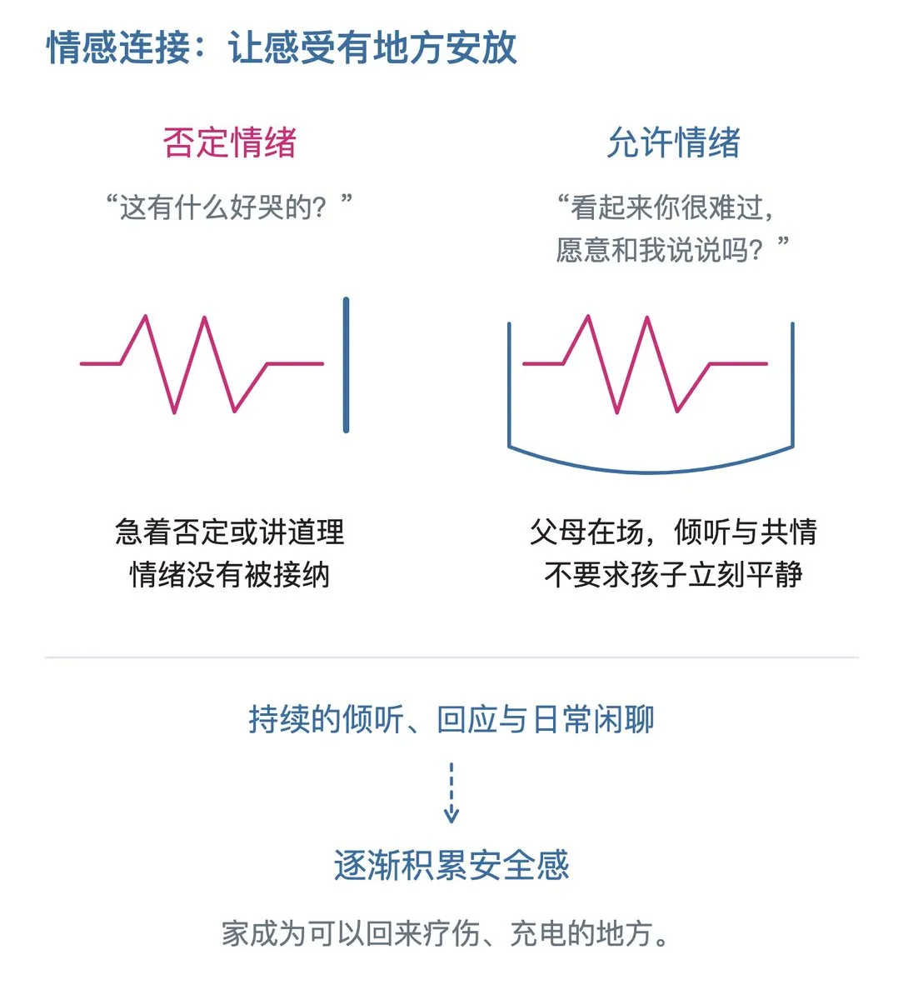

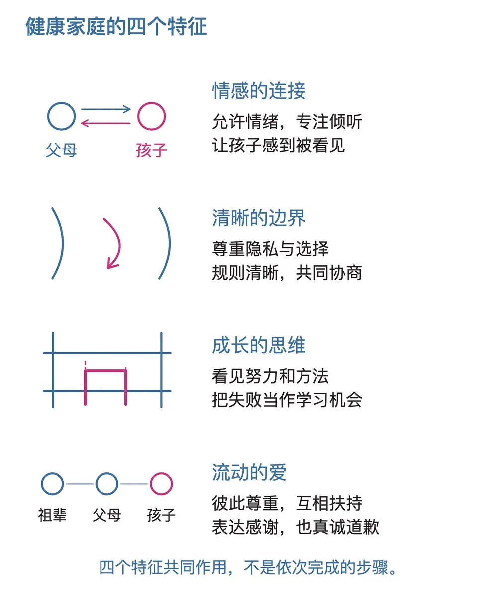

## 相关页面

- [[sources/qingyue-wechat-zhangxiaolong-story-and-independent-spirit]]
- [[sources/gudunaonao-lifeos-personal-agent-architecture]]
- [[concepts/cognitive-load-three-element-model]]
- [[concepts/selfmedia-compound-model]]
