# 龙海：实测 Uncle Bob 的 ub-mode——把《代码整洁之道》翻译成 AI Agent 的约束规则

> Uncle Bob 在 2026 年 10 月开源 ub-mode（152 行 SKILL.md + crapper/dryer/mutator 三个度量工具），把「先让功能可用，再把代码写好」翻译成 Agent 可执行、可校验的规则。本文完整拆解三个阶段的规则体系与三个工具的判定原理（CRAP < 10、结构重复度 < 0.8、变异体全部 Killed），并在真实开源项目 oh-my-x 上跑通「安装规则 → 部署门禁 → 全盘体检 → 量化重构」闭环。

<!-- more -->

如果把时间拨回到二十多年前，在面向对象与现代软件架构快速发展的时期，软件工程学者 Robert C. Martin（常被称为 Uncle Bob）是行业中的代表人物之一。早在 2001 年，他便作为核心发起人之一参与起草了《敏捷宣言》；随后他又系统整理并推广了 SOLID 原则，并在 2008 年出版了经典著作《代码整洁之道》（Clean Code）。长期以来，他对代码坏味道（Code Smell）的识别标准与工程规范，一直是软件开发领域衡量代码质量的重要参考。

当年我自己坐在工位上写代码的时候，曾一页一页认真研读过 Uncle Bob 的这本《代码整洁之道》。看到他在 2026 年 10 月 26 日（北京时间 00:04）于 GitHub 公开发布了一个名为 [ub-mode](https://github.com/unclebob/ub-mode) 的新项目，我专门从书架上把这本泛黄的旧书重新翻了出来，内页里还留着当年自己逐字逐句画线做下的笔记。截至 10 月 27 日，这个仓库创建不到两天已经获得了超过 1200 个 Star。

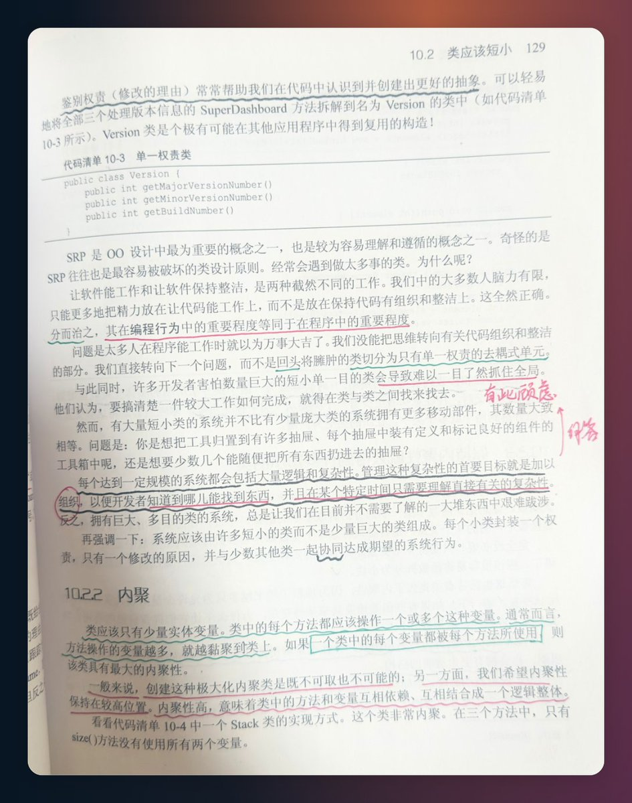

近二十年过去，这位从业五十多年的软件工程师最新发布的 ub-mode，核心依然承袭了他在书中提倡的工程思想：先让功能可用（First Make it Work），再回头让代码整洁（Then Make it Right）。不同的是，这次的规范不再面向人类工程师，而是转化为面向 AI 编程 Agent 的约束规则。整个项目构建起了一个完整的三层治理结构：首先是在实现功能阶段建立数据模型与 TDD 约束，杜绝状态混乱；随后在重构阶段引入三大命令行工具设立量化门禁；最后在工作区中为 Agent 制定严谨的工程操作习惯。

在当下众多开发者推崇 Vibe Coding（即依赖自然语言提示词让大模型生成代码，只要功能跑通便不再深究代码内部结构）的背景下，这位软件工程学者给出了一套截然不同的方案。ub-mode 参考了开发者 [@poteto](https://github.com/poteto) 的 poteto-mode / pstack 中的部分规则并做了精简，整个仓库共两个文件，核心是一份 152 行的 SKILL.md 文件，按照 README.md 的说明放入 Claude Code、Codex 或 Grok 的技能目录中即可通过 /ub-mode 调用。

它的特点在于：不仅用祈使句规定了 AI 修改代码时的思考顺序与架构边界，还在 SKILL.md 中要求大模型在交付代码前运行三个跨语言（支持 Clojure、Java、Go、TypeScript/JS、Rust、Python）的命令行工具（[crapper](https://github.com/unclebob/crapper)、[dryer](https://github.com/unclebob/dryer)、[mutator](https://github.com/unclebob/mutator)），给出圈复杂度、结构化重复度和变异测试三类检查证据，并在 README.md 中另外推荐了一个架构与指标可视化工具 [uml-viewer](https://github.com/unclebob/uml-viewer)。

虽然离开写代码的岗位有几个年头了，但我依然对了解 Uncle Bob 为各类 Agent 编写的《代码整洁之道》饶有兴致。在“[人人都能做产品](https://x.com/longhaiqwe123/status/2113192539679510927)”的今天，大模型让“人人都能生成代码”成为现实；但在实际构建产品时，代码能跑通并不等同于代码质量合格。随着后续功能逐步叠加，代码往往容易出现结构混乱与回归缺陷。在大模型时代，“人人都能写出好代码”的关键，在于为 AI 建立起明确的工程规则与验证机制。本文在多款 Agent 工具的配合下，对照 ub-mode 及四个配套仓库的文档与源码，不仅完整拆解 Skill 中为 Agent 立下的工程规则、检查原理与落地边界，还在真实的开源项目中将这套工具链逐一实测，记录下具体的运行表现，并根据检测结果对开源项目的代码进行了完善。

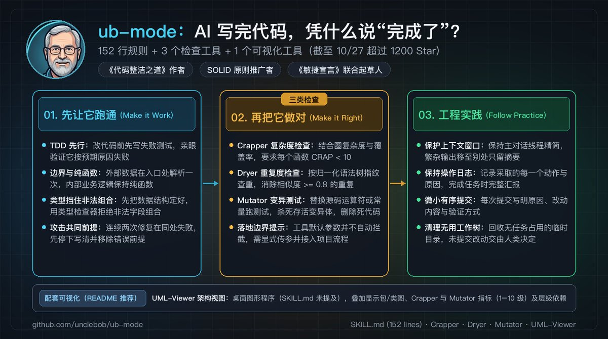

如果你是专业程序员，不管是为公司的线上系统编写代码，还是以独立开发者（OPC）身份为客户交付代码，我建议仔细阅读详细的 Skill 拆解。如果你并非专业程序员，但也在为自己或少数人交付产品，我建议直接跳到项目实测部分，了解如何使用这个 Skill 提升项目中代码的健壮性与可维护性。

## 第一阶段：先让功能可用（First Make it Work）

许多开发者在使用编码 Agent 时会遇到一个共性问题：任务初期的生成速度很快，但随着需求叠加，模型容易在已有条件分支上持续追加判断，导致状态管理混乱，修复一个缺陷往往引发更多未知错误。为了避免这种退化，ub-mode 在第一阶段确立了涵盖数据建模、系统边界与测试先行的前置防御纪律，要求模型在生成业务逻辑之前先完成数据结构定义，并保证测试先行。

### 最小改动约束与前置设计原则（Laziness Protocol & Foundational Thinking）

ub-mode 开篇的第一条规则是“最小改动与防冗余约束”（原文为 Laziness Protocol），核心包含两项要求：

- 每一个业务判断在代码库中只能存在于单一位置（One decision lives in one place），即关于同一逻辑的判断规则在整个项目中必须集中定义，其他调用方统一复用该定义，避免在多个文件中重复编写；
- 始终提交能解决当前问题的最小代码改动（Ship the smallest edit that solves the problem），防止产生非必要的额外修改。

紧随其后的“前置设计原则”（原文为 Foundational Thinking）明确了开发时的先后次序：

- 在编写任何流程控制与分支逻辑之前，先定义正确的数据结构（Data Shape）；
- 优先完成能够简化后续开发流程的基础设施与底层设计；
- 存在并发写入的场景下，禁止在不同组件间共享可变状态。

在架构规范的领域建模（Model the Domain）与类型系统纪律（Type System Discipline）中，规则进一步列出了四项约束：

- 将领域模型设计成能阻断非法状态的结构（Put the domain in a structure that makes the illegal states impossible），同时维护一份统一的领域术语表；如果现有代码已经清晰且局部化，就不要随意改动；
- 在类型层面杜绝非法数值（Make the illegal value impossible to write）；
- 外部数据只在进入系统边界时解析一次（Parse outside data once, where it comes in）；
- 禁止屏蔽编译器的报错与类型检查警告（Do not silence the compiler）。

为了直观理解什么叫“在类型层面杜绝非法数值”，我们可以用一个日常业务中的 TypeScript 订单状态定义来做对比说明（示意）。在缺乏约束时，模型生成的代码容易出现多个分散的布尔值或可选字段：

```typescript
// 反面示意：isPaid 为 true 但缺少 transactionId 的组合可以通过类型检查
interface Order {
  id: string;
  isPaid: boolean;
  paidAt?: Date;
  transactionId?: string;
}
```

如果按 ub-mode 的类型纪律收紧，在生成逻辑前需要先将数据结构定义为互斥的判别联合类型：

```typescript
// 正面示意：类型检查器会拒绝 paid 状态却缺少交易号或支付时间这类组合
type OrderState =
  | { status: "pending" }
  | { status: "paid"; paidAt: Date; transactionId: string };
```

当数据结构在第一阶段被这样定义后，在正常的类型检查下，编译期就能拒绝“已支付却缺少交易号”这类字段组合。当然，外部输入进入系统时仍要在边界处做运行时校验，且代码里如果使用类型断言或 any 也会绕过检查，这也正是规则同时要求“外部数据在入口解析一次”与“不要屏蔽编译器的报错或警告”的原因。

### 系统边界校验、幂等性与并发状态隔离（Boundary, Idempotency & State）

在架构规范部分，Uncle Bob 对系统输入校验、数据流向与并发状态隔离明确了三项要求：

- 系统边界校验（Boundary Discipline）：系统只在外部数据进入边界时进行完整校验，一旦数据进入内部业务领域便直接信任该数据；核心业务逻辑必须全部由纯函数（即输入相同则输出必定相同、不产生外部副作用的函数）实现。
- 确保操作具备幂等性（Make Operations Idempotent）：同一操作无论是重复执行，还是在执行中断后重新运行，系统达成的最终状态必须保持一致。
- 共享状态前先做隔离解耦（Separate Before Serializing Shared State）：多个调用方若无需修改同一对象，应各自持有独立副本；若必须共享可变状态，需在数据结构与流程设计上强制约束单一写入者（One Writer）机制。

### 测试驱动开发、第一性原理重构与工程杠杆（TDD & Execution）

在具体的编码执行流程中，ub-mode 的测试驱动开发（TDD）规范明确了标准执行循环：

- 修改业务逻辑之前，必须先编写一个执行失败的测试；
- 确认该测试确实因预期的逻辑缺失而失败；
- 编写仅能让该测试通过的最小代码量；
- 若某个场景在当前架构下确实无法编写有效测试，规则明确禁止编写无效测试充数（If an honest test is impractical, do not write a bad one）。

在引入新功能或排查复杂缺陷时，其余条款给出了工程层面的行动准则：

- 基于第一性原理重构设计（Redesign From First Principles）：禁止在陈旧脆弱的架构上直接堆砌新逻辑（Do not bolt a new requirement onto the old design），应推演若该需求自项目初期即存在时的设计，确立清晰方案后再拆分为小单元交付。
- 先删减后增加（Subtract Before You Add）：在向系统中引入新抽象或依赖之前，先清理原有的冗余复杂度。
- 面向可验证的最终状态交付（Outcome-Oriented Execution）：始终以最终可自动检验的系统状态为目标；在方案明确且可回滚的前提下，允许重构过程中的临时中间状态。
- 质疑共同前提假设（Attack the Premise）：当基于同一假设前提的连续两个修复方案均告失败时，必须先用清晰的一句话提炼底层假设，排查并解除不合理的模块职责；在该前置梳理完成前，禁止盲目尝试下一次修复。
- 构建自动化工具放大工程效率（Build the Lever）：当某项任务缺乏直观规范时，先手工完整实现一个标准单元，进而编写专门的脚本或工具自动匹配并执行后续同类工作。

## 第二阶段：再把代码写好（Then Make it Right）

让功能跑起来只是起点。大模型在没有严格约束时，容易生成表面能够运行但内部结构脆弱的代码。在第二阶段，ub-mode 先确立了三条代码与测试审查规则，随后要求运行三个独立的命令行检查工具：crapper、dryer 和 mutator（README.md 另外推荐了可视化工具 uml-viewer）。

这三个工具在工程质量检验上构成了层层递进的防御链条。最外层的 dryer 用于排查源码层面的结构性重复，防止模型为了应付功能而直接复制粘贴相似逻辑；中间层的 crapper 深入函数内部计算分支决策点，结合测试覆盖率评估圈复杂度风险，确保逻辑分支不过度膨胀且有测试护航；最深层的 mutator 则直接针对测试用例本身展开变异压力测试，通过注入缺陷检验断言是否有效，杜绝“行覆盖率虚高但断言流于形式”的假测试。通过这套由浅入深的量化闭环，系统才能在不依赖人工逐行审查的情况下，对代码与测试质量建立起客观的信任。

### 缺陷根因排查、可验证单元与面向行为的测试规范

在修复缺陷与审查测试用例质量时，第二阶段开篇明确了三项工程准则：

- 排查并解决根本原因（Fix Root Causes）：必须先稳定复现缺陷，进而定位产生异常的根因。规则指出“仅用来遮掩程序崩溃的防御性条件判断并不是真正的修复”（A guard that only hides the crash is not a fix），禁止单纯通过增加非空判断来掩盖错误。
- 将改动拆解为独立的微小可验证单元（Sequence work into verifiable units）：将开发任务拆解为粒度极小、可单独运行自动化测试的单元，逐一验证通过后再推进后续工作。
- 基于系统外部行为编写测试（Test Behavior, Not Implementation）：测试必须完全模拟外部调用者的视角去执行接口，并断言调用者可观察到的实际结果；若函数体清空并不返回任何数据时测试依然能通过，该测试用例即属无效，必须直接删除（If the test would still pass when every function returned nothing, throw it out）。

为了用量化数据检验代码是否达标，SKILL.md 要求调用以下三个检查工具。

### 检查一：Crapper（要求单函数 CRAP 评分低于 10）

unclebob/crapper 是一个跨六种语言（Clojure、Java、Go、TypeScript/JS、Rust、Python）的复杂度与覆盖率联合计算工具。它使用软件度量学中的 CRAP（Change Risk Anti-Patterns）公式对每个函数进行打分：

CRAP = CC² × (1 − coverage)³ + CC

公式中的 CC 是该函数的圈复杂度（Cyclomatic Complexity，统计函数内部的分支决策点，包含 if、for、while、switch/match 分支、catch/except、三元表达式、&&、|| 以及 TypeScript 中的 ?? 和 ?.），coverage 是该函数的测试覆盖率（0 到 1 之间的小数）。

根据 crapper 文档说明，得分在 1–5 之间属于低风险，5–30 值得注意，而 30 以上则属于复杂且缺乏测试的代码。在 ub-mode 的规则中，明确要求通过拆分函数、补充测试或两者结合，使用 crapper 工具把每个函数的评分控制在 CRAP 10 以下（Reduce each function under CRAP 10），并审视分支判断语句是否能够精简。

从公式推算，如果一个函数的圈复杂度达到了 10，哪怕测试覆盖率做到 100%（此时 (1 − coverage)³ = 0），它的 CRAP 得分也刚好是 10，依然不满足 < 10 的要求。这意味着圈复杂度达到 10 的函数，只补测试无法达标，必须拆分（不过要注意，圈复杂度只计分支数，较长的顺序执行代码分数仍然可能较低）。运行 ./crapper 后，工具会调用对应语言的覆盖率引擎，在终端按分数从高到低输出表格，并将结果写入 .metrics/crap.edn。

例如在实际项目上运行 crapper 时，终端输出了函数级别的圈复杂度与 CRAP 评分表格：

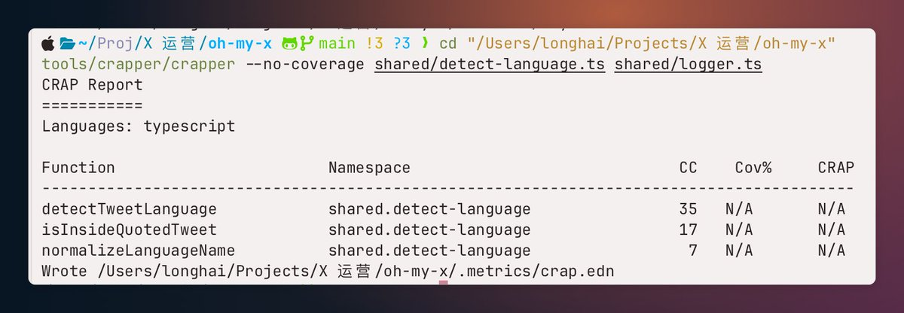

### 检查二：Dryer（消除结构相似度 0.8 以上的代码块）

大模型在生成代码时，容易直接复用已有逻辑并仅替换局部变量名。unclebob/dryer 是用来检测这类结构性重复的跨语言扫描工具。需要注意的是，dryer 只在同一种编程语言内部对比代码块（默认跳过少于 4 行或归一化语法节点少于 20 个的短函数）。

它计算的是两个代码块归一化抽象语法树（AST，即代码语法结构的树状表示）结构指纹的 Jaccard 相似度，即共有结构指纹数除以两边结构指纹并集数：

score = 两个代码块共有的结构指纹数量 ÷ 任一代码块中出现的全部结构指纹并集数量

在进行结构归一化时，dryer 会保留所调用的函数名、方法名、运算符以及语法树的嵌套形状，但会把局部变量名、字段名、字面量和 Clojure 的 :kind 这类 keyword 数据剥离掉。以 unclebob/dryer 官方文档中给出的两段 Clojure 函数为例：

```clojure
(defn alpha [xs]
  (let [ys (filter odd? xs)]
    (map inc ys)))

(defn beta [items]
  (let [kept (filter even? items)]
    (map dec kept)))
```

尽管这两个函数的名字（alpha 与 beta）、参数名（xs 与 items）、局部变量（ys 与 kept）以及作为高阶函数参数传入的谓词和映射函数不同，但保留下来的 filter、map 调用头与底层语法树指纹集合一致，算出的结构相似度得分为 1.0（注：这两段示例函数只有 3 行，在 dryer 默认 --min-lines 4 参数下会被跳过，需调小行数与节点阈值才会报告）。

运行 ./dryer 时，工具会报告结构相似的候选文件与行号范围。例如官方文档中展示的报告格式示例：

```text
DUPLICATE score=0.89
  src/billing/invoice.clj:3-13
  src/billing/receipt.clj:3-14
```

在 ub-mode 的规则中，明确要求运行 dryer 工具消除所有相似度在 0.8 及以上的结构性重复代码。在实际项目上运行 dryer --threshold 0.8 时，终端输出了如下的重复结构定位报告：

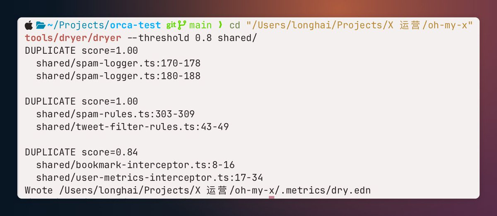

### 检查三：Mutator（用变异测试检查存活变异体与死代码）

即便代码覆盖率达到了 100%，也不能证明测试真正校验了业务逻辑。unclebob/mutator 是配套的跨语言自动化变异测试工具。

变异测试（Mutation Testing）是评估自动化测试套件有效性的一种工程方法。测试工具会自动在源代码中替换某处运算符或常量（例如将大于替换为小于、将加号替换为减号），由此生成的带缺陷代码副本被称为“变异体”（Mutant）。其核心逻辑在于：若源码被注入缺陷后，单元测试仍全部通过且未触发断言失败，表明测试覆盖存在盲区，该变异体判定为“存活”（Survived）；若单元测试报错并拦截了错误，则表明测试用例成功阻断了该变异体（Killed）。

它的运行机制是：自动识别源码中选定的运算符或常量并做替换（每次替换生成一个变异体 Mutant），例如将 + 替换为 -，将 > 替换为 >=，将 == 替换为 !=，将 && 替换为 ||，将 true 替换为 false，或者在 TypeScript 中去掉可选链调用（将 a?.() 替换为 a()）。随后，mutator 会在 target/mutation-workers 目录下按 CPU 核心数创建并行工作目录（被修改的文件及其相对导入会复制一份，其余文件使用软链接），对每个变异体运行一遍项目的单元测试。同时，mutator 支持增量运行，后续执行时仅重跑上次存活的变异体以及发生过改动的函数。

评判标准是：源码被替换修改后，若单元测试执行失败或运行超时，该变异体判定为已阻断（Killed）；若源码被修改后单元测试依然全部通过，该变异体判定为存活变异体（Survived）。一旦检测到存活变异体，./mutator 进程会返回非零退出码 3。

我们可以用一个免运费的边界示例说明其实际效用：假设业务规则是订单金额满 100 元免运费，实现代码写为 amount >= 100。若测试用例仅覆盖了 50 元和 150 元两个数值，两项测试均会顺利通过，该行代码的代码行覆盖率在统计上也是 100%。但当 mutator 自动将 >= 替换为 > 之后，50 元与 150 元的测试依然能够通过，这个变异体就存活了下来。这明确指示出测试套件遗漏了“金额恰好为 100 元”这一临界边界用例。若要阻断该变异体，必须在测试套件中补齐针对“金额恰好为 100 元”的测试断言（断言满 100 元免运费）。补齐该测试后，当 mutator 再次将 >= 替换为 > 时，100 元的测试用例便会报错，变异体随之被成功阻断。

在分析 mutator 的检测结果时，有两点工程技术边界需要明确。首先，根据 mutator 官方文档说明，变异注入后导致编译报错同样被计入成功阻断（Killed），因此变异体的消除并不完全等同于由业务断言发现错误。其次，存活的变异体通常意味着测试缺失，但也存在一部分属于等价变异（即算子虽被替换，但系统对外展现的实际运算行为并未改变）。

针对 mutator 的输出报告，ub-mode 在 SKILL.md 中给出了三项明确的处理要求：

- 补充编写未覆盖代码的测试用例（Cover the uncovered）；
- 补齐边界断言以阻断存活变异体（Kill the survivors）；
- 清理并删除项目中未被调用的无用代码（Delete dead code）。

紧随其后的重构规范（Refactoring）进一步明确：重构前必须先通过完备的自动化测试固化系统现有的外部行为，随后调整内部实现结构，并在重构完成后验证外部行为未发生任何非预期改变。在实际项目上运行 mutator 时，终端输出了如下的变异拦截报告：

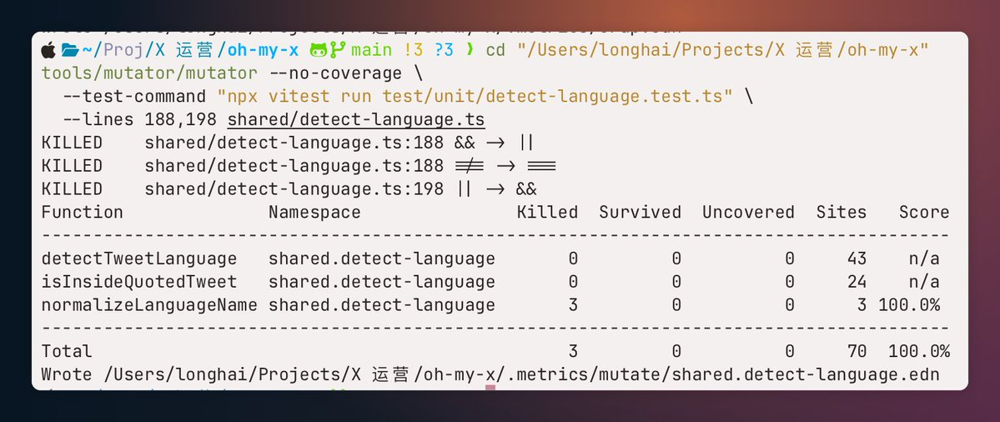

### 配套可视化：UML-Viewer（架构健康度与依赖方向视图）

除了上述三个被写入 SKILL.md 的检查工具，ub-mode 的 README.md 还在配套仓库列表里推荐了一个桌面图形程序 unclebob/uml-viewer（SKILL.md 未提及它）。它会把源码扫描和架构配置生成的结构图，与 .metrics/ 目录下由 crapper、mutator 生成的指标叠加显示（不读取 dryer 的结果）。

在 uml-viewer 的视图里，每个包和类卡片的填充颜色由该模块的 CRAP 评分（均值加标准差 μ + σ）和变异测试消除率共同决定，两者各换算成 1 到 10 级（10 级最好）后再取平均；如果某个模块缺失数据，则按 1 级显示为红色。如果用户在配置里写了 :levels 划分架构层级，从内层指向外层的反向依赖箭头会被画成红色（选中时加粗）；不配置 :levels 则不会自动标红。点击类卡片上的方法名，会打开源码并定位到该函数的定义处。启动后，桌面弹出的实时架构全景窗口如下图所示：

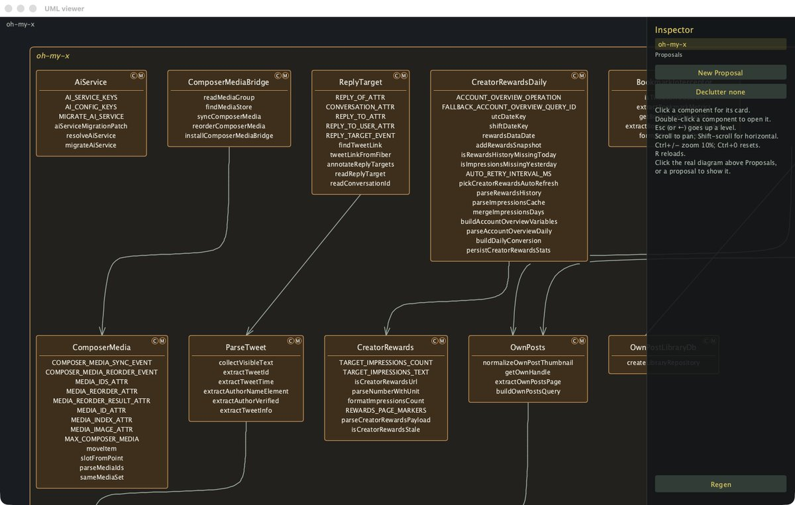

## 第三阶段：工程实践（Follow Practice）

在完成代码与测试审查之后，ub-mode 针对 Agent 在本地工作区中的日常操作流程，制定了四条工程实践规则：

- 记录执行日志（Keep a Log）：详细记录实施的每一个具体操作及其原因，并在任务结束时向用户汇报日志摘要。
- 控制上下文窗口占用（Guard the Context Window）：保持主对话线程精简，将大体积日志或中间输出分流至外部文件或子任务中，避免终端输出过快耗尽上下文配额。
- 清理临时工作区（Worktree Cleanup）：排查并识别可安全清理的临时目录或 Git Worktree，在确认无后台任务依赖后及时回收磁盘空间；对于尚未提交的本地修改（Uncommitted work），必须暂停操作并交由人工确认，禁止擅自覆写或清理。
- 按规范小步提交与推送（Commit and Push）：保持小粒度的有序提交，每一个 Git Commit 均须明确说明修改背景（Why）、具体变更内容（What changed）以及验证其正确性的证据（How you proved it）。虽然规则原文要求在流程结束时直接推送到主干分支（Push to the main line at the end），但在团队协作时应结合既有的分支保护策略与 Pull Request 流程执行。

## 真实项目实战：如何驱动 Agent 把这套规则用在项目中

在理解了 ub-mode 的思考顺序与代码纪律后，最关键的工程问题在于：在真实的开发环境中，人类究竟该如何驱动 Agent 将这套方案运转起来？

在实际工程中，将这套方案落地通常分为两种场景：一种是尚未启动的全新项目，另一种是已有业务代码的存量项目。

对于尚未启动的新项目，将 SKILL.md 作为前置编码守则注入给 Agent，是这套规则最理想的应用形态。没有规则约束时，Agent 开发新功能往往会遵循阻力最小路径，直接在一个文件里将数据结构定义、网络请求、数据校验、错误处理与业务计算杂糅在同一个函数中，导致项目起步阶段就埋下高圈复杂度与紧耦合隐患。如果从第一天起就加载该规则，Agent 在编写第一行代码时就会受到防御性纪律的约束：先写失败的单元测试并提供最小实现，用类型系统在系统边界锁死非法状态，并将业务逻辑拆解为无副作用的小型纯函数，从源头避免产生高圈复杂度的单体函数。在后续推进中，把 crapper、dryer 和 mutator 配置在每次特性提交前的自动化流程中，就能让新项目始终维持在较低技术债的健康状态。

而对于已经存在历史代码的存量项目，脱离实际开发流去生硬地手敲命令并不符合日常研发习惯。真实场景中，人类是通过与 Agent 对话，驱动它一步步完成“安装规则、部署门禁、全盘体检、量化重构”的完整治理闭环。为了检验这套流程在真实工程里的表现，我使用 Claude Code 在自己的开源项目 oh-my-x（基于 TypeScript 和 WXT 框架开发的浏览器插件）上完整跑了一遍。整个过程由四个步骤串联而成：

1）安装 Skill：首先需要在 Agent 中加载 ub-mode 的行为规则，建立防御性思考顺序与提交纪律。在 Claude Code 中直接发送安装指令：

https://github.com/unclebob/ub-mode 请安装这个 skill

2）让 Agent 安装并排布量化门禁工具链：规则加载后，需要为项目配置度量工具，直接向 Agent 下达安装指令：

帮我安装好需要的工具

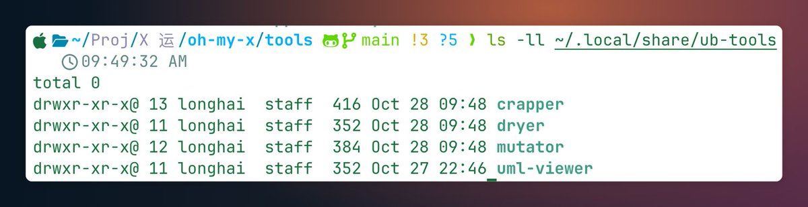

Agent 会自动在项目根目录下创建 tools/ 目录，将 Uncle Bob 仓库中的 dryer、crapper、mutator 以及可视化的 uml-viewer 下载并克隆至相邻目录。这里需要注意几个关键调用参数：crapper 默认阈值为 30，若要严格遵守 < 10 的规则线，调用时须传入 --threshold 9.99；dryer 默认阈值为 0.95，建议指定为规则要求的 --threshold 0.8；mutator 则须通过 --test-command 绑定项目的单测命令（例如 Vitest），避免盲目全量扫描。

3）驱动 Agent 开展工程体检：工具安装完成后，向 Agent 询问在当前项目中开展体检与优化的具体方法：

接下来我要怎么在项目中应用这个 skill 来优化项目代码？

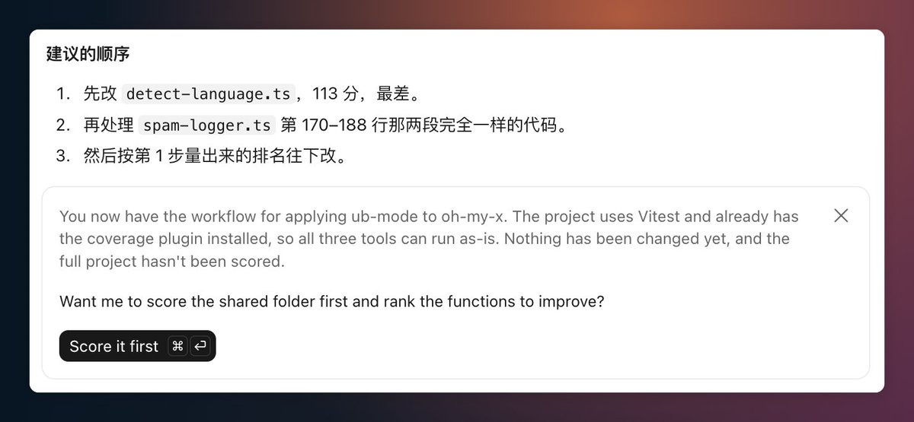

Agent 会根据项目现状给出具体的优化路线，并依次调用底层工具链对核心代码展开扫描，排查出存在结构重复、圈复杂度超标或缺乏测试覆盖的模块。

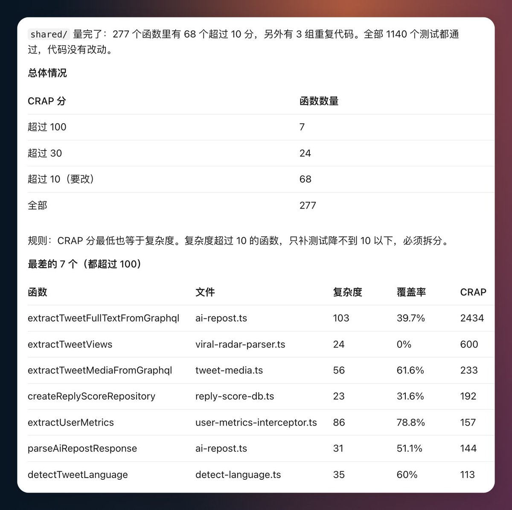

4）向 Agent 下达带约束条件的重构指令，完成从检测到修复的闭环：在工具扫描出圈复杂度超标或代码重复后，Agent 会提出针对性建议。在实测场景中，Agent 建议先把测试用例补充完整。随后询问 Agent 按照 Skill 该如何做：

按照 skill 的规则，接下来要做什么

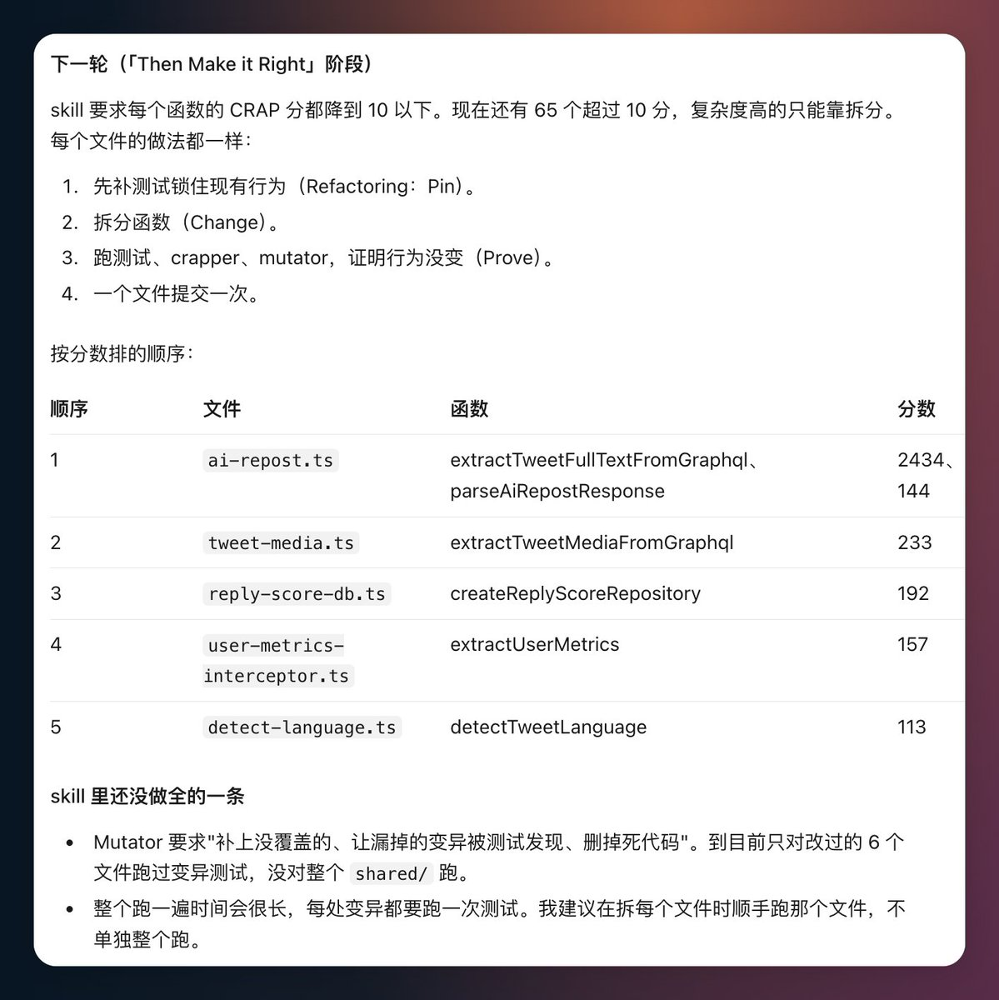

让 Agent 依照规则继续推进重构，会得到逐步修复的代码与测试结果：

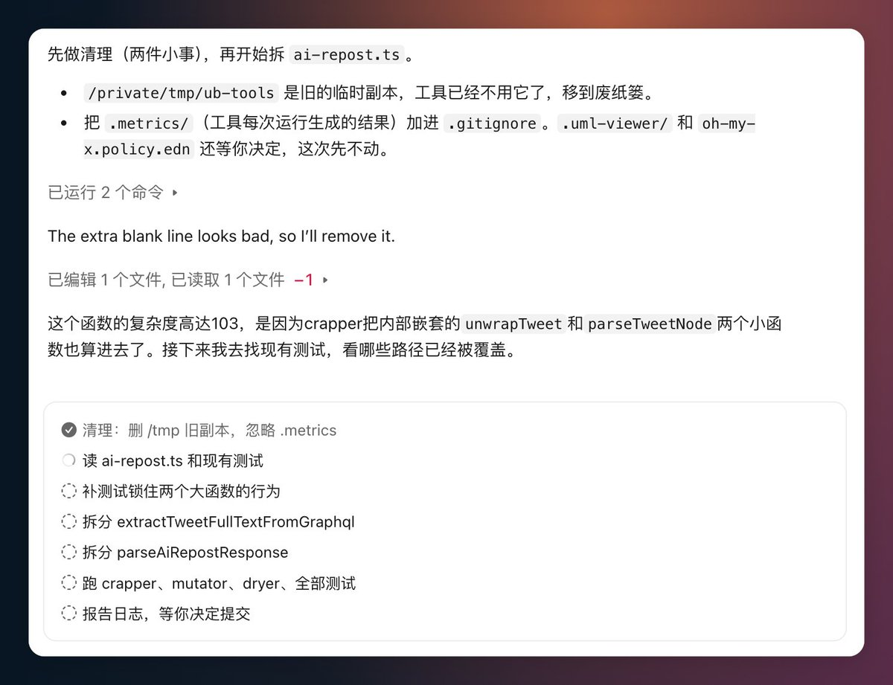

通过让 Agent 依照规则逐步排查与重构，存量项目完成了从问题定位到质量收敛的闭环。在实测中，针对工具排查出的薄弱环节，治理过程分两步落实：首先针对 mutator 扫出的存活变异体（主要集中在边界判断如 >= 与 >、空值处理等位置），在单测套件中补齐了针对临界数值的业务断言；随后针对 crapper 报告中圈复杂度偏高的单体函数进行了合理拆分，将杂糅的条件分支抽离为独立的纯函数。在完成上述改动后，再次调用度量工具复检，函数评分全部降到了 CRAP 10 以下的安全区间，存活变异体全部被测试用例精准拦截阻断，mutator 进程返回了正常的零退出码。至此，代码在保持原有外部行为一致的前提下，完成了可度量、可验证的质量优化。

## 结语

从 2008 年 Uncle Bob 出版《代码整洁之道》，到 2026 年他为大模型写下这份 152 行的 ub-mode，技术演进虽然改变了生成代码的具体工具，但衡量软件好坏的底层标准其实从未动摇。

大语言模型降低了生成代码的边际成本，但没有降低维护系统的复杂度。Vibe Coding 带来的灵活性属于初期的原型探索阶段，而当系统承载真实业务与高并发时，决定产品稳定性的，依旧是严谨的数据建模、纯函数的逻辑隔离，以及由自动化测试和度量工具筑牢的工程底线。

Uncle Bob 的这份规则与工具链，本质上是将软件工程长期沉淀的质量纪律，转化为 AI Agent 可执行、可校验的约束规则。这种约束不仅体现在代码产物上——通过圈复杂度、重复度与变异测试等客观指标建立量化门禁；同样体现在操作流程上——通过控制上下文窗口、保持操作日志与小步有序提交规范 Agent 的行为边界。过去，写出高质量代码需要工程师经过长期的实战与训练；而在大模型时代，这种门槛被重新定义了：开发者即便不逐行手写底层重构，只要懂得为 Agent 配置正确的工程规则与量化工具，守住“先让功能可用，再把代码写好”的底线，就能让 AI 持续交付架构稳固、可长期维护的生产级代码。“人人都能写出好代码”，由此才有了清晰的技术支点。

本文梳理的规则拆解、度量工具运行机制与实操参数，建议保存备用。无论是在团队中主导开发，还是以独立开发者（OPC）身份构建产品，当发现 AI 生成的业务逻辑开始难以维护、或者单元测试通过却遗漏边界场景时，不妨参考这份规范，将其配置进你的 Claude Code、Cursor、Codex 或其他 Agent 中，重新校准代码质量与交互操作的边界。

龙海｜前大厂程序员 - 项目经理 - 产品经理，目前 OPC 实践（失业）中｜做了几款小产品

## 相关页面

- [[patterns/ub-mode-engineering-rules]]
- [[patterns/ai-coding-three-pillar-system]]
- [[patterns/eval-mechanism]]
- [[concepts/agent-token-architecture]]
