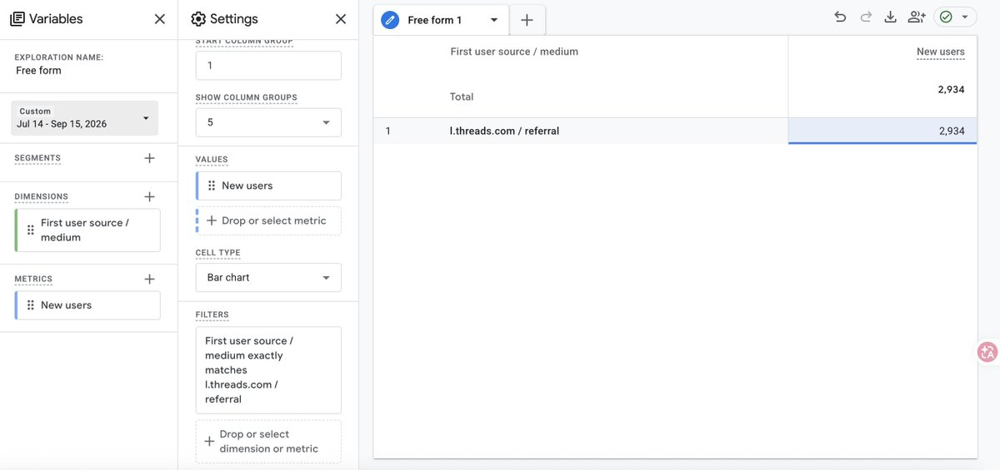

# joy（@loverboyy0321）：靠一篇 threads 爆帖给产品引流近 3000 名新用户——生活 70% 加推广 30%

> 作者不吹牛、直接上 GA 后台数据：一篇 threads 爆帖给产品引流近 3000 名新用户。threads 是 Meta 旗下的文字社交平台，和 Instagram 强视觉、X 偏资讯讨论的氛围不同，更像一个大型朋友圈，平台用户对新鲜实用的 AI 工具接受度很高但非常排斥明显广告，一上来介绍产品功能、放链接、催用户体验基本很难获得自然传播。她做内容遵循六条原则：生活内容占 70%、推广内容占 30%，让账号像个真实的人而不是品牌号；用给好朋友推荐的心态软植入，先讲我遇到了什么问题、这个工具具体帮我解决了什么；一篇帖子只讲一个核心功能，比如推广转录工具时只讲如何快速整理一段采访录音；从场景切入而不从产品功能倒推；用圈内话术写第一句话；把评论区当转化场，主帖负责引发讨论和露出品牌，评论区再补充工具名称、使用方法和相关说明。总结是 threads 爆帖对粉丝量的依赖不高、运营成本很低、无需充会员、更容易起量，新账号也有机会获得较高曝光，平台目前仍在扩张，新用户的第一条串文还会被标记为「首条串文」更容易获得初始流量。

<!-- more -->

不吹牛批，直接上 GA 后台数据展示！

下面我将详细介绍一下如何运营好 threads！

1. threads（脆）是什么？

我发现有很多 uu 还不知道这个平台是干嘛的，作为出海人不知道脆，那可真是 out 了！咳咳，就让 joy 来介绍一下脆吧！

threads 是 Meta 旗下的文字社交平台，和 Instagram 强视觉、X 偏资讯讨论的氛围不同，threads 更像一个大型朋友圈。大家会分享日常、吐槽、玩梗，也会围绕兴趣话题聊天，表达比较轻松。

平台用户对新鲜、实用的 AI 工具接受度很高，但也非常排斥明显的广告。如果一上来就介绍产品功能、放链接、催用户体验，基本很难获得自然传播。

我自己的感受是：想在 threads 做推广，首先要成为平台里的真实用户，需要不断互动，官方也鼓励大家互动。

当然，有个前提是，我很早就开始玩 threads、X 和 Instagram 了，刷多了，对爆贴的的敏感度也提升上来了，我想，这也是我发的帖子能爆的原因之一。这种“网感”很难靠一次调研获得，本质上是长期使用平台培养出来的。

2. 具体做内容时，我主要遵循下面几个原则

2. 1 生活内容占 70%，推广内容占 30%

不能只发产品，除了 AI 工具，也可以分享生活、好用物、省钱技巧、美食和旅行信息等，这样账号才像一个真实的人，而不是专门来投放广告的品牌号，偶尔出现推广内容时，用户的抵触感也会更低。

2. 2 用给好朋友推荐的心态软植入产品

不要直接说“我们的产品非常强”“支持多少功能”，而是先讲清楚：我遇到了什么问题，这个工具具体帮我解决了什么。

threads 用户更愿意相信亲身经历和真实感受。把自己放在“朋友分享好东西”的位置上，内容会自然很多。

2. 3 一篇帖子只讲一个核心功能

产品功能再多，也不要一次全部塞进帖子。

一篇内容围绕一个场景、一个痛点、一个解决办法展开就够了。信息太多，用户反而抓不住重点，也记不住产品。

比如推广转录工具时，可以只讲“如何快速整理一段采访录音”，没必要同时介绍转录、摘要、翻译、字幕和多格式导出。

2. 4 从场景切入，不从产品功能倒推内容

我做 threads 内容时，不会先想“今天要推广哪个功能”，而是先看目标圈层最近在讨论什么。大家在焦虑什么、好奇什么、会互相@朋友看什么，再判断产品能不能帮上其中某一步。

卖场景通常比卖产品更有效。用户看到熟悉的情境，会先产生“这说的不就是我吗”的感觉，然后才会关注解决方案，要让用户知道这篇帖子就是为 ta 写的，让 ta 有身份认同感，这样 ta 才会分享转发，产生裂变。

2. 5 用圈内话术写第一句话

不要使用太多产品术语，也不要写得像官网介绍。

第一句话最好就是目标用户平时会说的话，让对方一眼知道这件事和自己有关。配图也尽量选择有讨论度的素材，再自然露出品牌名，加深用户印象。

2. 6 把评论区当成转化场

主帖不一定要塞满产品信息，更不需要反复放链接。

主帖负责引发讨论和露出品牌，评论区再补充工具名称、使用方法和相关说明，同时回答用户的问题。

有时候让用户主动搜索品牌，比直接把链接推到面前更自然，带来的用户意愿也更强。

3. 总结

threads 爆帖对粉丝量的依赖不高，运营成本很低，无需充会员，也更容易起量，新账号也有机会获得较高曝光。平台目前仍在扩张，新用户的第一条串文还会被标记为“首条串文”，更容易获得初始流量。

对出海产品来说，threads 不只是一个发帖渠道，更是一个低成本的内容试验场。什么场景有真实需求、什么表达能让用户停留、什么功能值得继续放大，都可以通过帖子数据和评论区反馈快速验证。

先进入圈层，再理解需求；先让内容值得看，再让产品自然出现；这比单纯研究“怎么写推广文案”更重要。

## 相关页面

- [[patterns/overseas-website-conversion-loop]]
- [[concepts/b2c-conversion]]
