# 裴同学：AI 全自动生产小红书笔记，2 小时搞定 30 篇——工具被 Skill 换掉的一年

> 一个 1 人内容团队的完整工具迭代史：实习生在稿定设计手搓排版 → 花 1 个月自研「百变拼图」虚拟笔记工具（卖出 2 万多）→ 只花 1–2 天搭的 Claude Skill 把整条线接住。从拆图、排版、写标题正文、配 10 个标签、飞书多维表格上传到扫码发布，人只剩最后审一眼。核心结论：跟 AI 配合最好用的不是工具，是 Skill——工具只是流水线上的一个工位，Skill 是整条流水线的 AI 助手。

<!-- more -->

大家好，我是裴同学！

上半年，我花了 1 个月时间，开发了一个专门做小红书虚拟笔记的工具。陆陆续续卖了 2 万多块，到现在还有很多学员每天在用。

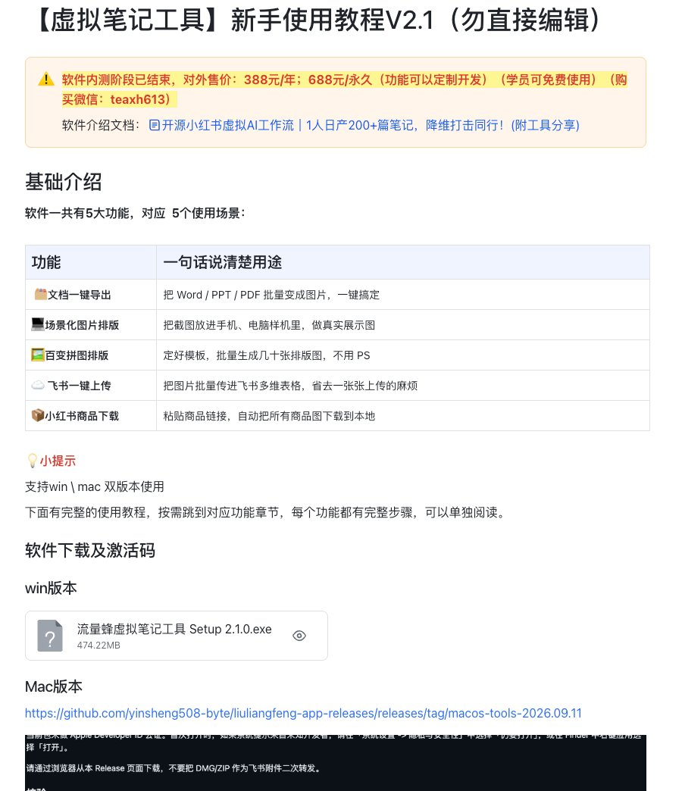

但我们团队自己，已经不用了。

替掉它的，是一个只花一两天搭起来的 Skill。

现在我们做笔记，只要把一份 PPT 丢给 Claude，说一句“做成 5 篇笔记”。拆图、排版、写标题正文、配 10 个标签，它自己全部做完，最后直接传进飞书多维表格，扫码就能发。

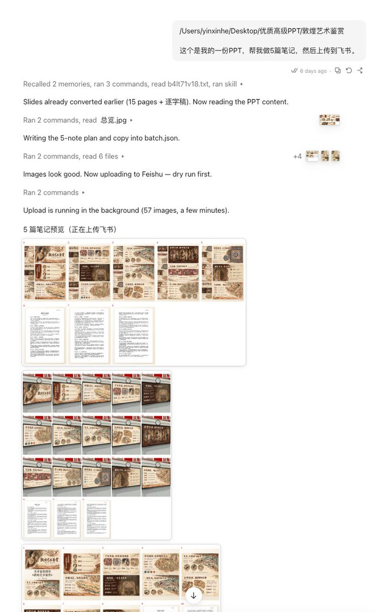

以前我们招实习生做笔记，用工具一天能出 30 篇，已经算挺快了。现在同样的量，1-2 个小时就做完，全程交给 AI，人只需要最后审一遍。

说实话，一个月前我写那篇 AI PPT 复盘的时候，还专门拿出一段介绍这个工具的“百变拼图”。那时候我是真觉得，笔记排版这块有它就够了。

没想到才过一个月，连它也被换掉了。

这篇就把我们做笔记这一路是怎么变过来的、现在整条流程怎么跑，完整摊开讲一遍。

## 01｜从实习生手搓，到自己做工具

最早做笔记，我们是在稿定设计上一张张手搓的。

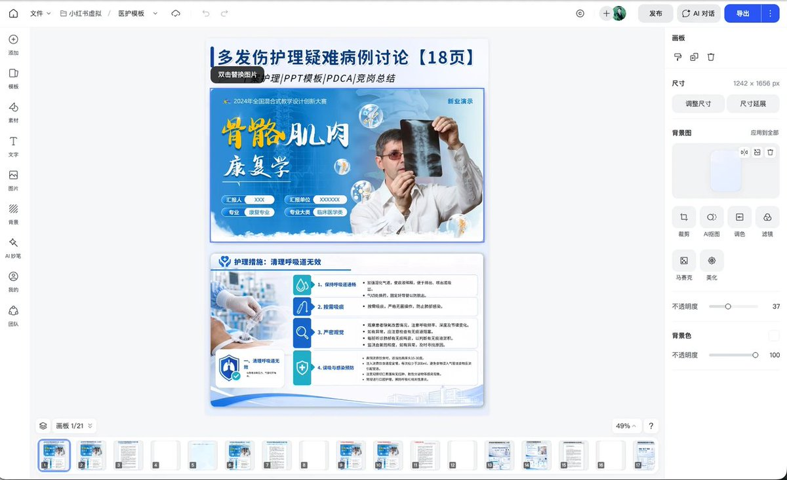

打开模板，手动排版，把 PPT 图片一张张拖进去，调好位置再导出。图做完了，还得自己想标题、写正文、凑标签，最后再一篇篇上传、发布。

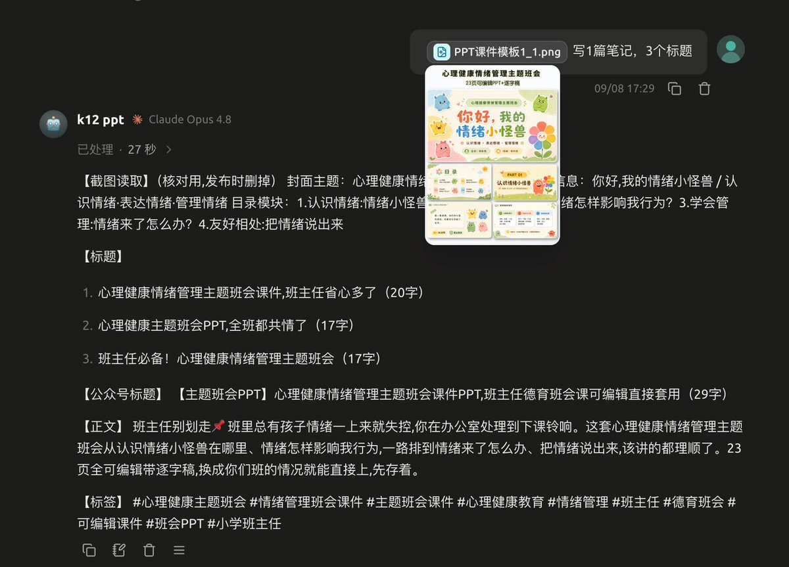

这些活我们招了实习生来做，一天一百多块工资。活不难，但特别磨人，大部分时间都耗在拖图、对齐、导出这些重复动作上。

做得多了，我就想，排版这件事能不能别再靠手拖？

于是上半年，我花了 1 个月做了这个虚拟笔记工具。

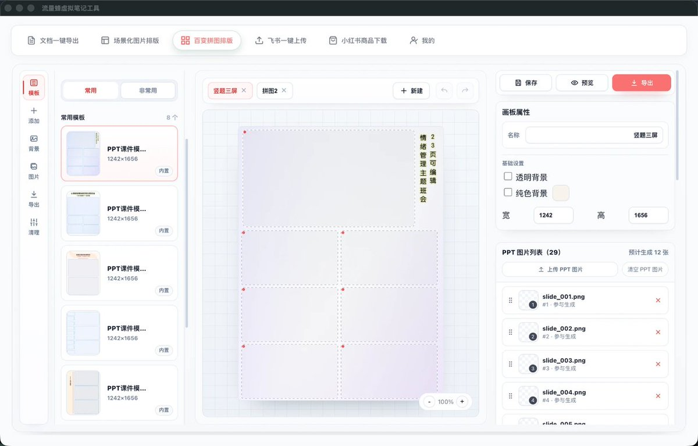

思路很简单，就是把排版模板化：

百变拼图：提前定好每套模板的坑位，PPT 图片丢进去自动填，一键出图；

场景化排版：能把 PPT 放进电脑屏幕、黑板这些实拍场景里，做出样机效果，不用再开 PS。

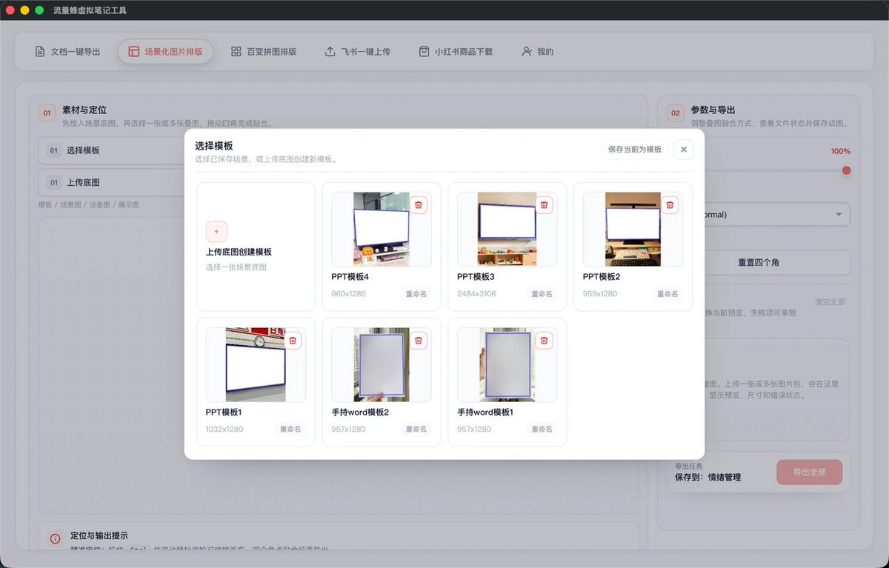

用上它之后，一个实习生一天能出 30 篇，速度确实上来了。

但它其实只解决了排版这一件事。拆图、写文案、上传、发布，工具再快，这些环节还是得人一件件接着做。

## 02｜真正的转折：AI 接住了整条线

真正的转折是上个月。

我们开始试着直接让 AI 做笔记，没想到它不光能排版，从拆图到写标题正文、配标签、上传，一整条线都能接住。

跑顺之后，我们把整套做法写成了一个 Skill。体验变得非常丝滑！

顺带说一句，这套流程 Codex 和 Claude 我们都跑过。Codex 最大的问题就是慢；Claude 排版能力非常强，出活也快得多，所以现在我们的主力，已经转回了 Claude。

### 那现在一份资料丢进去，到底会发生什么？

搭这个 Skill 之前，我们先去小红书上采了 13 篇同类的 PPT 笔记，一篇篇拆它们的排版。拆完发现，互动高的几乎都是模板化的套图。

还有一种是把 PPT 放进教室一体机、电脑屏幕里的场景图，特别适合家长会、答辩这种要现场放映的内容，一看就很真实。

这些规律，我之前做成了软件的功能，现在都变成了 Skill 里的规则。

现在用起来是这样的：

我把一份 PPT 发给 Claude，说一句“做成 5 篇笔记”。

1. 先读懂 PPT

它先把 PPT 一页页看一遍，搞清楚这是一份什么 PPT：是小学课件、主题班会，还是医护宣教、毕业答辩，讲的什么主题，一共多少页，目录有哪几块。

2. 规划 5 篇笔记

然后它会规划 5 篇笔记，而且每篇长得都不一样：

- 一篇是左边 9 张小图、右边 3 张大图的多图版式；
- 一篇是把 PPT 贴进教室一体机、办公显示器里的场景图；
- 另外三篇是首图加大图展示，配色和首图布局每篇都换。

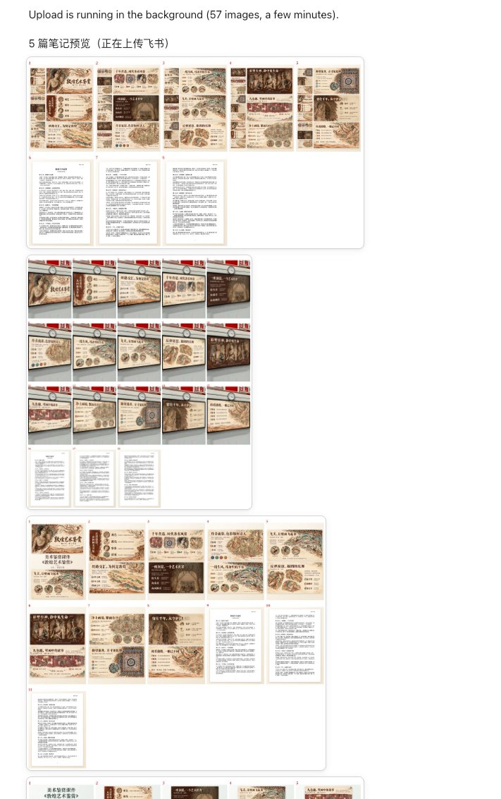

Claude 5 分钟直出的排版图片：

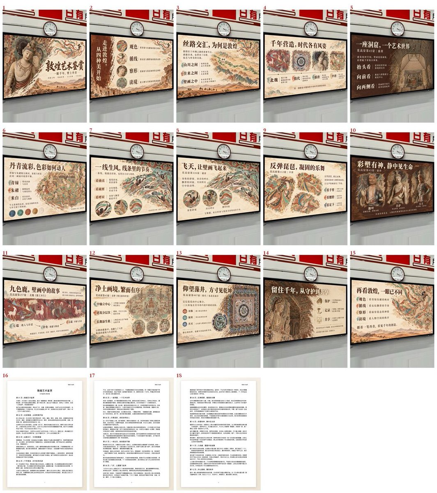

3. 写文案

图排好了，它接着写文案。每篇一个标题、一段分好段的正文、正好 10 个标签，5 篇的标题各用一种写法。而且只写 PPT 里真有的内容，不会瞎编。

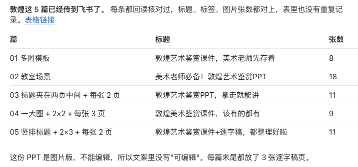

4. 自己检查

最后它会自己检查一遍：PPT 够不够清楚、颜色搭不搭，哪篇不好看就自己重做。

5. 上传飞书

全部做完，它直接把 5 篇笔记一篇篇传进飞书多维表格，标题、正文、标签、图片都在对应的格子里。

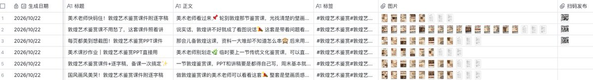

这里上传用的是飞书 CLI，和飞书打通特别方便，大家一定要用起来！

6. 扫码发布

发布这一步，我们在表里加了一个自己开发的扫码发布字段捷径。

人看一眼内容没问题，拿手机一扫就发出去了。最后发布那一下始终是真人，所以也不用担心 AI 风控。

如果要发多个平台，也可以让它通过我们流量蜂的 MCP，把笔记直接传进发布软件里，再分发到各个平台(抖音、公众号等)。

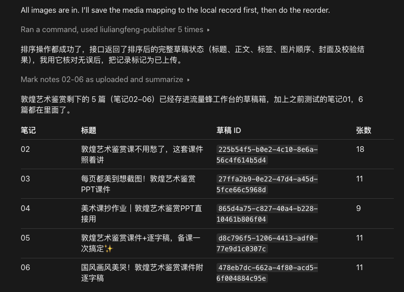

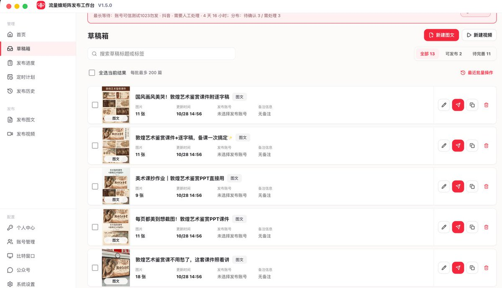

从一份 PPT，到 5 篇能直接发的笔记，过去要人一件件接的活，现在一句话就跑完了。

人要做的，只剩最后看一眼。

### 不只是 PPT 笔记

除了 PPT 笔记，其他各种类型笔记的图片，Claude 直出的效果也挺好！我第一次看到的时候是真的震惊了，这在过去完全不敢想。

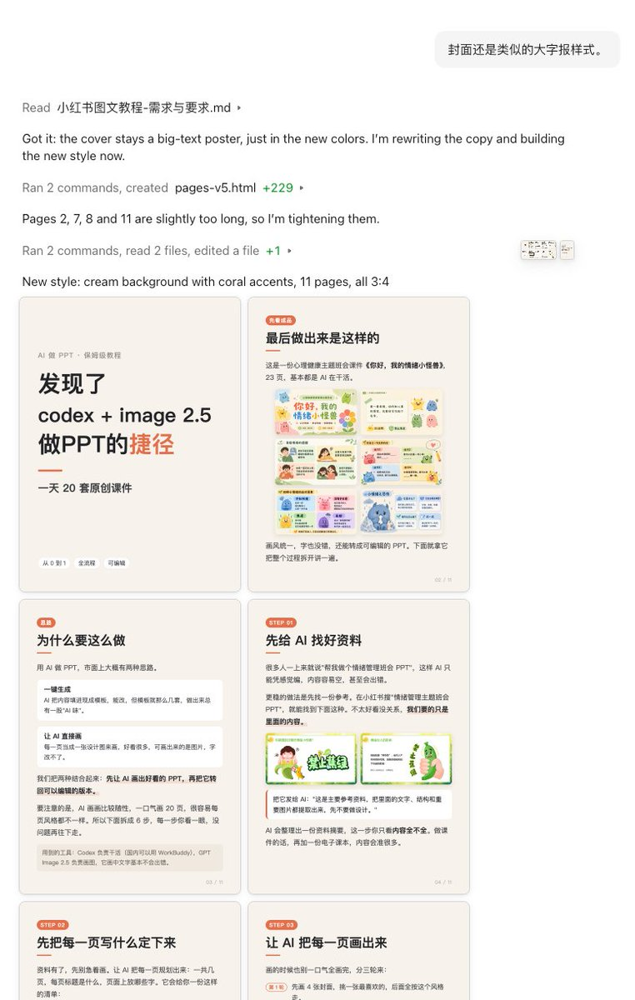

各种排版风格的图片都能直接出，只要喂好参考图，出图非常快！

## 03｜最好用的不是工具，是 Skill

回头看这件事，我自己感触挺深的。

我是产品经理出身，过去遇到效率问题，第一反应永远是：做个工具。

但这次我想明白了一件事：跟 AI 配合，最好用的东西不是工具，是 Skill。

工具像给流水线上的某一个工位，换了一台更好的机器。这个工位确实快了，但前后的活，还得人来接。

Skill 更像是给整条流水线配了一个 AI 助手。你把说明书写清楚，它就能照着从头干到尾。

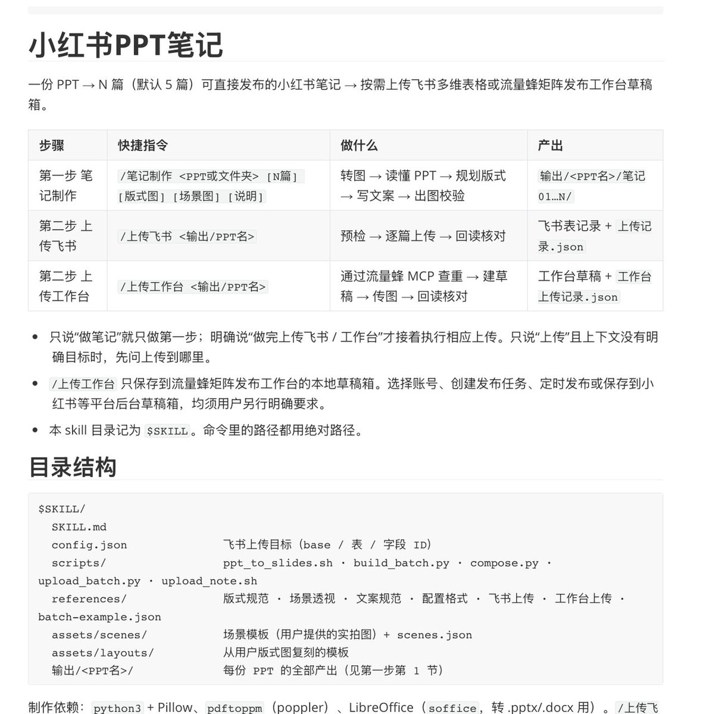

而且这个助手上岗特别快。做工具我花了 1 个月，搭 Skill 只用了一两天；以后要改需求，工具得重新开发，Skill 改几句话就行。

说到底，工具用的是我们自己写的那点功能，Skill 用的是大模型本身的能力。模型越强，Skill 就越好用，这是工具追不上的。

PPT 本身就是小红书虚拟里非常非常大的一个赛道。在这么大的赛道里，能把制作和笔记全部深度 AI 化，价值特别大。

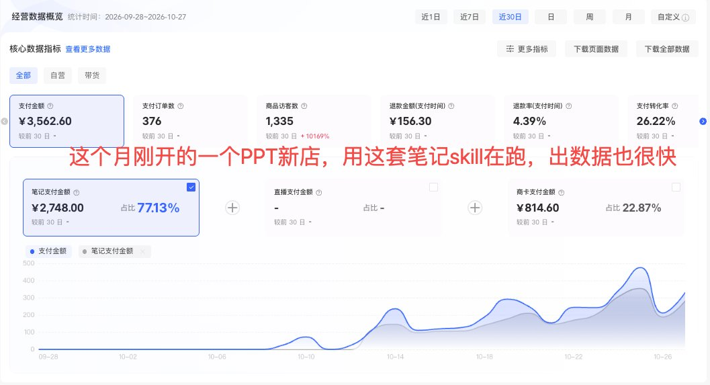

所以现在 PPT 制作、写笔记这些流程化的活，我们基本都交给了 AI。团队的精力，全放在了选品、测品、拉效率上。

这些要看数据、要判断用户需求的事，AI 替不了人；而能写成流程的事，人也没必要再自己干了。

## 04｜别给 AI 设限

最后再说个小插曲。

7 月我们自己整理医护 PPT 的 SOP 时，里面还写着一句：全流程用 AI 做 PPT，效率不一定高。

三个多月后，从 PPT 到笔记，已经全自动了。

这件事给我最大的提醒就一句：别给 AI 设限。

你觉得它做不到的事，很可能只是你上次试的时候它还做不到。AI 就像一个盲盒，隔段时间就会多出新本事。

所以有想法就丢给它试，试不成也别急着下结论，过一阵子把那件事拿出来，再开一次。

说不定，你上次放弃的那件事，它现在已经能做了。

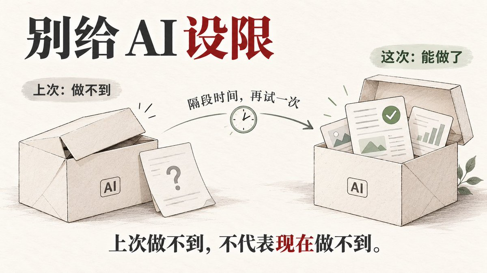

回头看我们做笔记这一路，从实习生在稿定上手搓，到自己花 1 个月做工具，再到一个 Skill 全部接住。下一次它会变成什么样，我现在也不知道。

但这个盲盒，我会一直开下去。

## 相关页面

- [[patterns/ai-agent-content-farm]]
- [[patterns/skill-over-tool]]
- [[patterns/wechat-image-post-account-sop]]
- [[concepts/ai-content-pipeline]]
