# 裴同学（@LucasPei181034）：小红书 × Agent × 自动化选品，真的爽翻了！

> 小红书电商选品从人工苦工到 Agent 自动化的实战演进：拆解千帆成交榜人工选品的四重痛点（只有手机端可看、头部大店占据榜首无参考价值、上新时间需靠评论区首条日期反推、已爆单老品混入榜单），并给出用 Agent 接管全流程的方案——自动抓取榜单、识别低粉高销潜力账号、追踪商品上架周期与真实单量换算日均收益、跨会话去重记录，最终把「找品」的时间成本压到最低，把人力全部转移到「判断」环节。

<!-- more -->

做电商的都知道，最重要的是选品。

最麻烦的，也是选品。

做小红书电商 3 年多了，越做越确定一件事：品选对了，笔记和运营是锦上添花；品选错了，笔记卷得再好也是白卷。

但选品这件事，真的太磨人了。很多时候找一两天，一个合适的品都找不到。

以前我选品，主要靠刷千帆的成交榜。

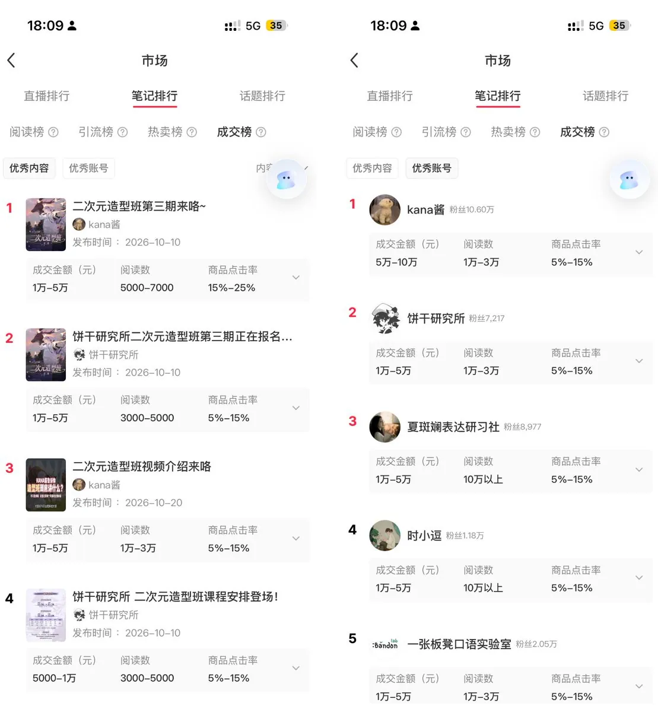

第一个让人崩溃的地方，是只能用手机看。千帆在电脑上看不到商品，也跳不进店铺。你想知道这个号到底在卖什么，只能掏出手机，点主页，点店铺，一个一个翻。电脑上一眼就能扫完的东西，在手机上得一屏一屏地划。

第二个，是榜单前面的基本没用。排在最前面的，大概率是大店，粉丝几万，做了好几年，你看了也做不了。真正有参考价值的，是那种粉丝没几个、卖得却很好的号。可它们都藏在后面，你只能一路往下翻，一个个点开看。

时间就是这么没的。

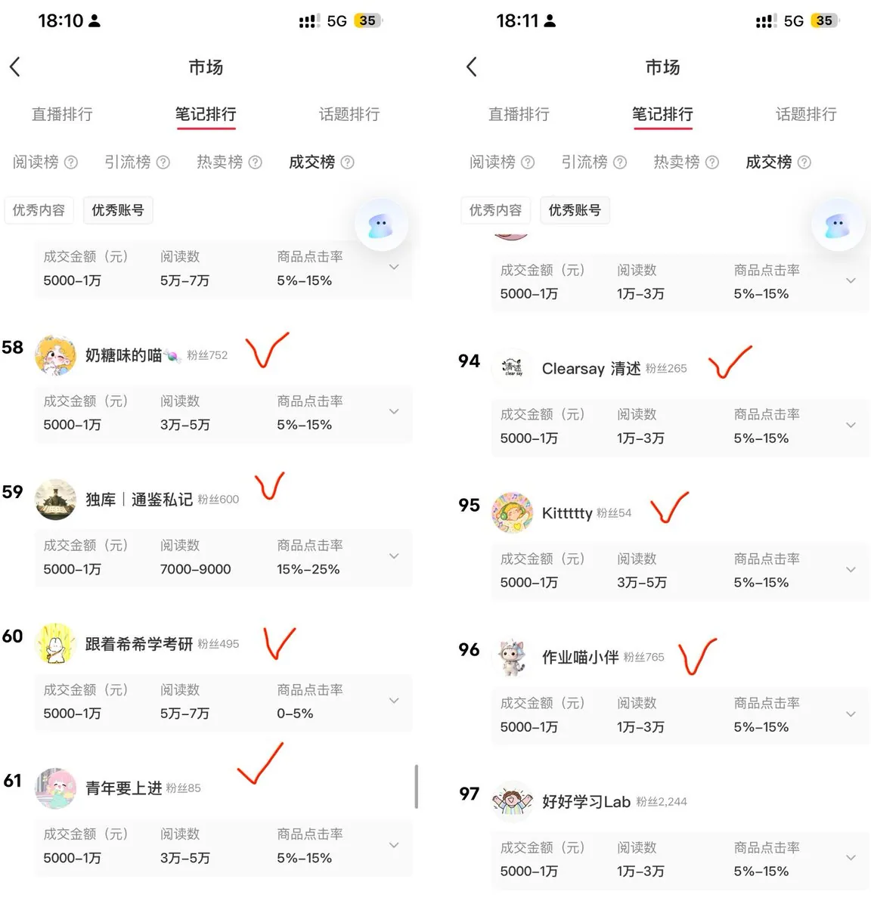

好不容易翻到一个看着不错的，还需要跳转到小红书去刷。

他什么时候上的这个品？平台不告诉你。只能把商品评论区翻到最底下，看第一条评论是哪天，再往前推个五天十天，自己猜。

猜完再算账：卖多少钱，卖了多少单，卖了几天，一天大概能赚多少。大部分品算完你会发现，不值得跟。一天几百块钱，费那劲干嘛。

十几分钟，白干。退出来，点下一个。

最憋屈的是什么？是终于算出一个能做的，一看，已经卖了三四千单了。

再翻翻评论才发现，这些单大多是几个月前卖的，最近基本没什么动静了。

第二天再打开千帆，又是这批人。哪些昨天看过、哪些算过，全靠脑子记，记不清就只能从头再翻一遍。

说实话，这套方法我在课上也教过学员。我自己讲的时候都说：这个方法有效，但是很恶心。

有效，是因为它真能找到品。

恶心，是因为它把人的时间全耗在了「找」上，留给「判断」的时间几乎没有。

现在我实在不想干这种体力活了，干脆把它都交给了 AI。

结果才发现，真的爽翻了。

## 一、我现在是怎么选品的

先说清楚一件事。

我说的交给 AI，不是随便打开一个对话框，说一句话它就能帮你刷千帆。AI 自己手里没有小红书的数据，哪家店卖了多少单，它是看不到的。

所以我们自己搭了一套东西。用安卓模拟器挂上矩阵号，用 Agent 自己去搜关键词、刷商品、点店铺，把数据一条条抓下来；抓下来的数据再交给 AI 深度分析。

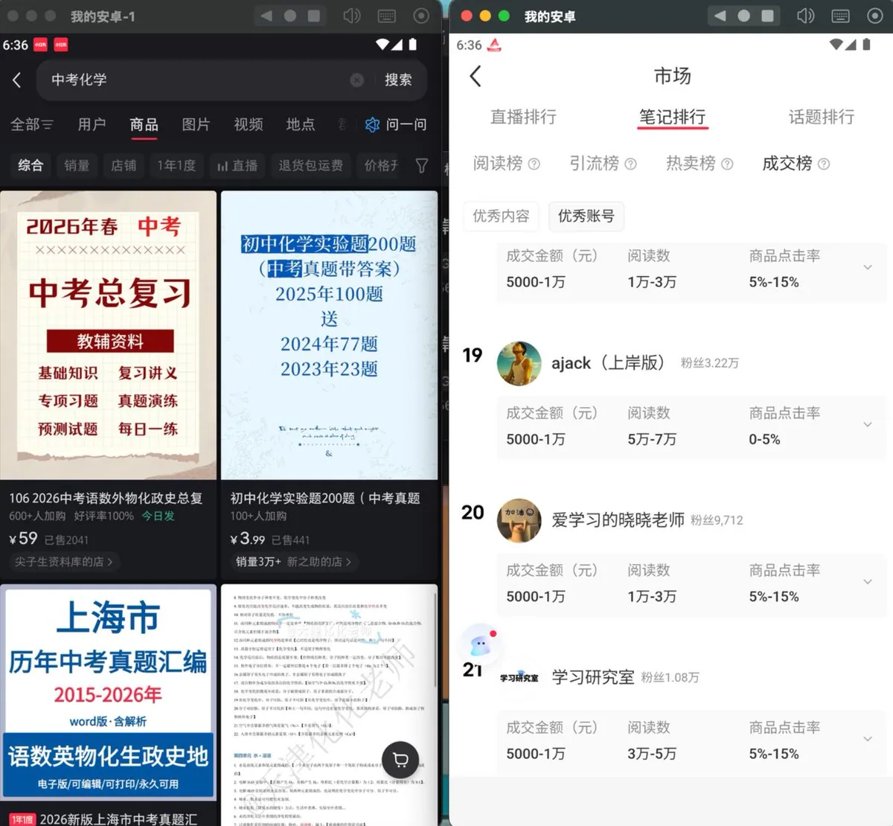

AI 在中间做的，是听懂我要什么，调这些能力去跑，自动的采集商品与笔记数据，跑出错了自己纠偏，最后把结果整理成我能直接看的表和报告。

有了这套东西，我现在选品主要就四种方式。

### 1. 整个赛道采下来，盯日增销量

以前看一个赛道，就是在手机上一个词一个词地搜，一页一页地划。你能看到的，永远只是这个赛道的一小角。

现在我是整个赛道一起采。PPT 赛道采了 15000 多条商品，K12 赛道采了 2 万多条，全部放进选品网站，定期更新销量。

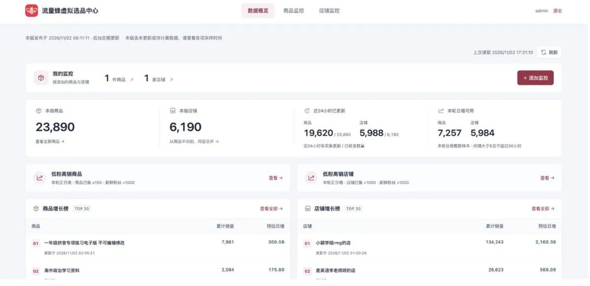

我真正盯的，是日增销量。

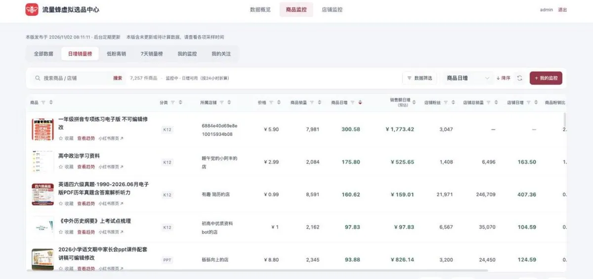

累计卖了几千单的品，你看得到，同行也看得到，而且很可能已经过了最好的时候。我要找的，是最近每天都在涨、日增销量排在前面的品，和卖出这些品的店。

找到这样的店，我会单独拎出来，再去拆背后的商家：他都卖了哪些品，哪个先起来的，笔记是怎么做的。

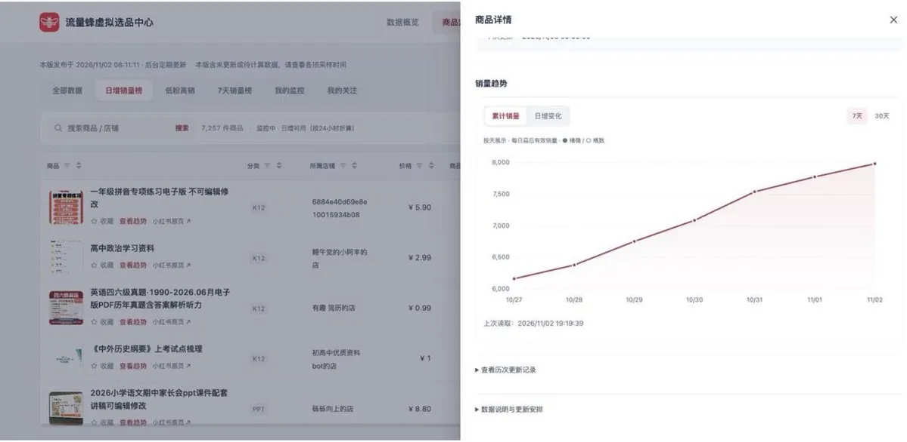

以前这一步，光是筛出值得看的店就要花掉大半天。现在筛选交给工具，我把时间留给真正的分析：这个对标凭什么卖得好，我能不能做得比他好。

### 2. 千帆榜单，交给 榜单采集

赛道监控适合已经想好做什么的时候。想看看全平台最近什么卖得好，我还是会看千帆榜单，只不过现在不用自己刷了。

我把以前手刷的步骤，原样交给了 AI：

「采集千帆成交榜的优秀账号前 200 名，统计出粉丝数低于 2000 的，进他们的店铺，把店铺销量前 3 的商品采出来，最后给我一份完整的报告。」

跑完，它会把所有低粉账号的名称、价格、销量、链接全在一张表里，非常方便快速筛选。

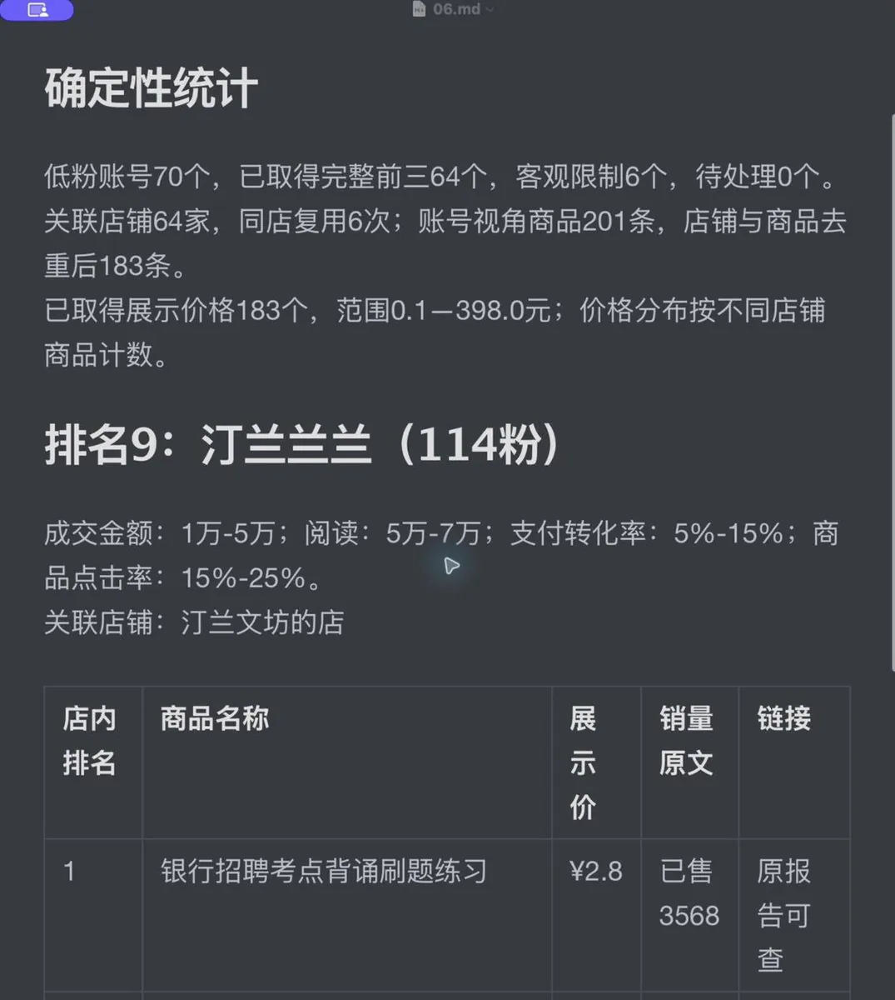

我扫了一眼就看出东西了：排在前面的几个低粉号，卖的都是银行招聘。有个号只有 114 个粉丝，一份 2.8 元的银行招聘考点资料，显示已售 3568。

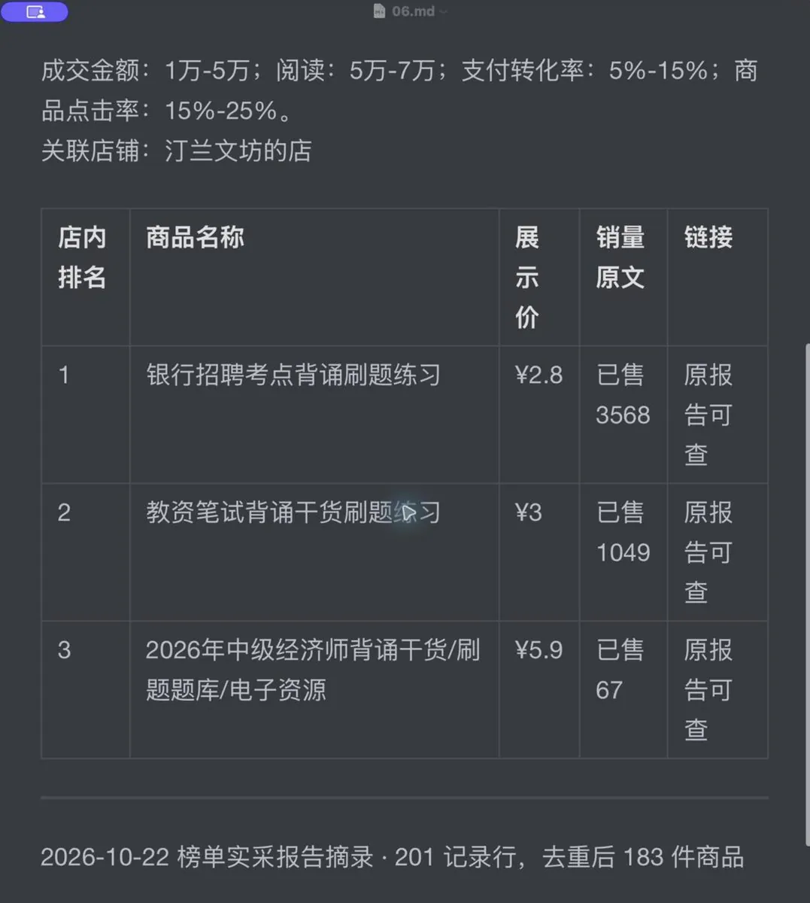

几个毫不相干的小号，同时在卖同一类东西，说明银行招聘这段时间是真有需求，而且粉丝这么少都能卖，说明同行做得并不强。

但 10 月已经是这波需求的中段了，现在进去吃不到第一波。要不要做，就得看后面的考试节点还有多长，值不值得追。

这个判断，以前我得在手机上点一晚上才凑得出来。现在看一张表就够了。

用了几天，我又加了一句：「我只要没看过的商品和店铺。」

榜单每天的变化其实不大，加上这句之后，200 个号每天落到我眼前的，就只剩十几件新品。昨天的记录，就是今天的过滤器。

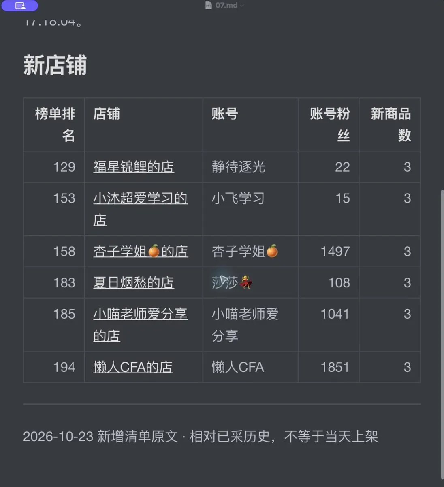

### 3. 找到对标，交给博主采集

不管是赛道监控还是千帆榜单，找到值得学的店，下一步都是拆。

以前拆对标是真的累。一个号几百篇笔记，在手机上往下划，你不知道高赞的在哪，不知道什么时候发的，更不知道哪篇笔记带的是哪个品。

现在我丢给它一个店，它把这个博主所有的笔记、店里所有的商品都采下来，挑出互动最高的几篇重点拆，最后给我一份报告。

我拆过一批卖原创课件的店，都是今年下半年才开始做的。

报告一出来，这几家在卖什么一目了然：主要是语文、道法、数学、科学，哪个年级、哪个科目卖得最多，老师最愿意为哪一科掏钱，都摆在那里。

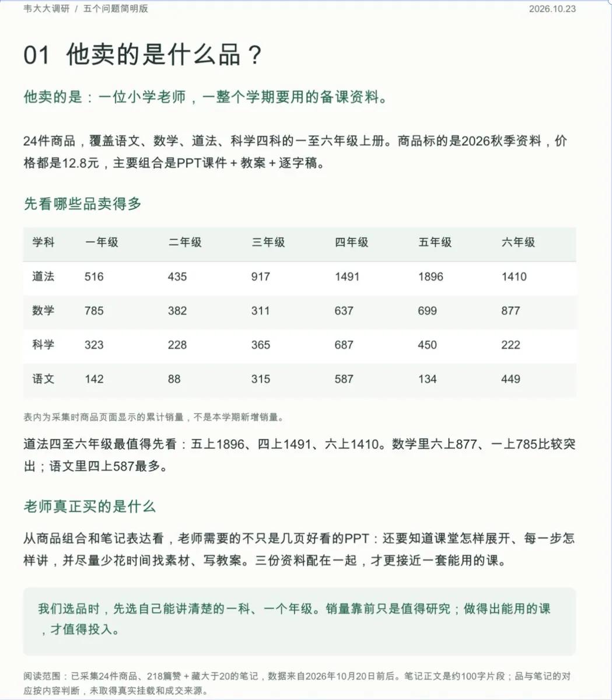

更关键的是时间线。他们的高赞笔记 7 月开始冒头，8 月爆发，9 月还在爆，到 10 月就没了。

这说明课件的运营节点在 8、9 月，也就是开学前后。等你 10 月才注意到，再进场已经晚了。想做课件，就得提前到暑假去铺。

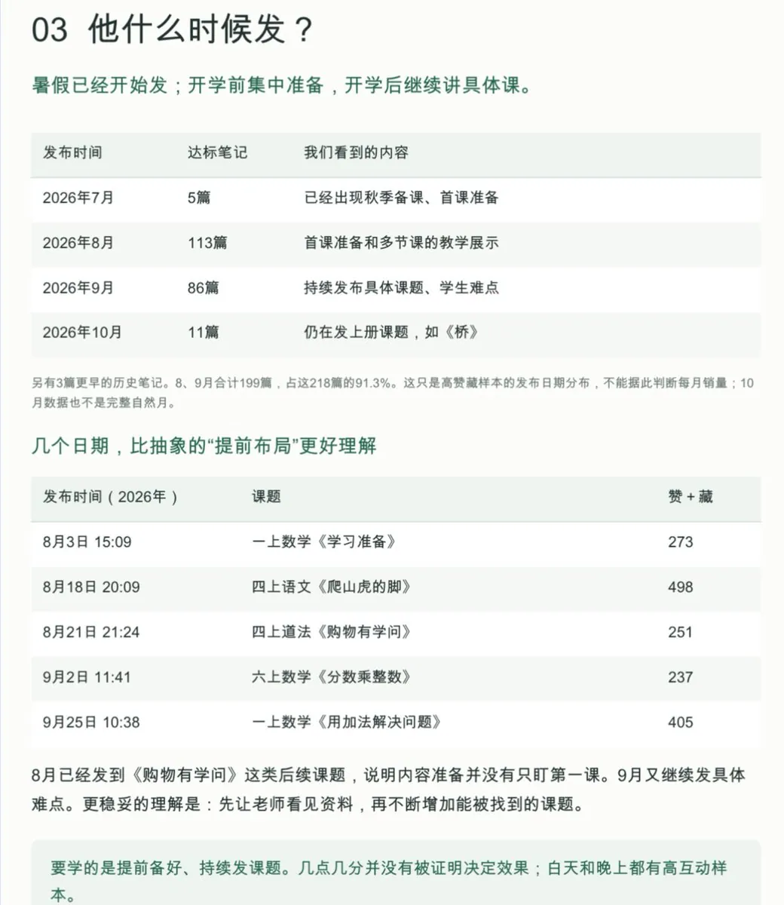

这个结论，靠手刷是刷不出来的。

还有一家做心理测试的店，叫 Great Talent。开店 63 天，只有 514 个粉丝，店铺页显示已经卖了 26 万单。

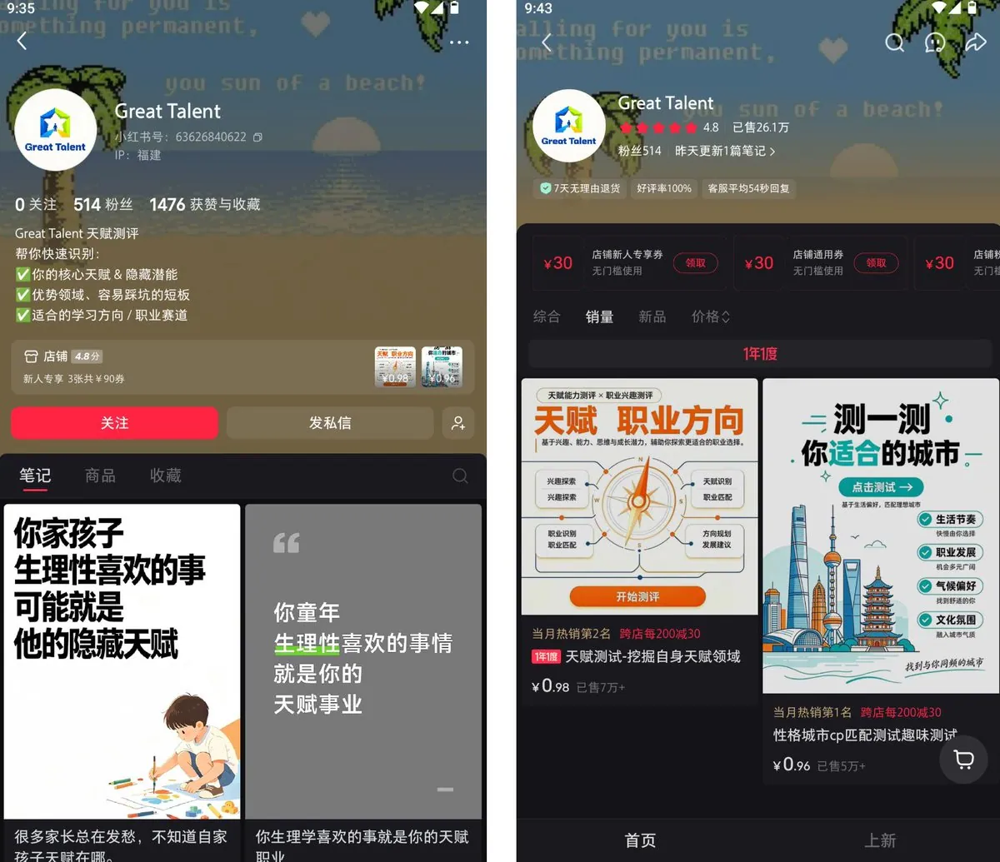

我把它丢给 博主采集，商品和笔记都采集下来，让 AI 一拆，它卖得好的原因就摆在那了：

一是击中好奇心。笔记翻来覆去都在讲一句话：你身上有个连自己都不知道的天赋。看到的人，都想测一下自己是什么。

二是笔记形式简单。要么一句戳人的观点配报告样例，要么几道测试题让人在评论区答题，大部分笔记只有几个赞，靠的是天天发。

三是价格低。原价 68，到手 1 块钱左右，测着玩也不心疼，顺手就买了。

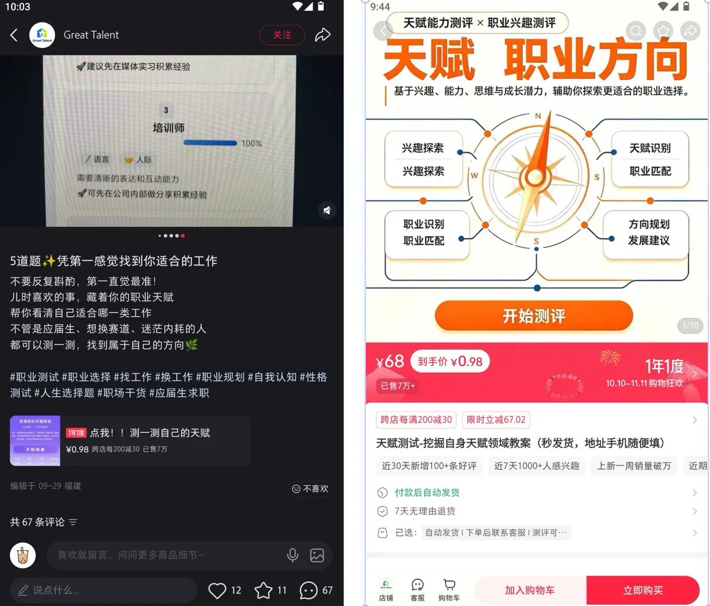

好奇心、笔记形式、价格，这三个点，都是从 AI 直接从它的商品和笔记里直接拆出来的。

### 4. 完全陌生的方向，让 AI 帮我找

前面三种，都得先有个赛道，或者先有个店。

但更常见的情况是，我只有一个模糊的想法，连该搜什么都不知道。

这时候我会让 AI 两条腿一起走。

一条腿，是它的联网搜索能力。让它去查这个领域：有哪些人群，什么时候有需求，考试、开学、放假这些节点卡在哪，能拆出哪些细分。比如「社会工作者考试」，什么人会考、什么时候考，你完全不懂，AI 几分钟就能理清楚。

另一条腿，是真实的商品数据。让它搜这个领域的关键词，把下面的商品刷出来，挑出近期数据好的，总结给我。

AI 对领域的判断，加上真实的销量数据，两边对得上，方向才靠谱。

前段时间我想做一本 K12 的知识手册，年级、科目、专题一个都没定。我就直接问：

「我想围绕 K12 做一个某个科目某个专题的知识手册，但不清楚做哪个年级、哪个科目、哪个专题，你整体帮我调研下。」

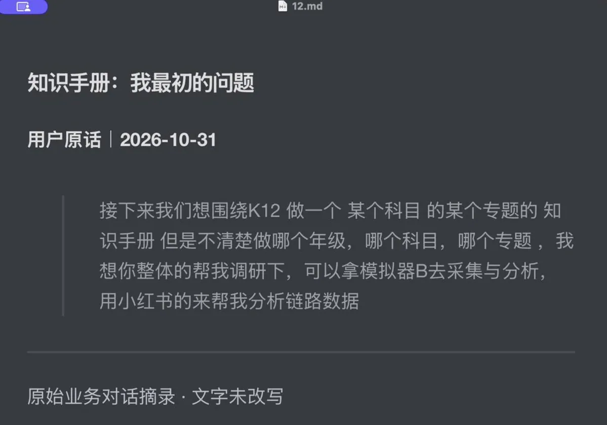

它查完给我的答案是：第一本先做三年级语文的阅读理解方法手册。理由也很清楚，近期有人买，有低粉作者在卖，相关笔记也有热度。

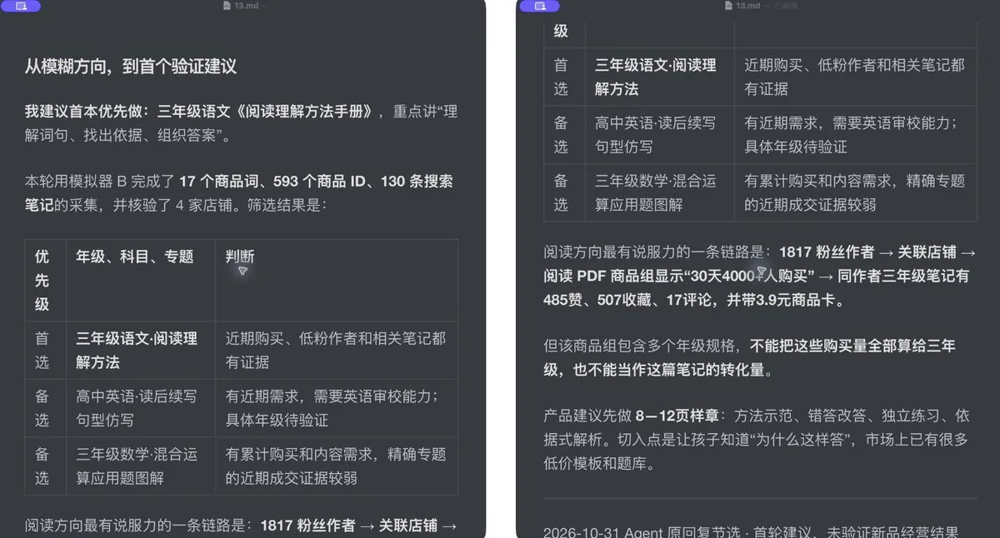

它还顺着往下说了怎么做出差异：市面上低价的模板和题库已经很多了，与其再做一份题库，不如讲清楚「为什么这样答」。

从一个模糊的想法，到先做哪个年级、哪个专题、往哪个方向做出差异，一次就出来了。

### 说到底

这四种方式，接走的是刷、翻、猜、记这些体力活。我的时间，终于可以留给真正需要人来做的那一步：判断。

但工具只是帮你找品的一种方式。真正的核心，还是要用下面这套选品逻辑，筛出自己真正能做的品。

## 二、选品逻辑：一个品能不能做，看四个问题

工具给我的，只是一堆候选。真正决定做不做，我会在脑子里过四个问题，每天都这么过！

### 1. 这个赛道，我打得过吗？

选赛道，我一直说一句话：找个软柿子，垫垫脚能够到。

先分清，赛道不等于品。PPT 资料是一个大类，K12 课件是一个赛道，初中历史课件是一个细分，「七年级历史期末复习课件」才是一个具体的品。选得越细，越容易找到自己打得过的位置。

你去跟全年级、全学科铺满的大店拼课件，基本没机会；但只做七年级历史的期末复习，对手可能就那么几家。

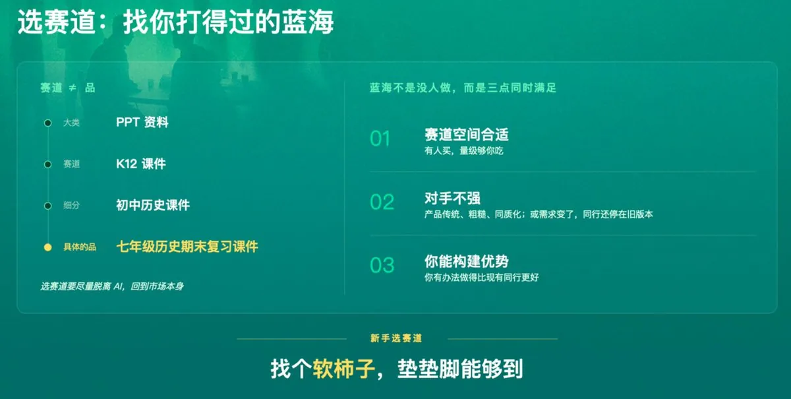

还有一点要想清楚。小红书电商已经发展了 3 年多，基本不存在还没人做的赛道。如果你发现一个方向真的没人做，大概率是因为没人买。

所以我们找的蓝海，不是没人做，而是：有人在买，同行做得一般，你能比他做得好一点。

### 2. 现在进，还来得及吗？

这是最容易被忽略的一个问题。

虚拟产品吃的主要是搜索流量。搜索流量需要时间积累，谁发得早，谁的笔记和链接就先攒下权重，等需求真正起来的时候，自然排在前面。

拿寒假衔接来说，需求大概从 12 月中下旬开始起，到 1 月中下旬一放寒假，就爆了。

如果 12 月中下旬就开始铺，等需求爆发，你已经在前面了；等它爆了再进，前面已经站满了人，只能花钱投流往上挤。

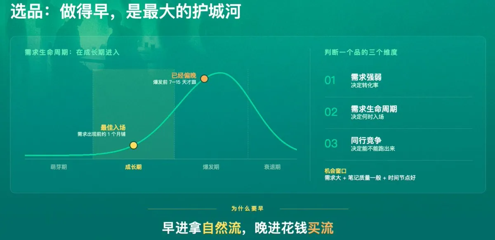

所以我常说，早进拿自然流，晚进花钱买流。一般在需求爆发前一个月左右开始铺，时间就比较合适。

这一个月里单量不会太多，但已经有需求了，销量会慢慢积累，等需求真正爆发的时候，你的笔记、商品自然就排在搜索的前面了。

### 3. 同行做得怎么样？

这个问题，前面的工具其实已经帮你回答了一半。

一个只有几百个粉丝的号，东西还能卖得动，本身就说明这个赛道的同行没那么强。这也是为什么我一直盯着低粉高销。

再点进去看看他的产品和笔记，如果产品做得粗糙，笔记也就那样，这就是你的机会。

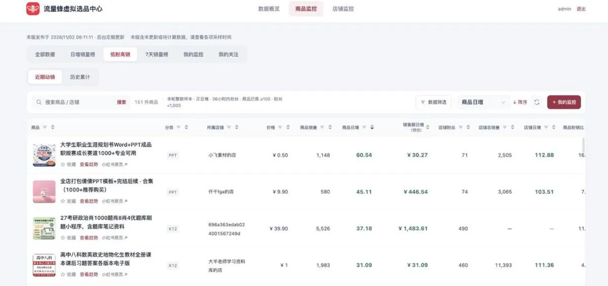

反过来，有些赛道已经卷到了一张图要花二三十分钟排版，还是团队批量在做，比如教资和小学资料。一个人进去硬拼，很难有机会。

遇到这种情况，要么在产品和笔记上做出差异，要么换一个竞争小一点的方向。

### 4. 算下来，赚不赚钱？

最后一个问题，是算账。

很多人选品只看销量，不看客单。一个几块钱的品，就算每天卖几十单，算下来也没多少钱，笔记却一篇都不能少发，咨询和售后也一点不会少，一个人做的话，光回消息就够你忙的。

所以我一般建议，一单尽量卖到 10 块左右。没有原创能力的，可以把单份资料打包成合集来卖，用户觉得划算，你的客单也能提上去。

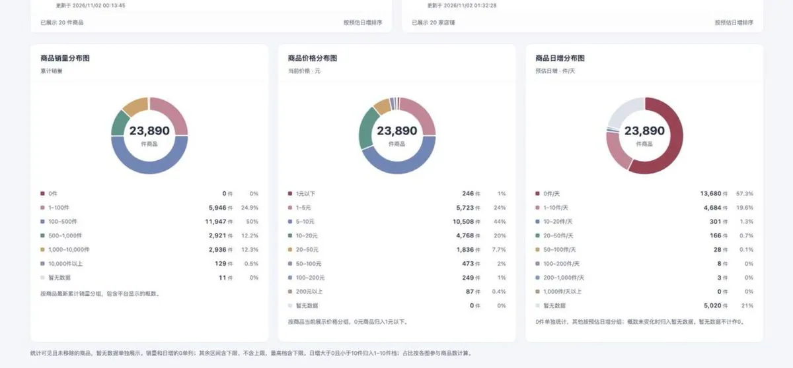

赛道打得过，时间来得及，同行不算强，账也算得过来，这四个问题都过了，这个品才值得你花力气去做。

回头看前面那四种工具，它们做的事情，其实就是帮我把候选更快、更全地找出来，让我有更多时间，去认真回答这四个问题。

## 写在最后

做小红书电商这几年，选品一直是我花时间最多的地方。

以前是捧着手机，一个店一个店地点，一个品一个品地算，找一两天都不一定有结果。现在刷、翻、猜、记这些活交给了 AI，我能把更多时间留给判断

工具会越来越好用，但判断这件事，还是得自己来。把这四个问题想清楚，不管你用的是什么工具，选出来的品大概率都不会差。

最后说两件事。

第一，文章里提到的选品网站，作者自己在用。里面收录了 PPT、K12 等赛道 3 万多条小红书虚拟商品，每个商品每天卖了多少、新增了多少，哪些是低粉高销、最近在起量的，都能直接看到，帮你省掉大量手动翻找的时间。

第二，如果你想知道这整套选品系统是怎么一步步搭起来的——从模拟器采集，到选品网站，再到让 AI 帮你跑榜单、拆博主——后续会把它完整拆解出来。

谢谢你看到最后。

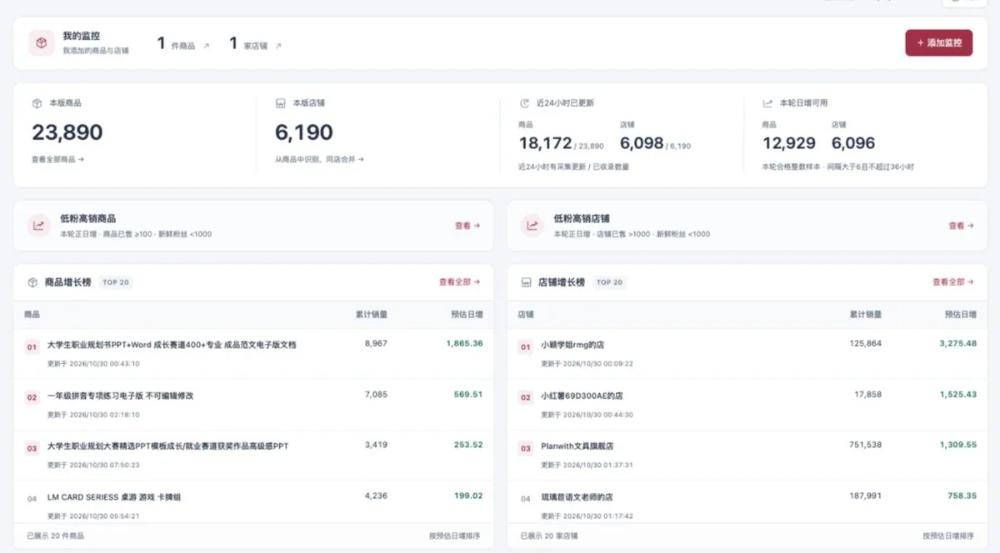

## 相关页面

- [[sources/dongqing-xhs-product-selection]]
- [[sources/hytidel-xiaohongshu-ecommerce-operations-and-10x-scaling]]
- [[concepts/xhs-product-selection]]
- [[concepts/b2c-conversion]]
