# 裴同学（@LucasPei181034）：从封店月损 8 万到单店月入 5 万——小红书虚拟资产全面转向 AI 原创 PPT 破局实录

> 小红书平台严打同质化与搬运侵权的背景下，团队如何用 AI 原创重塑虚拟电商业务：日耗 20 亿 Token 并发跑 30-50 个 AI PPT 生产任务；详解 AI 原创课件与职场 PPT 的大纲生成、排版样式渲染与全流程自动化，彻底告别侵权封店风险，单店月入突破 5 万元。

<!-- more -->

大家好，我是裴同学！

我们团队做小红书虚拟，到今年已经两年多了，一直在一线做业务，没断过。

也正因为一直在一线，今年的变化我们体感特别明显——小红书虚拟类目的打击，越来越严。类目被收回、笔记被判同质化、店铺因侵权盗版被封，我们五个经营了一两年的店铺陆续被封，算下来，一个月八万的收益说没就没。

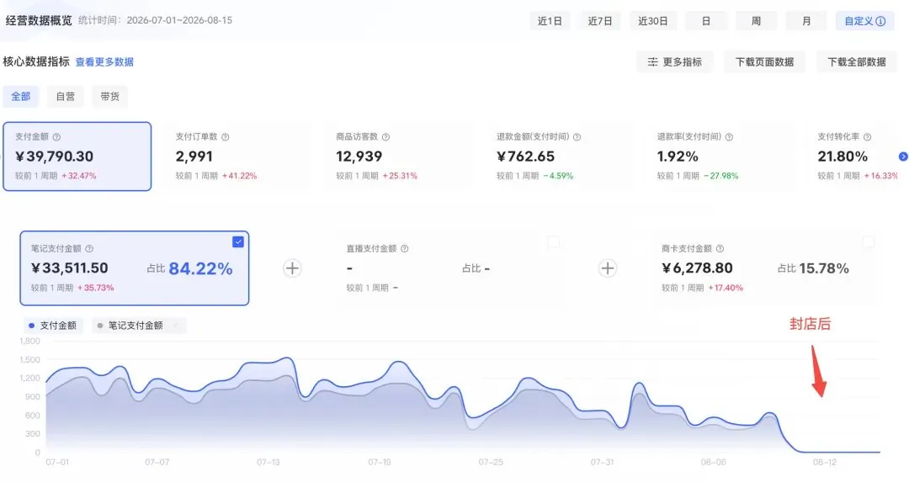

难受归难受，路还得走。这段时间我们就干了一件事：全面转向 AI 原创，把整个虚拟项目从 0 到 1 重新跑了一遍。

现在拿到了两个结果：

- 一是从制作到发布，整条链全 AI 化了，现在我们每天光 token 就要烧掉 20 个亿。30 到 50 个 AI PPT 任务在并发跑，生产效率非常高，每天基本只剩“选赛道”和“客服”两件事；
- 二是赶上课件开学季，我们有店铺一周能卖到上万，单月做到 5w。其他赛道也接到了大量定制单。差不多回到了之前的水平，但是完全没有了违规侵权风险。

今天这篇，就把我们怎么一步步破局、踩了哪些坑、又是怎么做到的，完整复盘给你。主要讲这几块：

1. 小红书平台这轮到底在打什么、红线在哪
2. AI 原创的机会有多大，为什么我们偏偏选了 AI PPT；
3. 我们现在做到什么程度、用的是什么方案；
4. 从制作到发布，这条全 AI 流水线怎么搭；
5. 做好后怎么卖、怎么批量制作与多平台分发；
6. 做了哪些 PPT 赛道、又该怎么选品；
7. 大家最关心的几个问题，比如电子资源类目现在到底怎么开。

如果你也在做虚拟、也被平台的政策搞怕过，或者你一直想知道 AI 到底怎么落到能换钱，这篇应该能给你点实在的东西。

## 一、我们先搞清楚：小红书这波到底在打什么

8 月份我们一批店铺被封之后，我做的第一件事不是急着改，而是先把那些违规通知一条条扒下来看，搞清楚平台这次到底在打什么。

扒完之后发现，官方这轮动手，核心盯着两样东西：

第一样，卖盗版

这是这轮打击的重中之重。

你会发现平台的动作特别多：电子资源类目不断收紧入驻门槛，之前“强开”的店铺被一批批回收类目权限，带盗版的商品被直接下架冻结，严重的干脆一纸通知把整个店铺封掉。

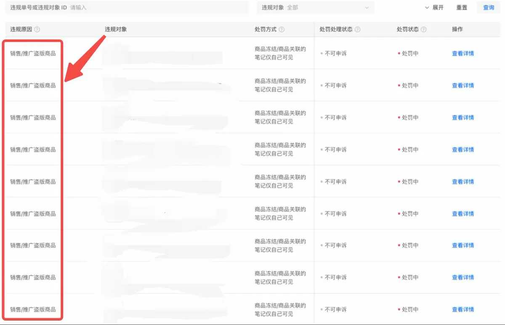

看着眼花缭乱，但把它们串起来看，本质都是同一件事——把盗版摁下去。违规原因也写得明明白白：“销售/推广盗版商品”“不当使用他人权利”。

官方甚至亲自下场，发起“盗版电子书治理”的专项调研。

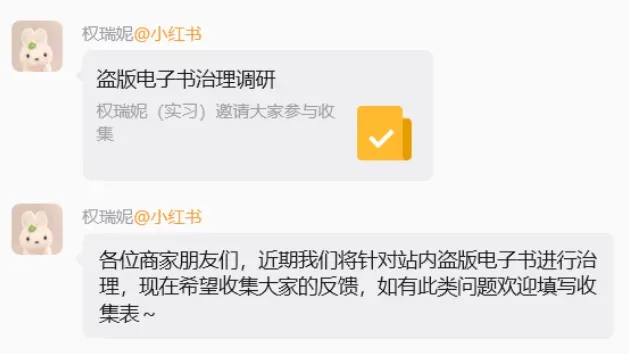

为什么盯得这么死？

一来电子资源这个类目本身盗版问题就多，二来国家的“清朗行动”也在严查盗版。

平台索性顺势从源头收紧——先用门槛把想进来铺盗版的人挡在外面，再回头把已经在卖的清出去。

这一点，我们是真真切切踩过的。之前做课件被直接封店，我去申诉时客服说得很干脆：出版社名字、教材封面、课本原图，只要沾上这些，平台一律算你“不当使用他人权利”。换句话说，课件本身还能卖，但是一定要提前申请好自己的版权文件，被判违规时方便拿去申诉。

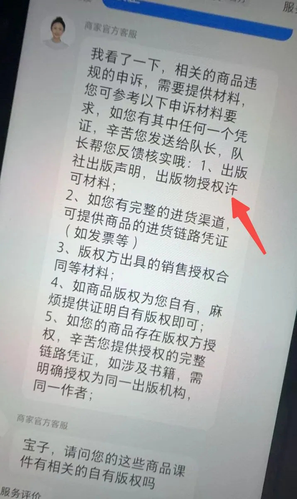

以后在小红书想靠批量上品、批量搬运去铺量的玩法，只会越来越难做。门槛越收越紧，盗版查得越来越严——你搬得越多、上得越快，反而死得越快。

第二样，社区内容治理

也就是大家常说的“笔记同质化”。搬运别人的笔记、封面标题正文套同一个模板、素材改一改就发——都非常容易被限流。

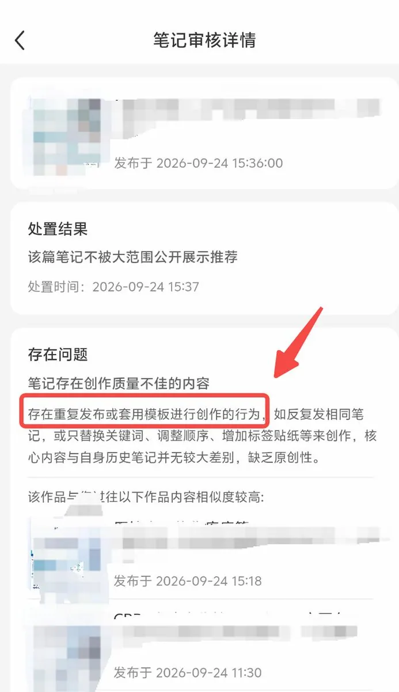

这背后其实有个新变量：AI 起来得太快了。小红书是靠“真诚分享”起家的社区，它不想自己的池子被过度 AI 化、被批量生产的内容灌满。

但问题是，平台也识别不清一篇笔记到底是不是 AI 做的，那怎么办？它就盯“套模板、搬运、同质化”这些特征下手——只要判你跟别人相似度高、批量套模板，不管你是不是真人一张张手搓的，照样给你限自然流。

把这两样串起来，我心里其实就有数了：这轮不是平台偶然抽查，是在动真格。

盗版和同质化，平台一直都在打，只是这一次，下手重了太多太多。

说到底就一句话——它要合规、要原创，没有中间地带：要么往合规、往原创走，要么就别做了。

## 二、真正的机会是 AI 虚拟，而 PPT 是个很好的切入口

小红书虚拟政策是在收紧，这没错。但我想先给个判断：真正要紧的那几样东西，其实一点都没变，机会甚至比以前更大。

先看需求这一头——一点没少。 家长该焦虑的还在焦虑，要考证的、要找课件的，一个都没跑。这个盘子一直都在那儿，甚至比往年还大。

再看供给这一头——对手少了一大半。 那些靠无脑搬运、靠批量铺量活着的人，这一波基本被清干净了。所以你得先想明白：平台这次动手，砍的是“盗版搬运”和“批量铺量”，不是“虚拟产品”这门生意——这俩压根不是一回事。

需求没变，对手却少了很多，这本身就是机会。但真正让我眼前一亮的，是第三头。

第三头，是 AI 把生产成本，直接打到了地板上。

再往深了说一层。过去这一两年，虚拟资料为什么好赚？说白了，赚的是一笔“信息差 + 平台管得松”的钱。谁胆子大、谁搬得快、谁上架早，谁就先吃到肉。

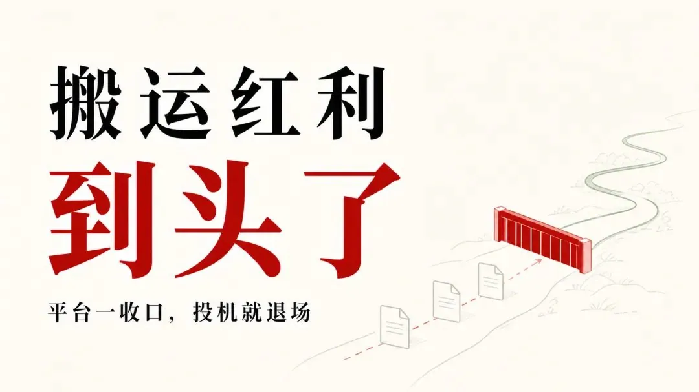

但这种套利型的红利，都逃不过一个共同的宿命：平台一旦成熟，就一定会收口。 淘宝走过这条路，拼多多走过，小红书也不例外，只是轮到了今年。

信息差这条路被堵死了，那还能靠什么赚？答案就是 AI。

现在生产一份原创虚拟资料的成本，从“招一个人”“熬一整天”，直接变成了“烧几块钱 token”。 原来卡住所有人的那道“原创太贵”的坎，被 AI 一脚踏平了。

而小红书这片土壤，天生就特别适合 AI 虚拟产品生长。 小红书的用户对 AI 做出来的东西接受度也很高，只要你东西做得好看、真能帮上忙，没人会因为“这是 AI 做的”就嫌弃你。

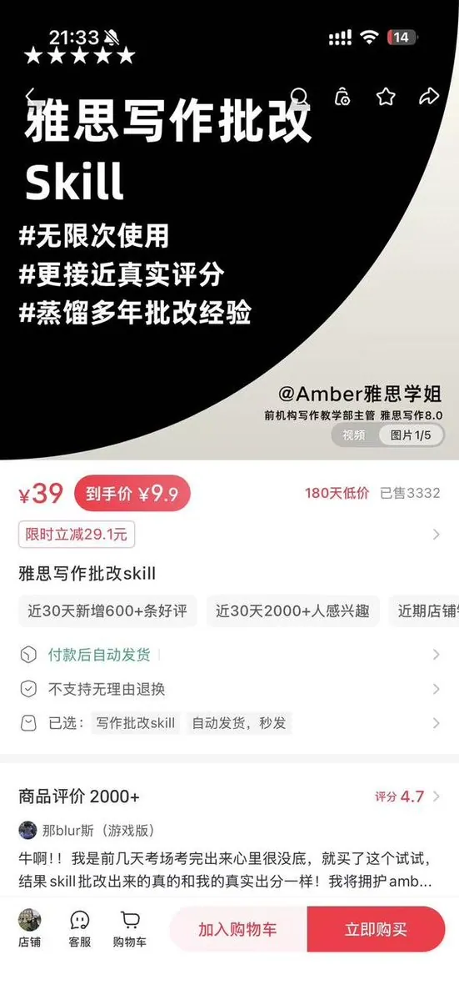

你顺着这个思路往下看会发现，能用 AI 重做一遍的虚拟品类，多到数不过来：课件、知识库、资料包、模板、工具、刷题小程序……几乎每一个传统虚拟品类，都有一块能被 AI 重新啃一遍的空间。而且特别适合轻量化运作的一人团队（OPC）。

我们团队现在就是两两分组，除了 AI 原创课件，同时还在跑 AI 知识库、AI 漫画等方向。

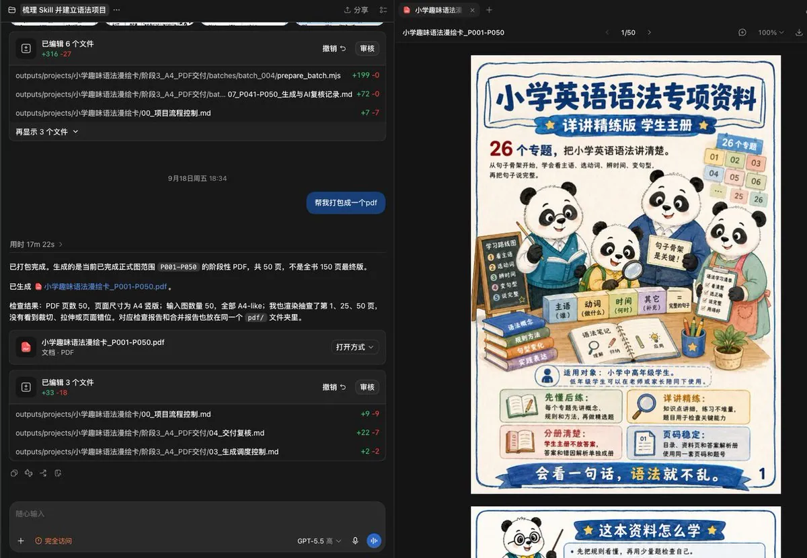

那问题就来了：这么多方向，我们为什么第一个就切了 PPT？

答案特别朴素：因为它是所有 AI 虚拟品类里，“需求够硬”和“最适合 AI 重做”结合得最好的那一个——是最好的切入口。

这个需求，我们自己早就验证过了。 在做 AI 原创之前，我们直接卖市面上现成的 PPT、课件就已经卖得很好了，单月旺季能做到 10 多万，做得好的课件团队，一年跑上百万的也不在少数。

再说重做，PPT 简直就是为 AI 量身定做的。 你想想它长什么样：封面、目录、章节页、内容页，一页页结构高度固定，图文为主，套路清清楚楚。这种“结构规整、能模板化、图文密集”的形态，恰恰是 AI 最擅长批量复制的。

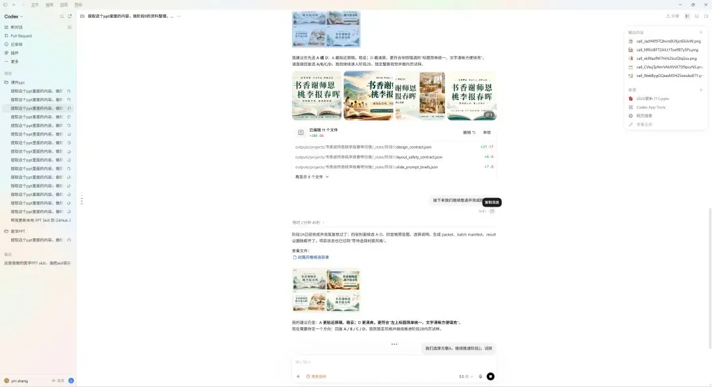

这是我一直挂在嘴边的 MVP 思维：需求在前，AI 在后。

先找到一群长期有需求的人，用越来越低的成本，持续帮他们解决一个愿意付钱的问题。技术永远该服务于生意，而不是为了 AI 而 AI。

## 三、跑了两个多月，我们现在做到了什么程度

接下来就是往死里跑。跑了两个多月，放几个数据，你感受一下。

我们现在每天光 token 就烧 20 个亿，同一时间挂着 30 到 50 个 PPT 任务并发跑。落到人头上，一个员工一天能出 50 份以上的 PPT，单份的生产成本只有几块钱，单张图的生成成本在 2～3 分钱。

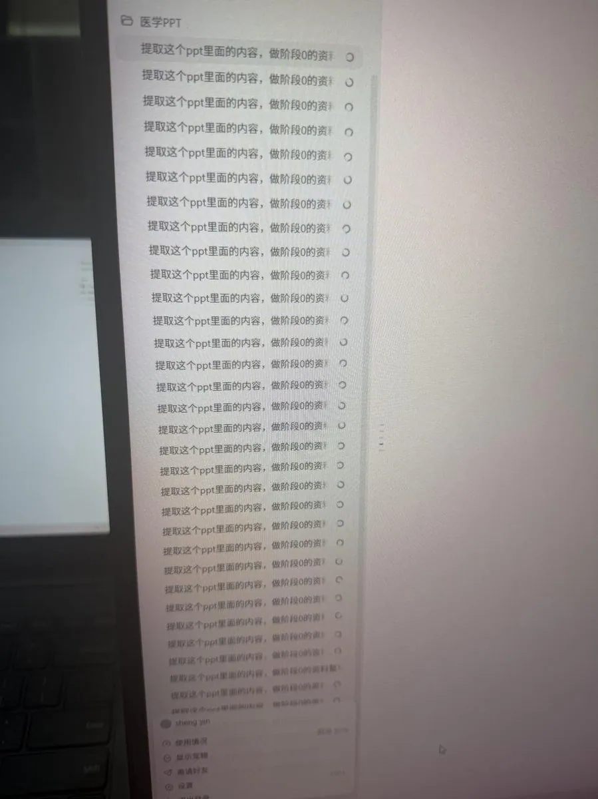

这套产能，落到了小红书店铺的直接销量上。

我们 PPT 模板这块主打走量，最近卖的都是应季刚需——比如开学第一课、主题班会、教师课件这些。以及一些需求性比较持续的.如医护 PPT 赛道。

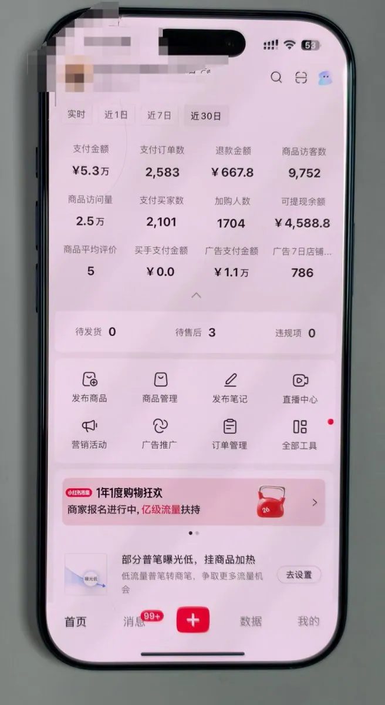

赶上这波 K12 开学季，我们单个店铺一周就做到了破万的数据。而且不只是我们自己，一堆学员也在跟我们分享：有单日利润做到一万多的，一天卖出几千的更是一抓一大把。

说白了，产能一旦跑起来，撞上开学、节日这种需求集中爆发的窗口，出单是真的猛。

定制这块，客单更舒服。

目前我们主要做的是一些医护赛道的定制 PPT，主要是护士拿来宣教用的，她们内容比较有针对性，所以会更倾向于买定制。引流到私域成交，客单价少则两三百、多则七八百。

而所谓“定制”，很多时候就是在做好的模板上用 AI 结合他们提供的资料稍微改一改，一个员工一天能出五到八份，每天接一两单就回本了。

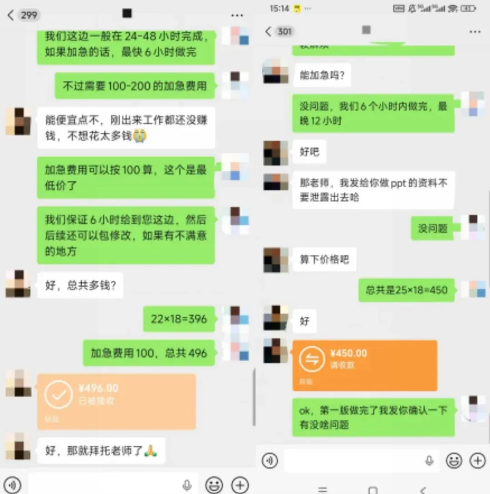

说实话，做到这一步，我自己也挺感慨。

对我们这种普通做生意的人来说，AI 最实在的价值，可能就是这个——不是天天追新概念、追新模型，是真能把买来的算力，一份份变成能卖钱的东西。

## 四、AI PPT 到底是怎么做的

这套效果，绝不是我们买了个什么神器工具，一键就能出来的。

市面上那些 AI PPT 工具，我基本都试了个遍。做单份自用还行，可你想拿它当商品卖、还要批量生产，就全都不够看了——要么做出来的风格不好看，要么导出来根本改不动，要么 token 消耗太快。

最快的一档，是 Kimi、Gamma 这种一键直出。速度确实快，也能编辑，但做出来的东西偏生硬、没什么设计感，一看就是“模板味”。

往上一档，像现在很火的归藏 PPT skill、huashu-design，用 HTML 一页页排版，商务风挺唬人，自己拿去做个汇报绰绰有余——但要说拿去卖，还差口气。

还有一类优化得更好，是 Canva、Claude Design 这类 AI 设计画布。明显好看多了，已经摸到“能卖”的边了。

这些我们全流程都跑过，也都知道各自的毛病。最后我们认准的，是生图这条路——整页的文字、图形、版式，全部用生图模型一次性画出来。

为什么是它？因为我们是拿去卖货的。

卖得好的 PPT，本质都做得很精美。很多老师做的课件，内容其实没毛病，唯一的问题就是不好看；他们又不会用 Canva、Kimi 这些工具，也不想自己折腾。

我们能做的，就是把 PPT 的视觉狠狠升一档——生图这条路，视觉上限最高，而这，恰恰是能不能卖得动的关键。

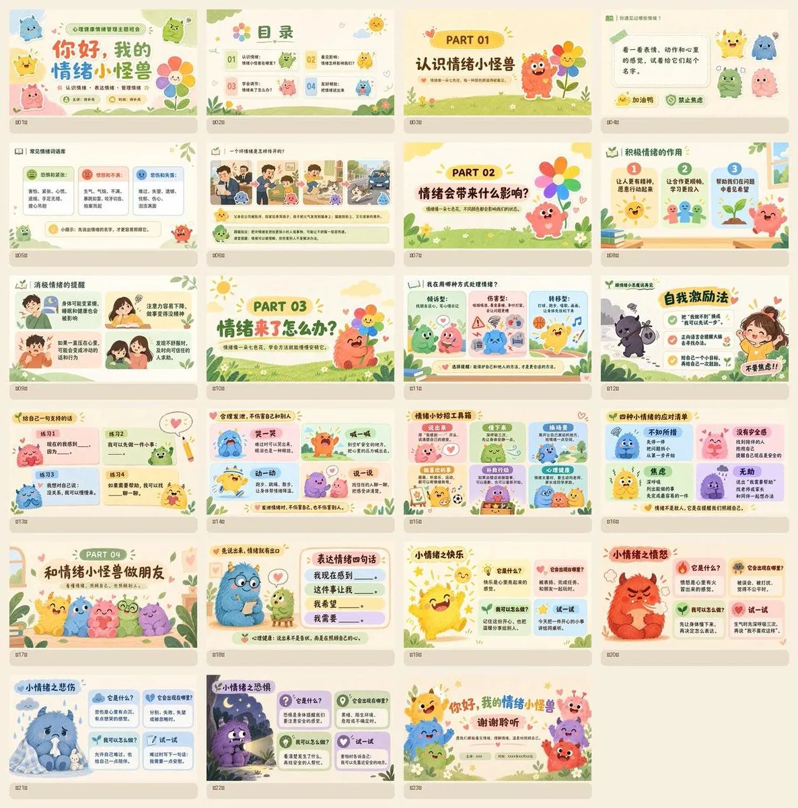

但光有方案还不够。真正卡了我很久、也让我想通一件事的，是另一个问题：要不要为这套东西，专门做一个工具？

一开始我是动过念头的。可真要去做，很快就发现不对劲——AI 迭代实在太快，你工具还没做完，模型又更新了一轮，你做工具的速度，永远追不上 AI 变化的速度。

所以最后我们没做工具，只搭了一套最轻量的 skill，嵌在 Codex、Workbuddy 这种 AI 工作台里跑。哪里不好用，随时改，全流程都能自己定制。

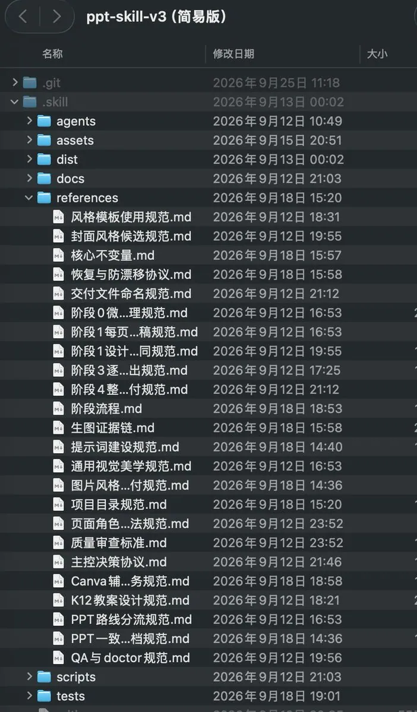

这件事让我越来越确信一句话：在今天，提示词已经不值钱了！工具也不值钱了！真正值钱的，是构建 skill 的能力。

很多人到处找我要提示词，其实提示词本身没啥用。不管你后面是做 PPT、做二创知识库，还是搭别的自动化流程，底层逻辑都一样：把你的工作流蒸馏成一套 skill，嵌进 AI 里，它就成了一个能替你连轴转的东西。

工具会被 AI 迭代淘汰，skill 不会。因为 skill 里装的是你的判断、你的流程，这才是别人抄不走的壁垒。

### 完整流程：拆成五个阶段，每步都设一个“卡点”

接下来的内容是全文干货最密的地方，我尽量给你讲清楚。如果对 AI PPT 项目感兴趣的话可以仔细看

先说整套东西的核心思路：我们不是让 AI 一口气把 PPT 从头做到尾。 恰恰相反，我们把“做一份 PPT”拆成了五个稳定的阶段，每个阶段都有明确的产物，也都有一个需要人确认的节点。让 AI 停下来，给人看一眼，确认没问题再往下走。

下面是这五个阶段。

阶段 0：资料整理

这一步不做 PPT，只干一件事——把料喂进去。原版 PPT、电子课本、文章、截图、你自己写的说明，凡是跟这节课有关的，全丢给它。做课件的话，最佳组合是“一份原版 PPT ＋ 对应的电子课本”。

为什么一定要喂料？因为你要是啥都不给，直接说“帮我做一份 XX 的 PPT”，它就只能凭空瞎编，内容的正确性根本没法保证。

喂了真实资料，AI 会先把里面的文字、页面结构、重要插画全提取出来，整理成一份资料清单和摘要，后面才有准头。

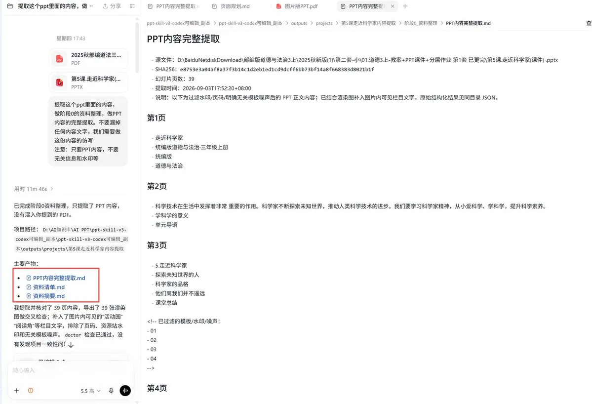

那原料从哪来？给你几个我们常用的路子：

做教师课件，首推「国家中小学智慧教育平台」。这是官方的免费网站，配上浏览器插件，电子课本能整本下载，还带一批配套的参考课件——原始素材一下子就齐了。

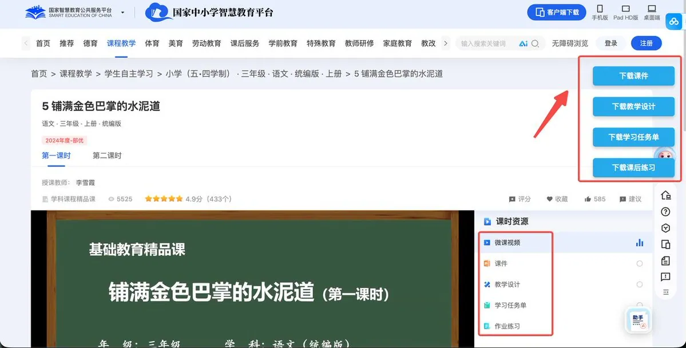

而且它还有个隐藏用途：它本身就是个绝佳的选品、选赛道工具。上面按学段、学科、册次分得清清楚楚，你想切哪个方向、哪一册需求大，扒一圈就有数了。

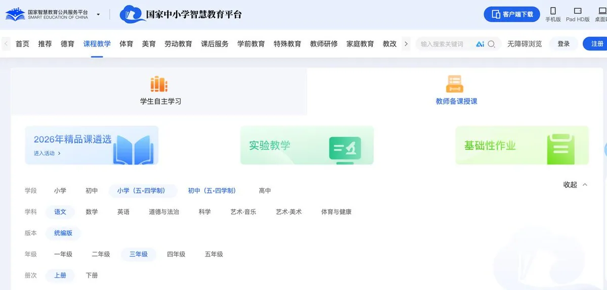

做医护、创赛、汇报这种没有现成的官方 PPT ，可以直接喂参考链接。比如把一篇公众号文章的链接丢给它，它能自动把里面的内容抓下来、整理好。

涉及学术、专业性强的内容，就调秘塔学术搜索。比起让 AI 自己凭记忆写，走一遍学术搜索，出来的结果更靠谱、内容也更准确，能少踩不少“AI 一本正经胡说八道”的坑。

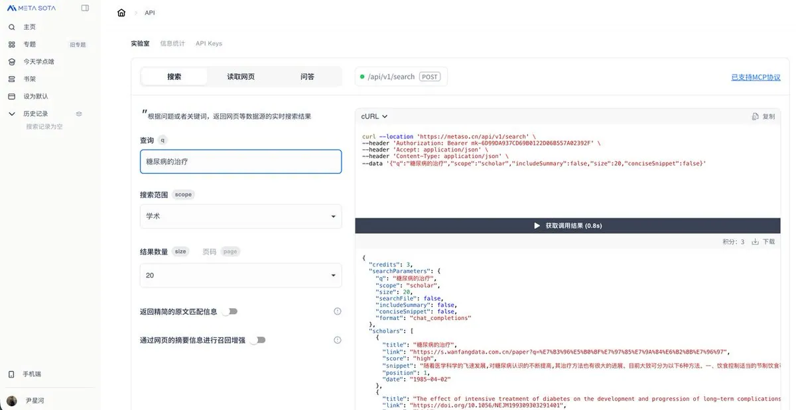

材料喂得越对、越全，后面每一步才越省心——这一步看着不起眼，其实是整条流水线里最该花心思的地方之一。

阶段 1：页面规划

这一步还是先不生图，核心就干一件事：把内容骨架和视觉风格，一次性定好。

具体要定两样东西。

第一样，是每一页的文字内容。

每页讲什么、标题是什么、正文出现哪些字，都得在这一步敲定，让 AI 写清楚。

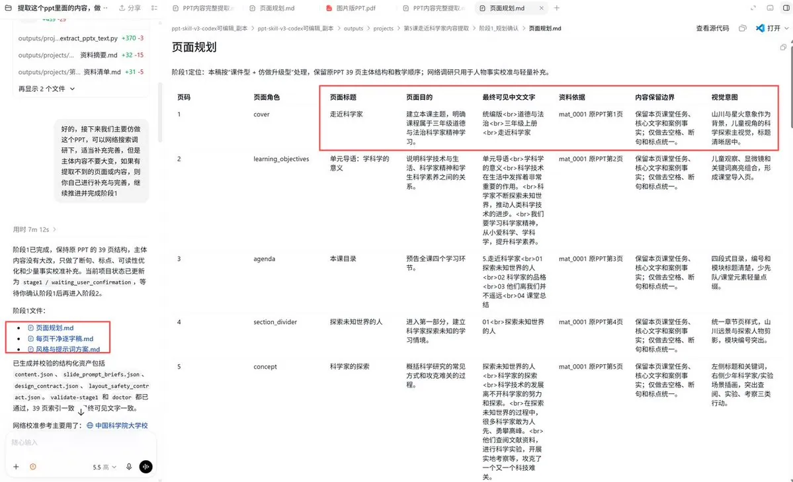

如果想要深度化洗稿内容，就让 AI 逐页分析原稿——每一页的文本、文字、图例之间是什么逻辑关系，先把这套骨架扒清楚。

然后让 AI 重新组织一遍——换一套表达方式、换一种逻辑结构。核心的一条红线是：跟原稿不能重合，但底子里的教学思想、逻辑形式、底层逻辑要保留下来。

最后出来的 PPT，内容层面能跟原版拉开很大差距——既躲开了同质化的判定，质量也立得住。

第二样，是整套 PPT 的视觉风格。

这一步为什么这么关键？因为 AI 有个通病——任务一长就“漂移”，做着做着风格就跑偏了，前几页水墨、后几页突然变卡通。所以必须在开工前就把风格摁死。

风格怎么定？看你手上有没有参考。没有参考图，用大白话描述就行，“我要水墨国风”“我要扁平商务”“我要幼儿园卡通”，它都能领会。

有明确风格或参考图，更推荐一个进阶做法：先让 AI 照着参考图，单独生成一个“风格模板”存下来。

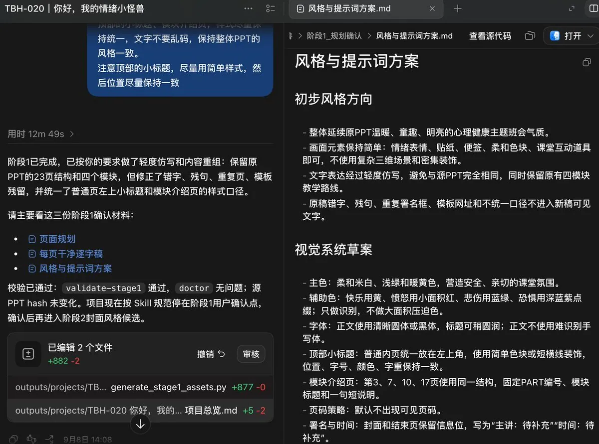

之后不管做多少份 PPT，都直接调用这个模板——这样一来，哪怕是不同的课、不同的批次，出来的视觉风格也能保持高度统一。

这一招，对要成套做、要打品牌辨识度的人特别管用。

阶段 2：图片版 PPT

这一步是真正开始“画”了，也是整条流水线里最烧钱的环节

先说怎么生图——一定要走中转站的 API。

我们生图用的模型是 GPT 的 Image 2.5，选它主要图它一个优点：中文保留得好，不像有些模型一出中文就糊成一团。

如果生成出来的图偏糊，就把出图规格拉到 4K，细节能保留得更足，拿去卖也更经得起放大看。

这里有个坑得提醒你：别用 Codex 内置的那个生图工具。

它不是不能用，是太慢了，根本没法并发——你一次只能干等它一张张出。而我们要的是批量生图，所以必须把生图接到中转站的 API 上，可以控制多个并发任务同时生图，速度非常快。

好在中转站也不贵，一般三分钱左右一张，一份 PPT 几十页算下来，也就块把钱的成本。

再说怎么生——拆成三小步，一步一确认。

为什么非要拆？因为这一步需要大量生图，一旦让它闷头把全套几十页一次性生成完，中间但凡风格或文字歪了，返工就得全套打回重做。所以我们把它切成三步：

- 第一步，定风格。先让它生成三到四张不同风格的封面，你从里头挑一张最顺眼的定调。这一步是为了先把“好不好看”这件事锁死。
- 第二步，出试样。基于选定的风格，先生成前几页做样张，你重点检查三样东西：文字对不对、排版顺不顺、风格稳不稳。有问题就在这几页里改，别急着往下走。
- 第三步，出全套。前两步都过了，才放心让它批量生成全套、打包成 PDF。这一步就可以并发去调中转站了——多张图同时生成，一份 PPT 的图片，大概三五分钟就能全部出完，速度非常快。

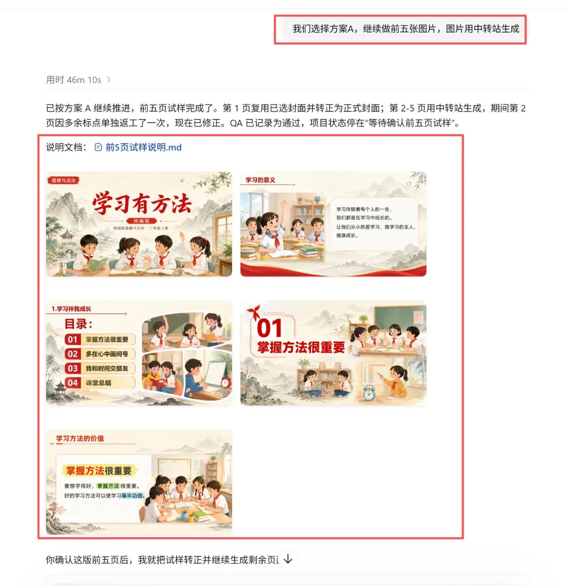

阶段 3：生成附属产物，打包交付

PPT 主体定稿之后，剩下的其实都是“配套的活儿”了——逐字稿、教案、文件打包，这些统统交给 AI 自动生成，你基本不用自己动手。

先是逐字稿。基于已经确认的 PPT 内容，逐页生成讲稿。注意，逐字稿不是把 PPT 上的字照抄一遍，而是“这一页该怎么讲、怎么跟上一页衔接”。

如果做的是 K12 课件，还会同步出一份教案（教学目标、重点、教学过程），这些老师都用得上。

这里有个关键，决定了 AI 出来的东西好不好用：你得先给它套好一个框架。你把整套流程是怎么走的、每样产物大概长什么样，先给 AI 讲明白；再喂它几份质量过关的模板去学。

框架清晰、模板到位，它才知道你要的是什么、照着什么标准出——不然它只能凭感觉写，出来的东西就飘。

全部生成完、你检查没问题之后，最后一步是整理交付。这一步不再产出任何新内容，就是让 AI 把图片版 PDF、逐字稿、教案、页面图片，统一打包成一个干净的交付包。它甚至能顺手帮你传到百度网盘——客户最后拿到手的，就是这个包。整个过程，你基本只负责“验收”两个字。

把这几个阶段串起来看，你会发现一件事：从喂料、规划、生图，到出讲稿、打包交付，这一整套流程，其实都能交给 AI 从头跑到尾。

它不再是一个需要你盯着一步步操作的工具，而更像一个能自己连轴转的 Agent——你把框架和标准给够，它就能顺着流程一路做下去，你只在几个卡点上把把关。

而这套东西之所以能跑起来，靠的正是前面说的 skill，而不是做一个工具。

你要真去做一个工具，工程量大得吓人，做完了还笨重、难改，模型一更新就得跟着返工。但 skill 不一样——它轻，把你的整套工作流“装”进去就行，哪儿不顺手随时调。

这套 skill，会随着你的迭代，越用越顺、越用越值钱。这，才是这条流水线真正留在你手上的东西。

### 最难、也最值钱的一步——转可编辑

说到“转可编辑”，这就是整条流水线里最难啃、也最值钱的一步。课件能编辑，用户才愿意为它掏钱。

而这一步，也是我踩坑最多、花时间最长的地方。

一开始我特别轴，非要自己搞一套可编辑方案。

7 月就开始弄，试了个叫 2pptx 网站的方案，效果不够好，我干脆把它整个重做了一遍；还试过开源的 PPT Master 逐元素方案，一个元素一个元素地定位、填字、校对，极其费 token，一份 PPT 能给你磨上一两个小时。

折腾了一大圈，最后我把自研的那套方案，整个删了。

因为我想明白一件事：能用现成的，就别自己造。 论技术，我们跟那些大厂做工具的团队差得远，非要自己死磕可编辑，只会把整个项目拖得越来越重。与其这样，不如老老实实用现成的三件套：

第一个，WPS

最省、最快，我们的首选。

WPS 的超级会员自带 PDF 转 PPT 的功能（会员闲鱼上买，比官方便宜太多）。

操作也简单：把做好的图片版 PDF 右键，选“PDF 转换”、转成 PPT，品质选超清、引擎选 AI 自动，再切一下“扫描件转换”就行。它走的是 OCR 识别，把图片上的文字、元素扫出来，重新填回可编辑的 PPT 里。

好处是免费、快，而且它是国产的，中文识别好，基本不出乱码，简单的图文课件用它转出来基本够用。

短板是复杂的插画、图表、花哨的艺术字它提取不好，图片里的人物、贴图背景这些也变不成可编辑的，个别地方还得手动精调一下。

第二个，Canva 国际版

效果更好，但麻烦一点。

注意一定得是国际版，国内版没这功能，还得配好网络环境（会员同样闲鱼搜“可画国际版”，图省钱买共享号能转个二十来次，想稳定点就买商业版个人号）。

它的核心是“AI 图层”功能，元素提取能力比 WPS 强，出来的效果也更精细。

但它有个通病：中文经常出乱码，得一页页去改错别字。

好在这活能自动化——用 Codex 接上 Canva，它能一页页对着原文帮你把错别字改过来，用 Workbuddy 的话，要自己接一下 Canva 的 MCP，稍微折腾，跑通了一样能用。

第三个，Codia

效果最好，但最贵。

这是美国一家公司做的，说实话效果是三个里最好的：几乎不出乱码，全部元素都能编辑，基本不用你手动调，连复杂图表都能拿下。

缺点就一个字——贵，转一张大概五至七毛钱（支持支付宝直接充，不用办外卡）。

那到底怎么搭配用？

我的顺序是：

- 先用 WPS 转，简单的它就搞定了；
- WPS 效果不行、或者你要做那种很精美、艺术字很多的（比如幼儿园、小学低年级），上 Canva；
- 实在复杂、带一堆图表、又不想费劲改错别字的，直接上 Codia。

还有很关键的一点：你得先想清楚，客户到底要哪种程度的可编辑。

上课的课件、答辩的汇报，很多客户其实只想改改里面的文字、名字、日期，根本不需要全元素精美可编辑——那 WPS 转个六七成、八成就够用了。

所以宣传起量的时候，我们甚至可以先挂图片版开卖、笔记里标注“可编辑”，等客户真下单了，再动手转，都完全来得及。

### 一天三五十份是怎么来的：很简单，并发

那“一个人一天三五十份”的产能，又是怎么来的？

靠的是并发。你把上面这套流程跑熟之后会发现，真正需要人卡一下的，其实只有阶段 2 生图的时候。

所以我们的做法是：一次性把后面几步的提示词全排进队列，让 AI 自己往下跑；然后开多个窗口，每个窗口跑一个 PPT 任务，同时开工。

一台电脑，一天并发三十到五十份，完全没问题。再配上便宜的调度模型去跑那些重复劳动、挑对便宜又稳定的生图中转站，成本还能进一步压下来。

至于成本，很多人一听“AI 生成”就怕烧钱，其实真不贵：生图一张也就几分到几毛，转可编辑最贵的 Codia 也就五毛一张，一份 PPT 的生产成本加起来，最多也就十几块钱。

## 五、AI PPT 做好了，怎么把它卖出去

PPT 做出来，那只是货。货得卖出去，前面那些生产制作才算数。我们前段时间没花功夫在运营上，一下就囤了几百个 PPT 没人发。

所以卖这一端，我们花的功夫，一点不比生产少。

这一节就掰开说清楚：卖到哪、笔记怎么做、怎么铺到多个平台，还有几条我们踩出来的注意事项。

### 先说卖到哪：店铺走量，私域接定制

销售场域，我们主要盯两块。

第一块，也是我们最看好的，还是小红书店铺。

别看这轮被平台收拾得挺惨，但话说回来，小红书卖模板，依然是最好卖的地方。

用户买虚拟资料不设防、转化链路又短，模板挂上去就有人下单。而且我们现在走的是自己 AI 原创的路子，配上提前申请好的版权文件，基本就绕开了商品违规那道坎，这就是原创加合规给的底气。

第二块，是多渠道分发，把人导到私域，接定制和复购。

店铺走的是量、是低客单的通用模板；但真正客单高、利润厚的定制需求，得靠私域承接。

我们的打法是：在各个平台铺内容、把人引到私域，再慢慢接复购和定制。客单价少则两三百、多则七八百，而且沉下来的都是能反复成交的老客

店铺负责走量拉新，私域负责托底复购，两条腿走路，被小红书封怕了之后，我们就再不敢把命押在一个平台上了。

### 再说笔记怎么做：展示和排版

想在这些平台卖货，第一步是把 PPT 变成一篇篇好看的笔记。一份 PPT 做完，你得把它展示好、排好版、导成一张张图，才能发出去。

很多人就卡在这一步：还在打开稿定设计或者 canva，一张张手动往上拖，特别费时间。

我们为此开发了一个软件，专门用来快速排版 PPT 图片。

里面有一个叫“百变拼图”的功能，提前把每套笔记模板的坑位定义好，工具自动往里填、一键出图，不用再一张张手动摆。原本要磨半天的排版，现在几分钟就出一批。而且还可以快速换不同模板。

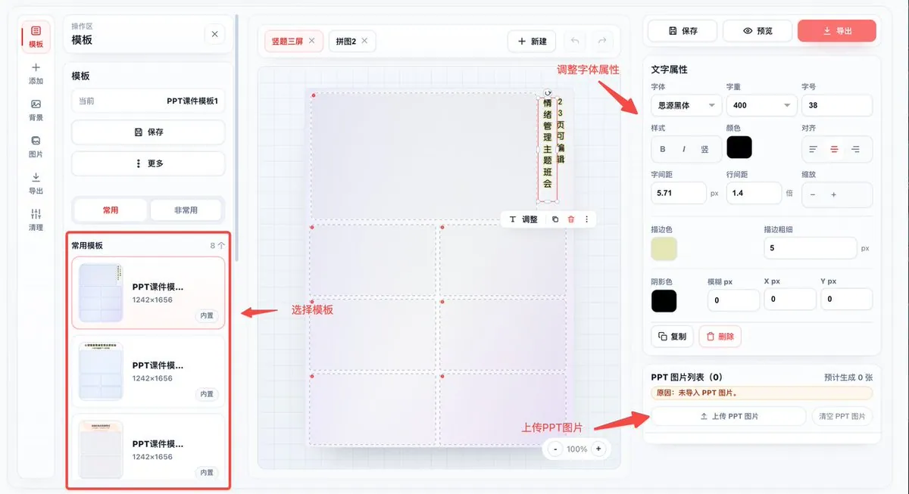

其次还设计了这样的场景化图片排版功能，把你的 PPT 图片放进手机、电脑屏幕或者黑板里，做出逼真的样机展示效果，不需要 PS。

### 然后是多渠道分发

目前为了高效导流私域，我们做了多平台矩阵——一套内容，同步铺到小红书、抖音、视频号、公众号。为这个，我们专门做了一套分发工具。

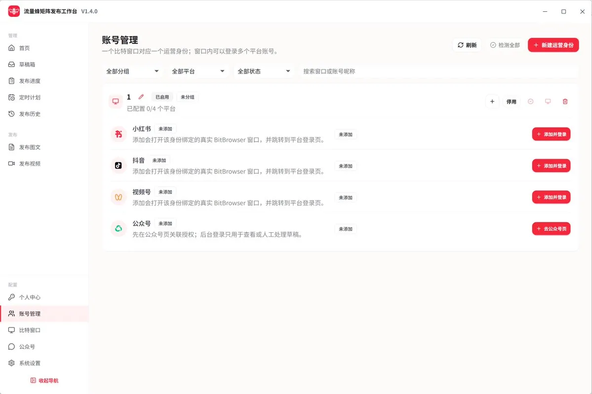

其实市面上不是没有代发工具，我本以为这么普遍的需求，早有成熟工具了，买一个来用就行。结果调研一圈，没一个真能用的。

工具看起来可以发布很多平台，但其实最重要的像小红书、公众号都没有做得很好。

不是功能不够多，而是它们没搞懂两件最要命的事：内容逻辑和风控逻辑。

最典型的就是图省事，直接走后台 Cookie 帮你灌内容。听着方便，其实极其危险。现在平台的关联检测分好几层——设备、网络、账号、操作行为，每一层都盯着。

没处理好，轻则限流，重则封号。我们做矩阵最怕的不是发布失败，是被批量关联，一挂挂一片。

所以我们做工具时，定了一条最核心的原则：拟人化，绝不做无脑全自动。上传素材、填文案这些又杂又累的活，全交给工具和 AI 去干；但最后点“发布”那一下，一定是真人来点。

因为“全自动发布”恰恰是平台风控盯得最紧的行为特征。这么一分工，既快，又安全。

每个账号跑在独立的浏览器窗口里，独立 IP、独立指纹，窗口之间互相隔离。

这样一来矩阵号之间互不牵连，就算一个号出问题，也不会连累一片。

比特浏览器操作也很简单，调它的本地接口，就能直接控制它的窗口和页面操作。

### 几条踩出来的注意事项

第一，别贪多。单个账号一天别超过五到十篇，尽量把发布时间隔开。堆太猛，反而容易被平台风控限流。

第二，一定要多做几套笔记模板轮着发。别老用同一套封面骨架、同一个排版——不然很容易撞上开头说的“同质化”那道坎，被限流。多备几套模板换着来，是躲限流最实在的办法。

第三，也是最关键的，卡准时间节点，在需求爆发前提前铺。很多品是有明确窗口的，比如开学季课件、节日 PPT。你得提前半个月到一个月就开始铺笔记，等旺季一到，正好接住那波流量。像课件的旺季就是开学前后各一周，错过了这一波就得再等一学期。

而且提前铺还有个额外的好处——吃搜索流量和长尾流量。

说个我们自己的真实经历：医护 PPT 的公众号，一开始数据很惨，每天就几个阅读，发了大半个月都没人问，我一度都想放弃了。

但后来它慢慢涨起来了，每天能有几百阅读——而且全是精准的搜索流量，加微信、转化的效率特别高。长尾这东西前期是真熬人，但你只要熬过去，它就是复利。

到今天，从资料收集、到生产、到排版、再到分发，这一整条链，几乎每个环节都交给了 AI 和工具。

剩下留给人的，基本就只有两件事：选赛道与客服。

## 六、那到底该做哪些赛道？又该怎么选？

PPT 这个大赛道，往下能细分出几十个方向，但不是每个都值得做。我先给你我们的结论——推荐几个能做的方向；再教你自己怎么判断、怎么选。

先给个总的判断底色：我们专挑那些还很传统、AI 还没杀进去的方向去做。

同行还在手搓、还在卖老掉牙的模板，我们用 AI 做一版，质量直接甩他们一截，这就是降维打击；哪个方向已经卷得飞起、水位很高，我们就绕开。

### 先说结论：这几个方向可以做

第一个，K12 课件，这是最大的盘子。 小学到高中，按学科、年级、课题能无限往下切，需求量巨大，旺季一天卖上千很正常。唯一要避开的是小学语文——这块已经彻底卷成红海，同行个个加 AI 视频，做起来难度很大.

除了语文，其他科目的同行八成还在卖很传统的课件，全是能用 AI 降维打击的肥肉。缺点是课件要成套做、工作量大，适合能投入整块时间的人。

第二个，医护，全年刚需。 护士医生查房、健康宣教、晋升答辩，一年到头都要用。它的特点是成品需求不大，但定制需求特别猛——淘宝上做医护定制的，头部单店销量能到五万，客单也高。

缺点是有点门槛，你得懂点这个行业、也得会用 AI，更适合本身是医护、或者愿意花时间钻的人。

第三个，大学生 / 高校，主要卖模板。 毕业答辩、开题报告、竞赛竞选、奖学金答辩……一到季节就有大批学生熬夜找 PPT。

就说毕业答辩，一份模板卖了三万七千份，虽然客单才几块钱，但它本质就是几套模板换换颜色，做起来成本极低，特别适合拿来练手、测水。

第四个，职场通用，需求大、客单高。 年终总结、述职、竞聘、工作汇报，全是卖模板的，一份单价能到二三十甚至五十块，头部上万、腰部大几千。

但它有个门槛：职场客户对模板的质量、可编辑程度要求很高，得做精品，对审美和排版有要求，更适合有点基础的人啃。

第五个，节日类，新手练手最佳。 中秋、国庆这种应景的 PPT，有学员一天就能出一两百单。基本都是单份、不用做合集，制作简单，是最适合零基础先赚到第一笔钱的方向。

### 再说方法：怎么判断一个赛道能不能做

上面这几个是我直接给你的结论。但赛道天天在变，你更该学会自己判断。我判断一个 PPT 赛道能不能做，就固定看三步：需求、利润、竞争。

第一步，看需求——有没有人买、买的人多不多。 方法特别土：直接去搜“这个品的名字 + PPT”，比如“年终述职 PPT”，切到商品页、店铺页，看有没有店在卖、卖得怎么样。要是好几家店每天都能出几百上千单，说明需求真实存在；

要是只有一两家卖得好、其他都个位数，说明需求都集中在头部了，你得掂量能不能打过；要是所有店都只卖了几单几十单，那这赛道几乎没需求，直接放弃。

第二步，看利润——最高能赚多少、我大概能赚多少。 找三家头部、三家腰部，分别估一下他们一个月能做多少钱。头部看的是这赛道的天花板，腰部看的是——你用 AI 做出来，大概率能落到的水平。

你别指望一进场就干到头部，但只要腰部一个月能过万，你没经验、老老实实做，搞个五千也不难。反过来，要是连头部都破不了万，那这赛道太小，别进。

第三步，也是最关键的，看竞争——我能不能打过同行。 这一步只干一件事：翻开同行卖的 PPT，看他们做成什么样。

要是像小学语文那样，个个都加了 AI 视频、做得又精又贵，那我打不过，不做；要是像小学道法那样，八成还在卖很传统的盗版课件、画面排版都一般

那我用 AI 做一版，质量直接甩他们一截——这种就是降维打击，放心干。

需求、利润、竞争，就这三步。 如果一个赛道需求大、利润够、同行还很传统，那就是块肥肉，闭着眼做都行。

### 好品从哪找？几个笨办法

判断标准有了，接下来是去哪找品。说白了，你选不到好品，大概率就是因为看得太少。给你几个笨办法：

一是盯同行。 重点盯三种店：做得最好的、做得最早的，还有最近才做起来的新店。老品权重高、你打不过，但新店最近卖爆的新品，往往说明这个方向有新机会，你就可以跟。有个细节：一定要用小号去关注，别用你自己的大号——这些店一看到同行来关注，立马就把你拉黑。

二是看千帆榜单。 后台数据里有笔记排行，看热卖榜和成交榜，专挑里面做 PPT 的品去研究。一周看一次，花不了一个小时。看得多了，你对什么品好卖、市场多大，慢慢就有手感了。

三是让 AI 帮你选。 现在 AI 做选品也很强，你把背景交代清楚，让它把所有 PPT 赛道都列出来、甚至预测接下来三个月哪些品会有需求，它列得又全又准。

但记住一点：AI 能告诉你有哪些方向、什么时候做，却给不了你具体的销量和竞争情况——那部分，还得你自己一个个去看。

### 别忘了：卡对时间节点

选对了品，还得卡对时间。

很多应景的品，比如开学季课件、节日 PPT，都有明确的窗口。

你得提前半个月到一个月就开始铺笔记，等旺季一到正好接住流量。像课件的旺季就是开学前一周和后一周，错过了，这一波就没了。

所以别一有产能就闷头哐哐生产——选品和时间节点，永远是批量生产的前置条件。

最后想说句实在的：别被“卷”字吓退。

除了小学语文那种极端红海，其实 PPT 这个大赛道整体一点都不卷，市场还大得很，旺季一天卖几千真不是什么难事。

而选品这件事，说到底就是个经验活——没什么天赋不天赋，你看得足够多，自然就比别人挑得准。平时没事就多去刷刷同行、刷刷千帆榜单

## 七、大家问我最多的两个问题，一次说清

问题一：现在电子资源类目还能开吗？怎么开？

先说现状：能正常上架虚拟商品的类目，现在基本就剩电子资源这一个了，别的类目大多被堵死了。

以前很多人钻 bug“强开”类目，不用任何资质就能把类目开出来，这条野路子现在彻底没了，之前强开的还被平台一批批回收。但你别慌——官方的正规流程一直都在，条件够，照样给你开。

官方列的条件一长串：账号满 180 天、无违规、笔记 30 篇以上、粉丝过千、近一年有单月流水 6000＋、签承诺函、交保证金、个体执照满一年……乍一看挺唬人。

但你拆开看，这里头大部分——粉丝、笔记、流水——都能想办法补上去，或者直接找代办搞定（电子资源代申请也就 70 块）。

真正你自己绕不过去的硬门槛，其实就三个：账号注册满 180 天、店铺没有违规记录、个体店的营业执照满一年。

补一句：其实不开店也能卖。你把账号升级成个人专业号就能开个人售卖，不用审核、不用交保证金，一样能自动发货、用网盘交付。缺点是不能投流、数据分析也糙一点，但拿来给新手把整个闭环先跑通，反而特别合适。

问题二：我用 AI 二创别人的 PPT，会不会被投诉？

这事得看你二创的是什么。那些很传统、很老旧，卖盗版都没人管的 PPT，你二创它，基本也没人管。

真正容易被投诉的，是你去二创那些本身就做得很精、很用心的作品——而且你只是换了个壳、把封面标题改改，内容骨架跟人家一模一样。

破解办法就一个：别做“换壳”，要做“重做”。

在做 PPT 的流程前两步——资料整理和页面规划——你就得让 AI 基于原内容和提供的电子课本等原始材料，再加上网络搜的资料，重新原创一版，把内容改到跟原版有五成到八成都不一样。

目录、内容千万别跟人家一模一样（标题撞了倒无所谓，那很正常）。这样改出来，对方基本举报不到你。

做完了，你还可以去地方版权局申请个版权，多一层保障。

真万一被投诉了也别慌，让 AI 帮你写段申诉话术，态度诚恳地说明你重新设计过，并且有自己的版权文件，并非搬运抄袭，一般都能捞回来。

写到这，也该收尾了。

这门生意听着一点都不性感，甚至有点无聊。

但真正赚钱的项目，往往就是这么无聊——找一个能一直卖的产品，持续做流量

然后复制、放大，一年、两年、三年，回头一看，一个当初平平无奇的小生意，已经滚成了一个不小的盘子。

我一直很信一句话：“年入千万，中人之姿即可。”

它说的不是这事有多容易，而是——它要的从来不是过人的天赋，而是一个正确的模型，加上把对的事重复足够多次的耐心。

从 0 到 1 最难，从 1 到 10 靠复制，从 10 到 100 靠规模。而我们现在，也不过是刚刚跨过最难的那一步。

非常感谢你看到最后，希望你能有所收获👋

以上内容共 1.3w+字，都是自己的真实经验分享，如果你觉得内容有价值，还请点个赞，非常感谢！

## 相关页面

- [[sources/hytidel-xiaohongshu-ecommerce-operations-and-10x-scaling]]
- [[sources/jessicao-xiaohongshu-0-to-1-operations-guide]]
- [[concepts/selfmedia-compound-model]]
- [[concepts/b2c-conversion]]
