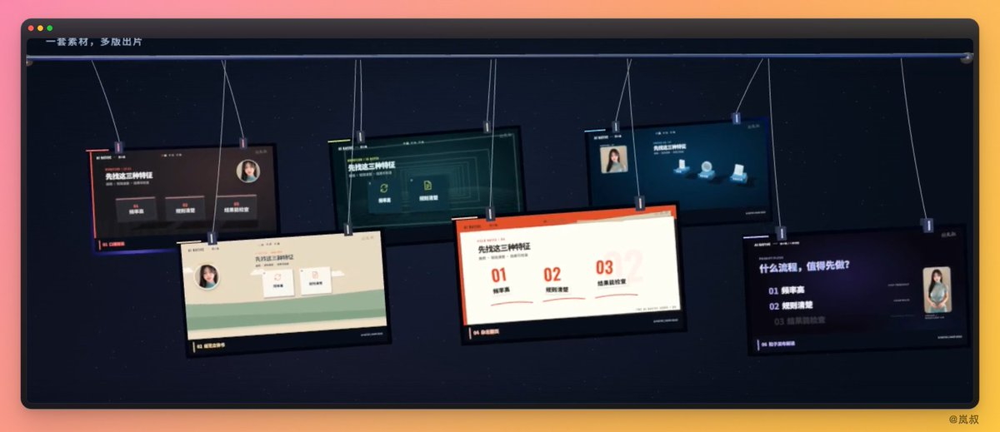

# 岚叔：保姆级无限流数字人口播教程及项目正式开源

> 一次性捏好人物底片→切成动作镜头库→后续每条视频只花几块钱配音+口型，人物底片无限复用。开源地址：lanshu-infinite-stream-koubo。6 个版本后可排宫格、悬挂落片、视频雨、魔法环阵。配套参考：lanshu-create-ai-presenter-video。

<!-- more -->

兄弟们，做数字人口播，真别再傻乎乎地每条都从头抽卡生成视频了，那个烧钱法谁顶得住😂

如果我跟你说：只需要一次性捏好一套人物底片，以后不管发 100 条还是 1000 条视频，永远不再花一分钱的视频生成费，平时日更，只需要花几块钱跑个配音、改个口型，剩下的全靠本地剪辑和套模板白嫖，甚至一条片子花几块钱就能裂变出 6 种大片质感的花活儿……

这就是我们最近跑通、且正式开源的：无限流数字人口播：lanshu-infinite-stream-koubo ，开源地址见文章底部

## 为什么叫“无限流”？

以前大家做 AI 数字人，换篇稿子就得重新调视频大模型生成一遍人物，又贵又慢，动作还经常抽风。

我们的思路直接反过来：把“生成视频”变成一次性基建。

前期只花一次成本，用视频模型捏好一套高清人物母片，按动作、表情、景别切成碎段，存成一个“动作镜头库”。

从这往后，你再做任何新视频，彻底告别高昂的视频生成费用：

换新稿子了：直接从镜头库里像抓药一样挑动作、拼镜头，再去配个音、把露脸说话的片段对个口型就行，人物底片无限复用。

同一篇稿子想换风格：那更爽，连配音和对好的口型都直接复用，挂上不同的剪辑 Skill（模板），本地直接渲染出新片，**新增模型生成成本：0**。

更爽的！哪天某类动作看腻了：单独补几条新切片塞进库里，库就越滚越大。

为了验证这套“无限流”到底多能打，我们专门拿一段 1 分 49 秒的口播做了个极限压测案例：

用同一套底片、同一段口播，我们没多花一分钱生成费，一口气在本地剪出了 6 种完全不同的视觉风格；完了还不算，又把这 6 条成片当素材，拼成了视频雨、悬挂落片、魔法环阵……

先给大家算笔实打实的账：

这 1 分 49 秒的 6 版成片，不算前期建底片库的固定资产，单算这期内容的消耗：正式配音+一次局部补录，花了 40 个 Renoise 积分；口型算上中间返修共跑了 92 秒，按百炼[公开标价](https://help.aliyun.com/zh/model-studio/acoustic-portraits-videoretalk) 0.08 元/秒来算，也就 7 块 3 毛 6。

因为配音和口型是 6 版共用的，后面所有的换包装、加动效、空间混剪，全在本地跑，模型费用直接归零。也就是说，花 7 块多钱，干出了 6 条精装口播！

这次整套活儿基本是让 Codex 串起来的：

先通过 Renoise 调 Wan 3.0 生成人物母片，用 Seed Audio 1.0 配音；再通过百炼的 `bl` 工具调 VideoRetalk 对口型；最后全交给 Codex 排镜头、写动效、剪辑渲染。我主要负责当甲方——提要求、看成片、挑刺，然后打回去让它重改。

能这么低成本玩出花来，核心在于这套流程可以无缝接各种现成的口播 Skill。这次主要用了和参考了这几套：

lansu-infinite-stream-koubo：我们这套无限流的核心底座，管母片、切片打标、按文案挑镜头、派发口型任务，以及最后的检查导出。

talking-head-editor（来自 Renoise）：借鉴了它的口播精剪逻辑、按句子排画面、字幕花字、画中画和信息图展开。用这套规则做出了“口播精装版”。

[lanshu-create-ai-presenter-video](https://github.com/cclank/lanshu-create-ai-presenter-video)（来自岚叔）：里面多种风格视频可以直接用，我们这次取了里面的纸艺立体书风格，让纸页、卡片、人物照片跟着讲解一层层翻开。

[digital-human-koubo](https://github.com/andyhuo520/digital-human-koubo)**（来自神佬）：借了它的 C 发布解读模板和动效组件，用来做粒子聚字、文字爆散、文档聚焦和滚动数字。

后面这几套 Skill，我们主要把顺眼的分镜、版式和动效扒下来，直接套在已有的切片和音轨上。至于空间长廊、杂志翻页、全息流程工厂，则是做着做着顺手发散出来的野路子。

## 具体怎么把这个“无限流”运转起来？我把跑通的 6 步拆给大家看：

1. 攒一套一劳永逸的人物母片

使用我们的开源项目：

先用参考图把人固定住，衣服、背景、打光和机位全部统一，再用 Wan 3.0 生成近景、中景、带温和手势的素材。这里有个关键经验：脸和嘴一定要清楚，而且每次做完手势尽量让人物回到最开始的稳定姿势，这样后面随便怎么抽出来接镜头都不会跳。

2. 切片入库，把表情动作标清楚

顺着动作和自然停顿切成小碎段，把景别、眼神、表情、手势，还有适合从哪切入切出都记下来。哪段适合干讲、哪段适合强调、哪段做过渡或收尾，分门别类放好。

这块我们前面踩过坑：台词明明在很严肃地讲事，画面里的人突然莫名其妙笑一下，或者眼珠子往旁边乱瞟。后来老老实实重新筛片、卡准入点，看着才顺眼。前期建库时切片挑得准，以后每次做片能少返工无数次。

3. 每次出新片：先定文案和配音，锁死时间轴

这次用的是 Seed Audio 1.0 的克隆音色。配完先核对台词，有漏字或者读错的地方，不用整段重来，局部补录完拼回原音轨就行（比如案例里漏读了“合同初审”四个字，就是这么打补丁修好的）。

声音一定下来，时间轴就锁死了，后面的字幕、镜头、动效全跟着声音节奏走。哪怕后面怎么换外包装，底子的节奏都不会乱。

4. 按文案抓药排镜头，只给露脸片段对口型（省钱关键！）

先排好哪里让主播露脸讲，哪里直接上全屏图解。从切片库里挑好素材后，**被全屏图解盖住的时间，压根不用浪费钱跑口型**；只有真正露脸开口的片段，才丢给 `bl` 处理（所以 109 秒的视频我们只跑了 92 秒口型）。

注意如果有裁剪时长或者变速，一定要在对口型之前弄完。等口型对好了，再去搞人物缩放、挪位置、套圆形小窗，避免嘴型和声音错位。

5. 套上喜欢的 Skill，零成本换剪辑和动效

素材和声音都齐了，接下来就是围着同一段内容换皮肤：纸艺展开、科技感流程、杂志翻页、粒子文字，随便折腾。

画面调度也是跟着内容走的：重点句子推近景；讲复杂逻辑时让图解占满主画面，主播缩成小窗；提到具体数字、关键词、合同条款时，再把对应信息弹出来。

顺便避个坑：我们试过把人物抠像，结果头发丝和肩膀边缘老留残影。后来干脆保留原背景，把人物做成竖窗、照片或者空间里的视频卡片，画面一下子稳多了。想要立体感，就靠真实的透视、前后遮挡、打光和相机运动去凑。

6. 合成、通看检查、导出

最后把口型片段、动效、字幕、音乐和音效合起来，拉平音量。重点检查嘴型、接缝、人物表情、文字遮挡和转场，从头到尾放一遍没问题就导出。

这次导出的成片是 16:9、720p、50fps。6 个版本做好后，又能直接当成新素材，排宫格、做悬挂落片、下视频雨，或者围成一个魔法环阵。

大家换上自己的人物和文案，就能顺着这套方法无限续杯了：一套底片反复薅，每次只出几块钱配音口型费，风格随便换，哪种画面好玩就往哪种做。

这回，省成本和花里胡哨，真可以全都要😂

开源地址： https://github.com/cclank/lanshu-infinite-stream-koubo

## 相关页面

- [[sources/pluvio9yte-talking-head-digital-human-action-spec]]
- [[sources/leaf-sanren-seecut-video-pipeline]]
- [[sources/awe0-video-talkcraft-ai-promo-pipeline]]
