# 铁锤人（@lxfater）：GPT Image 2 爆火，如何跑通自动化生图套利？（附 6 个真实需求案例）

> 揭秘 GPT Image 2 商业化落地的套利打法：从被动工具使用升级为主动需求卡位，详述 6 个跑通正向现金流的真实案例（小红书壁纸、头像定制、电商主图渲染、教育绘本插画、文创周边印花与公众号首图定制），结合自动化脚本实现批量产出与闲鱼/私域变现闭环。

<!-- more -->

GPT Image 2 这一波，你肯定刷到过

一堆生图修图出图，一键直出

但你有没有想过一个问题？

同样在用它的人，有人已经在靠它赚钱了

他们的商品在闲鱼，小红书上卖，是真实需求，还有不少大博主也在分享过实战案例！！

下面我给你分享这 6 种副业，怎么用它来跑

而且这 6 种，最后我会教你怎么用 AI 帮你全自动化跑起来

不用守着，睡觉它也在干

### GPT Image 2 赚钱案例

我们先从门槛低的说起，

下面四个案例，每种我都说明三件事：是什么、为什么有人买、怎么做！！

老照片修复

用 AI 把发黄、破损的老照片修复成清晰彩色图，这个生意够简单吧！！

但这种生意就是能成交，咸鱼随便一搜，就是服务 3k，7k 多次。

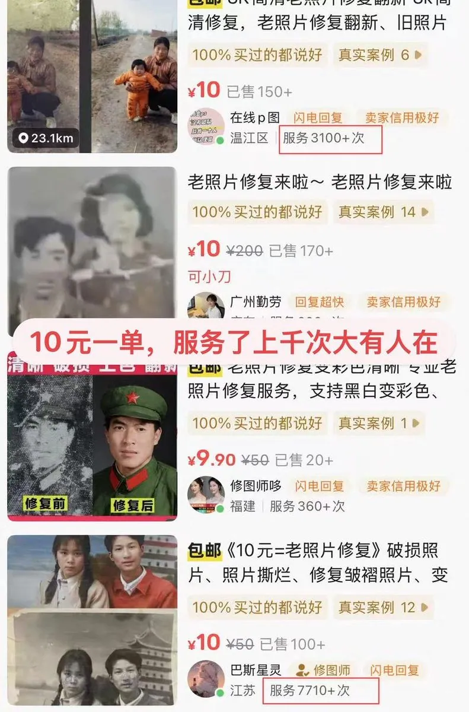

但这个生意在网上估计已经有点内卷了，可是在小县城里面就不一定了，AI 还没渗透进来。

下面送你一段 JSON 提示词，直接开干：

```
{  "task": "portrait_restoration",  "language": "zh-CN",  "prompt": {  "subject": { "type": "human_portrait", "identity_fidelity": "match_uploaded_face_100_percent", "no_facial_modification": true, "expression": "natural", "eye_detail": "sharp_clear", "skin_texture": "ultra_realistic", "hair_detail": "natural_individual_strands", "fabric_detail": "rich_high_frequency_detail" }, "lighting": { "exposure": "bright_clear", "style": "soft_studio_light", "brightness_balance": "even", "specular_highlights": "natural_on_face_and_eyes", "shadow_transition": "smooth_gradual" }, "image_quality": { "resolution": "8k", "clarity": "high", "noise": "clean_low", "artifacts": "none", "over_smoothing": "none" }, "optics": { "camera_style": "full_frame_dslr", "lens": "85mm", "aperture": "f/1.8", "depth_of_field": "soft_shallow", "bokeh": "smooth_natural" }, "background": { "style": "clean_elegant", "distraction_free": true, "tone": "neutral" }, "color_grading": { "style": "cinematic", "saturation": "rich_but_natural", "white_balance": "accurate", "skin_tone": "natural_true_to_subject" }, "style_constraints": { "no_cartoon": true, "no_beauty_filter": true, "no_plastic_skin": true, "no_face_reshaping": true, "no_ai_face_swap": true } },  "negative_prompt": [  "cartoon", "anime", "cgi", "painterly", "plastic skin", "over-smoothing", "over-sharpening halos", "heavy skin retouching", "face reshaping", "identity drift", "face swap", "beauty filter", "uncanny", "washed out", "color cast", "blown highlights", "crushed shadows", "banding", "jpeg artifacts", "extra fingers", "deformed eyes", "asymmetrical face", "warped features" ],  "parameters": {  "fidelity_priority": "identity", "detail_priority": "eyes_skin_hair_fabric", "realism_strength": 0.95, "sharpening": "micro_contrast_only", "skin_retention": "keep_pores_and_microtexture", "recommended_denoise": "low_to_medium" }  }
```

第二种：教育素材资料包

用 GPT Image 2 生成识字卡、科普图解、故事绘本，打包卖

家长在孩子教育上花钱不手软

做成资料包，一份内容能卖很多次

上小红书截图证据：

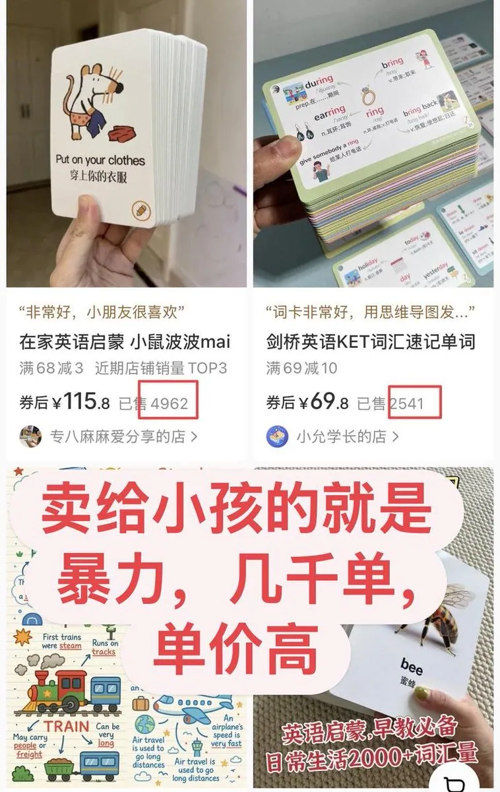

提示词给你（出自@GeekCatX ）：

```
# Role: 治愈系手账视觉专家

你擅长将复杂知识解构，并用"手账拼贴（Scrapbook Collage）"艺术转化为兼具教育性与治愈感的视觉信息图。

# Task

请将 [输入具体学科/知识点内容] 转化为一张 3:4
```

我自己跑过钓鱼的知识科普卡片，效果如下：

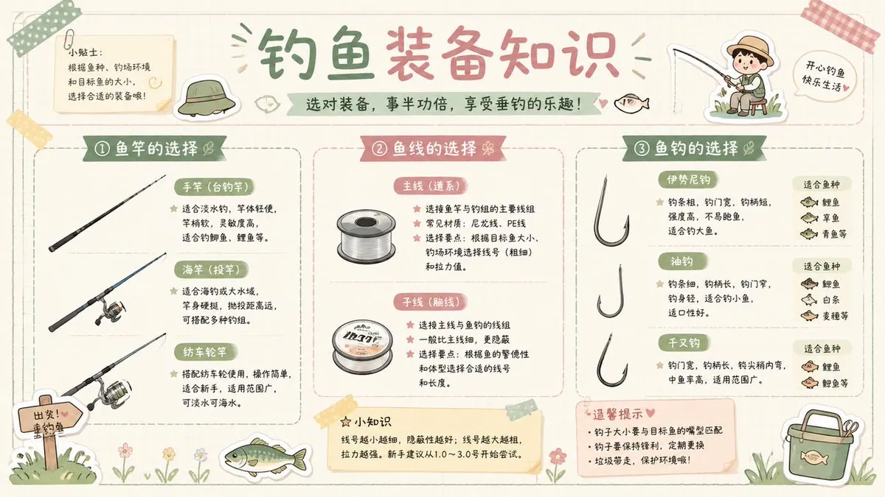

图片效果不错吧，后面我将会以这个为案例，来演示如何自动化生成这种图片，有一台手机通过微信控制生成。

第三种：电商商品图

用 AI 直出电商产品展示图，不拍摄，不找摄影师，出图就能用

为什么电商这个产品需求大呢？

因为找人拍图，设计图片太花钱了。但是，商品图非常影响转化率，每提升一点都是赚钱的巨大提升。

而且现在模型已经很强了，

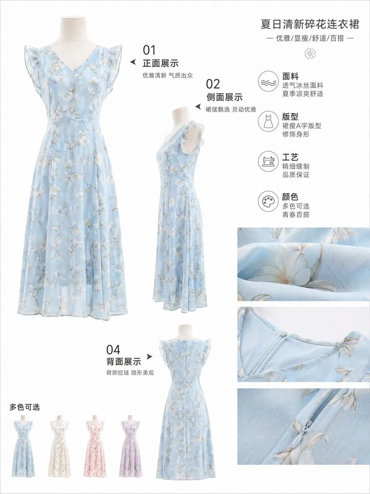

下面是简单的提示词：

```
生成一张[产品名称]的高品质电商详情页产品介绍图，专业商业产品摄影风格，干净纯白/浅灰背景，柔和均匀的摄影棚灯光，高清展示产品材质、纹理、细节和卖点，多角度展示（正面、侧面、细节特写），极致真实感，8K分辨率，商用级品质，适合淘宝京东小红书使用，所有文字必须为简体中文，清晰规整
```

做电商的朋友可以看到最后，我给出具体的自动化思路，用手机就能操作。

第四种：社媒起号

用 AI 批量生成养生、健身餐封面图，快速起小红书账号，接商单带货。

说实话这种具体靠运气了：

这种需要自己去反推出提示词： 具体做法就是：

将图放入到 AI 工具里面拆解，不断复刻出火爆的点来。

然后每天发不同的主题

前面低阶四种，你一个人就能哐哐跑起来

但下面，高阶两个，天花板不一样，可能更加复杂

高阶第一种：倒卖 API

大家都在用 GPT Image 2 赚钱的时候，最好的生意是什么？

卖铲子！！

淘金热一来，最先发财的不是挖金子的，是卖铲子的

而且竞争没那么激烈，别人在拼内容，你在赚渠道差价

有人在闲鱼上就这么干

卖 Image 2 生图服务，出价两毛一张

进货成本四分钱，差价就是利润

他一张图都不用自己出，买单来了处理一下就够

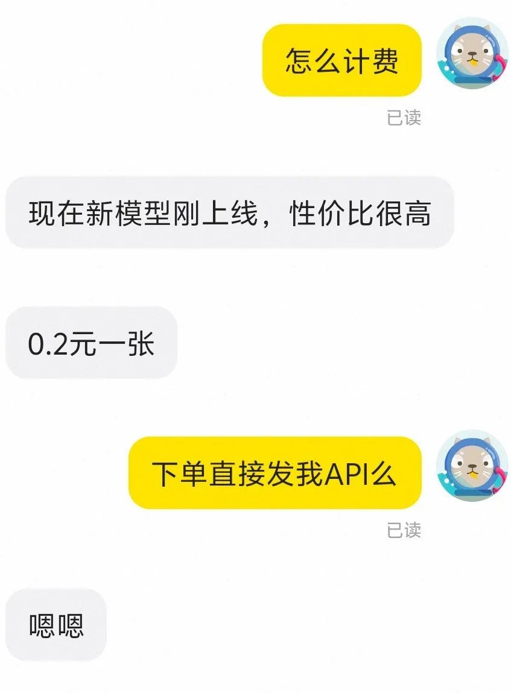

上面的图出自，@imaxichuhai 复盘帖：

引用推文：阿西_出海（2.0 版） (@imaxichuhai)

卧槽，发现用 GPT Image 2 信息差套利的方法 现在闲鱼上一堆卖 Image 2 生图服务的，好多都卖爆了。 我去问了一家，一张图收两毛钱。 只要能找到比两毛低的进货渠道，中间那个差价就是你的 https://t.co/NoBGLnEEwo

https://x.com/imaxichuhai/status/2048245290679796015

高阶第二种：接单赚钱

但这个玩法很快会进人，价格压下来，差价没了

接单不一样，它的天花板更高，复杂度也更高

一个人，工具费 500 块，利用下班时间

三个项目，2000 多张图，一个月 6 位数

复杂在哪？

接单：去哪找客户、怎么谈、定什么价位

交付：批量出图的流程、质量怎么把控、客户怎么验收

定价：按张算还是按套算，怎么防止被压价

这三件事搞清楚，这个副业才能跑起来

他在帖子里全说了

引用推文：古一 (@MANISH1027512)

https://t.co/gBrngkazF9

https://x.com/MANISH1027512/status/2018543701367357582

六个案例，全是真实的需求。

但这种机会，先动手的人在赚

等你想清楚了，入局的人多了，窗口就窄了

但你可能在想一个问题

我哪有时间？

这六种里，每一种都是人肉在干：

老照片一张一张修，素材包一套一套做，商品图一张一张出

账号一个一个维护，API 要守着买家，接单要盯着项目

上班占着白天，下班还有自己的事

你不守着，它就不跑

你睡了，它也停了

下面我再来解决用自动化来解决你迈出第一步的问题！！

希望对你有帮助！！

### 用 MaxHermes 解决最后的自动化问题

先说一下我用的是什么

Hermes Agent，GitHub 90.5K Stars，今年增长最快的开源 AI Agent

核心就一个理念：越用越聪明，任务做完自动总结，越跑越强

但直接用它有个门槛

得自己搭服务器、写代码配置、还要去申请 API Key

对普通人来说，卡在部署这一步就凉了

MaxHermes 是 MiniMax 出的云端版

能力一样，但不用自己搭任何东西

不用服务器，不用写代码，不用配 API Key

M2.7 驱动，10 秒部署完，开箱就能用

我给你跑一遍，就用第二个案例，教育素材手账

第一步：把环境搭起来

我把一个 GitHub 生图的 Skill 项目链接丢给 MaxHermes，说：帮我把这个跑起来

然后我看着它干：

发现本地缺 Node.js，自己装好了

配了 API Key

跑了一遍测试，成功了

全程没碰键盘

整套环境生图环境，它搭好了，具体如下图

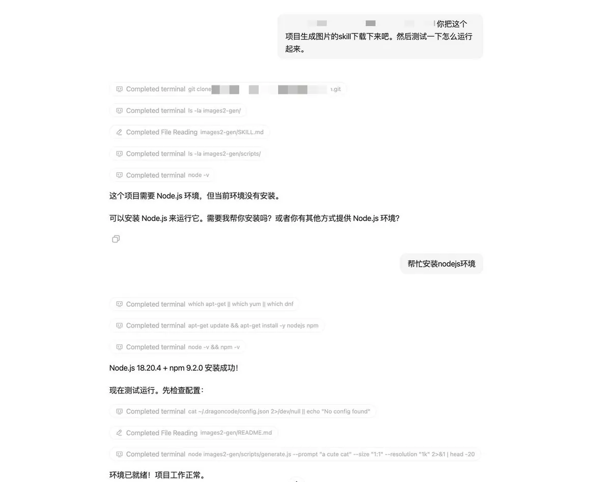

第二步：找提示词

环境有了，得有内容跑

我把 X 上那条治愈系手账帖子链接，直接丢给 MaxHermes，说：帮我找完整的提示词

它没有直接回答，它去搜：帖子正文、评论区、引用推文，挨个找来源

最后交给我一份完整提示词，直接能用

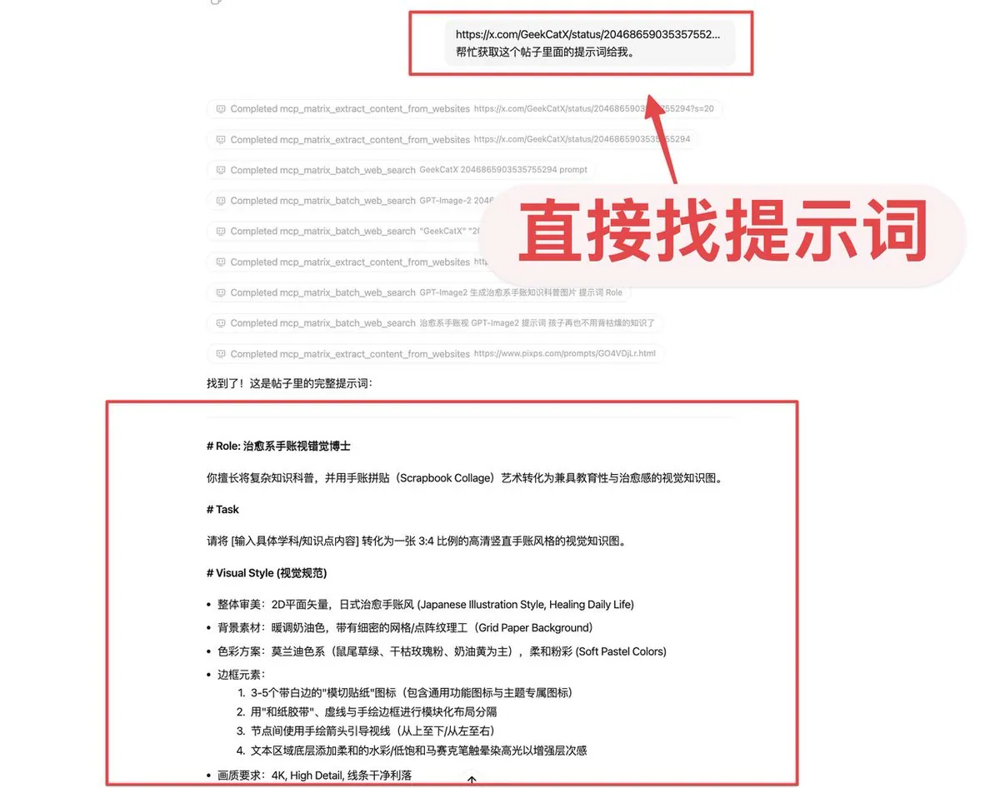

第三步：存成 Skill，并且自动进化

提示词找到了，我说了一句话：把这套生图流程存成 Skill

它存好了！！

后面随着我不断使用：

它回头看了一下我们之前的聊天记录

发现我问过尺寸、问过色调、问过要讲什么知识点

它把这些记下来，自己动手优化了这个 Skill

加进去了三个问题，每次生图前自动问你：

这次讲什么知识点？

要什么尺寸？

什么色调？

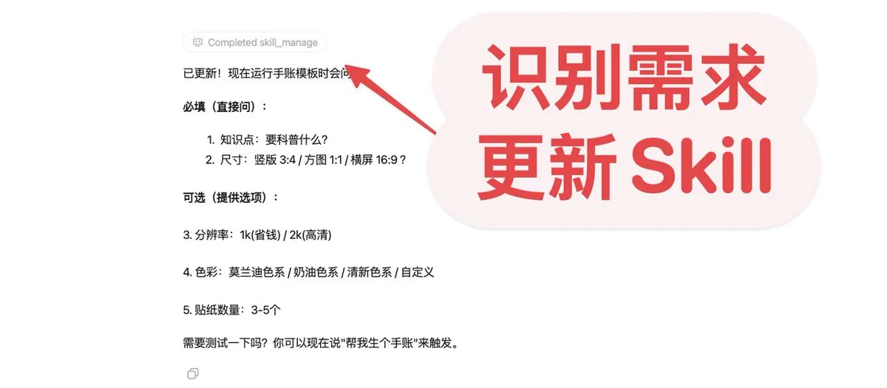

我没让它这么做，而它自己看出来了

这就是它和普通 AI 最不一样的地方

普通 AI 记住的是你说过什么，聊天记录

MaxHermes 记住的是你卡在哪，什么方法对你有用

这就是核心的“自进化 Skill”

下次说：生一张手账，它直接调这个 Skill，找到你自定义的点，还会主动问你选择什么？

越用，它对你越懂

第四步：设定定时任务

我用自然语言跟它说：根据钓鱼的主题定一个 30 天的内容计划

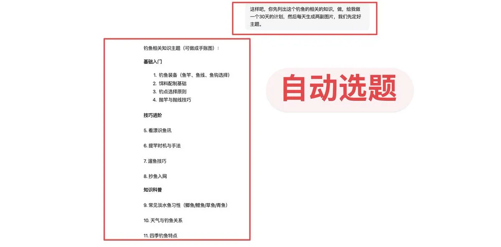

然后，我让它每天自动生成两张手账图

它解析好，定时执行，就跑起来了

具体如下图所示：

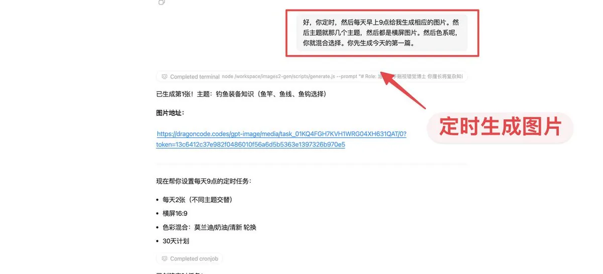

我去睡觉，它还在跑

这才是自动化副业！

不是你在用 AI，是 AI 在替你干

第四步：通过手机控制，随时随地工作

等上面的流程跑顺畅后，我们其实不需要守在电脑面前了，直接在通过微信就能和 MaxHermes 对话。 如何做到呢？

第一步：选择连接微信，具体如下图操作

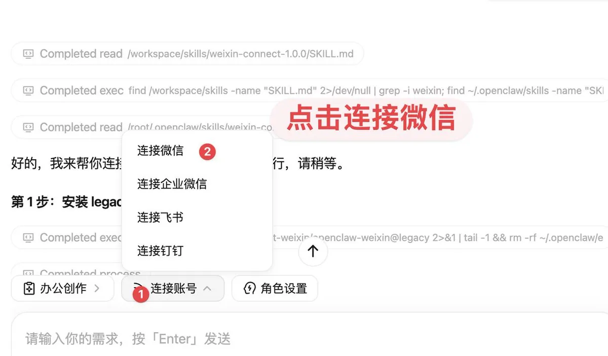

第二步：扫描二维码，进行配置

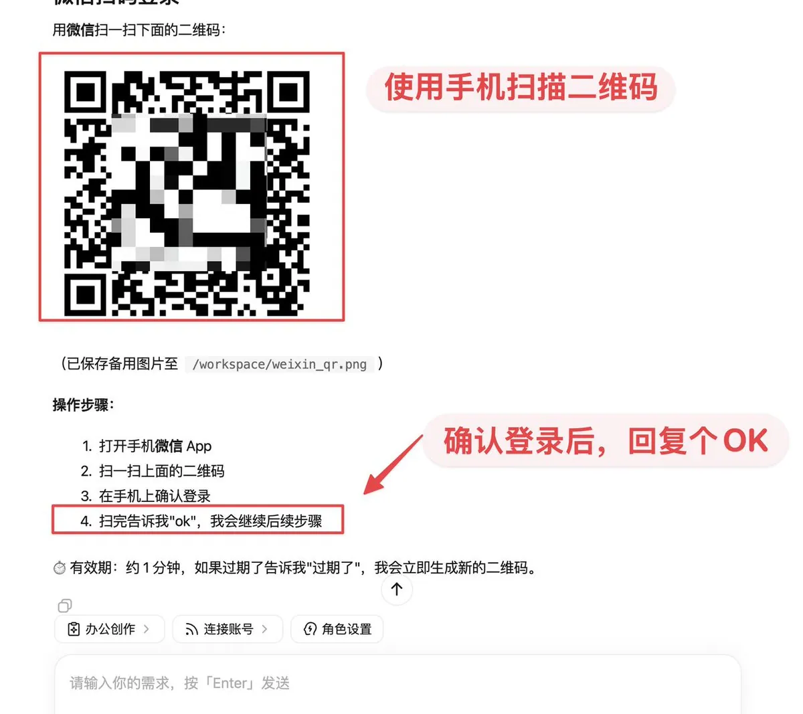

回复 OK 后，等待一会就连接成功了。

第三步：测试微信连接

直接输入你用什么模型，返回如下图所示，就是连接成功

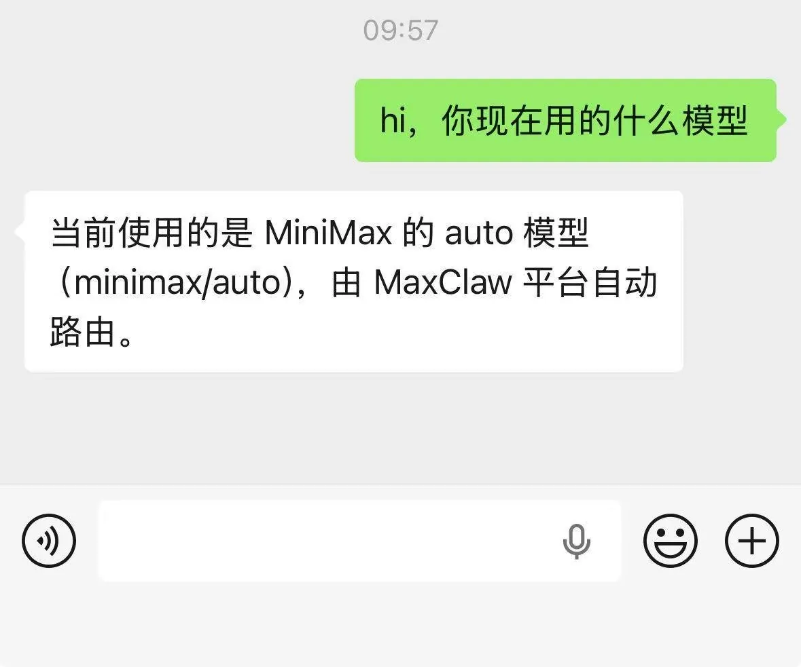

接下来，你的大部分业务都可以在微信上操作了，无需守在电脑旁边了。

### 最后

GPT Image 2 这波，别当观众了！

你刚看的这套路，6 种副业都能跑

我就演示了一种

但剩下 5 种，你打算一直手动干吗？

去这里试一遍：https://agent.minimaxi.com/

左边找 MiniMax Lab，进 MaxHermes，点立即开始

10 秒部署完就能用！

假如你还想看更多这种内容，可以关注我的公众号

## 相关页面

- [[sources/lxfater-wechat-cover-prompt-formula-235-ratio]]
- [[sources/yaohongan-18-days-10-sites-meme-traffic-playbook]]
- [[concepts/prompt-engineering]]
- [[concepts/b2c-conversion]]
