# 铁锤人（@lxfater）：Hermes Agent 工作流——用顶级 AI Newsletter 构建第二大脑

> 利用 Hermes Agent 与网易龙虾邮箱搭建的自动化 Newsletter 学习流：自动订阅海外顶级 AI 简报、解构长篇邮件并抽取关键知识点、沉淀至本地向量知识库，解决信息过载与知识消化不良问题。

<!-- more -->

每天出新东西，你也每天在刷

但关上手机那一刻：什么都没进脑子

刷了那么多，说不出自己学到了啥

AI 越来越聪明，你越来越像个局外人

这不是你不够努力，是大多数人学 AI，从一开始就把劲儿使错了地方

我有段时间也是这样，直到我把学习方式彻底反过来

把这套方法跑在 Hermes Agent 上之后

学 AI 这件事，变了，甚至我的文章输出变好了，连续出了 18w，17w，86w 的文章：

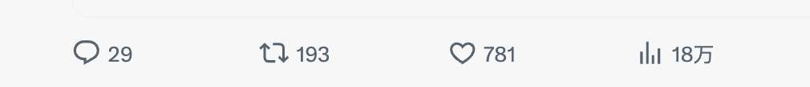

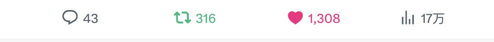

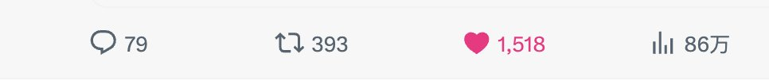

今天，这篇把完整工作流拆给你：

第一步：换掉信息源（顶级 AI Newsletter 清单，从 50+里筛出来的）

第二步：让 Hermes Agent 每天替你筛选消化，构建第二大脑

第三步：倒逼出能打的输出

再也不怕学不动 AI！！

下面，我们先说如何让 Agent 阅读到高质量 AI 信息源！！

## 换信息源，用 Hermes 构建获取管道

让 Agent 能通过 newsletter 的方式获取到高质量信息，我们就必须安装下图一步一步进行配置。

当然配置完毕后，你对邮件信息的处理能力将从原始时代提升到火器时代。

下面整个工作流的示意图：

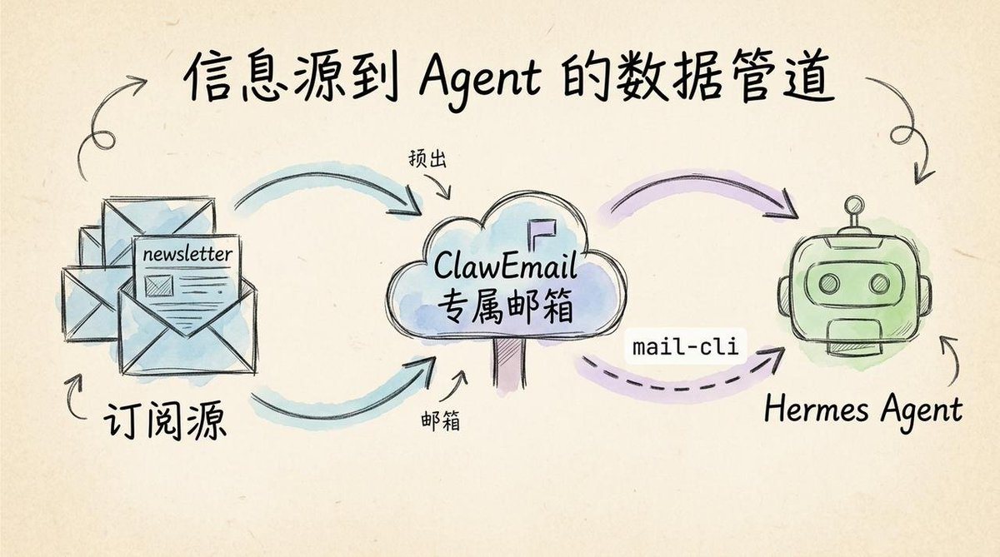

配置之前，我们需要聊一个很重要的事情。

### 高质量 AI newsletter 清单

没有好的信息源，我们学到的只是噪音。下面这些 newsletter 是我半年里从 50+ 源里筛下来的高质量信息源，希望对你有帮助。

- The Rundown AI（therundown.ai）：每日 AI 产业动态，通俗易懂、密度高

- TLDR AI（tldr.tech）：5 分钟科技简报，AI 加编程加产品精华浓缩

- The Neuron（theneurondaily.com）：面向非技术读者的 AI 日报，3 分钟读完

- Ben’s Bites（bensbites.com）：Ben Tossell 的 AI 日报，工具圈消息源

- Latent Space（latent.space）：swyx 开发者简报，未公开项目加工程视角

- Smol AI News（smol.ai/news）：Discord、Reddit 等 AI 社区圈内直击

- Interconnects（interconnects.ai）：Nathan Lambert 的 RLHF、模型训练深度专栏

- One Useful Thing（oneusefulthing.org）：Ethan Mollick 的 AI 实用洞察（学术加工作场景）

- AI Breakfast（aibreakfast.beehiiv.com）：每周一份 AI 新闻早餐，系统回顾加深度讨论

- Every（every.to）：科技与商业的下一步，资深专家战略分析

你可能会问：为什么不看国内公众号信息？

AI 这种变化快的赛道，真正有信号的源头全在海外 newsletter。公众号被洗稿一层一层过滤，你看到的时候已经是二手信息。

学东西，垃圾进垃圾出，源头得把控好！！

接下来，我们构建 newslatter 信息到 Agent 的管道，让最高质量的人类信息和我们的 Agent 接触！！

### 第一步：给 Hermes 配置邮箱

为了构建这套系统，我们首先得给 Hermes 配置一个邮箱，这样才能收到前面的 AI 高质量信息源的邮件。

那具体如何给 agent 申请邮箱呢？

打开 https://claw.163.com/?channel=lxfater（网易邮箱新出的 Agent 专属邮箱产品），报名内测（填平常你的邮箱），等邀请码邮件。

因为在内测阶段，需要输入可以用我的专属激活码：CLAW3C02D3891B6C( 邀请码使用上限 200 次，先到先得)，然建主邮箱，比如 [XXXX@claw.163.com](mailto:lxfater@claw.163.com)，

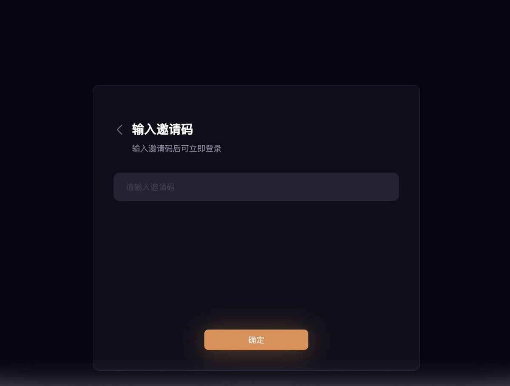

但这还没完，为了让 Agent 能使用它的邮箱，你必须安装一个工具！！

### 第二步：装 mail-cli，让 Hermes 有眼睛

一旦你安装完 mail-cli 后，Agent 能读邮件、能搜关键词、能拉正文，邮箱正式变成 Agent 的输入管道

如何做呢？

终端按顺序敲这 4 条：

```bash
# 1. 全局安装 mail-cli
npm install -g @clawemail/mail-cli

# 2. 把 API Key 写进系统钥匙串（上一步在 Dashboard 拿的那个）
mail-cli auth apikey set ck_live_xxxxxxxxxxxxxxxx

# 3. 登录主邮箱
mail-cli auth login --user lxfater@claw.163.com

# 4. 测试连接通了没
mail-cli auth test
```

上面缺失 ApiKey，可以按下面获取方式获取：

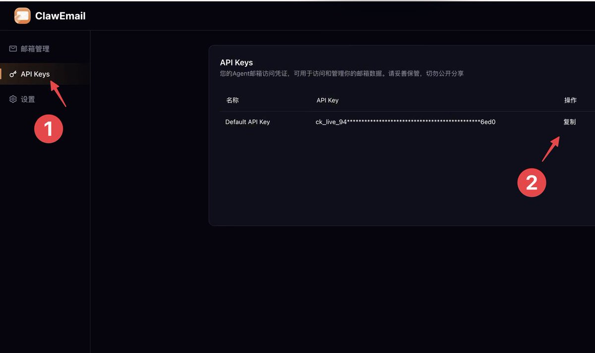

同时为了让 Hermes 学会使用 clawmail，我们在 Hermes 简单输入下面提示词：

```
https://claw.163.com/projects/doc/ 阅读这个CLI文档，然后制作一个Skill来专门来操纵这CLI。
```

利用 Hermes 自学习能力，很快就学会使用这个 CLI 了，具体如下图

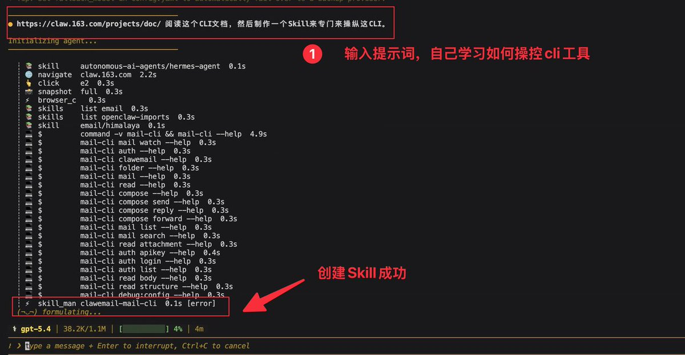

做到这里，你可能会说，要是我还想用邮箱干客服工作呢，那不就搞混了？ 我的解决方法就是专门建一个子邮箱，专门来接收 newsletter。

### 第三步：构建 newsletter 专属子邮箱

安装一个专属的 newsletter 的子邮箱，能隔离不同的信息，提升 Agent 处理信息的效率。

终端里敲：

```
mail-cli clawemail create \
  --prefix newsletter \
  --type sub \
  --display-name "Newsletter Bot"
```

然后去 Dashboard 把这个子邮箱的通讯规则打开：

1. Dashboard → Agent 邮箱管理 → 选中这个子邮箱 → 通讯规则
2. 选 开放外部通信
3. 收信范围选 所有人（newsletter 发件域太杂，白名单维护不过来）

具体如下图：

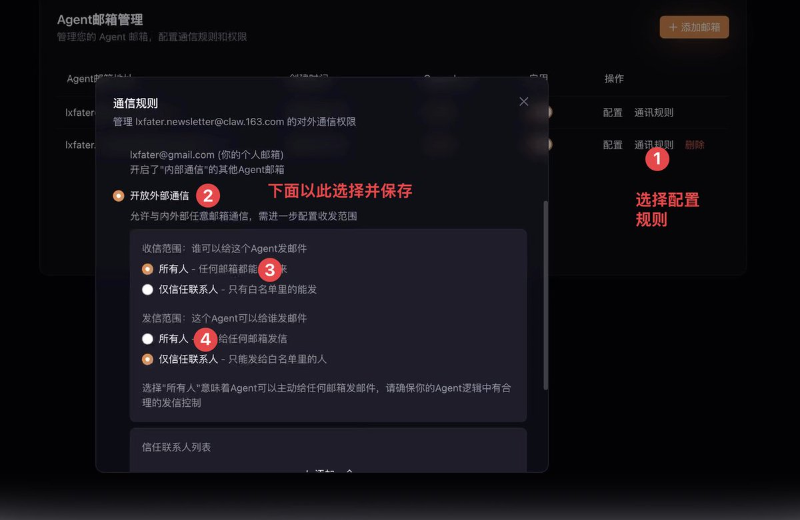

看到这里，你可能很累，但胜利就在眼前，哈哈哈。

接下来，马上教你如何用 Agent 订阅 newsletters。

### 第四步： 子邮箱订阅 newsletter

做完这步你所有的 newsletter 订阅就在一个专属的子邮箱里面，这样以后你还想做其他邮件自动化时候，比如专门用 agent 做企业客服，邮件就不会搞混了。

Agent 订阅 newsletter 很简单：

以后看到新 newsletter，订阅框直接填 [XXX.newsletter@claw.163.com](mailto:lxfater.newsletter@claw.163.com)

确认邮件到后，让 Hermes 直接提取出确认地址，地址输入浏览器就能确认成功，需要回复邮件进行人机检查的，让它帮忙回复。

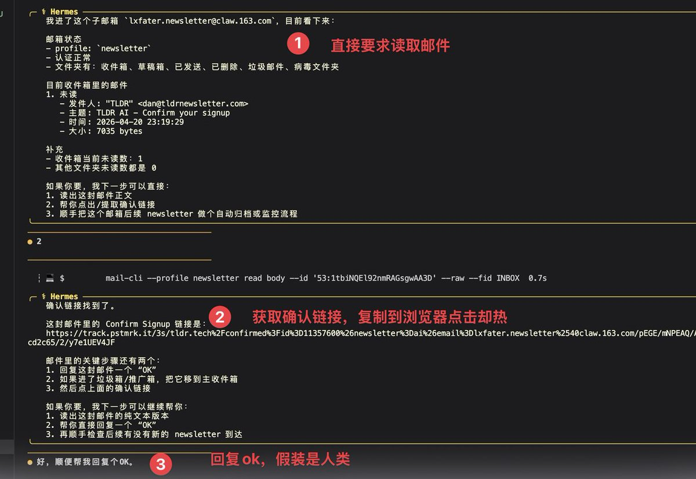

到这里你已经比 80% 的人领先一档，他们还在 Gmail 里用人肉读 newsletter。而你的 newsletter 已经进了 Agent 专属邮箱，Agent 随时能读

但这篇教程真正的重点是让 Agent 每天替你筛选、消化、这些高质量新资源，并产出一份你真能用的日报，并且进行真正的主题研究。

所以请往下👇看

## 二、筛选消化信息，Hermes 构建第二大脑

下面我将介绍让我最近文章输出能力大涨的 Hermes-Agent 学习流程：

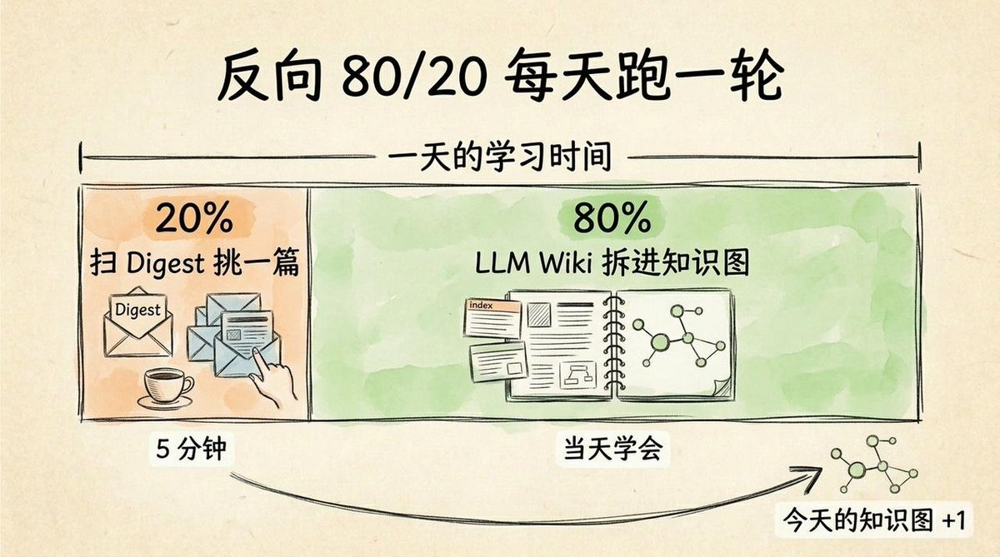

### 第一步：扫 Digest

我们可以利用 Agent 来初筛一遍 newsletter，这样既节约时间，也不会漏掉热点。

ClawEmail 官方自带一个能力，开启之后每天早上一封日报邮件到你 Gmail 里面是今天所有 newsletter 的摘要加推荐。

输入下面命令安装：

```
npx skills add https://claw.163.com/gitea-web/s/daily-report.git
```

这里有个有趣的点，大多数人订 Digest 是为了让 AI 帮他读完省时间，大概知道一些 AI 新闻，但我还有它干一件事：挑出今天最值得深读的那一篇文章。

下面是本文的核心

### 第二步：让 LLM Wiki 将 newsletter 拆进知识库

终于到了最核心的部分，利用 LLM Wiki 技术去消化知识。

你可能会一脸懵，LLM Wiki 是啥？

我打个比方：

它像个实习生，每天你扔一篇文章给它，它把里面的概念、实体、主张、开放问题一个个拆出来，每个做一张索引卡片贴在墙上，再用线把这张新卡片和墙上已有的相关卡片连起来，久了这堵墙就是一张活的知识图。

这是 Karpathy 2026 年提出的：他说 RAG 检索太窄，LLM 真正该干的是知识编译器。一经提出，火爆全球。

具体怎么操作？

让 Hermes 给出邮箱里面你感兴趣的文章，告诉它：这篇编译到我的 Wiki

跑完之后，你会获得一个互相链接的 Markdown 文件，构成一个知识网络，彼此用链接连起来。

打开 Obsidian 知识图图谱功能：

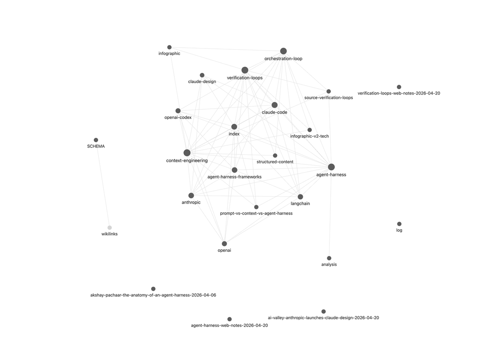

在这个图里面找到你不懂的概念，不断问 Hermes 拆解概念，你的知识图上现在有一堆互相勾连的概念。

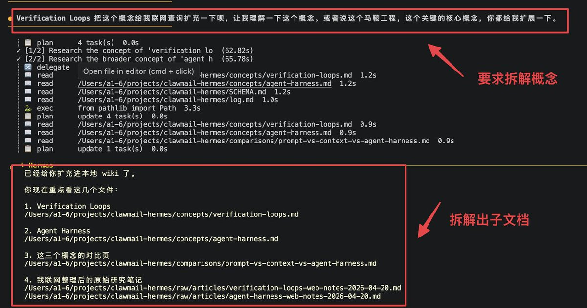

旧概念因为今天这篇又加了一条新论据，同时新旧概念第一次被连到一起

这个模式符合认知科学，因而会带来个神奇的效果：就是你读 1 篇等于刷新了 10 篇！

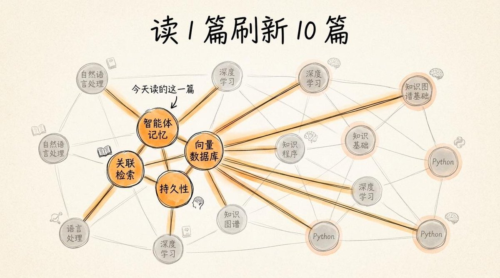

别人每天刷 100 条 推文，一天就忘。你一天一篇，自动将新知识和老知识关联，知识图一天厚一点，学进去就不易遗忘。

题外话：假如你还对 LLM Wiki 感兴趣，可以看下面这篇文章：

引用推文：铁锤人 (@lxfater)

https://t.co/VXmgiu5h5f

https://x.com/lxfater/status/2042848343949480173

做完这一切后，有一个更意义的问题：这些东西怎么变成一篇 X 文章，如何获得产出呢？

## 三、用 Hermes LLM Wiki 倒逼产出

学习就是为了输出，光学不练，就相当于没学，所以下面是输出实操：

很简单！！把 Wiki 里的 index 文件给 AI ，它就会去读你的 wiki 了

下面列举两种常见输出方式：

### 做信息图

Hermes Agent 内置一个信息图命令行，底层跑的是宝玉的信息图 prompt，Hermes 官方把它收进了内置命令了。

把 Wiki index 地址给 AI，问一个概念：Verification Loop 是什么？它扫一里面相关主题的知识，直接吐出一张下面的信息图。

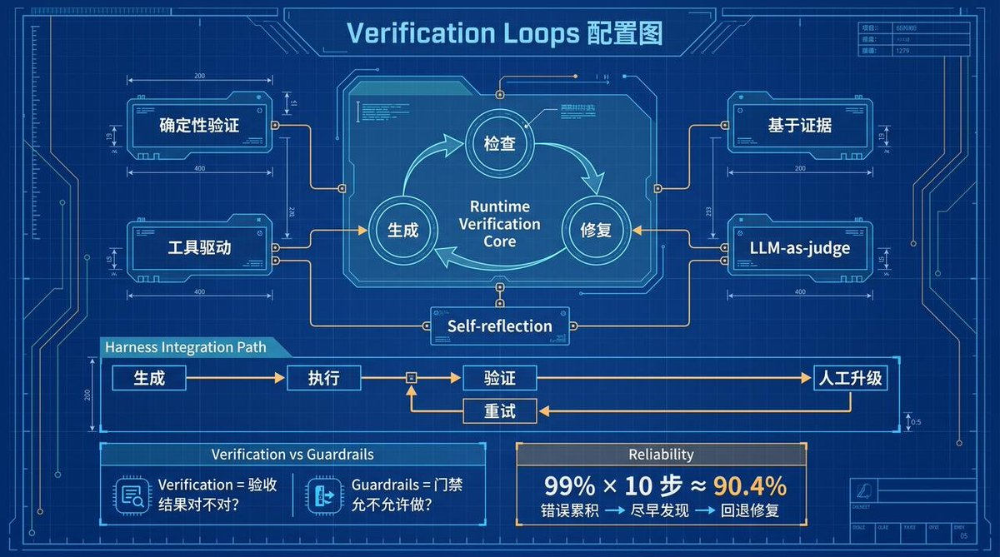

这还不是最有价值的，我们还可以用这个来串联知识，进而提高文章质量。

### 自己写文章，AI 做脑爆

大多数人以为 AI 写文章就是 AI 帮你写，但真正让你写出好文章还是你自己把事情想明白，AI 只做脑爆，提高多做可能性。

写的时候碰到想不清楚的地方，对着 Hermes 问：

1. 这个概念我上周读过哪几篇支持？
2. 那个观点我怎么反驳？
3. 还有哪些角度我没考虑到？

让 Hermes 利用 llmwiki 功能给你灵感和解决你的盲点

写好文章后，如果你不想排版，可以参考我这篇文章，自动 AI 排版和发布。

引用推文：铁锤人 (@lxfater)

https://t.co/GYYfoI1peY

https://x.com/lxfater/status/2037047059384328315

## 最后一件事

这整套流程用的是网易邮箱新出的 ClawEmail：这是一种新邮箱，是给 Agent 用的。

这也是电子邮件的未来！！

如果你对给 Agent 接入邮箱感兴趣，想自己搞一个，可以到官网 https://claw.163.com/?channel=lxfater报名内测

## 相关页面

- [[sources/hermes-obsidian-knowledge-base]]
- [[sources/hermes-agents-roomenvision-tutorial]]
