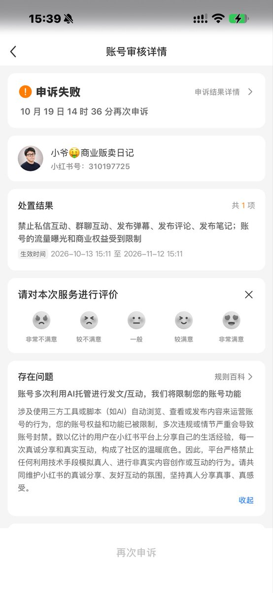

# 紧急通知：Grok Bot 接管小红书已出现大批量封号

> 「紧急通知一下啊，玩 Grok Bot 的人，**不要去让它接管小红书，小红书会封的啊，已经出现大批量封号了啊**。接管 X 公众号没有任何问题啊。」

<!-- more -->



*图 1：小红书批量封号情况截图。*

---

## 原文

```text
紧急通知一下啊，玩 grok bot 的人，不要去让它接管小红书，
小红书会封的啊，已经出现大批量封号了啊。
接管 X 公众号没有任何问题啊。
```

---

## 为什么这条值得单独归档

它**直接限定了另一篇攻略里的建议**。[[sources/lzj-grok-bot-beginner-guide]]（同一作者，2026-10-19 发布）中「国内平台登录小技巧」一节教用户：

> 云电脑在海外，登录公众号后台、小红书这类国内平台，可能被当成异地登录。设置 → Computer 里有一个「**让云电脑走你这台电脑的网络**」的开关（Route traffic through this computer），打开后网站看到的是你自己电脑的网络。

而这条通知比该文早 4 天发布，明确说**接管小红书会大批量封号**。

> **时间线**：2026-10-15（封号警告）→ 2026-10-19（保姆级指南）。指南的发布时间在后，但没有把这条警告写进「国内平台登录」一节——**只说了「你试之前先拿小号试」**。因此把这条单独归档，作为该节的必要限定条件。

---

## 平台规则的三条对照

| 平台 | 自动化接管风险 | 说明 |
|---|---|---|
| **小红书** | ⚠️ **高——已出现大批量封号** | 涉及账号内容与社区行为的自动化，平台检测与处置力度强 |
| **微信公众号 / X** | 相对可控 | 作者称「接管 X 公众号没有任何问题」 |
| **海外平台** | 相对可控 | 云电脑本身在海外，登录不构成异地异常 |

---

## 落到实操的三条

1. **不要把主账号交出去**——原文说的是「玩 grok bot 的人」，但风险敞口与账号重要性成正比，主账号被封的损失远大于小号；
2. **先小号验证**——[[sources/lzj-grok-bot-beginner-guide]] 里那句「你试之前先拿小号试」，在有封号实证的情况下不是客套话而是必要步骤；
3. **区分「登录一次」与「持续接管」**——云电脑的登录态是长期有效的（登录一次就一直有效），这意味着**一次授权的暴露面远大于一次性操作**。账号一旦交出去，后续所有自动动作都发生在你的身份下。

> **通用判据**：云电脑在海外 → 平台看到的是境外 IP，这是「异地登录」风控的直接触发条件。开启「让云电脑走你这台电脑的网络」能解决 IP 归属问题，但**不能解决「自动化行为本身被平台识别」的问题**。小红书的封号属于后者。

---

## 相关页面

- [[sources/lzj-grok-bot-beginner-guide]] — 小爷：Grok Bot 保姆级新手指南（上篇）
- [[sources/yaohongan-grokbot-48-use-cases]] — 虹安：Grok Bot 48 个真实玩法按场景整理
- [[patterns/agent-runtime-safety-guardrails]] — Agent 运行时纵深防御：默认拒绝、最小权限、执行前授权
- [[sources/y2a-auto-youtube-bilibili-pipeline]] — 视频分发流水线与平台规则边界
- [[concepts/shared-weekly-pool]] — 四合一「共用周池」机制详解
