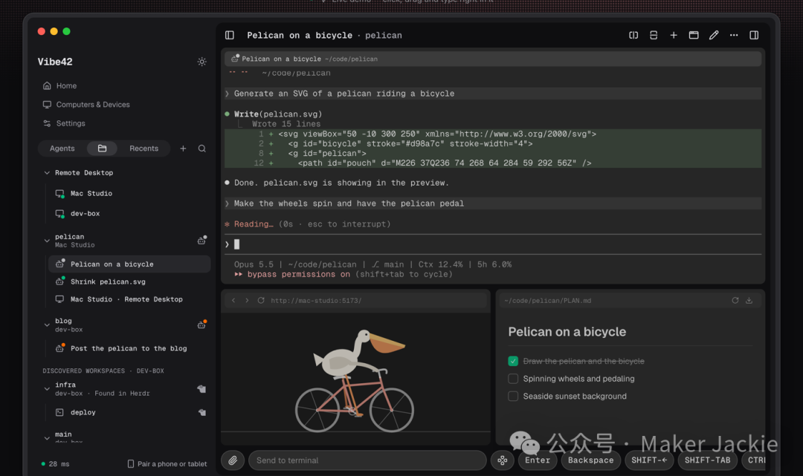
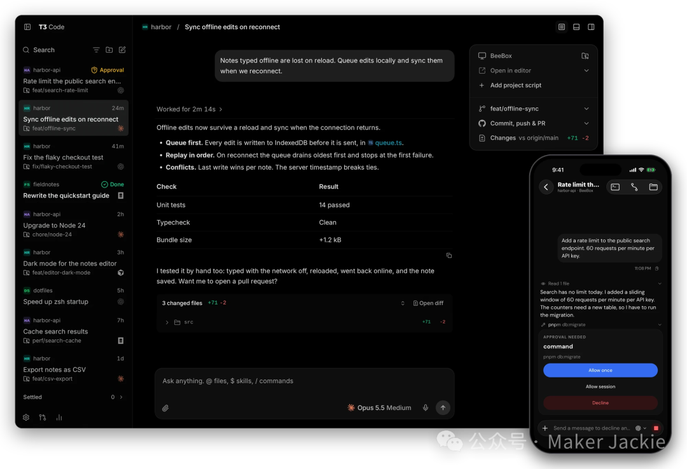
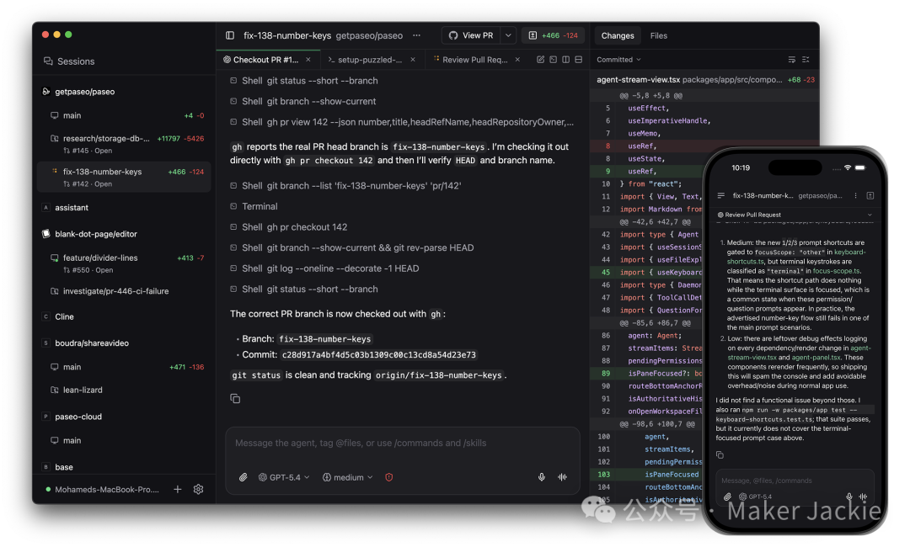

# 月订阅费 8000 块，我如何用一台手机同时管 9 台电脑、6 个 Agent？

> 出门只带手机也要能干完全部工作：把「人控机」与「机连机」拆成两层网络，远程方案按真实使用场景选型，而不是看谁嘴炮响。

<!-- more -->

## 精读正文

昨天刚说完我重启了公众号，而且全程用手机遥控 Agent 写完并发布了第一篇。
今天这篇，我也是真在珠海公园散步时，只拿着一台手机口述出来、远程发掉的。
其实手机发公众号只是很小的一个环节。作为独立开发者和数字游民，我真正想折腾的，是一套出门只带手机也能搞定所有工作的方案。
以前我也背着笔记本满世界跑，但重度 Vibe Coding 之后，一台电脑彻底不够用了。
我每个月花在 AI 订阅上的费用接近 8000 块，主力同时跑着 6 个 Agent，分别是 GPT、Claude、Google、OpenCode、DeepSeek 和 Grok。每个模型都有自己的长板，写后端、做游戏、写文案各有趁手的工具。
再加上要同时开发 App、做游戏、跑 4K 视频渲染，还得在美国云主机上隔离环境防封号，不知不觉手里攒了 9 台电脑，Mac 和 Windows 都有。
前一个月我桌前摆了五块屏幕，一离开工位就干不了活。本来想让 AI 提效，差点把自己活成焊在工位上的打工仔。
先拿最轻量的发公众号流程举例。
我在手机上打开远程终端，连上家里电脑跑着的 Antigravity CLI，直接对着手机语音把想法说出来。
底层调用比较说人话的 Gemini 4 Neon，配上提前写好的写作 Skill。Agent 会自动清洗口水话、出封面、配好图，再调用蚁小二 CLI 直接推到公众号草稿箱。
我自己在手机「订阅号助手」里瞄一眼排版，没问题就定时发出去。散个步顺手就把文章写了，根本不需要刻意坚持。
这套流程能跑通，关键在于手机怎么稳稳管住家里的多台机器。过去一段时间，我把市面上主流的几套方案都实测了一遍。
最早用的是 UU 远程。完全免费，国内直连极稳，偶尔使用我非常建议先从它试起。
但放到多 Agent 并发的场景下，短板很明显。它是按传统远程桌面设计的，在九台电脑间切终端很费劲，最致命的是根本看不到哪个 Agent 还在跑、哪个已经干完了。
后来试了开源的 Paseo。在家里局域网测下来很顺，桌前终于不用开五个显示器。
但一出门就卡壳，国内移动网络下连接不太稳，得自己搭中继。更劝退的是配对方式，九台电脑加多台手机，需要两两手动配对十几次。
最近推特上吵得很凶的 T3 Code 我也测了一遍。这波算是黑红出圈，我也是吃瓜才知道的（之前 AI 给我推荐的是 Paseo）。
我对于这类嘴炮争论其实不太在意，最关键还是看产品本身。举个例子，老黄出轨也不影响我用英伟达的 GPU。实测下来，T3 Code 短期内的交互体验确实是上乘，界面赏心悦目，同一个会话里切换不同 Agent 非常顺手。
至于大家争议的遥测数据，我看下来似乎也还好，没收集什么隐私内容。当然我也只是吃瓜群众，靠片面信息得出的片面结论，大家自己判断就好。
如果实在介意，加上下面两行环境变量就能直接关掉遥测（也可以去 B 站搜 BV1C81cz6Ed9 看教程）。
```bash
export T3CODE_TELEMETRY_ENABLED=false
export T3CODE_OTEL_SDK_DISABLED=true
```
不过 T3 Code 有个明显短板，它没有自带远程桌面。遇到要看 App 模拟器、点网页或者非终端操作时，还是得切回别的软件。
所以综合下来，我现在的主力还是付费方案 Vibe42。
它刚好补齐了前面几款的短板。出门移动网络极稳、端到端加密，统一账号让 iPhone、安卓和电脑无缝续接。刚在书桌前敲了一半的对话，出门掏出手机就能接着聊。
而且自带远程桌面和文件浏览，看完终端输出顺手查产物。
不过也说句实在话，Vibe42 当前版本还是以终端为主，属于完全不侵入式的终端形态，对普通用户可能没那么友好。但听开发者说，下周他们就会上线 Chat UI 版本，到时候上手门槛降下来，短期看 T3 Code 交互上乘，长期看 Vibe42 很快能赶上，还是个挺好的选择。
下面做了三款工具在桌面端与手机端的界面对比（原图为左右滑动形式，这里拆开列出）：

**01 / 03 · T3 Code（原生 Chat UI + 手机审批）**



结构化对话流 + 右侧 Diff 与 PR 面板，手机端可直接点同意或拒绝，短期交互最顺手。

**02 / 03 · Vibe42（全功能终端 + 远程桌面）**



左侧切多台主机与远程桌面，右侧自带产物预览和手机端快捷栏，下周上线 Chat UI。

**03 / 03 · Paseo（开源多主机轻量面板）**



局域网统一管多主机很轻快，但出门网络不稳、多机多手机两两配对较繁琐。

套餐方面，Vibe42 官网刚更新了额度，Pro 版 25 美元现在已经支持连接 10 台电脑。如果你设备不多，选 8 美元的套餐（2 台电脑）再搭配免费的 UU 远程基本就够用了。
我把实测的四套工具，加上开源社区呼声很高的 Orca，整合进了一张竖版对比图里，方便你直接参考选型。
最后顺带说一下这 9 台电脑之间是怎么互相沟通的。
注意 Vibe42 并不依赖 Tailscale，我用 Vibe42 是为了「人控机」，随时随地从手机连上任意一台主机。
而 Tailscale 解决的是「机连机」。这 9 台电脑分布在不同地理位置，用 Tailscale 组成一个私有局域网之后，它们之间就能直接互相访问。我的美国云主机专跑 Claude，本地电脑上装着好多个 Agent。组完内网后，Mac 可以直接调用 Windows 主机的英伟达显卡渲染视频，本地电脑也能直接调用另一台机器上的 Claude 或 Codex 干活，甚至让 Agent 自己挑一台空闲机器承接并发任务。
**两层网络各司其职**：

- **Vibe42（人控机）**：一台手机随时语音输入、远程操控任意主机；全球加密直连，不依赖 Tailscale。
- **Tailscale（机连机）**：把跨地域 9 台电脑组进私有局域网，机器之间直接互访。
  - A · 美国云主机：专跑 Claude（隔离防封号）
  - B · 本地主力 Mac：GPT / Google / DeepSeek / OpenCode / Grok 等多 Agent
  - C · Windows 显卡机：NVIDIA GPU 渲染游戏编译、4K 导出
  - 例：Mac 调 Win 显卡渲染，本地互调云端 Claude，让 Agent 自己挑空闲机器承接并发任务。
看到这，可能有人会觉得，你这是走到哪都要加班。
但我自己的体感恰恰相反，随时随地都能工作，换来的是不再被周一到周五绑死。不用纠结哪天必须守在电脑前、哪天才能出门，哪怕坐在洱海边，只要有网，手头的事就不会断档。
以上就是我这段时间管理多电脑、多 Agent 的一些使用经验分享。我现在基本上在家里用 Vibe42 的桌面端，出门就直接切到手机端。
当然，如果你没有像我这样重度的多 Agent 管理需求，用开源的 T3 Code 或者免费的 UU 远程其实也就够用了。

