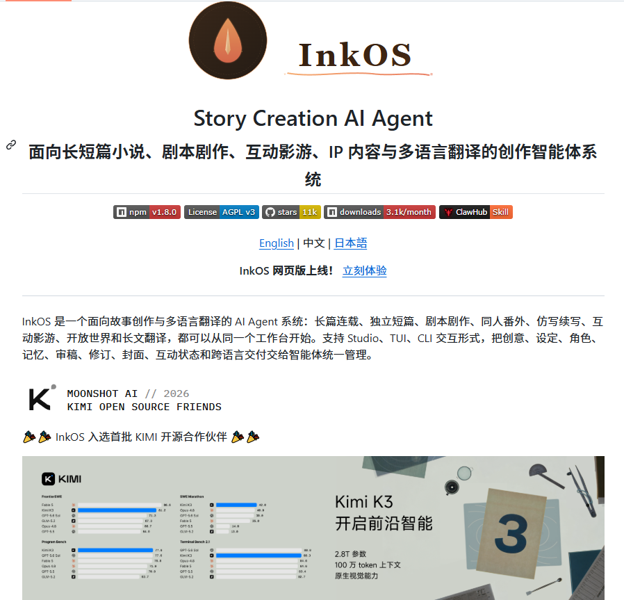

# Man ting（@Manorgw）：InkOS——面向长篇小说、剧本与互动影游的开源 AI 创作工作台

> 解决传统写小说、剧本和游戏剧情靠 Prompt 硬凑导致的上下文遗忘与设定冲突。开源项目 InkOS 将世界观管理、角色档案、伏笔追踪、审稿修订与多语言翻译集成于一体，支持 Studio/TUI/CLI 多种交互形态。

<!-- more -->

写小说、剧本或者互动游戏，还靠一条条 Prompt 硬凑？开源项目 InkOS 可以试试。

它把 AI 创作那套流程拢进一个工作台，世界观管理、角色设定、伏笔追踪、审稿修订、多语言翻译都能办，长短篇小说、剧本、互动影游都用得上。

Studio、TUI、CLI 几种玩法随你挑，想把创作流程系统化管起来的人用着正合适。

🔗 GitHub：https://github.com/Narcooo/inkos

## 相关页面

- [[concepts/ai-content-pipeline]]
- [[concepts/durable-execution]]
