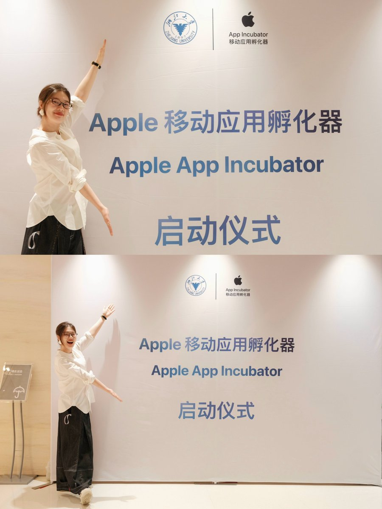

# 关于怎么把产品卖出去，最贵的 160 条判断

> 写完代码那天，真正的难题才开始。
>
> 本文内容来自 Apple × 浙江大学的移动应用孵化营中，团队为开发者们制作的纸质学员手册。160 条 App 创始人们不愿意承认的真话。

<!-- more -->
本文内容来自 Apple × 浙江大学的移动应用孵化营中，我们团队为开发者们制作的纸质学员手册。

这里是 160 条 App 创始人们不愿意承认的真话：

写完代码那天，真正的难题才开始。

[《成就伟大之前，先学会卖东西》](https://mp.weixin.qq.com/s?__biz=MzI3NjAzMTA1Mw==&mid=2651648631&idx=1&sn=813abdcc9cd883b143b6f962aee1f413&scene=21#wechat_redirect)，在 X 上意外火了。评论里很多人问同一件事：道理我懂了，具体怎么做？

今天把手册里的知识点部分公开出来，给没到现场的朋友。

1、这门课最终只回答一个问题：谁会在什么时刻，需要你的 App。

2、增长不是产品上线之后才开始做的事，是在产品还没讲清楚之前就要介入。

3、产品不是表达自己，也不是构造一个完整世界，而是服务一个具体用户的具体需求。

4、Build 只是前半段，Sell 需要另一套能力。

5、好 App 没有下载量，常常不是因为功能不够，而是用户没听懂它和自己有什么关系。

6、Apple 生态不会自动给新 App 分发流量。App Store 更像仓库，不像商场。

7、App Store 能承接用户，但不能替你完成用户教育。

8、用户下载一个 App 前，通常要先经历看见、理解、相信、知道下一步这几个环节。

9、做增长这件事，可以拆成问题、用户、表达、内容、渠道、转化、数据和迭代几个环节。

10、别把内容当成推广收尾才做的事，它本身就是验证产品的工具。

11、推广不是把产品推到更多人面前，而是让具体的人听懂理由。

12、这门课的第一半天解决「问题和表达」，第二半天解决「持续内容生产」，第三半天解决「验证系统」。

13、Apple 用户不是一个抽象的高端人群，而是很多具体场景里的具体用户。

14、参数、功能和技术细节不是用户天然能理解的购买理由。

15、用户不是先理解你的产品结构，再决定要不要下载，而是先判断「这是不是跟我有关」。

16、开发者容易把自己会做什么写出来，用户更关心自己可以少受什么苦、多得到什么结果。

17、一个 App 功能越多，越需要被翻译成更少、更清楚的使用场景。

18、旧路径是写完代码、上架、等待下载；新路径是边做产品，边测试表达。

19、产品没完全做完，也可以先测试问题、场景、标题、关键词和用户反应。

20、最小可验证对象不一定是功能，也可以是一个问题、一句表达、一张截图或一个使用场景。

21、做增长前先问：这个 App 解决的是谁的哪一个高频、强烈或明确的问题。

22、「所有人都能用」通常不是优势，而是表达还没有收窄。

23、用户夸「挺好」不等于愿意下载，愿意搜索、收藏、评论、私信、试用才更接近真实信号。

24、产品价值可以从省时间、省钱、省麻烦、减少不确定、获得掌控感、获得情绪支持这些角度来解释。

25、App 的第一句介绍不该试图讲完所有功能，而要让目标用户马上知道它和自己有关。

26、用户语言比开发者语言更适合做标题、封面和卖点。

27、课程里的核心动作不是「包装」，而是把产品翻译成用户能理解、能复述、能行动的语言。

28、小红书不是唯一答案，但它适合作为早期内容验证训练场。

29、对中国开发者来说，Google Play 路径受账号、支付、分发等因素影响更复杂，iOS 路径相对更清晰。

30、对独立开发者和小团队来说，先用低成本内容验证需求，通常比一开始大规模投放更稳。

31、Apple 用户买的不只是功能，还有用着顺手、看着舒服、觉得自己被理解这些东西。

32、翻译产品时，不要只问「我有什么功能」，要问「用户在哪个时刻会需要这个变化」。

33、场景化表达回答「用户在什么情况下用」。

34、情绪化表达回答「用户用了之后少了什么焦虑、多了什么感受」。

35、身份化表达回答「用户为什么愿意把这个 App 当成自己的选择」。

36、工具类 App 通常要讲清楚「省掉什么步骤、减少什么反复、避免什么失误」。

37、情绪类 App 通常要讲清楚「让用户感受到什么、陪用户度过什么时刻」。

38、AI App 不要先讲模型能力，要先讲用户在哪个任务里变轻松了。

39、开发者工具不要先讲架构，要先讲它让开发者少踩什么坑、少花什么时间。

40、健康、习惯、记录类 App 不要只讲数据，要讲用户如何更容易坚持。

41、效率类 App 不要只讲清单和提醒，要讲它如何减少用户的混乱感。

42、财务、记账类 App 不要只讲统计，要讲用户如何更安心地知道钱去了哪里。

43、表达方向不是一次定死的，同一个 App 可以测试多个用户场景和多个卖点。

44、判断表达好不好，不看团队自己喜不喜欢，而看用户是否愿意产生下一步动作。

45、好标题通常先指向问题、结果或场景，不先写产品自我介绍。

46、好封面要让用户在一眼内知道「这和我有关」。

47、好正文要提供故事、过程、证据、方法和下一步，不只是抒情。

48、能被用户转述给朋友的一句话，才是比较稳的产品表达。

49、写 App 一句话介绍时，最好同时包含目标用户、使用场景和带来的变化。

50、如果一句介绍需要解释很多次才能懂，说明它还没有被翻译好。

51、小红书更像一本可搜索的杂志，不只是即时信息流。

52、小红书的搜索流量很重要，很多用户不是刷到你，而是在搜索问题时遇到你。

53、小红书内容要有杂志感，这里的杂志感不是精致装饰，而是信息有秩序。

54、一篇笔记最好解决一个清楚的问题，不要把所有卖点塞进一篇。

55、标题负责把用户拉进来，封面负责让用户看懂，正文负责建立信任，评论区负责继续承接。

56、小红书关键词应该来自用户真实搜索词、搜索联想、评论区原话和竞品内容。

57、关键词要自然出现在标题、封面、正文、评论、合集和账号简介里。

58、小红书不能直接放 App Store 下载链接，所以必须设计清楚的下载路径。

59、下载路径可以通过 App 名、账号简介、置顶评论、私信关键词、官网或社群来承接。

60、不要只写「去 App Store 搜」，还要让用户知道搜什么、点哪个、为什么现在去。

61、账号主页就是用户做决定的地方，头像、简介、置顶笔记和合集都要服务转化。

62、第一个月不应该只追爆款，而要建立一组可搜索、可复用、可对比的内容样本。

63、早期内容节奏的目的不是每天刷存在感，而是测试用户、问题、标题、封面和转化路径。

64、小红书笔记发布后，要看搜索曝光、点击率、收藏、评论、私信、App 名搜索和下载变化。

65、没有爆不等于失败，没有任何有效信号才说明需要调整方向。

66、评论区比会议室更早说真话，用户提问和误解都可以反向修改产品表达。

67、内容中的案例越接近用户真实生活，越容易产生信任。

68、App 内容不一定要像广告，可以像经验、教程、避坑、复盘、清单和真实记录。

69、海外自然验证应该先于海外付费投放。

70、海外渠道不是越多越好，每个平台承担不同验证任务。

71、App Store 负责承接和转化，标题、副标题、截图、预览视频、评分和评论都会影响下载。

72、Product Hunt 更适合做发布节点和势能放大，不适合作为完全冷启动的第一步。

73、Reddit 更看重真实问题和非广告式回答，硬广容易被抵触。

74、X 更适合用观点、进展、demo 和连续开发记录建立认知。

75、海外投放前，要先确认网页、App Store 页、付款、隐私说明和支持路径能承接用户。

76、账号不是公司网站，而是产品持续出现的现场。

77、账号策略要根据资源选择，不要一上来就做超出团队能力的矩阵。

78、创始人出镜适合建立信任，尤其适合需要解释理念、判断和长期陪伴的产品。

79、产品官方号适合稳定输出功能说明、使用教程、版本变化和用户案例。

80、KOC 或素人矩阵适合覆盖多场景、多关键词，但对管理和合规要求更高。

81、开发日志适合展示真实构建过程，让用户看到产品如何一步步变好。

82、创始人 IP 对 B2B、开发者工具和高信任产品更有价值。

83、技术内容能吸引开发者和专业用户，但不能只停留在技术自嗨。

84、账号定位要说清楚我是谁、我解决什么问题、为什么可信、用户下一步做什么。

85、冷启动前 10 条内容最好覆盖问题解释、使用场景、产品方法、真实案例、常见疑问和下载路径。

86、冷启动阶段不要两条笔记换一次定位，否则数据无法比较。

87、不要把产品藏得太深，用户看完内容后必须知道这是一个可以使用的 App。

88、早期不要把粉丝数当成唯一指标，更要看有没有真实问题、真实互动和真实转化。

89、账号内容要有固定栏目，这样用户和创作者都知道下一条内容可以从哪里来。

90、老用户可以提供真实案例、评价和复购线索。

91、新用户能帮助团队跳出熟人反馈和老用户惯性。

92、账号承诺、产品体验和下载页表达必须一致，否则转化会断掉。

93、AI 内容生产不是一键生成笔记，而是让内容流程更快、更稳定。

94、AI 会让很多内容变得相似，真正拉开差距的是产品事实、用户细节和创作者判断。

95、AI 适合做选题扩展、结构整理、标题变体、正文初稿和改写。

96、人要提供真实材料，包括产品截图、用户原话、使用场景、失败经历、版本变化和限制条件。

97、好提示词要包含产品一句话、目标用户、具体场景、关键词、表达方向、参考风格和禁用内容。

98、AI 写出的初稿通常需要改成更像真人说话的表达。

99、AI 不能替你判断用户是否真的需要这个产品。

100、Vibe Coding 的开发过程本身可以变成内容素材。

101、功能选择、取舍、报错、迭代和上线过程，都可以成为开发者日志。

102、不要等到产品完美再记录，真实过程比事后包装更有可信度。

103、内容生产最好先建素材库，再从素材库里长出选题。

104、一条内容从素材到发布，可以拆成素材、选题、标题、封面、正文、评论区互动和数据复盘。

105、一个真实素材可以改写成教程、案例、避坑、清单、复盘和短观点。

106、AI 可以给出多个标题方向，但最终要用用户语言和平台反馈来选。

107、发布前要检查三个问题：问题是否具体，证据是否真实，下一步是否清楚。

108、评论和私信应该回流到下一轮提示词里，不只是当客服处理。

109、AI 内容最危险的地方不是不好看，而是看起来合理但没有真实用户依据。

110、付费投放不是许愿，而是用预算测试哪个表达值得继续。

111、没有自然信号之前，不建议直接用大预算投放。

112、5000 元测试预算不是买增长，而是买判断。

113、小预算测试可以先用 3 到 5 条内容，每条 100 到 200 元，跑 2 到 3 天看信号。

114、搜索广告测试的是明确需求和关键词承接。

115、信息流广告测试的是兴趣、封面、标题和第一眼吸引力。

116、投放前必须准备好落地页、App Store 页、账号主页或私信这些接住用户的地方。

117、App Store 产品页就是重要落地页，截图、标题、副标题和预览视频都会影响转化。

118、Product Page Optimization 可以测试不同产品页元素对转化的影响。

119、Custom Product Pages 可以为不同人群或不同广告方向准备不同承接页面。

120、App Analytics 要关注展示、产品页浏览、下载、转化率、激活和留存。

121、很多广告问题不是后台设置问题，而是内容、承接和下一步设计问题。

122、App 增长漏斗可以拆成曝光、点击、落地页或主页、下载、激活、D1 留存和长期使用。

123、iOS 隐私机制会影响归因精度，所以早期要接受「方向性判断」而不是追求绝对精准。

124、成熟平台上那些跑得通的打法，背后通常是同一套东西：内容、下一步、流量和规则。

125、电商里的小黄车对应 App 的下载入口、落地页、官网、TestFlight、社群或私信承接。

126、电商里的店铺对应 App 的 App Store 页、官网、账号主页和注册流程。

127、电商里的评分、评价和售后，对应 App 的评分、评论、留存、反馈和支持系统。

128、电商里的矩阵账号，对应 App 不同内容账号或不同内容栏目对搜索词和用户阶段的覆盖。

129、A 种 B 收，是指 A 抛出需求，B 负责推荐，C、D、E 继续补体验、价格、避坑或使用细节。

130、A 种 B 收的评论区不是闲聊，是一套一步步打消用户戒心的剧本。

131、郑州帮式打法是撒出大量小号，伪装成素人，在多个场景里海量铺内容、评论、收藏和私信。

132、A 种 B 收和郑州帮都把广告包装成路人共识，把推荐包装成真实发现。

133、这类玩法能拆出的底层结构是提问、解释、案例、答疑和承接下一步。

134、这类玩法能拆出的可迁移动作是用不同内容覆盖不同搜索词、不同用户阶段和不同疑虑。

135、这类玩法不能直接照搬的部分是托评、伪装素人、虚假体验和批量控评。

136、更长期的替代方案是真实用户反馈、开发者日志、产品案例、版本变化和清楚的下载路径。

137、灰色玩法只能解决看起来铺得广、看起来可信，解决不了产品本身有没有价值。

138、流量来源可以分成自然流量、付费流量、自造流量和达人或媒体流量。

139、好投放的终点不是一直花钱买量，是找到能自己长出自然流量的那套表达和路径。

140、30 天行动计划不是排一个内容日历，而是设计一条验证路线。

141、行动计划要写清楚一个 App、一个目标人群、一个核心场景、一个主渠道和一个关键指标。

142、第 1 周要先确定用户、问题、产品一句话、关键词和第一批内容题目。

143、第 1 到第 2 周要测试人群、问题、标题、封面和下载入口。

144、第 3 到第 4 周要放大已经有信号的内容方向和承接路径。

145、没有有效信号时，优先调整表达和人群，不要先怀疑自己缺更多预算。

146、同一个问题被反复问到，说明它可能值得继续做内容。

147、同一个卖点反复带来搜索、私信、下载或激活，说明它可能值得加预算。

148、每周复盘要看内容数据、用户问题、下载数据、激活数据和留存数据。

149、App 关键数据不只看下载，还要看激活、关键行为完成率、D1 留存和用户反馈。

150、资源决定打法，一个人的团队不应该一开始就承担复杂矩阵、重投放和多平台同步。

151、先做小闭环，再扩大动作，比一开始做大系统更适合早期 App。

152、产品、内容、账号、投放和数据不是五件事，而是一条验证链。

153、内容验证产品表达，账号接住用户信任，投放放大有效表达，数据帮你决定下一步。

154、最好的课程结果不是「学会小红书」，而是知道自己的 App 下一步该验证什么。

155、第一周最小行动可以是发出第一篇笔记、重写产品一句话、搭一个落地页、找 10 个真实用户或跑一次小预算测试。

156、不要用内部术语替代用户语言。

157、投资人、评委和同行的认可不等于真实用户需求。

158、Apple 生态里的长期信任来自产品体验、隐私意识、表达克制和持续迭代。

159、长期增长来自真实价值和可信表达，不来自一次性热闹。

160、增长不是一次活动，而是不断把产品翻译给正确用户、再用反馈修正产品的循环。

🪐

做产品的人，骨子里都有点理想主义。相信自己做的东西能让谁的生活好一点点。

这份手册想帮你的，就是让这份心意别被埋没。

以上，希望对你有启发。

[才华要转换为金钱，才不辜负自己](https://mp.weixin.qq.com/s?__biz=MzI3NjAzMTA1Mw==&mid=2651648492&idx=1&sn=54825a77f58cf389fcfbf141ef1af179&scene=21#wechat_redirect)

## 相关页面

- [[patterns/content-arbitrage-pattern]]
- [[patterns/ai-business-seven-layers]]
- [[concepts/ai-oneperson-company]]
- [[sources/indie-hub-dontbesilent]] — dontbesilent 的 Codex 工作流分析
