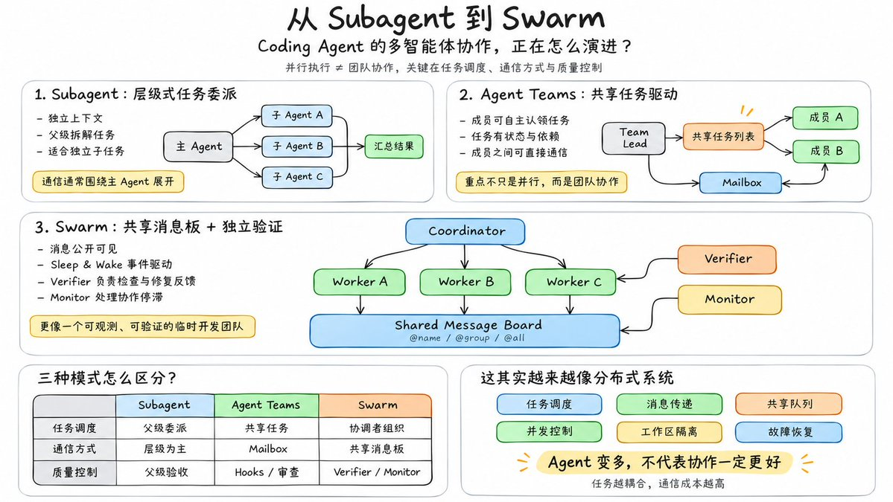

# meow：从 Subagent 到 Swarm——三条多智能体协作路线对比

> 同时跑十个 Agent 和让十个 Agent 真正组成团队是两件事。三条路线：① **Codex Subagents** 层级式委派（spawn/send_input/wait/resume/close；V2 解耦消息传递与任务调度，Task Path 标识、Mailbox 等待、followup_task 分配后续）；② **Claude Code Agent Teams** 共享任务列表 + Mailbox（Team Lead/Teammates/Task 等四组件）；③ **Antigravity Swarm** 像开发团队分工通信并行交叉验证。另对比 /run-workflow（执行路径确定、批量分发、严格校验）与 /swarm（任务边界未定、多角色边写边对接口）的适用场景。附 6 个官方文档链接与 1 张配图。

<!-- more -->

从 Subagent 到 Swarm，Coding Agent 的多智能体协作正在发生什么变化？

同时跑起十个 Agent，和让十个 Agent 真正组成一个团队，其实是两件完全不同的事。

最近研究 Google Antigravity 时，发现它内置了一个很有意思的 /swarm 功能，可以让多个 Agent 像开发团队一样分工、通信、并行执行并交叉验证。

把 Codex 的 Subagents、Claude Code 的 Agent Teams 和 Antigravity 的 Swarm 放在一起看，三者都在解决多 Agent 协作，但在任务调度、通信机制和生命周期管理上，走出了三条不同的路线。

1. Codex Subagents：层级式任务委派

Codex 的多 Agent 协作以经典的层级式委派为基础。主 Agent 负责理解需求、拆解任务，创建拥有独立上下文的子 Agent，再向它们下发任务、追加指令、等待结果，最后汇总交付。

在 Multi-Agent V1 中，这套协作主要靠几个核心工具串联：

- spawn_agent 创建子 Agent
- send_input 向已有 Agent 发送指令
- wait_agent 等待执行结果
- resume_agent / close_agent 恢复或关闭 Agent

不过 Codex 并没有停留在单纯的父子委派。最新公开源码中的 Multi-Agent V2 已经开始把消息传递和任务调度进一步解耦，并通过层级化的 Task Path 来标识不同 Agent。

比如 send_message 只负责投递消息，不会直接开启新的执行轮次；followup_task 则负责向已有 Agent 分配后续任务，并在必要时重新启动执行。同时，V2 还引入了 Mailbox 消息等待、Agent 列表查询和执行中断等能力（具体工具是否可用取决于模型和运行时配置）。

此外，Codex 支持为不同角色配置模型、推理强度和沙箱策略。你可以让成本更低的模型负责代码搜索，把复杂逻辑和代码审查交给更强的模型。整体看，它正在从父子任务委派扩展到更灵活的通信与生命周期管理，很适合代码库探索、并行审查以及相对独立的子任务。

2. Claude Code Agent Teams：共享任务与成员通信

Claude Code 的 Agent Teams 在独立会话之上，引入了两个关键组件——Shared Task List（共享任务列表）和 Mailbox（收件箱）。

整个团队由四个核心部分组成：

- Team Lead 负责组建团队、拆解任务和汇总结果
- Teammates 拥有独立会话和上下文的团队成员
- Task List 维护共享任务的状态、归属和依赖关系
- Mailbox 负责成员之间的消息传递

启用 Task 系列工具后，成员完成当前任务，可以主动去共享列表里认领尚未分配、且没有依赖阻塞的新任务。底层通过 File Locking（文件锁）处理并发认领时的竞争，前置任务一完成，下游依赖也会自动解除阻塞。

通信机制同样很有意思。Claude Code 会为每个成员维护一个独立的 JSON 收件箱：

~/.claude/teams/{team-name}/inboxes/{agent-name}.json

成员能通过 SendMessage 直接向其他 Agent 发消息，不用所有信息都经过 Team Lead 转述。比如前端 Agent 发现后端接口缺少字段，直接找后端 Agent 协商修改就行。配合 TeammateIdle、TaskCreated、TaskCompleted 等 Hooks，开发者还能把测试和静态检查接入任务生命周期，不达标时直接阻止任务完成。

新版 Claude Code 中，普通具名 Subagent 其实也可以直接通信；部分较新模型默认不提供 Task 系列工具，团队成员会直接通过消息协调工作。所以 Agent Teams 的核心不只是让 Agent 能互相发消息，而是把独立会话、成员管理、任务状态和质量控制整合成了一套完整的协作机制。

3. Antigravity Swarm：共享消息板与独立验证

Antigravity 的 /swarm 采用了另一种思路。启动 Swarm 后，当前会话变成 Coordinator（协调者），负责划定任务边界、创建 Worker、分配职责和验收结果，具体技术工作交给团队成员执行。

每个 Worker 同样有独立会话和上下文，但和 Claude Code 的独立 Mailbox 不同，Swarm 使用的是一个公开的 Shared Message Board（共享消息板）。任务范围、禁止修改的内容、完成标准，以及成员间的提问、代码变更摘要和测试结果，都会按顺序发布在同一个消息板上。成员之间通过 @name、@group、@all 公开交流，没有私下传话，整个协作过程对团队和用户完全可见。

除此之外，Swarm 还有三个设计非常值得关注：

Sleep & Wake（事件驱动的休眠与唤醒）

Worker 没有任务或正在等回复时可以进入休眠，期间不消耗模型 Token；当其他成员通过 @ 提及它时，再自动唤醒继续执行。这避免了 Agent 为了等消息而反复空转调用模型。

Verifier（独立验证机制）

Coordinator 通常会按每两到四个 Worker 配一个 Verifier 的比例，专门检查代码变更、运行测试，并把发现的问题反馈给对应 Worker 修复。Worker 和 Verifier 还可以使用不同模型，实现跨模型的代码审查与验证。

Monitor（协作停滞监控）

当整个团队都进入等待状态、但任务还没完成时，Monitor 会主动介入发消息唤醒相关成员，尝试推动任务继续执行。

工作区方面，Swarm 默认共享工作区，也可以给多个 Worker 分配独立的仓库工作副本，减少并行改代码产生的冲突。它甚至提供了 Graph 视图，可以观察 Agent 之间的通信关系，并回放整个团队的消息交互过程。过去我们只能看到 Agent 最终交付了什么，现在连它们如何讨论、协商、验证和修复问题，也逐渐变得可观测。

4. 三种架构的核心差异

对比下来，三者的设计重心非常清晰：

- Codex Subagents 偏重层级化任务委派、子 Agent 生命周期管理和消息传递
- Claude Code Agent Teams 偏重共享任务状态、自主任务认领和团队成员通信
- Antigravity Swarm 偏重共享消息板、事件驱动调度、独立验证和停滞监控

三者之间并不存在严格的迭代替代关系，Swarm 也不是彻底去中心化的架构，依然需要 Coordinator 负责整体协调。真正值得关注的，是它们如何组织任务、传递信息，以及如何判断整个团队已经完成了工作。

Antigravity 自己也同时保留了 Subagents、Swarm、Boost 和 Teamwork 等不同模式，分别用于独立子任务、并行开发、复杂问题的反复验证和长周期项目。不同类型的任务需要不同的 Agent 组织方式，并不是所有事都值得拉起一个蜂群。

5. 多 Agent 协作正在遇到分布式系统的经典问题

上一篇拆解 T3 Code 和 Orca 时，我把 Agent 编排系统类比成了操作系统。而从 Subagent、Agent Teams 一路看到 Swarm，会发现多 Agent 协作越来越频繁地触及分布式系统里的经典设计：

- Subagent Delegation → 层级式任务调度
- Mailbox → 点对点消息传递
- Shared Message Board → 共享消息日志
- Shared Task List → 共享任务队列
- File Locking → 并发控制
- Sleep & Wake → 事件驱动调度
- Git Worktree → 工作空间隔离
- Verifier → 独立质量验证
- Monitor → 系统活性监控

随着 Agent 数量增加，通信开销、资源竞争、状态一致性、任务依赖和故障恢复这些老问题，也会逐一冒出来。

任务认领加了锁，不代表代码修改实现了互斥；拥有独立的上下文窗口，不代表拥有独立的文件系统；多个 Worker 都汇报任务完成，也不代表集成后的代码能通过测试。一旦任务依赖没正确解除，或者所有 Agent 都在互相等待回复，整个团队甚至可能直接陷入协作停滞。

这些难题现在都还没被彻底解决，Claude Code Agent Teams 目前仍处于 Experimental 阶段，Antigravity Swarm 也还处在 Preview 阶段。而且多 Agent 从来不是越多越好，面对高度耦合的任务，盲目增加 Agent 反而会带来更高的通信开销、重复推理和 Token 消耗。

我越来越觉得，除了模型本身的能力和 Agent Harness 的打磨，如何组织多个拥有独立上下文、工具和推理能力的 Agent，并以可控成本实现可靠协作，将会成为 Coding Agent 非常关键的竞争方向。

毕竟，让十个 Agent 同时写代码，和让十个 Agent 共同交付一个完整的项目，是两件完全不同的事。

相关技术文档，感兴趣的朋友可以继续深入研究：

▪︎ Codex Subagents

https://learn.chatgpt.com/docs/agent-configuration/subagents

▪︎ Claude Code Agent Teams

https://code.claude.com/docs/en/agent-teams

▪︎ Claude Code Tools Reference

https://code.claude.com/docs/en/tools-reference

▪︎ Google Antigravity Swarm

https://antigravity.google/docs/swarm/

上一篇：T3 Code 和 Orca 是如何实现多 Agent 无缝协作的？

https://x.com/meow2149/status/2125478426991804713

T3 Code 和 Orca 是如何实现多 Agent 无缝协作的？

同时拉起多个 Coding Agent 并不难，难的是让它们顺畅地委派任务、互相通信、交接上下文，并在出错后可靠恢复。

Codex、Claude Code、Pi、OpenCode 各自都有独立的会话、上下文和工具体系。最近拆解了 T3 Code 和 Orca 的源码，发现它们都是在这些工具之上架了一层 Agent Orchestration Layer（Agent 编排层），把原本单打独斗的 Agent 组织成一套协作系统。

目标一致，但两者的底层设计走了两条很有意思的路线。

1. 先分清两个核心角色：协调者与编排器

多 Agent 协作系统通常可以拆成两层：

- Coordinator（协调者）：本身往往也是 Agent，负责理解需求、拆解任务、指派执行者和验收结果。
- Orchestrator（编排器）：底层运行时，负责拉起 Agent、投递消息、维护状态、管理依赖和失败重试。

比如让 Claude Code 做架构设计，Codex 写实现，Pi 跑测试和审查。协调者决定怎么分工，编排器负责把这些决策稳稳落地。

2. T3 Code：MCP 委派 + 事件驱动

T3 Code 的思路偏向统一运行协议与状态管理，核心落在三个设计上：

任务委派：把协作包装成标准工具调用。它通过 Orchestrator MCP Server 暴露 delegate_task 工具，Claude Code 需要把子任务交给 Codex 时，直接调用工具指定目标 Agent、任务描述、角色、工作区隔离方式和执行模式即可。T3 Code 随即创建子线程，由 Provider Adapter 启动目标 Agent，并挂载到父线程的执行树下。整个过程支持异步，父 Agent 可以继续处理其他工作，也能主动等待结果。

状态与恢复：Orchestrator V2 采用事件驱动架构。任务委派、工具调用、执行结果和工作区检查点全部记录为事件，再配合数据库事务、Outbox 和状态投影，将状态持久化与外部执行解耦。客户端通过 WebSocket RPC 订阅状态变化，断线重连后也能无缝恢复进度。

上下文交接（Context Handoff）：T3 Code 把应用层会话 AppThread 和底层原生会话 ProviderThread 分开管理。假设前几轮由 Codex 完成，中途切到 Claude Code，之后又切回 Codex，系统可以直接恢复原有的 Codex 原生会话，只增量补充它漏掉的那段对话历史，避免每次切换都重传全量内容（当然，不同 Agent 内部的推理状态和 KV Cache 仍无法共享）。

3. Orca：CLI 协议 + 收件箱通信

相比之下，Orca 的重心放在任务调度与 Agent 间通信上：

调度方式：通过 orchestration Skill 教会 Agent 使用一套 CLI 协议，涵盖创建任务、启动 Worker、发消息、查状态和汇报结果。比如启动 Codex 执行一个已登记的任务，只需运行：

orca orchestration worker-start --task "$TASK_ID" --worktree current --agent codex

这条命令交由 Orca Runtime 处理，Agent 本身无需关心其他 Agent 的启动细节。

跨 Agent 通信：内置一套 Mailbox（收件箱）机制。执行中卡住用 ask 向协调者提问，协调者用 reply 回复，做完后 Worker 发 worker_done 汇报结果。这些结构化消息持久化到 SQLite，由 Runtime 负责投递并唤醒接收方。

任务模型与防冲突：Orca 把一次协作拆成四个核心实体：Run（完整协作过程）、Task（具体任务及依赖）、Dispatch（一次实际派工）和 Worker（执行任务的 Agent）。把 Task 和 Dispatch 分开建模非常实用：如果某个 Agent 执行超时、协调者把任务重派给了新 Worker，哪怕旧 Agent 事后突然返回完成信号，系统也能靠 Dispatch ID 识别出过期回报，防止误改当前任务状态。

依赖编排：支持 DAG（有向无环图）任务依赖。前置任务全部完成后，Runtime 自动把下游任务标为 ready，交由协调者挑选合适的 Worker 接手。

4. 两条路线的差异与趋同

对比下来，两者的发力点很清晰：

- T3 Code 侧重统一 Agent 运行协议、会话管理、上下文交接和事件流。
- Orca 侧重任务依赖、派工隔离、结构化通信和 Worker 生命周期。

不过两者的能力也在互相靠拢。T3 Code 已有实验性的 TypeScript Workflow，Orca 也补上了跨 Agent 会话交接；两者也都通过 Git Worktree 隔离并行任务，减少多个 Agent 同时改代码带来的冲突。

5. 越来越像面向 Agent 的操作系统

套用操作系统的视角，这套编排架构的每一层几乎都能一一对应：

- Coding Agent → 进程
- Orchestrator → 进程调度器
- Mailbox → 进程间通信（IPC）
- Context Handoff → 会话上下文迁移
- Event Store → 状态持久化与恢复
- Git Worktree → 工作空间隔离
- Task DAG → 任务依赖管理

多 Agent 编排真正有门槛的从来不是并发数量，而是底层的分工、通信、等待、交接与容错，最终把分散的结果拼成一个可交付的项目。随着这些基础设施逐渐补齐，Coding Agent 管理工具也越来越像一套专门面向 Agent 的操作系统。

本篇文章的创作灵感来自 @LJL06019 关于 Antigravity Swarm 的分享，也借此机会深入研究了 Codex Subagents、Claude Code Agent Teams 和 Antigravity Swarm 三种多 Agent 协作机制背后的架构设计。

https://x.com/LJL06019/status/2125847355027320886

反重力 Antigravity 的 /run-workflow，第三个功能。

agy 在 v2.32.0 推了个叫 /run-workflow 的斜杠命令，动态工作流。

敲下 /run-workflow 描述任务，Gemini 4 Neon 会先写一段支持顶层 await 的 Python 编排脚本，用代码把执行顺序、并发策略、数据格式固定下来，再交给 Harness 在独立的 python3 进程里跑。

跟 /swarm 的区别：执行路径确定、需要按文件列表批量分发、严格校验汇总结构的任务，交给 /run-workflow；任务边界还没定、需要多个角色边写边对接口、反复返工验收的，交给 /swarm。

比如让它找出仓库核心目录下的源码，再用 flash 模型并行审查每个文件有没有未关闭的资源、吞掉的异常、隐蔽的空指针，每个文件按固定结构返回风险等级和一句话结论。

## 相关页面

- [[patterns/agent-team-handoff-model]]
- [[sources/chasen-liao-swarm-blackboard-agent-swarm]]
