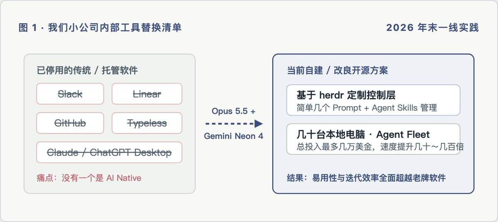
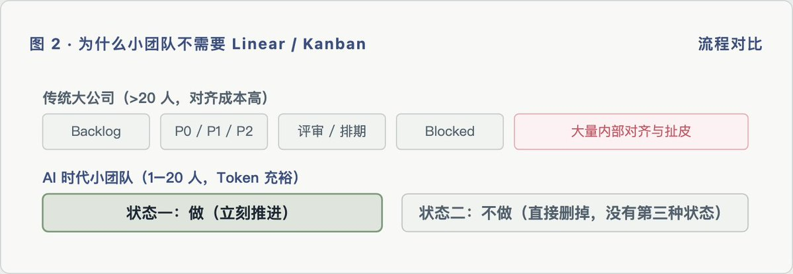

# 迈克 Mike：传统 IT 的 To B 生意会归零——因为没有一款软件是 AI native 的

> 把几人小公司内部用的软件全用 Opus 5.5 和 Gemini Neon 4 替掉（部分基于开源魔改、部分自建），包括 Slack、Linear、GitHub、Typeless，甚至 Claude Desktop / ChatGPT Desktop。核心原因只有一个：现有软件没有一个是 AI native 的——Claude Desktop 可以勉强定制但不够强，DeepSeek Harness 能定制但很不容易。

<!-- more -->

为什么我觉得传统 IT 行业 To B 的生意会归零？

最近我把我们几人小公司内部用的软件，全都用 Opus 5.5 和 Gemini Neon 4 替掉了（部分基于开源魔改，部分自建），包括 Slack、Linear、GitHub、Typeless，甚至 Claude Desktop / ChatGPT Desktop。

核心原因就一个：现有软件没有一个是 AI native 的。

Claude Desktop 可以勉强定制，但不够强；DeepSeek Harness 可以定制，但很不容易。对专业用户来说不如 herdr，对普通用户来说两者又都很普通。我现在基于 herdr，几个 prompt 和 agent skill 就能管几十台本地电脑的 agent fleet，花几万美金拿到的算力和迭代速度，比非 AI 顶级大厂的朋友高出几十甚至几百倍。

以后我不会再用 Office、Salesforce、传统 CRM，也不会再用便宜外包。企业客户早晚会发现，只要上点心，自己用 AI 就能做出比现有 SaaS 好无数倍、深度定制的工具。

推荐看下 @dannypostma 这条关于 SaaS 未来的帖子，说得非常透：静态软件已死，要么买断源码自己托管随便改，要么每人一个独立沙箱配专属 agent。

https://t.co/yoH68LSKnU

那软件创业还有机会吗？我觉得依旧有两大机会：

1. 只要 Salesforce、微软、HubSpot 市值还没归零，就有暴富机会。但过去 software 2.0 时代的软件必须从底层推倒重来（比如 Notion 如今远不如 Obsidian，我自己也在做更好的替代 InfoFlow）。
2. 正如 Orca CEO @JinjingLiang 说的，2C 软件机会比过去任何时候都大。普通人面对安装、上架这些各种 Red Tapes 和复杂度，最多搓个自用替代品，不会成为你的竞争对手。

工欲善其事，必先利其器。2026 年末，这句话比任何时候都清晰。一家之言，见笑了。

Here's my thought on the future of software/SaaS.

I'm completely switching off hosted platforms and hosted tools. I just reverse engineer them for myself, because I only need parts of them.

Two reasons why:

1. I want to own my data.

I use my data in different tools. Marketing, note-taking, whatever. And I want my agents, like Claude, to have complete access to it.

Not walled off in HubSpot, where I have to talk to their agent. Not behind MCP either. With MCP the agent pulls what it asks for, but it doesn't know what's there.

Give it a full list of data files and it has complete access. It knows what's there.

2. I want to customize it.

When I sign up for Pipedrive, I don't need all that bloated shit. I need one part of it, adjusted to my content, my business, how I work.

With AI that's a prompt, and one hour later it's done.

So static software is going to be a thing of the past. People want to adjust it to how they work and plug it into the other tools they have.

Where this goes, I think two ways:

A. You buy software again. Like paying $900 for a Photoshop license and putting it on your computer. Except now you get the source code. It's premade, because you don't have weeks to build it, but you host it on your own headless box and you can customize it, remove stuff, plug stuff in. Someone needs to build the operating system for this.

B. Everyone gets their own hosted instance. Not 10,000 customers on one box. Your own sandbox, with an agent that customizes it fully to you. The code stays proprietary, but you can adjust everything.

Might be completely wrong. Might be different for most people.

But this is already how I work.

全文：https://mikechong.substack.com/p/it-to-b-opus-55-ai

@guoshim fyi https://x.com/mike_chong_zh/status/2122150909832749358

今天 @onenewbite 发给我 Steve Yegge 这条，感觉受益很大：

https://t.co/zrlEMutuA6

他讲完两场“软件工厂”演讲后，总结了大家觉得最反直觉的三个观点，我用中文概括一下：

1. 慢下来。AI 的产出要按人的速度来，工程和业务都快不了。他的 agent 曾给玩家塞太多功能、给会计发太多邮件、把 merge queue 塞满，还惹毛了管理员。

2. 大多数人不需要软件工厂。维护成本极高，他已经推倒重来了五次。真要做就自己搭、别买，因为它会和你的业务深度绑定，是“装在盒子里的公司”。

3. 明年每个人都会有一个私人幕僚长 agent，忙的人甚至有一整队助手，而且会带到工作里，“你的人跟我的人谈”。人和 agent、agent 和 agent 之间的办公室戏码也会很多。

简单来说，明年每个人都会有一个幕僚长，你可以理解为每个人身边都有了一个蝙蝠侠的 Alfred。

## 相关页面

- [[concepts/agentic-architectures]]
- [[sources/multi-agent-communication]]
