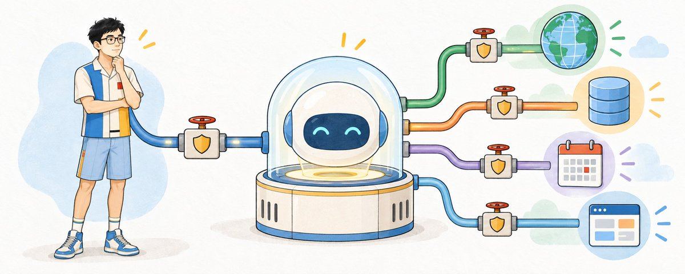
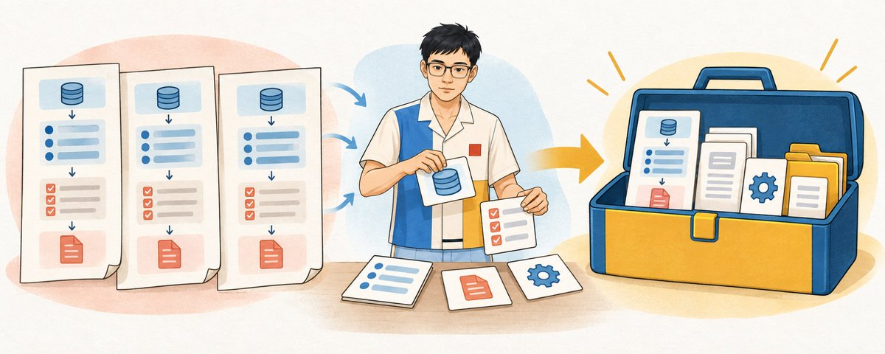
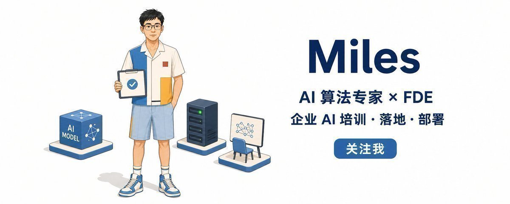

# Miles Ma（@miles_mazy）：零基础入门 AI，看完这篇就够了（避免花钱买课被割韭菜版）

> 面向零基础人群的 AI 入门完整指南，明确以「避免花钱买课被割韭菜」为出发点：厘清 AI 工具的分类与选择逻辑、日常高频场景的实操路径、提示词的基本功与常见误区，并指出哪些付费课程真正值得买、哪些是纯概念收割，帮助读者建立不依赖付费课程的自学闭环。

<!-- more -->

最近有不少人问我，自己没什么技术基础，现在开始学 AI，还来得及吗？

一圈看下来，可能收藏了几十篇文章，安装了一堆工具，还是不知道自己到底会了什么。

技术小白入门 AI，只需要一张路线图，不用花钱买课，不会被割韭菜：先看懂 AI 在做什么，再知道它为什么会出错，接着学会给材料、设边界、接工具和检查结果。遇到反复要做的事，再把它沉淀成 Skill。

走完这条路，你就有了继续学习各种 AI 工具的能力。

## 一、AI 的四类核心能力

小白第一次看 AI，很容易被产品名字绕晕。今天是 ChatGPT，明天是豆包，后天又出现一个新 Agent。把界面拿掉，它们主要在做四类事。

第一类是理解和表达。

你可以让它解释一个概念，比较几个方案，帮你把模糊的想法问清楚，也可以让它把专业内容改成普通人能看懂的话。很多人所说的“和 AI 聊天”，就在这一层。

第二类是生成内容。

文章、邮件、图片、语音、视频脚本、分镜，甚至一段可以直接使用的代码，都可以由 AI 生成。生成之后还要检查。一张图看着不错，里面的字可能是错的；一段视频能播放，声音、字幕和画面也可能对不上。

第三类是处理已经存在的东西。

把 PDF 里的要点抽出来，把两份合同的差异找出来，把会议纪要整理成待办，修改文档，检查表格，给一批文件重新命名。这一层要检查原始数字、文件结构和真实意图有没有被保留。

第四类是调用工具完成动作。

查网页、搜索文件、读取日历、调用公司系统、运行一段程序、创建或修改文件，都属于这一层。Codex 这类产品既能给建议，也能在授权的环境里动手。

这四类能力可以合在一起。你给它一份新产品资料，它先读文件，再总结内容，生成文章和配图，最后把文件放进正确目录。能力每增加一层，需要检查的地方也会增加一层。

先记住一句就够了：AI 可以回答，可以生成，也可以做事，三种结果各有对应的检查方法。


## 二、AI 为什么时好时坏

很多人第一次用 AI 觉得特别神，第二次就觉得它在胡说。这种波动来自生成概率、当前上下文和任务信息。

大语言模型会根据当前收到的内容，继续生成更合适的后续。这个过程里有概率，同一个问题问两次，表达方式和细节可能不一样。

AI 做不好一件事，常见的原因有四个。

一是你说得太模糊。“帮我优化一下”里没有说优化什么，它只能自己猜。

二是它缺少必要材料。你让它评价一个项目，没有提供项目文档、实际结果和用户反馈，它只能用通用经验填空。

三是你问的东西在模型外面。今天的股价、公司的实时库存、你电脑里刚写完的文件，不会凭空出现在它面前。它需要读取文件，搜索网络，或者通过工具查询真实系统。

四是任务缺少验收。代码需要运行，文件需要打开，文章里的事实需要核对。验收时要看文件、来源、运行结果、修改差异和最终成品。

把这四类问题分开，就能对症处理。任务没说清，补任务；材料不够，补上下文；需要外部信息，给它工具；结果不稳，加上验收和人工确认。


## 三、提示词是一份任务说明

提示词是一份交给 AI 的任务说明，作用是把目标、材料、边界和完成标准说清楚。

一份好用的任务说明，至少要回答四个问题。

你要拿到什么？

哪些材料会影响答案？

哪些事不能做？

怎样证明真的完成了？

比如你说“帮我把这份资料整理一下”，它不知道你是要摘要、文章、PPT，还是准备明天向老板汇报。换成下面这种说法，结果就容易检查得多。

```text
目标：
把我提供的资料整理成一份面向技术小白的说明。

上下文：
读者刚开始接触 AI，不熟悉专业名词。
只使用我提供的材料。材料之外的事实统一标为“待确认”。

边界：
- 保留原文中的数字、产品名和限制条件。
- 没有依据的内容标为“待确认”。
- 不修改原始文件，另存一份结果。

完成标准：
- 小白能看懂每个概念有什么用。
- 每个关键结论能回到原始材料。
- 最后列出待确认内容和已生成的文件。
```

提示词是第一道边界。如果 AI 已经可以修改文件、发送消息或调用公司系统，还要检查它拿到了什么权限。只读权限可以直接限制删除动作。

靠得住的边界有四层：提示词说清任务，上下文提供材料，权限限制动作，验收决定能不能交付。

小白最容易忽略的是最后一层。你让 AI 改了一篇文章，就去对数字、名字、图片和引用；你让 Codex 改了文件，就看实际 Diff，打开结果，运行对应检查。别只听它复述自己做了什么。


## 四、资料一多，你就会需要知识库

知识库适合资料需要反复使用、持续更新或追溯来源的场景。

你只想读一份报告，把文件上传给 AI 就够了。你每次都在重新上传同一批文件，或者已经记不清上次的结论来自哪里，知识库才开始有用。

上下文、记忆和知识库各自解决不同的问题。

上下文是这一次任务里，AI 当前能看到的内容。记忆更像是与你长期相关的偏好、背景和历史。知识库放的是会反复查询、需要回到来源的资料。公司的今日库存、当前订单和用户余额则属于实时数据，通常要现查系统，不能靠把几份旧文档塞进知识库。

你可以用四个问题判断自己是否需要知识库：

- 这批资料会不会反复使用？
- 内容会不会持续更新？
- 回答是否必须指出依据？
- 不同人是否只能看不同的内容？

四项都很轻，文件夹和上传文件已经够用。复用、更新、来源和权限越来越复杂，才需要往正式知识库走。

知识库需要处理文档解析、版本失效、来源追溯和文件权限。原始资料混乱，检索出来的内容也会混乱。

所以个人入门时，可以先建一个很简单的结构：原始资料、已核验笔记、正在做的项目、已完成的产出。这时候它还不一定是一个专门产品，一个整理清楚的文件夹也可以是知识库的起点。


## 五、AI 通过工具获取外部信息

当你问“今天上海的天气怎么样”，或者“公司现在还有多少库存”，问题的答案不在模型本身里，而在外部世界里。

浏览器搜索、文件读取、数据库查询、日历读写，本质上都是给 AI 增加一个外部入口。

工具是最容易理解的词。它就是 AI 可以调用的能力。“查今天天气”可以是一个工具，“从文件里搜索”可以是一个工具，“创建日历日程”也可以是一个工具。

Agent 是一种做事方式。给它一个目标以后，它会规划下一步，选择工具，看执行结果，再决定继续、重试或停下来问人。模型负责理解和判断，工具负责动作，Agent 把这几步连成一个循环。

API 是一种常见的系统接口。你可以把它理解成柜台窗口。窗口上写着可以办什么业务、需要交什么材料、最后会拿回什么。AI 按接口规则提交请求，就能调用柜台后面的能力。

工具调用是一个多步过程：AI 判断需要查数据，提出工具调用，外部系统真正执行，再把结果交回给 AI，由它继续整理答案。

MCP 解决的是另一个问题：外部工具越来越多，怎样用相对统一的方式把能力提供给 AI。它不会让一个差工具自动变好，也不会替你解决账号认证和权限问题。

小白先判断一个问题：这项任务要用到 AI 当前看不到的信息吗？

读眼前的文件，直接上传文件。查最新新闻，使用可核验的网络搜索。读公司数据，通过受控接口查询。发邮件、改日程和提交订单属于外部写入动作，需要身份、授权、确认和审计。

读取和写入的风险等级不同。先让 AI 查询，再开放修改；先让它生成草稿，再由人确认发送。这样的边界比一句“请你一定要小心”更可靠。



## 六、一个流程反复用，才值得做成 Skill

一套要求反复使用，就可以把它保存下来。

如果你每周都要整理会议纪要，而且规则已经很稳定：区分已确认决定和讨论中方案，负责人没写就留空，时间不清楚就标记待确认，最后输出固定表格。这时候就可以把它做成 Skill。

Skill 是一个可复用的工作包，至少要说清楚五件事：

- 什么时候应该用它；
- 需要什么输入；
- 按什么步骤做；
- 产出什么结果；
- 什么情况必须停下来问人。

必要时，Skill 里还可以带参考资料、模板、素材和脚本。比如发布前检查 Markdown 图片是否存在，这种机械动作让脚本去做会比让模型靠目测更稳。

一套流程实际使用两三次以后，重复部分会逐渐清楚。输入、步骤和验收稳定下来，就可以沉淀成 Skill。

你以前写过的提示词、清单和 SOP，都可以成为 Skill 的材料。沉淀时去掉临时路径、账号信息和特殊数据，保留可复用的方法和判断。

一句话区分提示词、知识库、工具和 Skill：

- 提示词告诉 AI 这一次要做什么。
- 知识库告诉 AI 可以从哪些材料里找依据。
- 工具让 AI 有机会去查数据或执行动作。
- Skill 告诉 AI 这类事以后应该怎么稳定地做。

能把这四个词分清，小白已经不容易被新产品的名字带跑了。



## 七、用一个案例走完七天

每个人的工作不同，拿同一个细分任务当作所有人的必修课，很难讲透。所以最后这七天，我只给一个通用案例：

选一个你真想学、想转型或想进入的方向，做一份可持续更新的学习包。

七天沿着这一条线往前走：

说清目标 → 盘点材料 → 补外部信息 → 建最小知识库 → 找能力差距 → 排四周计划 → 沉淀模板与 Skill。

- 第一天，说清自己的目标、起点和可投入的时间。
- 第二天，把已有的岗位描述、课程、文章和笔记交给 AI 盘点。
- 第三天，用联网搜索或工具补齐缺失的信息，同时保留来源和时间。
- 第四天，把材料分进“原始资料、核验笔记、学习任务、完成产出”四个目录。
- 第五天，让 AI 对照目标找差距，每项差距都配一个可以检查的结果。
- 第六天，排出四周计划，每周只留一个主题和一个交付物。
- 第七天，把好用的提示词、模板和检查清单留下来；稳定复用两三次以后，再做成 Skill。

最后你会拿到一页目标、资料清单、能力地图、四周计划、复用模板和错误记录。真正值得带走的是下面这段提示词。把四项信息填好，直接交给 ChatGPT 或 Codex，它会按天带你往下走。

```text
你是我的 AI 入门教练。请带我用七天完成一份“个人转型学习包”。

我想学习或转向的方向是：【填写方向】
我目前的工作和经验是：【填写】
我每天可以投入的时间是：【填写】
我已经有的资料是：【填写或上传】

请按下面的七天路径陪我完成：

第 1 天：明确目标、起点和可投入时间，列出还需要我补充的信息。
第 2 天：盘点我提供的材料，区分“材料原文”和“你的判断”。
第 3 天：查找缺失的外部信息，保留来源、发布时间和链接。
第 4 天：建立最小知识库，分为原始资料、核验笔记、学习任务和完成产出。
第 5 天：对照目标整理能力差距，每项差距都配一个可以检查的结果。
第 6 天：制定四周计划，每周只安排一个主题和一个交付物。
第 7 天：整理最终学习包，并找出可以继续复用的提示词、模板和检查清单。

执行时请遵守这些规则：

1. 每次只进行一天的内容。
2. 每天开始前，先说清当天要解决的问题和应该交付的文件。
3. 如果信息不够，先问我。所有经历、目标和数据都以我提供的内容为准。
4. 使用外部信息时，保留来源和时间，并把事实、推断和建议分开。
5. 每天结束时，让我检查产出，记录发现的错误和需要修改的部分。
6. 我确认当天结果以后，再进入下一天。

现在请用不超过 5 个问题了解我的起点，等我回答以后再制定学习方案。
```


## 小白最常问的 10 个问题

### 1. 我不会编程，能学 AI 吗？

能。不会编程也可以学习提问、提供材料、生成内容、读取文件和检查结果。编程会帮助你接 API、开发产品和处理复杂数据。

入门阶段需要练习三项基础能力：把问题说清楚，判断结果有没有用，发现数字、事实和逻辑里的错误。

### 2. ChatGPT、豆包和 Codex，我应该先学哪一个？

先选一个你现在就能打开、并且愿意连续用一周的。

提问、写作、读文件和做图，可以先用通用聊天工具。处理文件夹、修改项目或运行检查，可以使用 Codex。第一周选一个工具连续使用，重点放在完成任务上。

### 3. 提示词越长越好吗？

提示词的长度由任务决定。好用的提示词信息刚好够：目标清楚，材料给对，边界明确，完成标准可以检查。

复杂任务可以写两千字，简单任务用三句话也够。每句话都应该为任务提供有效信息。

### 4. 为什么同一段提示词，每次结果都不一样？

因为生成本身带有概率，当前对话、上传材料、工具结果和产品设置也会影响后续输出。

创意任务可以保留变化。合同、数字和固定格式需要模板、固定字段、程序检查和人工抽查。

### 5. AI 给出的答案能直接相信吗？

要按任务风险判断。“帮我把这句话改顺”和“帮我判断胸痛要不要去医院”，风险完全不同。

创意和低风险草稿可以快速试。涉及医疗、法律、财务、安全、人事和真实对外发布时，要回到权威来源和负责人。如果一句错话会让你付钱、签字、吃药、删数据或影响别人，就不能只因为 AI 说得很肯定就相信。

### 6. 我需要一开始就做知识库吗？

一次性任务可以直接上传文件，个人长期学习可以先整理文件夹和笔记。资料开始重复使用、持续更新，或者需要处理来源和权限时，再建立更正式的知识库。

先整理出一批会反复使用的材料，再考虑搭建 RAG。

### 7. API、工具和 MCP 到底有什么区别？

API 是系统对外提供的接口。工具是 AI 当前可以调用的某项能力。MCP 则是一种把外部能力提供给 AI 的通用协议和接入方式。

一个工具背后可能调用 API，也可能在本地读文件或运行程序。MCP 服务器可以向 AI 提供多个工具。小白先问清楚这个连接能读什么、能写什么、由谁授权。

### 8. 什么时候应该把流程做成 Skill？

等你至少实际做过两三次，已经知道输入是什么、步骤是什么、什么情况会失败、怎样算完成，再去做。

如果你还在每次重写整个方法，那它还是探索。如果你已经开始反复复制同一段提示词、同一个模板和同一张检查表，就到了沉淀的时候。

### 9. 一定要付费，才能学好 AI 吗？

不一定。免费产品已经可以让你学会问题拆解、提示词、文件处理和结果验收。付费通常会影响可用模型、使用量、速度、文件与工具能力，这些会随产品调整，不适合在学习路径里写成永久规则。

先用你现在能用的东西完成一个小项目。当你已经很清楚哪个限制在耽误自己，再为那个具体限制付费。

### 10. 公司文件可以直接上传给 AI 吗？

先确认公司是否允许。

先看公司规则、账号类型、数据处理条款和文件本身的敏感程度。密码、密钥、身份证信息、客户隐私、未公开财务数据和受合同保护的资料，都不应该因为“只是让 AI 帮忙看一下”就随手上传。

不确定时，先用公开材料、虚构数据或脱敏样本验证流程。使用 AI 之前，先判断哪些内容可以交给它。

学 AI 要持续完成可以检查的结果。频繁更换工具，只会让学习停留在熟悉界面这一步。

你现在可以先从一个真问题开始，把资料放进去，让 AI 交一版结果，再自己去查。遇到问题，看它是缺任务、缺上下文、缺工具，还是缺验收。

这条线走顺以后，你再去学新模型、新产品和新 Agent，心里就有尺子了。


我是 Miles，一名 AI 行业应用者，也是一名连续创业者。

我长期关注 Agent、RAG、MCP、AI 编程和企业级 AI 实践，也会持续分享工具的真实使用体验和行业判断。

如果你也在做 AI，或者想知道怎么把 AI 真正用进工作，欢迎关注我，一起让技术真正发生价值。



## 相关页面

- [[sources/khazix-6-prompt-mindset-techniques]]
- [[sources/leoshen-ai-agent-quickstart-rethinking]]
- [[concepts/prompt-engineering]]
- [[concepts/ai-era-learning-paradigm]]
