# Miles Ma（@miles_mazy）：出海赚美金系列｜SEO 保姆级教程

> 面向独立开发者的出海 SEO 系统性实操指南：从什么是搜索意图（Search Intent）切入，详解关键词挖掘（KD 分级、长尾修饰词）、域名选择（EMD 与品牌名权衡）、站内 SEO 架构（TDK 规范、H 标签层级、Schema 结构化数据）、站外高质量外链建设，到通过 Google Search Console 数据持续迭代自然流量的完整打法。

<!-- more -->

现在用 AI 做网站非常简单，真正难的是怎么让客户找到你。

如果只是单纯投流，广告一停，客户就没了；SEO 解决的就是这个问题。做好的页面能持续带来正在找工具、商品和服务的人。

做海外市场和做国内市场不太一样。想让内容进入 GEO 推荐，依然绕不开 SEO。网页要先被搜索引擎发现、收录和理解，才有机会出现在搜索结果和 AI 回答里。今天这篇就把这条链路讲清楚，也讲清楚 SEO 到底怎么做。


## 01 先把 SEO 这件事讲清楚

企业要卖商品、卖软件、卖服务，就要持续让新客户找到自己。广告可以直接买来流量，但停止投放以后，流量通常也会跟着减少。

SEO 做的是：把真正有人搜索的问题做成页面，让这些页面在较长时间里不断获得搜索展示和点击。

所以，SEO 不是“多写文章”，也不是在页面里反复塞几个关键词。它是一套完整的工作：

1. 找到真实需求，弄清楚用户会搜索什么。
2. 判断用户想看工具、商品、教程，还是产品对比。
3. 做出能解决问题的页面，让 Google 可以找到、读取和收录。
4. 用站内链接和外部引用帮助 Google 理解页面之间的关系，并判断哪些页面更值得展示。
5. 根据真实的展示、点击和搜索词继续修改页面。

以图片压缩工具为例。有人在 Google 搜“在线压缩图片”，网站提供一张可以直接上传和压缩图片的页面。Google 收录这张页面并把它放进搜索结果后，用户才有机会点进来使用工具。网站可以通过订阅、一次性付费、广告或其他方式赚钱。SEO 负责的，就是把“有人搜索”到“有人进入网站”这一段路打通。

这套能力既能给自己的产品带来用户，也能做成服务。企业同样需要有人帮它找搜索词、规划页面、修复收录问题、建设内链和外链，再根据数据不断调整。

## 02 Google 怎么把一张网页送到用户面前

Google 不是等用户搜索以后，才临时把整个互联网翻一遍。它平时就在不断寻找网页、读取内容，再把符合条件的页面放进自己的搜索数据库。用户搜索时，Google 从这个数据库里挑选可能有用的页面并排序。

一张网页进入搜索结果，大致要经过四步：

- 发现：Google 先知道这个网址存在。
- 抓取：Google 打开页面，读取文字、图片和链接。
- 收录：Google 判断页面内容后，决定是否把它放进搜索数据库。
- 排名：有人搜索时，Google 决定这张页面要不要出现，以及排在什么位置。

这四步不能混在一起。Google 发现了网址，不代表已经抓取；抓取了，不代表一定收录；收录了，也不代表会有排名。

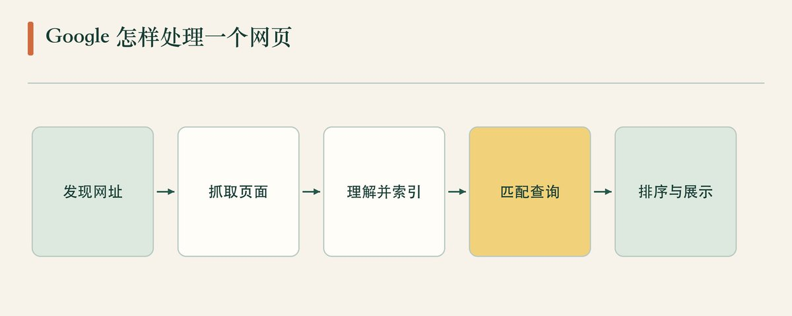

SEO 做的每一件事，都能放回这条链路里看。需求和搜索词决定页面要回答什么；页面内容和技术设置决定 Google 能不能读懂；站内链接和外部引用帮助 Google 发现页面、理解页面；搜索数据则告诉你，前面的判断有没有做对。

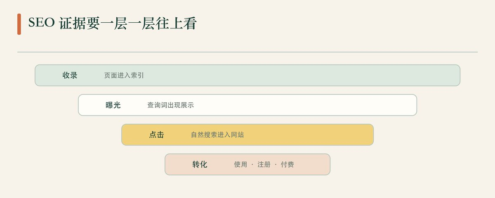

## 03 SEO 的第一步，是找到真实需求

弄懂 Google 的工作方式以后，先不要急着注册域名、写文章或者提交收录。SEO 的第一步，是找到一个真实需求。没有需求的页面，即使被收录，也很难带来用户。

假设你已经知道一个需求：有人想把图片压小，方便发邮件或上传网站。先不用急着想英文词，可以用中文把这个需求拆开：

- 他要做什么：压缩图片、缩小图片体积。
- 他为什么做：邮件附件太大、网站上传失败、网页加载太慢。
- 他在什么设备上做：手机、Windows、Mac。
- 他处理什么文件：JPG、PNG、证件照、商品图。
- 他担心什么：图片变糊、文件泄露、操作太慢。
- 他会比较什么：免费工具、免注册工具、某个产品的替代品。

这些说法不是最后的关键词，只是一张需求地图。真正面向美国市场，就把候选说法翻成英文，再去美国地区的搜索结果和工具里核对；面向日本，就用日语核对。中文可以帮助你把问题想清楚，最后的判断必须回到目标用户实际使用的语言。

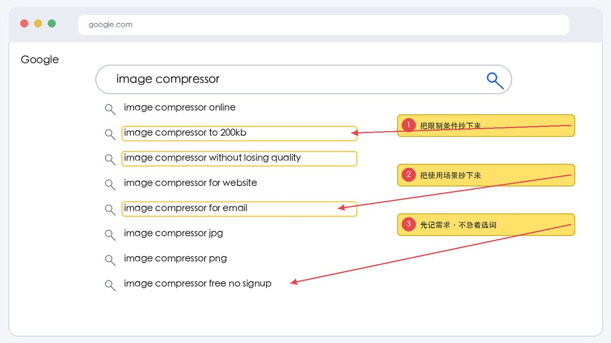

## 04 已知一个需求，怎样找到更多搜索词

找搜索词不需要全靠自己猜，也不能全部交给 AI。更稳妥的做法，是先让 AI 铺开，再用真实搜索数据收窄。

你可以先把产品、用户和使用场景交给 AI：

```text
我做了一个在线图片压缩工具，目标用户是美国的小商家、内容创作者和普通办公用户。

请从下面几个方向，列出他们可能会搜索的问题：
1. 想直接完成任务
2. 遇到具体限制
3. 想学习操作方法
4. 比较不同工具
5. 寻找替代产品
6. 担心隐私、画质或速度

先用中文解释需求，再给出自然的英文搜索说法。不要编搜索量。
```

AI 很适合做三件事：补充同义说法、寻找你没想到的使用场景、把一大批词按需求分组。它不适合直接告诉你“这个词一定有流量”“这个词竞争很小”或者“做这张页面一定能排上去”。这些判断需要真实搜索结果和关键词工具来核对。

接着到 [Google](https://www.google.com/) 输入最核心的说法，查看自动补全、搜索结果底部的相关搜索，以及“其他人还问了”。这些内容来自真实搜索环境，能继续带出相邻问题。

关键词工具能一次列出更多相关说法。可以先试 [Ahrefs 免费关键词生成器](https://ahrefs.com/keyword-generator) 或 [OpenSEO 关键词生成器](https://openseo.so/keyword-generator)。输入一个宽泛说法，它们会返回相关词、估算搜索次数和竞争情况。

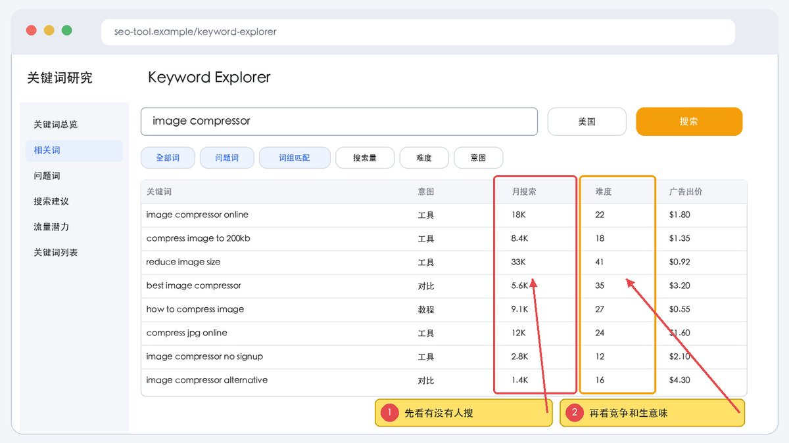

工具里还会显示一个广告参考数字。它大致表示广告主愿意为一次搜索点击支付多少钱。数字高，通常说明这个词更接近购买、订阅或商业决策；数字低，也不代表这个需求没价值。它只是帮助你判断“这个搜索背后有没有生意”，不能单独决定做不做。

[Google Trends](https://trends.google.com/trends/explore) 用来看一个需求是在上升、长期稳定，还是只在某个季节变热。它显示的是相对热度，不是准确的搜索人数。输入两个说法进行比较时，要选择目标国家和合适的时间范围。

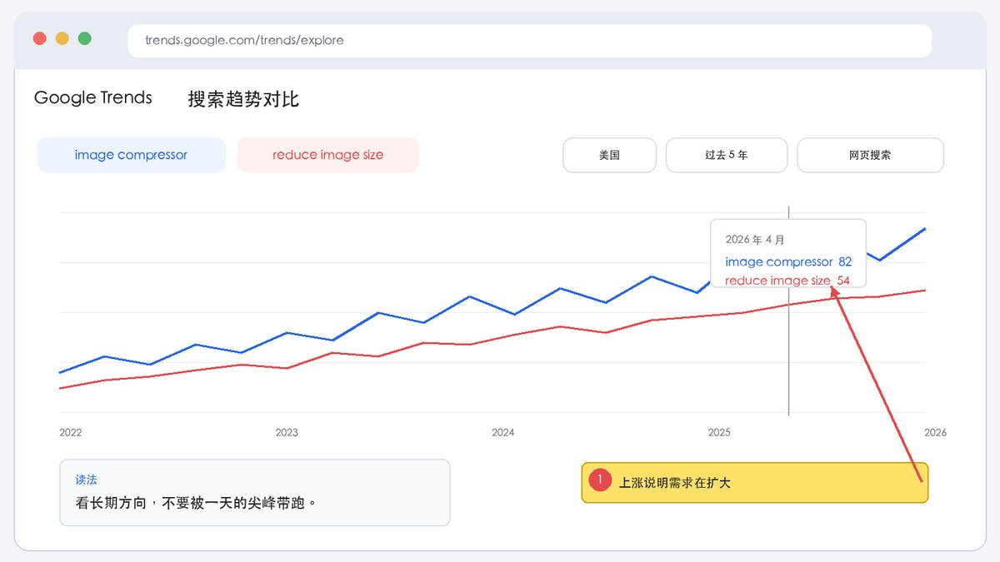

[Google Ads 关键词规划师](https://ads.google.com/aw/keywordplanner/home) 可以继续查看搜索量区间、地区和广告竞争。它属于 Google Ads，使用前需要登录 Google Ads 账号。第一次用时，进入“发现新关键词”，既可以输入一个搜索词，也可以输入竞品网址，让 Google 从那个网站里找相关词。

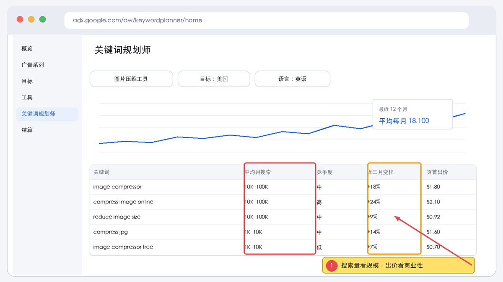

如果候选词很多，可以在 Ahrefs 或 OpenSEO 里继续扩展。工具负责给你更多可能性，人负责删掉和产品无关、没有点击机会、或者自己根本解决不了的需求。

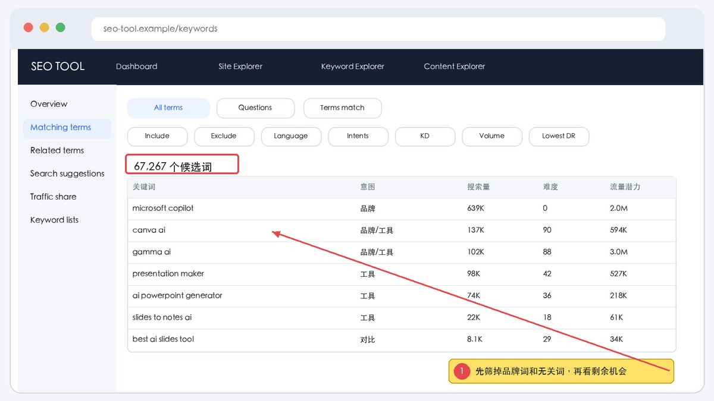

## 05 搜索意图不能只让 AI 猜

“搜索意图”说白了，就是用户输入这句话时到底想干什么。

例如，“图片怎么压缩”可能是在找教程；“在线图片压缩”更像是想马上使用工具；“最好用的图片压缩工具”是在比较产品；“某某工具替代品”说明用户已经知道一个产品，正在寻找别的选择。

AI 可以帮你做第一轮分类，但最后一定要亲自搜索。因为真正决定页面类型的，是当前排在前面的结果。Google 如果连续展示在线工具，说明大多数人想直接操作；如果前面大多是教程，说明用户想看步骤。搜索结果本身，就是 Google 对这句话的理解。

判断时只看三件事：

- 前排是什么页面：工具页、商品页、教程、对比文章，还是官方文档。
- 它们怎么呈现：步骤教学、产品清单、问答、下载，还是直接操作。
- 它们共同强调什么：免费、速度、免注册、安全，还是某个具体功能。

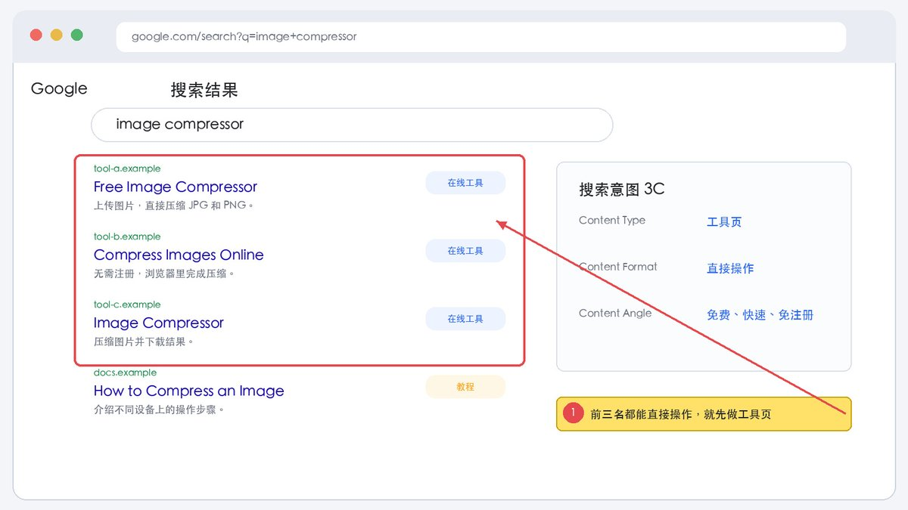

同一批词还要判断是否应该放在同一张页面。分别搜索两个词，如果前排结果大部分相同，通常可以先由同一张页面承接；如果结果完全不同，就拆成两张页面。

## 06 把需求变成页面，而不是变成一堆文章

做完需求和搜索词，下一步不是立刻开始写，而是先决定网站需要哪些页面。

还是图片压缩这个需求，可以形成这样的结构：

```text
/image-compressor        直接使用的图片压缩工具
/compress-jpg            专门处理 JPG 的页面
/blog/compress-image     图片压缩教程
/alternatives/example    某个同类产品的替代方案
```

工具需求做工具页，购买需求做商品页，学习需求做教程，比较需求做对比页。不要把所有词都写成博客，也不要为了多收录，把同一个功能换几个词复制成十张页面。

内容运营可以按四层来排：

1. 核心页面：真正提供产品、工具或服务，是网站最重要的页面。
2. 场景页面：解决某种文件、设备、职业或使用场景下的问题。
3. 教程内容：回答“怎么做”“为什么失败”“如何选择”。
4. 比较内容：帮助已经在挑产品的人比较方案。

新站先做少量核心页面，再围绕它补场景和教程。页面数量没有一个固定答案，字数也不是越多越好。工具页先保证能用，再把步骤、限制、格式和常见问题讲清楚；教程写到读者能够完成操作就够了。

AI 可以帮助整理提纲、翻译初稿、补充常见问题和检查遗漏，但发布前要人工核对三件事：内容是否真的符合产品功能，步骤是否能够操作，语言是否像当地用户会说的话。批量生成几十篇意思差不多的文章，只会让网站变得更乱。

## 07 工具页要同时让用户和 Google 看懂

一张工具页最上面先说清楚它能做什么，然后马上让用户操作。工具下面再补说明，不要让用户先读很长的背景介绍。

一个基础工具页按照下面这张图安排就够了。重点是先让用户完成任务，说明、限制和常见问题放在工具后面。

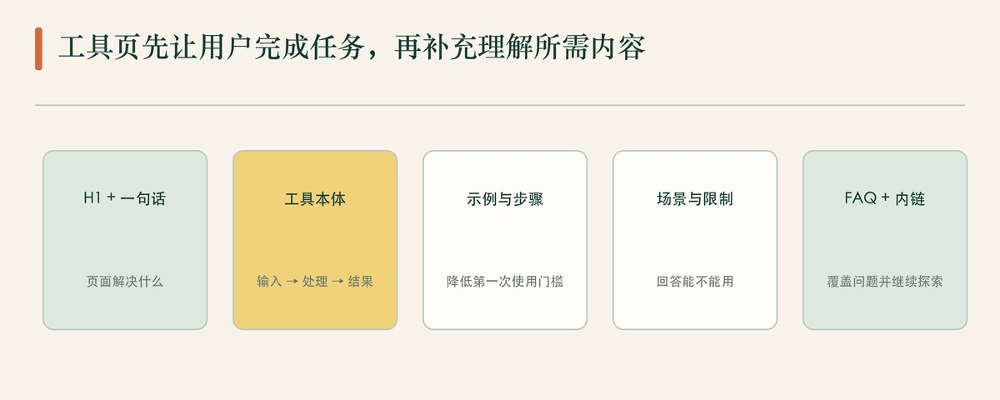

内容要围着用户正在完成的任务写。比如页面说“免费压缩 JPG”，工具却要求上传后付费，搜索词和页面承诺就对不上。Google 想判断的不是你写了多少字，而是这张页面能不能解决搜索者的问题。

Google 自己的 [SEO 入门指南](https://developers.google.com/search/docs/fundamentals/seo-starter-guide?hl=zh-CN) 也一直强调：先为用户做有帮助的内容，再让搜索引擎容易发现和理解。

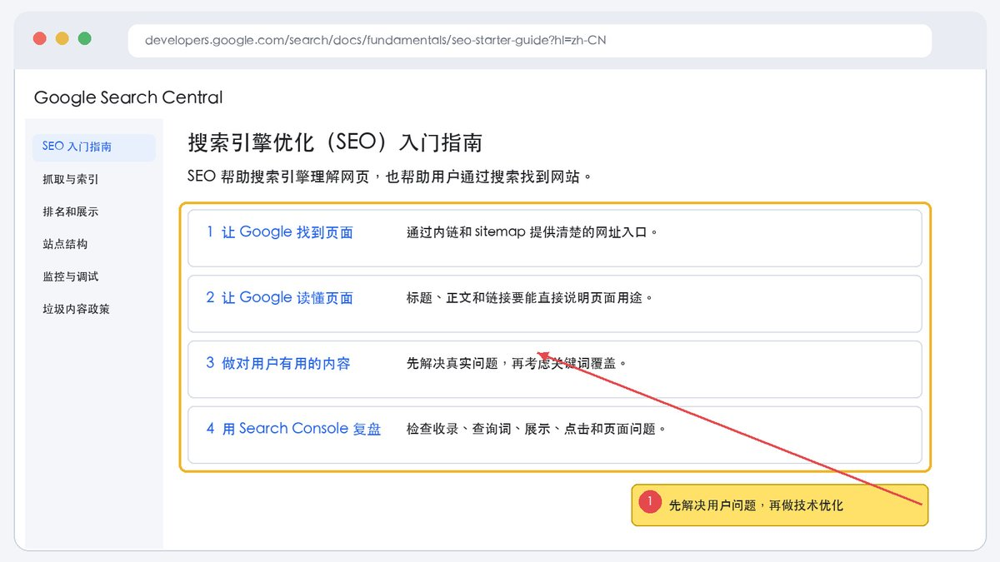

页面做好后，检查几个基础位置：

- 搜索标题：用户在结果页看到的主标题，要直接说清页面解决什么问题。
- 搜索说明：标题下面的简短介绍，告诉用户功能和适用场景。
- 页面主标题：用户进入页面后看到的最大标题。
- 小节标题：把步骤、限制和常见问题分开。
- 页面地址：尽量简短、稳定、能看懂。
- 图片说明：图片无法显示时，搜索引擎和读屏软件仍能知道图片内容。

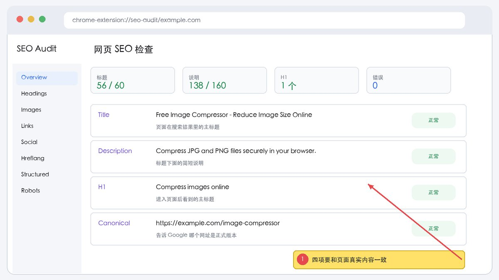

## 08 页面做好后，让 Google 发现、读取和收录

前面的需求、搜索词和页面都做好以后，再来处理收录。所谓技术 SEO，就是检查网页有没有挡住 Google。新手先看下面几项：

- 页面公开可访问，不需要登录。
- 页面能正常打开，不是“找不到页面”或服务器报错。
- robots.txt 没有禁止 Google 读取重要页面。
- 页面没有添加 noindex。这个标记的意思是“不要收录这张页面”。
- sitemap 里有最终想让 Google 收录的网址。
- 重要页面都能从正常链接点进去。
- 手机端可以正常操作。
- 页面打开后能看到真正的文字和链接。

如果网站是 AI 写出来的，可以直接问它：“打开网页源代码时，能不能看到页面的核心文字和链接？”网页源代码就是浏览器最先拿到的页面内容。如果里面几乎没有正文，就让 AI 把公开页面改成 Google 更容易读取的形式。你不需要先学会所有前端技术，但要看懂这次检查有没有发现问题。

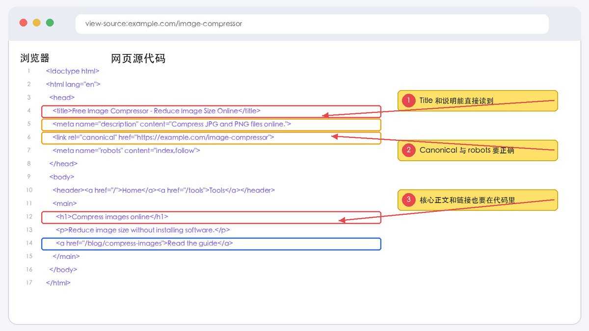

网站上线，不等于 Google 已经知道它。Google 发现新页面，常见的入口有四个：

1. 站内链接。首页、分类页或旧文章链接到了这张新页面。
2. 外部链接。其他网站、产品目录或文章链接到了这张页面。
3. Sitemap。网站把想让 Google 知道的网址整理成一份清单，也叫站点地图。
4. Search Console。站长可以在 Google 的网站管理后台里提交站点地图、检查网址和查看搜索数据。

一张新页面发布后，先从首页或相关页面给它一个正常链接，再确认它已经出现在 sitemap 里。然后打开 [Google Search Console](https://search.google.com/search-console/about)，提交 sitemap，并用“网址检查”查看这张页面。

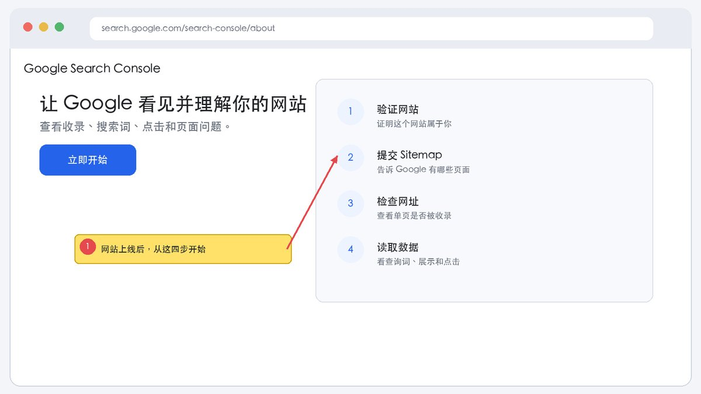

Sitemap 可以理解成“我希望 Google 知道的页面清单”。它帮助 Google 发现网址，但不能保证收录。大多数 WordPress、Shopify 和常见建站框架都能自动生成。打开后确认核心页面在里面，再到 Search Console 的“站点地图”提交。

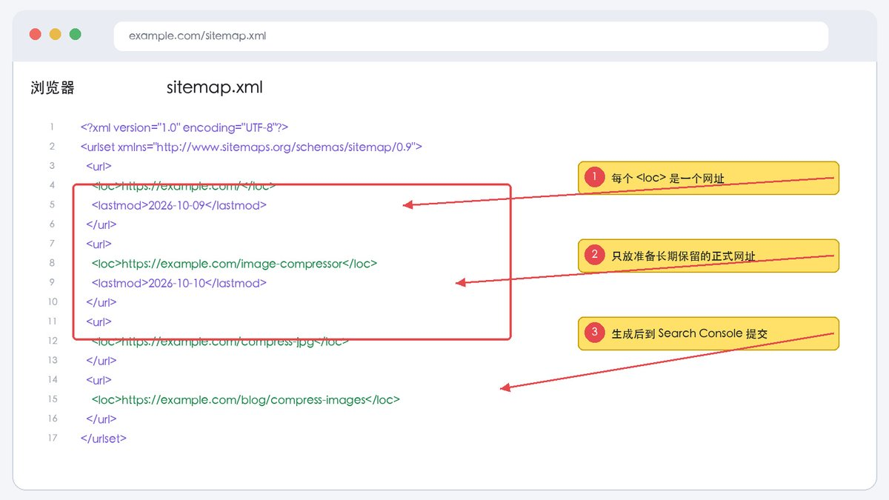

在 Search Console 检查页面时，可能会看到几种状态：

- 显示“未发现”，先检查站内链接和 sitemap。
- 显示“已发现，尚未抓取”，说明 Google 知道网址，但还没有来读取。
- 显示“已抓取，尚未编入索引”，说明 Google 看过页面，但暂时没有收录。
- 显示“网页已编入索引”，说明页面已经进入 Google 的搜索数据库。

在 Google 搜索 site：你的域名，也能粗略查看网站有没有页面出现。要检查某一张具体页面，Search Console 的“网址检查”更准确。

网站只有几张页面时，可以逐张检查。页面很多时，不必一张张请求收录，保证站内链接和 sitemap 正常更重要。请求收录只是提醒 Google 来看，不代表它一定会收录，反复点击也不会让收录变快。

## 09 内链把页面接起来，外链把外部入口带进来

内链就是自己网站内部的链接。首页链接核心工具和主要分类，教程讲到图片压缩时链接压缩工具，相关工具之间也可以互相推荐。

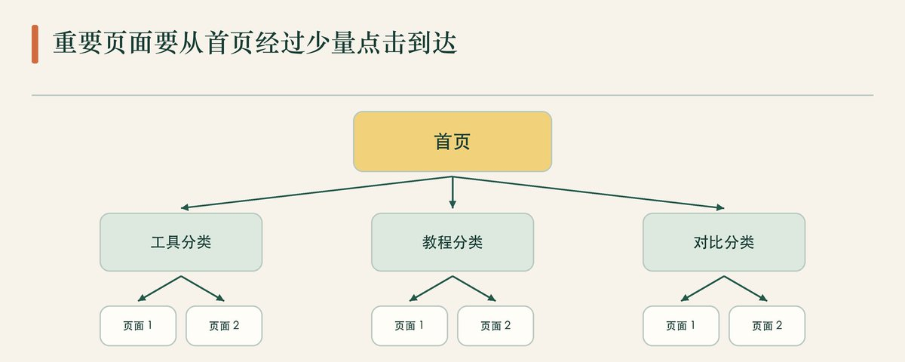

内链一方面帮助 Google 发现更多页面，另一方面告诉它哪些页面更重要。链接文字直接写清目的，例如“图片压缩工具”“图片压缩教程”，比整站都写“点击这里”更容易理解。

[AITDK SEO 扩展](https://chromewebstore.google.com/detail/aitdk-seo-extension-traff/hhfkpjffbhledfpkhhcoidplcebgdgbk) 可以直接查看一张页面的标题、图片和链接。新手用它时先找两个问题：重要页面有没有入口，链接文字能不能看懂。

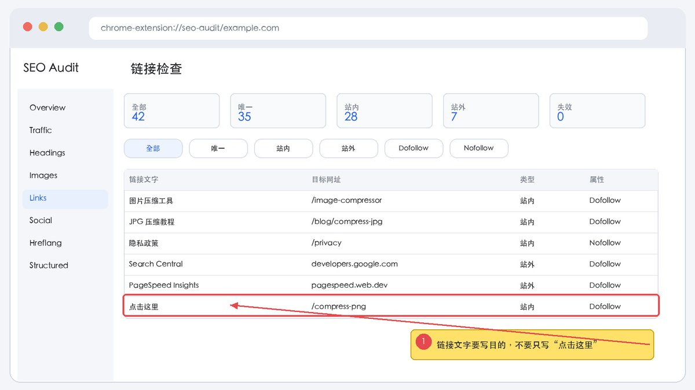

外链是其他网站链接到你的页面。它既可能带来用户，也让 Google 看到外部网站在引用你。检查竞品时，不用先研究所有分数，只看两件事：前排页面大概有多强，有多少个不同网站链接到它。

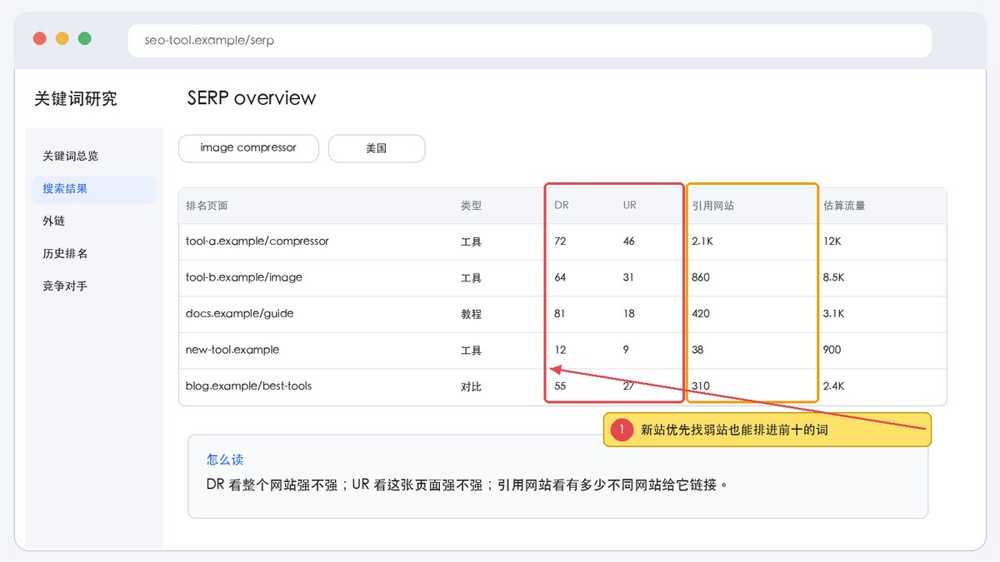

新站可以从真实入口开始：提交相关产品目录，在社区里解决具体问题，做别人愿意引用的免费工具或模板，联系写过相关主题的作者体验产品。链接出现的地方应该和产品有关，点进去的人也应该能得到帮助。

## 10 白帽和黑帽，区别在于网站有没有真实价值

白帽、黑帽不用背复杂定义。判断一个动作时，问两个问题就够了：这个页面对用户有没有用？这个链接除了影响排名，还有没有正常存在的理由？

能解决问题的页面、真实推荐产生的链接、独立可用的小工具，更接近白帽。隐藏内容、复制大量空页面、入侵别人的网站放链接，或者专门搭一批空壳站给主站加链接，风险很高。

有人会搭多个小网站。多个网站本身没有问题。如果每个网站都有独立功能、内容和用户，它们之间在合适的位置互相推荐，是正常的产品关系。如果这些网站没有真实用途，只复制内容并统一给主站加链接，就成了专门操纵排名的站群。

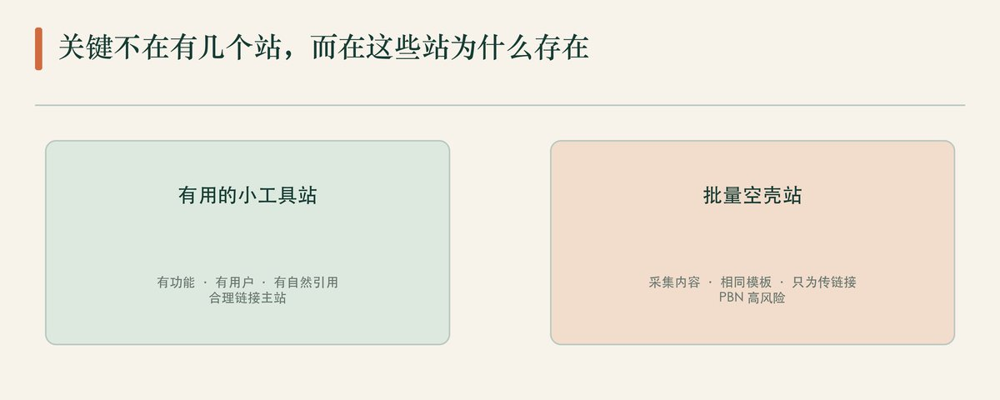

## 11 上线以后，再做三个基础检查

打开页面后，可以先用 [AITDK SEO 扩展](https://chromewebstore.google.com/detail/aitdk-seo-extension-traff/hhfkpjffbhledfpkhhcoidplcebgdgbk) 扫一遍。重点看搜索标题、搜索说明、页面主标题、正式网址、爬虫规则、站点地图、图片说明和链接。插件分数只是提醒你有没有漏项，不代表页面一定会有排名。

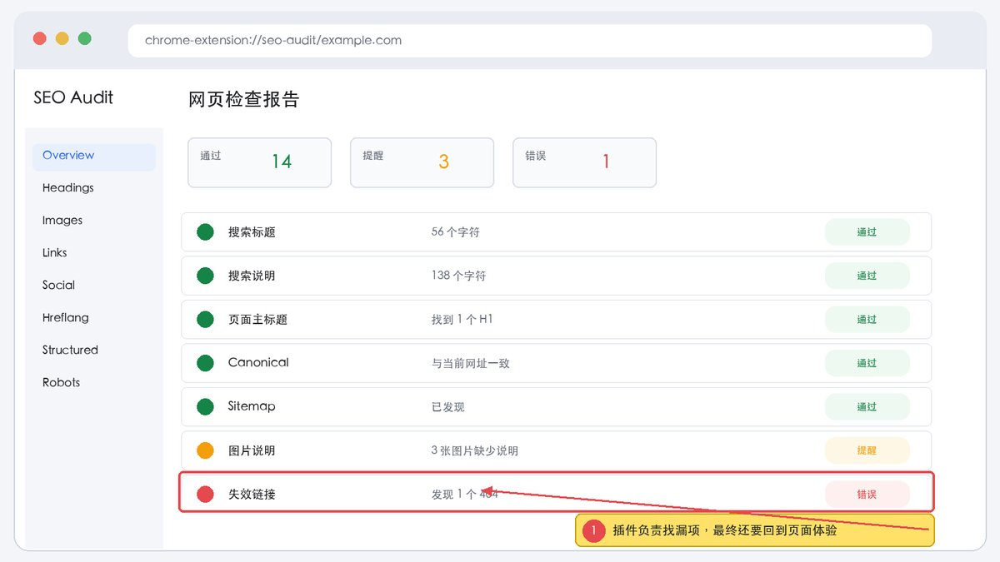

页面速度用 [PageSpeed Insights](https://pagespeed.web.dev/) 检查。新站先处理最明显的问题：图片太大、首屏加载太慢、点按钮没有反应，以及页面打开时内容不停跳动。

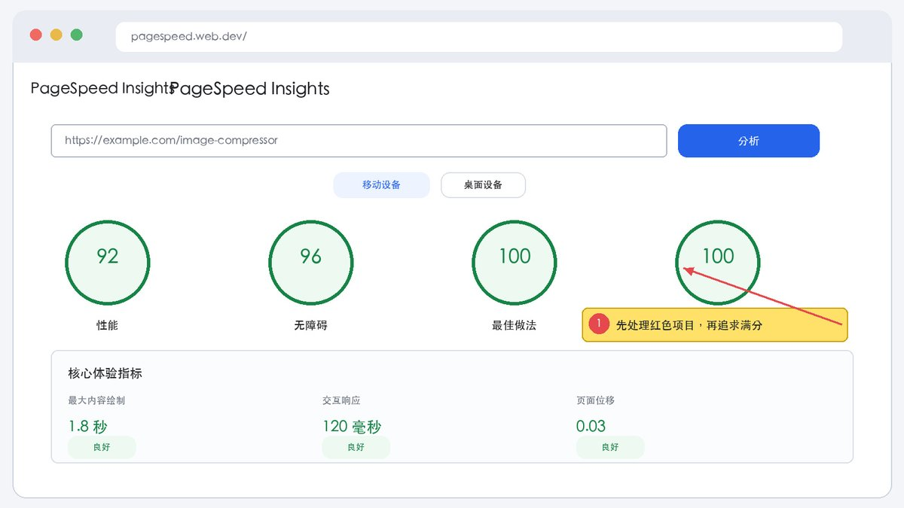

结构化信息属于加分项，不是新站第一天的必做项。需要时，可以让 AI 根据页面里真实存在的产品名、价格和评分生成代码，再用 [Google 富媒体搜索结果测试](https://search.google.com/test/rich-results)检查。页面上没有的信息，不要在代码里编造。

## 12 用 Search Console 决定下一步做什么

网站上线后，先在 Search Console 验证网站，提交 sitemap，再检查几张核心页面有没有被收录。

页面开始获得展示后，看四个数字：展示是页面在搜索结果里出现了多少次；点击是有多少人进入网站；点击率是每一百次展示大约带来多少点击；平均排名是页面大约排在什么位置。

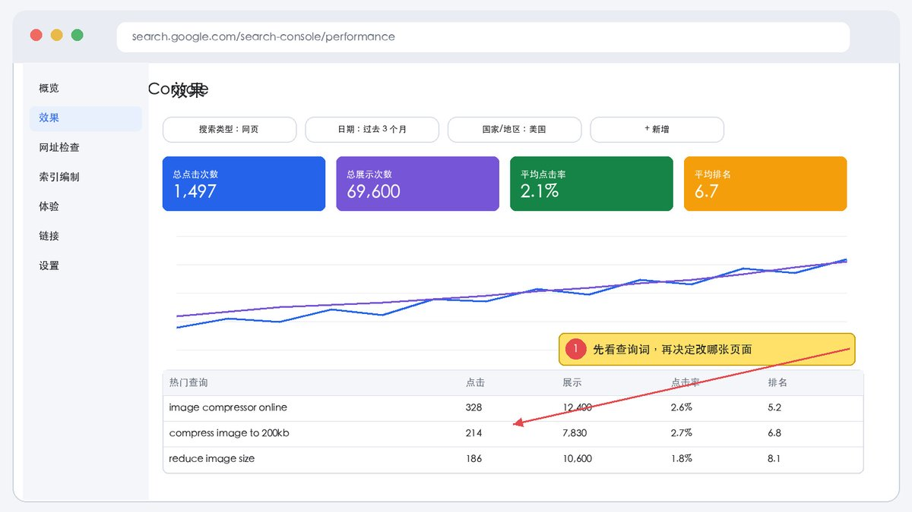

数据出现以后，按问题处理：

- 页面没被发现：补站内链接，检查 sitemap。
- 已经发现但没有收录：检查页面能否打开、内容是否太少或重复。
- 已经收录但没有展示：重新检查需求和搜索意图。
- 有展示，排名还靠后：补充页面内容、内链和外部引用。
- 排名不低，点击很少：修改搜索标题和说明。
- 有点击，却没人使用产品：搜索词和页面承接可能不匹配。

“网址检查”适合查看某一张具体页面。输入网址后，可以看到 Google 有没有收录、上次什么时候来过，以及它把哪个网址当作正式版本。

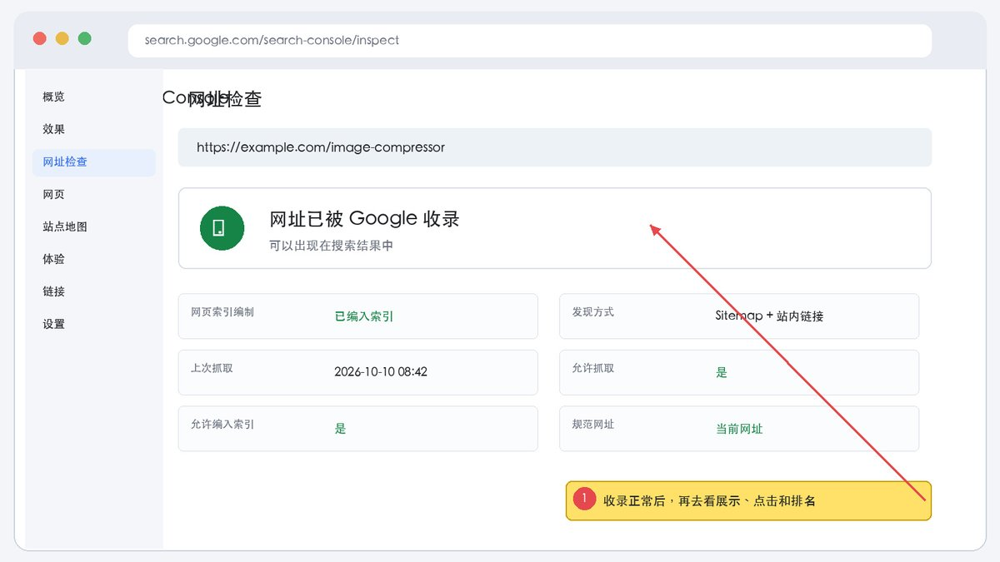

第一次做 SEO，可以只按这条路走：确定一个真实需求，让 AI 帮你扩展说法，再用 Google 和关键词工具核对；做出一张匹配搜索意图的核心页面；用站内链接、sitemap 和 Search Console 帮 Google 发现它；确认收录后，看真实搜索词和展示数据；最后再补内容、内链和外链。

先让一张页面跑通，再照着同样的方法做下一张。网站里越来越多页面能够被发现、被理解、被引用，SEO 才会逐渐形成稳定流量。等这些基础做好以后，再谈 GEO，才有可以被 AI 找到和推荐的内容。

我是 Miles，一名从大厂转型 FDE 的 AI 算法专家，做过算法研发、优化部署，也做过企业培训和落地交付。我会继续分享 AI、内容和创业路上的实践。

关注我 [@miles_mazy](https://x.com/miles_mazy)，一起成长，一起赚钱。


## 相关页面

- [[sources/gefei-seo-directory-inner-pages-wikipedia-structure]]
- [[sources/hezhiyan-outsea-3000usd-monthly-content-digest]]
- [[concepts/seo-basics]]
- [[concepts/gefei-seo-keywords]]
