# Miles Ma（@miles_mazy）：出海系列｜从 0 到 1 出海赚美金指南——四条路、建站、收款与利润

> 这篇把出海赚美金一次性讲清，先给四条路：卖商品（Amazon 含 FBA、TikTok Shop、独立站）、卖软件和数字产品（一次买断、按月订阅、按使用次数卖额度）、卖服务（按项目、小时或阶段收费）、做内容和免费工具（广告、联盟佣金、厂商买推荐位或赞助栏目）。最容易误会的一点是访问量不是收入——十万人看过页面，如果没有广告、成交、赞助或自己的产品，银行账户不会多一分钱。建站侧先问「用户进来以后要完成什么」再选技术：实物用 Shopify 这类商店系统，文章评测和资源目录用 WordPress，工具站用 AI 辅助开发再部署到 Cloudflare，收费接口的密钥必须放服务端。收费方式跟着使用频率变：临时翻译一份文件更容易接受按次付费，每天都要阅读资料的人更适合订阅，别的软件要批量调用就按 API 用量收费。广告以 Google AdSense 为例要先申请并通过审核，作者算了一笔账：一次使用要花 0.1 美元接口费、而这次访问平均只带来 0.02 美元广告收入时，用户越多亏得越快。投放验证要先定一个总预算和截止时间（比如这一轮最多花 100 美元）。收款上 Stripe 此前核对的公开支持列表没有中国大陆，PayPal 中国有个人卖家和企业卖家两条路径，Paddle 这类名义商户服务只处理获准软件产品的付款、账单和销售税。最后回到利润：一位客户付的钱扣掉为他交付和获客花的钱之后还能不能留下钱，如果每多卖一单都在亏，订单越多亏得越快。

<!-- more -->

大家都知道出海可以赚美金，一句话就事：把东西卖给海外用户。

这个东西可以是一件实物、一个软件、一份模板，也可以是你的服务。

你还可以做中间商，建一个有流量的网站，帮商家展示商品、带去客户，从广告、赞助或成交佣金里赚钱。

现在做这件事，门槛比过去低了很多。AI 已经能帮忙写代码、做网页、翻译文案和处理本地化；Shopify、WordPress、Google 和 Cloudflare 等平台，也把建站、部署、推广和经营需要的大量基础工具准备好了。

今天这篇文章，就把出海赚美金的方式一次性讲清楚，

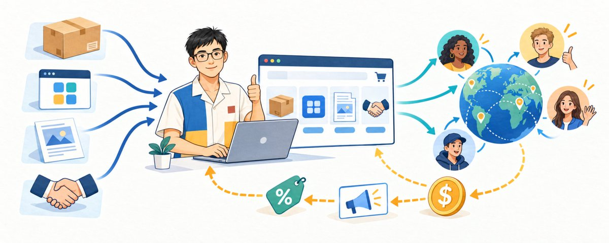

## 1. 出海赚钱，常见的是这四条路

### 卖商品：把一件货送到海外买家手里

卖衣服、家居用品、手机配件，这都属于卖商品，钱来自买家的订单。

订单金额扣掉采购、包装、仓储、物流、平台费用、广告和退货，剩下的才是利润。

在 Amazon 上卖，先选市场和商品，确认销售资格，找供应商拿样，算采购和配送成本。

商品没问题，再申请卖家账户、建立商品页，写清规格、价格、配送和退货。买家搜索到商品，下单付款，你完成发货和售后。

你可以自己或找仓库发货，也可以提前把货送进 Amazon 仓库，由平台按规则配送，这就是 FBA。不管哪种方式，采购、补货、积压和退货都要自己算账。

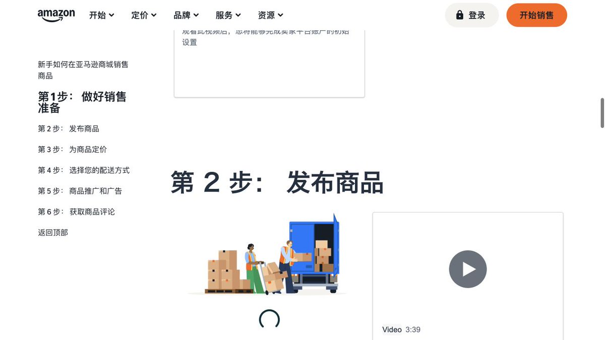

TikTok Shop 也是卖货，只是买家发现商品的方式不同。Amazon 上的买家常常已经知道自己要买什么，会主动搜索。

TikTok 上的用户可能原本只是在刷视频，看到演示以后才产生兴趣。因此你要把商品怎么用、能解决什么问题、用完是什么效果拍出来。短视频、直播和达人合作，都是把商品送到用户眼前的方法。

播放量要一路走到点击商品、付款、收货，才有机会变成利润。送样、达人佣金、视频制作和投流费用，都要算进成本。从国内做跨境店，还要按目标市场确认入驻和物流条件。

还可以自己建一个独立站卖货。独立站像一间开在网上的自营商店。商品怎么摆、品牌怎么讲、结账怎么走，都由你决定。

代价也很直接：平台不会自动送来买家。你要靠 Google 搜索、社交内容、达人或广告，把人带进网站；下单以后，还要自己接住支付、发货和售后。

如果不想先压一批货，可以接到订单以后再让供应商发货。这样少占一些现金，但商品质量和发货速度更难控制。自己备货更稳，也更容易积压。卖实物时，物流从一开始就决定了成本、售价和用户要等多久。

拿宠物除毛刷来说，你可以把它放到 Amazon，也可以在 TikTok 上拍使用前后的效果，还可以用独立站承接广告。三种入口卖的是同一件货，生意却不一样。Amazon 带来正在搜索商品的人，你要和同类商品争排名与评价；TikTok 靠视频让人临时产生兴趣；独立站由你掌握页面和品牌，但每一个访客都要自己找来。选择平台，其实是在选择从哪里获得买家。

### 卖软件和数字产品：付款以后，用户拿到功能或文件

翻译插件、图片压缩工具、字幕工具，都可以卖。模板、素材、电子书和课程也可以卖。它们没有纸箱和快递，交付的是使用权、下载文件或在线功能。

软件卖的是省下来的时间和完成的任务。用户先看演示或试用，确认有用后付款，你再开通功能、额度或授权。它可以很小，只要能把一件事做好。

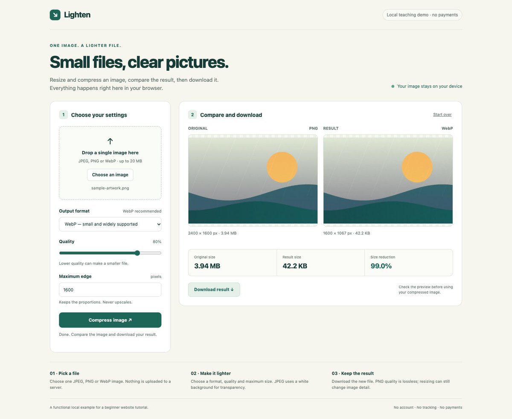

软件可以一次买断，也可以按月订阅，还可以按使用次数卖额度。一次买断适合边界清楚的功能。订阅要求产品每个月都能继续提供价值。额度适合会消耗模型、存储或算力的工具。收费方式不同，后面承担的成本也不同。

模板和素材更简单一些。你把成品、预览图、文件格式、使用范围和授权说明放到销售页。用户看过样例，付款，下载文件。一个文件可以卖很多次，但制作、更新、客服和推广仍然要花时间。

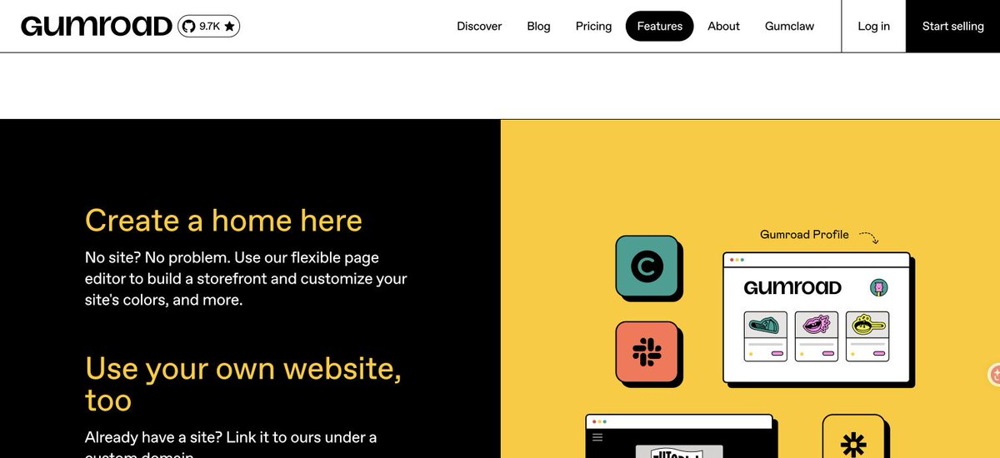

数字产品不用发快递，却不一定没有交付成本。翻译工具每调用一次模型接口，可能都要付钱；用户上传文件，会用到存储和流量；卖了长期使用权，后面还要维护。软件能复制，服务用户并不一定免费。

一个网页翻译插件可以先只做好“选中一段文字，原文旁边出现译文”。用户偶尔使用，可以提供免费次数；经常阅读资料的人，可以购买更多额度或订阅。另一个图片压缩工具，也可以让单张处理免费，把批量处理、统一尺寸和自动下载放进付费版。这里没有固定答案，收费点要放在用户愿意为省时间付钱的地方。

### 卖服务：客户付钱，请你完成一件事

设计、开发、翻译、剪辑和咨询，都能卖给海外客户。客户付钱，是为了得到你的工作时间和最终结果。

服务可以从接单平台获得，也可以从自己的网站获得。网站上放清楚你能做什么、做过什么、怎样联系。客户提交需求以后，你要确认交付内容、时间、素材、修改次数和价格。双方说清楚，再开始做。

比如做企业网站，页面数量、表单、域名、素材和维护要提前约定。否则页面越加越多，修改越改越久，收到的钱却没有变。

服务可以按项目、小时或阶段收费，也可以按月提供持续服务。它的好处是第一单不一定需要很多流量，几位合适的客户就能产生收入。它的问题是交付会占用时间，很难像文件下载那样同时服务很多人。

服务确定以后，可以通过账单写清项目、金额和付款事项，客户付款后再按约定交付。

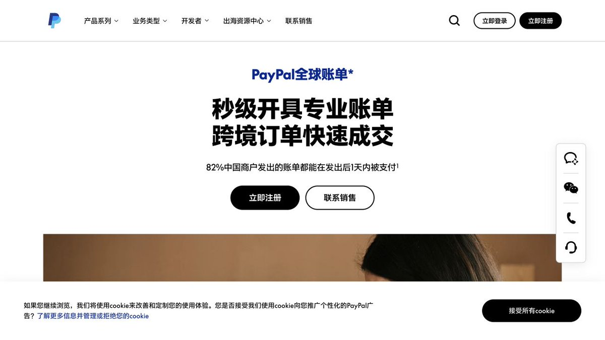

例如给海外创作者做短视频字幕，客户会看字幕是否准确、能不能按时交付、包含几轮修改。你可以先接一个项目，摸清一条视频要花多少时间。等同类订单多了，再把常见步骤做成固定套餐，甚至做成半自动工具。服务有时也是软件需求最直接的来源。

### 做内容和免费工具：用户不付钱，也有人愿意付钱

教程、评测、资源目录、小游戏、计算器和免费工具，都可以先让用户免费访问。钱可能来自广告主，也可能来自被推荐的商家和赞助方。

一个教程网站有很多人阅读，页面里可以放广告。广告主付钱购买展示或点击，网站按平台规则获得一部分收入。一个产品评测站把用户推荐到商家，用户完成购买后，商家可以按规则支付佣金。一个行业目录聚集了很准确的用户，厂商也可能直接购买推荐位或赞助栏目。

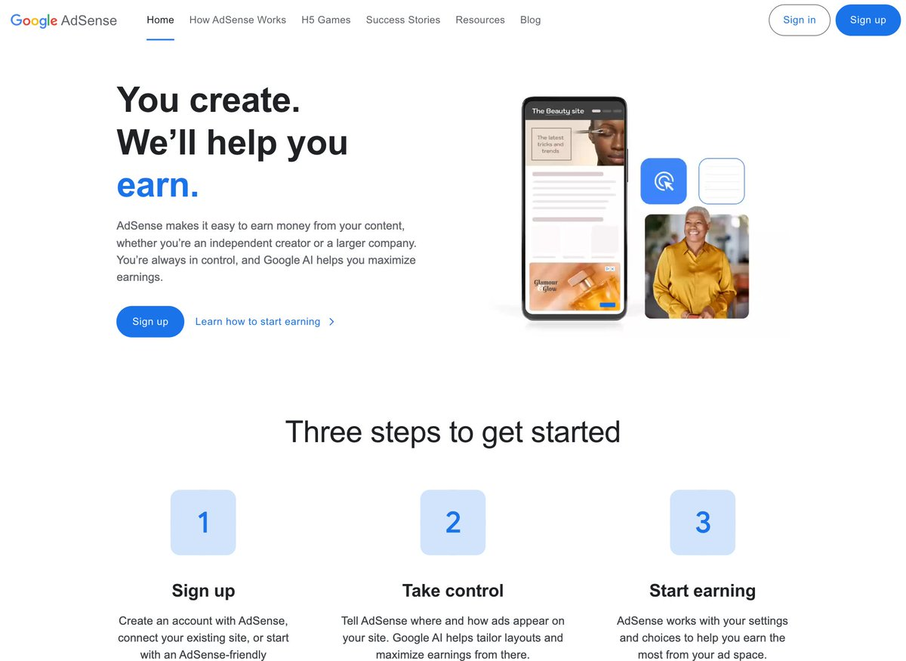

这里最容易误会的一点是：访问量不是收入。十万人看过页面，如果没有广告、成交、赞助或自己的产品，银行账户不会多一分钱。访问只是把可能付钱的人带到面前，后面必须有一条明确的收费路线。

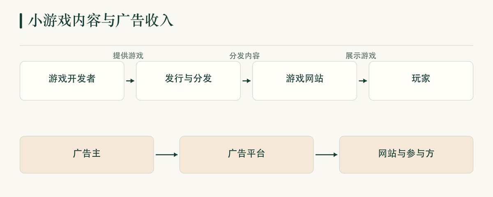

比如你做一个“远程办公工具目录”。有人来比较会议、翻译和项目管理软件，页面可以放联盟链接；某个厂商想获得更多曝光，可以购买明确标注的推荐位；访问足够多时，还可以接广告。读者没有直接给你钱，商家愿意为这批准确的用户付钱。中间商赚的，就是连接需求和供给的钱。

这四条路也能组合。免费工具可以卖批量功能，教程网站可以卖模板，服务网站可以卖咨询，也可以把常见工作做成软件。开始时最好先确定主要收入。你知道主要向谁收钱，才知道网站该做什么。

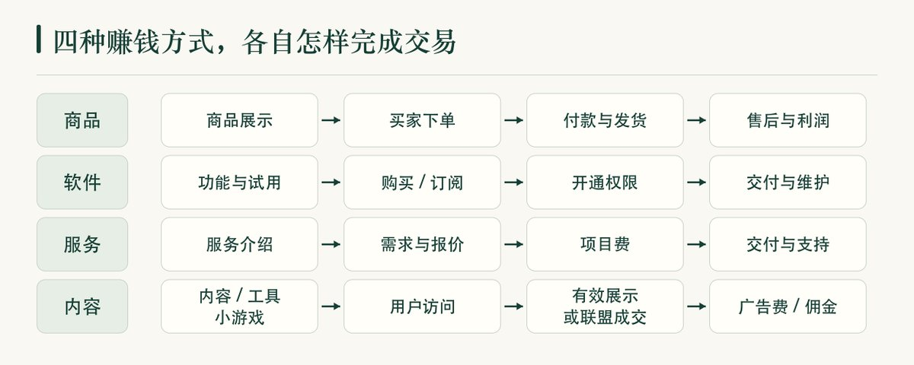

## 2. 聚焦建站：网站到底有什么用

网站不是一种生意，它是生意发生的地方。

卖实物的网站像商店，用户在里面挑商品、付款。工具网站像一台机器，用户放入文件，拿走结果。内容网站像一本不断增加页面的手册，用户来找答案。服务网站像一间接待室，让客户看作品、提需求、留联系方式。

所以不要先问“我该用什么技术建站”，先问“用户进来以后要完成什么”。卖货，最短路线是看商品、付款、收货；卖工具，是看到效果、亲自试用、购买权限；卖服务，是看懂你能做什么、提交需求、收到报价。路线不同，网站需要的页面和功能也不同。

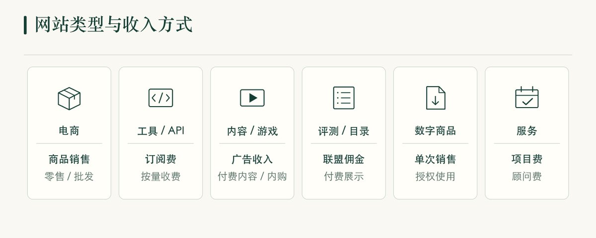

小网站的优势，是只解决一个小问题。它不用做成一个什么都能干的大平台。

还是看翻译插件。通用 AI 也能翻译，但有人每天都在网页上读专业资料。他不想反复复制，不想丢掉原文位置，也不想每次重新解释术语。如果一个插件把这几个麻烦处理好，它就有机会收费。用户买的是顺手，不是功能数量。

图片工具也一样。第一版只做上传、压缩、下载，就已经完成了一项任务。偶尔处理一张图的人可以免费用，经常批量处理的人可以购买批量、高分辨率或自动化功能。

这也是小网站值得做的地方。大平台会服务很多人，小网站可以把一个动作做得更快。有人只想把几十张商品图统一压到合适大小，他不需要一套复杂的设计软件，只需要上传以后一次处理完。这个动作如果反复发生，就可能变成一门很小、但说得通的生意。

一个网站经营久了，里面会留下产品、内容、用户和收入记录。有人愿意接着经营时，网站也可能整体转让。但出售网站是后面的结果。前面仍然要先证明它能解决问题、带来收入。

## 3. 先做一个能接住生意的网站

卖什么，决定在哪里搭。卖实物，可以用 Shopify 这类商店系统，它已经准备好商品、结账、订单和配送管理。你把商品、价格、支付和运费设置好，再完整测试一次下单流程。

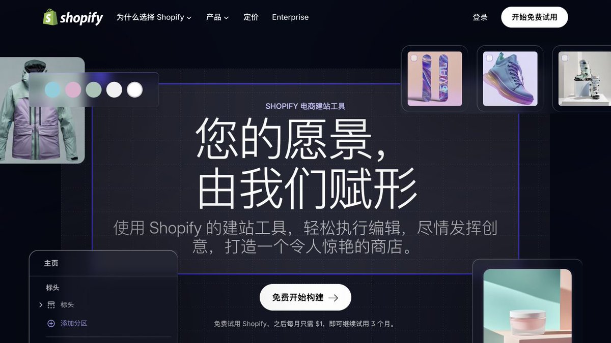

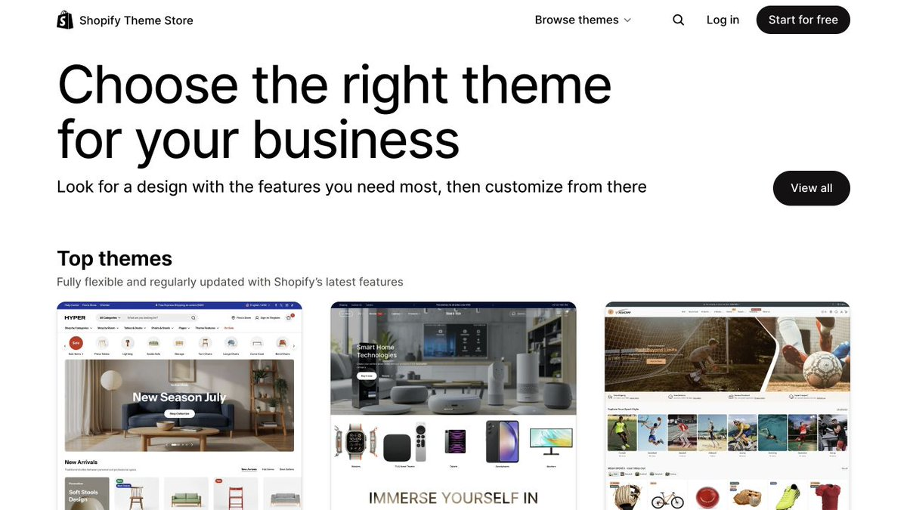

做文章、评测和资源目录，可以用 WordPress。它方便发布和管理内容，再按需要增加会员或商店。域名是网站地址，托管服务是放程序和文件的地方，这些都可能产生费用。

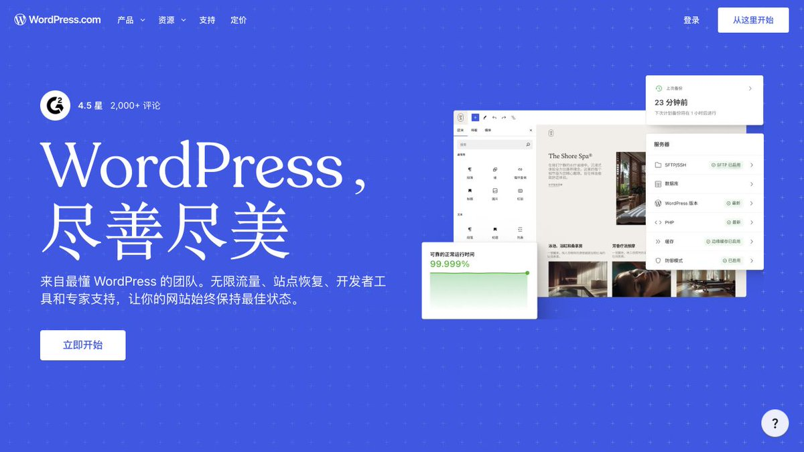

做工具站，可以用 AI 辅助开发，再部署到支持相应功能的平台，例如 Cloudflare。第一版先让用户输入材料、完成处理、拿到结果；收费以后，还要能记录订单、开通权限。收费接口的密钥放在服务端，不能直接暴露在网页里。

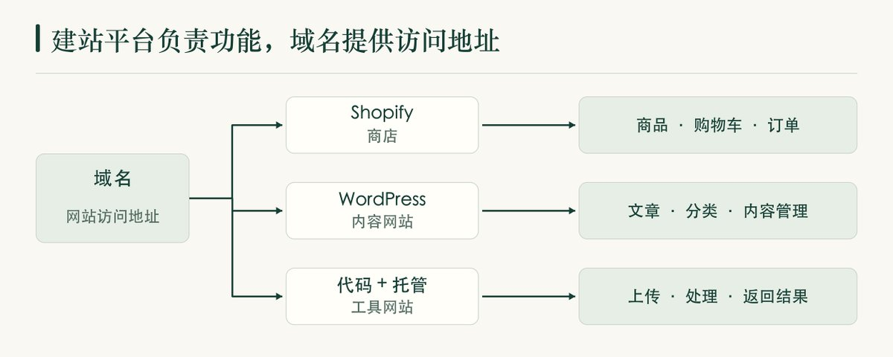

先把最短的购买和使用过程做好。主题、插件和页面以后可以加，核心功能不能只是演示。收款资格也要提前查清楚，别做完了才发现无法按原计划收钱。后台怎样设置、代码怎样部署，可以放到具体建站时逐项处理。

第一版网站不用很大。一个工具站可以只有首页、工具页、价格页和联系入口；一个数字商品站可以只有商品介绍、样例、付款和下载；一个服务站可以只有服务说明、作品和询价表单。页面少没有关系，只要用户从进入网站到拿到结果的路是通的。

## 4. 网站有了，钱怎样进来

### 直接付费：用户买你的商品或功能

一次购买最容易理解。用户付一笔钱，拿走一个插件、一份模板或一次服务。按次收费，是做一次任务付一次钱。额度包，是先买一包次数，用一次扣一次。订阅，是每个周期继续付款。

订阅听起来稳定，却不能硬套。用户每个月都会回来完成同一类任务，产品也每个月继续提供价值，订阅才站得住。如果一件事一年只做一次，用户很难愿意月月付钱。

价格页要把买到什么写清楚。一次买断能用多久，是否包含更新；订阅多久扣一次，怎样取消；额度怎样消耗，失败会不会返还。免费试用也要让用户真正拿到一次结果，否则他仍然不知道值不值得买。

工具还可以把能力做成 API，让其他软件调用。对方按次数或套餐付费。此时卖的不只是结果，还有稳定性、调用说明和用量记录。

还是以翻译工具为例。临时翻译一份文件的人，更容易接受按次付费；每天都要阅读资料的人，可能更适合订阅；另一个软件想批量调用翻译能力，就更适合按 API 用量收费。产品没变，用户使用它的频率和方式变了，收费方法也会跟着变。

### 广告：用户免费用，广告主来付钱

内容站、免费工具和小游戏可以放广告。以 Google AdSense 为例，网站申请并通过相应审核，连接广告服务后，页面可以展示匹配的广告。广告主向平台付钱，网站按规则获得收入。

广告收入会受用户地区、页面内容、广告需求和有效访问影响。同样一千次访问，不一定带来同样的钱。自己点击广告，或者叫别人帮忙点，也不是增加收入的办法。

免费工具尤其要算清楚。一次使用如果要花 0.1 美元接口费，而这次访问平均只带来 0.02 美元广告收入，用户越多，亏得越快。先免费不等于可以不算成本。

广告更适合边际成本很低的页面，例如文章、目录和小游戏。需要频繁调用收费模型的工具，通常不能只靠广告。可以把基础功能免费开放，用广告承担一部分成本，再把批量、高清或更快处理做成付费功能。

### 联盟：帮商家带来成交，拿一笔佣金

商家给你一个能识别来源的链接。你把它放进相关教程、评测或目录里。读者点过去并完成符合规则的购买，商家向你支付佣金。这就是联盟推广。

比如你比较几款文档翻译工具。读者看完以后，从你的链接进入其中一款并购买，这一单可能产生佣金。只点了没有买、后来退款、超过归因时间，或者订单不符合规则，都可能没有佣金。

联盟内容的价值是帮用户做选择。什么产品都说好，读者反而不知道怎样选。你需要讲清适合谁、哪里好用、有什么限制，并说明存在推荐关系。产品和佣金规则变了，旧页面也要更新。

一篇“适合学生的三款文档翻译工具”就可以承接联盟收入。读者本来就在做选择，你把价格、文件限制和使用体验讲清楚，他从链接进入商家并购买，你获得佣金。前面的比较帮读者少走了弯路，这才是链接能带来成交的原因。

### 赞助：厂商买一个明确的合作位置

当网站聚集了一批明确的用户，厂商可能愿意买首页推荐位、专题栏目、邮件广告或合作内容。对方买的是接触这批用户的机会。

合作前要说清位置、时间、素材、上线日期和交付数据。按展示收费，就交付约定的展示；按效果收费，就先说清什么结果算有效。曝光、点击和成交不是一回事，不能混在一句承诺里。

联盟主要看合格成交，赞助主要看双方约定的交付。你推广别人的产品，佣金是收入；你请别人推广自己的产品，佣金和赞助费就成了获客成本。

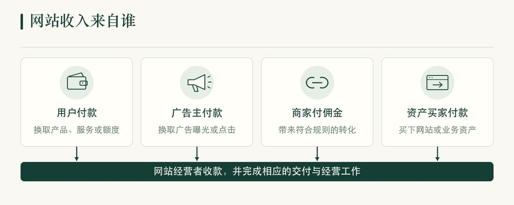

## 5. 找需求：先找人们正在做的事

“我要做一个 AI 网站”不是需求。AI 只是做东西的方法。需求要说清楚：谁在什么情况下，被哪一步卡住了。

例如，“帮经常阅读专业文档的人，在原网页对照翻译，并固定常用术语”，就比“做一个翻译网站”清楚得多。你知道了谁在用、何时用、哪里麻烦，才知道第一版该做什么。

很多人会反过来做：先让 AI 写出一个产品，再去问谁会用。这样最容易得到一个功能很多、需求很弱的网站。更稳的顺序，是先看用户正在完成什么任务，再决定做页面、插件还是服务。

找需求可以顺着网站和搜索词往下走。

先找一个同类产品，看它的导航、教程、评论和推荐。用户除了用它，还会用什么？整段工作里还有哪一步很麻烦？这是从一个网站找到更多网站。

再看这个网站靠哪些搜索词被找到，哪些页面访问多。Similarweb、Semrush、Ahrefs 等工具能给出估计。数字不一定完全准确，但能告诉你应该继续查看哪些词和页面。

然后拿任务去 Google 搜。打开排在前面的产品，用同一份材料试一遍。速度怎样，结果怎样，手机上好不好用，价格说没说清。现有产品已经解决得很好，而你只是换个颜色，就没有找到足够的改进。

再看自动补全、相关搜索和用户提问。有人搜“翻译网页”，想马上使用功能；有人搜“最好用的翻译插件”，想先比较。词看起来接近，用户此刻要做的事并不一样。

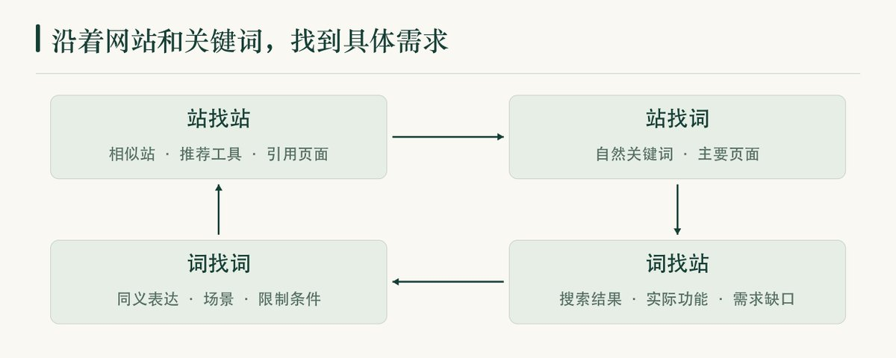

Google Trends 可以看一个词在不同时间和地区的相对热度。它适合比较方向和变化，不是订单预测器。曲线上升，只说明搜索兴趣变化，不代表做出来一定有人付钱。

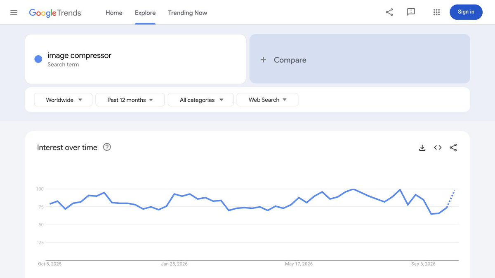

评论区和差评也很有用。有人抱怨“每次都要重新设置术语”“长文件容易失败”“手机上无法操作”，这些都是具体问题。不要看到一条抱怨就立刻开发。多看几个产品、多看几种来源，确认同一个麻烦反复出现。

比如你连续看到用户抱怨 PDF 太大、上传失败、处理后排版错乱。先别急着做一套完整的文档平台，可以做一个只处理某种常见 PDF 的小工具，把“上传失败”这一件事解决掉。再找提出过这个问题的人试用。有人愿意反复用，甚至愿意付费，需求才从一句抱怨变成了可以继续做的方向。

第一版只抓住其中一件事。把用户放进去，把输入写清楚，把结果写清楚。比如：让阅读专业资料的人，把网页内容翻译成双语对照，并保留固定术语。这个范围已经足够做出、演示和收费。

## 6. 产品做出来以后，先让人看见

流量主要有两种。自然流量来自搜索、内容、社区和别人主动推荐，花钱少一些，积累需要时间。付费流量是直接买广告，能更快看到用户会不会点击、使用和付款。SEO 的具体做法可以单独展开，这里先把付费验证讲清楚。

自然流量适合长期经营。你写一篇真正解决问题的教程，或者做一个别人愿意收藏的小工具，它可能不断从搜索和分享里带来用户。广告适合快速验证。页面今天上线，明天就可以买一小批相关访问，看用户会不会完成任务。两种方式可以一起做，只是解决的问题不同。

### Google 搜索广告：接住正在找答案的人

有人搜索“compress png online”或“translate pdf”，已经在主动找工具。Google 搜索广告可以出现在相关搜索结果里。用户点一下，进入你的工具页或商品页，你为这次点击付费。

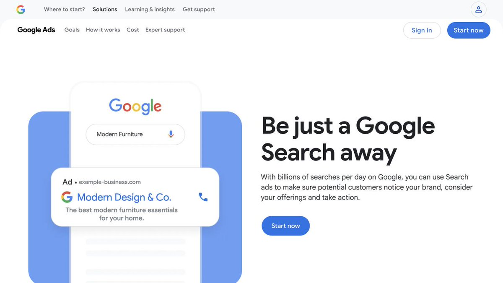

关键词规划工具可以帮助查看相关词和大致竞争情况。不要只挑搜索量大的词。一个词越宽，进来的人越杂。第一轮更适合围绕一项具体任务，控制地区、语言和关键词范围。

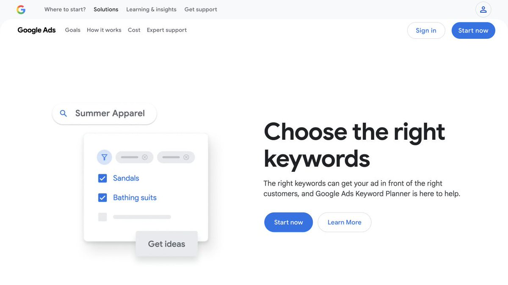

### YouTube 和展示广告：先让人看见效果

有些产品靠画面更容易懂。图片修复、视频工具、设计模板，都可以用短演示告诉用户：原来是什么样，点了哪里，最后变成什么样。YouTube 适合承载这种过程。

展示广告会出现在网站或应用的广告位置。它能获得大量曝光，但看到的人未必正在找你的产品。适合做提醒和再触达时，也要盯住后面的使用和购买，不能只看展示次数。

### Facebook 和 Instagram：把产品放进用户正在看的内容里

用户刷 Facebook 或 Instagram 时，通常没有主动搜索某个工具。广告要先让他停下来。因此素材比一长串功能更重要。用一个清楚的场景、一个操作过程或前后效果，让人几秒内知道产品有什么用。

投放时，广告目标、网站购买事件和实际想要的结果要对应。你想验证销售，就把人带到能购买的页面，并确认付款事件能记录。只优化点击，平台可能带来很多爱点广告却不购买的人。

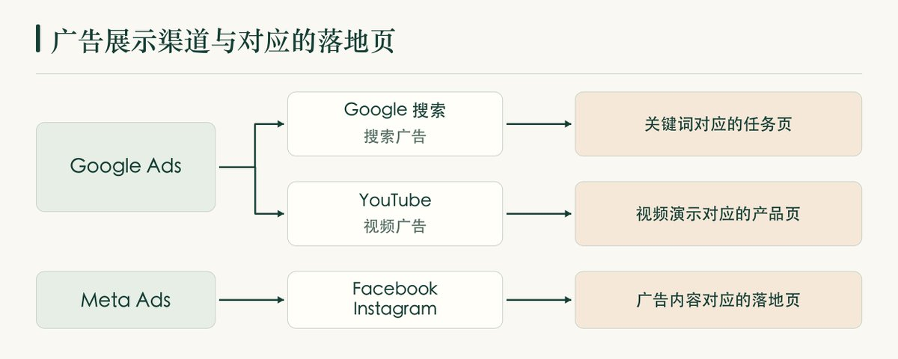

搜索广告接住已有需求，社交广告主动介绍产品，视频广告展示过程。平台没有绝对好坏，关键是用户当时在做什么，以及你的产品用文字还是画面更容易说清楚。

卖“PDF 压缩工具”，用户本来就会在 Google 搜解决办法，搜索广告更直接。卖一套有明显前后效果的商品图片模板，用户未必会主动搜索，Instagram 或 TikTok 的演示更容易让他停下来。选平台时先看用户怎样发现这类产品，不用一开始把所有广告平台都开一遍。

## 7. 用一小轮广告，快速验证有没有人买

广告最快的价值，是让你尽早拿到真实反应。

投之前，先准备一个能完成任务的版本。页面上要有演示、价格和购买按钮。付款以后，要能拿到文件、开通权限，或者收到明确的服务安排。统计工具要能记录广告来源、开始使用、进入结账和付款成功。

拿 PDF 压缩工具来说，第一轮不用把所有文件格式都支持。先选一个明确场景，例如“把过大的 PDF 压到邮件可以发送”。页面放一段操作演示，让用户上传一份文件，看到压缩结果，再决定是否为更大的文件或批量处理付费。这时广告带来的用户有没有完成压缩，比页面有多少访问更重要。

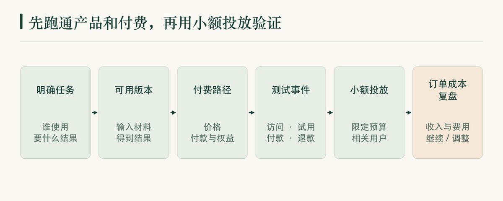

做 Google 搜索广告时，先选一个市场和一种语言，把一组意思接近的关键词放进同一广告组。广告里写清任务和结果，点击以后直接进入对应页面。不要广告说“在线压缩图片”，点进去却先让用户读一大段公司介绍。

关键词匹配控制搜索范围。精确匹配也不是只允许字面完全一样，它仍可能覆盖含义接近的查询。广告开始后，要看用户实际搜索了什么。无关查询花了钱，就排除或收紧。

做 Facebook 或 Instagram 广告时，可以准备几份差别明显的素材。一份展示结果，一份展示操作过程，一份放进具体使用场景。都指向同一个能购买的页面，分别标记来源。这样才知道哪种讲法带来了真正的使用和付款。

如果用 Pixel 或服务器上报转化，要检查订单标识和去重。同一笔订单可能同时被多个平台认为是自己的功劳，最后仍要回到支付和订单记录核对，不能重复计算收入。

测试前先定一个总预算和截止时间。比如这一轮最多花 100 美元，跑到某天就复盘。Google 的平均每日预算不是每天绝对不会超过的上限，单日花费可能更高，所以还要持续看实际支出。

有人点击却没有开始使用，先查广告和页面。有人开始使用却拿不到结果，先修产品。有人拿到结果却不付款，再看价格和付费功能。有人进入结账却失败，先修收款。不要把所有问题都归成“流量不行”。

第一轮没有订单，也不是一句“这个需求不行”就结束了。广告没人点，可能是你没有把场景说清楚；点进来不使用，可能是入口太难找；使用成功却不买，可能是免费功能已经够用，或者收费点不值钱。把用户停下来的位置找出来，下一轮只改最关键的一处。

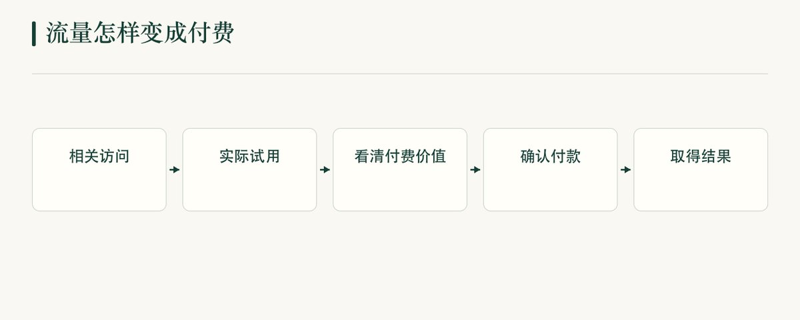

## 8. 收款要能用，也要算进成本

收款先看经营主体在哪里、卖什么、账户能否通过审核。Stripe、PayPal、Paddle 承担的工作不同，不能只挑一个熟悉的名字。

Stripe 可以提供付款链接或收银台，但要满足商户开户条件。此前核对的公开支持列表没有中国大陆，只有境外银行卡也不能代替真实的主体资格。PayPal 中国有个人卖家和企业卖家的申请路径，具体功能仍要看验证与审核。Paddle 这类名义商户服务可以处理获准软件产品的买家付款、账单和销售税等事务，再向开发者结算，不适合实物或主要靠人工交付的服务。

不管选哪一种，用户付款后都要拿到对应商品、文件或权限。自动交付要依据经过验证的真实付款通知，不能只看浏览器跳回了成功页。

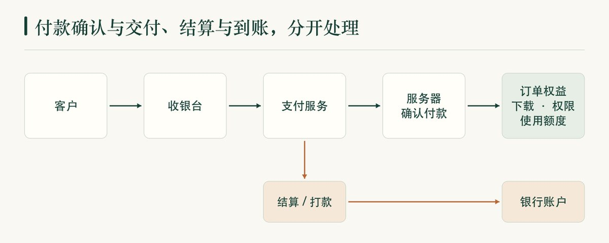

客户付了钱，不代表银行马上到账。手续费、汇率转换、退款和适用税费会减少到手金额，结算时间会影响现金周转。这些都要提前算进去。具体开户和接入步骤适合单独展开，这里先把它当成生意成本的一部分。

对刚开始的人来说，先确保一件事就够了：客户能顺利付钱，你能确认这笔钱属于哪一笔订单，并把承诺的东西交出去。复杂的订阅续费、税务和自动化，可以等第一条交易链跑通以后再做。

## 9. 收到钱以后，先看有没有利润

收到的钱不是利润。卖实物，要扣采购、仓储、物流、平台费用、广告和退货；卖软件，要扣接口、存储、支付、维护和客服；卖服务，也要算交付时间和修改成本。

你只需要先抓住一个判断：一位客户付的钱，扣掉为他交付和获客花的钱之后，还能不能留下钱。如果每多卖一单都在亏，订单越多，亏得越快。详细的 ROI、CAC 和广告点击价格，可以单独用一篇文章算清楚。

这一步会直接影响前面的选择。实物利润薄，就不能用太贵的广告长期获客；工具每次运行都要付接口费，免费额度就不能无限开；服务交付要花很多小时，报价就不能只看同行写了多少。赚钱方式不同，最后都要回到同一个问题：这笔收入能不能覆盖为了得到它付出的成本。

## 10. 能赚钱以后，再把生意做大

一轮收入扣完成本还有利润，可以小幅增加投入，再看结果能不能保持。预算一放大，点击价格、用户质量、退款和服务成本都可能变化，所以不要看到一次赚钱就立刻把预算翻很多倍。

如果获得一位客户花的钱，已经超过这一单能留下的钱，同样条件下继续投，只会把亏损放大。先暂停，查清楚是广告找错了人、页面没说清楚、产品不好用，还是价格和成本有问题。

如果已经花完事先定好的总预算，或者到了截止时间，仍然没有出现值得继续的结果，就停下来复盘。前面花掉的钱已经回不来。下一轮要不要继续，只看下一轮有没有更好的可能，不能为了“把旧钱赚回来”不断追加。

还要看现金。广告和接口可能先扣钱，销售款过几天才结算，退款可能更晚发生。账上显示有利润，也要留下交付和退款所需的钱。

停下来以后，改一个关键问题，再看下一轮结果。网站生意会反复走同一圈：找到任务，做出产品，带来用户，收款交付，再把收入和成本算清楚。

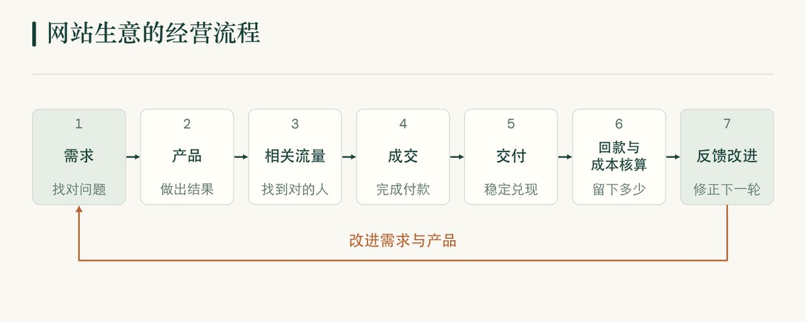

一个渠道有效，就留下对应的页面、素材和数据，再扩到相近需求、语言或市场。自然搜索积累长期访问，广告用来验证和放大。用户总在同一步失败，就修那一步；付费后反复问同一个问题，就改交付。收入增长时，产品和服务也要跟得上。

有人会同时做多个网站，也就是常说的站群。几个站可以围绕相关需求：一个提供免费工具，一个写教程，一个卖收费产品。它们之间可以给用户合适的下一步入口。但每个站都要有自己的用途、内容和维护。多买几个域名、复制一批页面，不会自动多出利润。

从零开始，先让一个网站完成一项任务，再把真实用户带进来。有人愿意付款，交付能完成，收入能盖住成本，就继续把这门生意做稳：让更多合适的人看见，让每一单最后还能留下钱。

你不需要一开始同时做跨境店、工具站、内容站和服务。先挑一条最接近自己现有能力的路。手里有供应链，就从一件商品开始；会开发，就做一个小工具；有专业技能，就先卖服务；擅长整理和写作，就做内容、目录或联盟推荐。先让第一条收入路径跑通，再决定要不要把它扩成更大的生意。

我是 Miles，一名从大厂转型 FDE 的 AI 算法专家，做过算法研发、优化部署，也做过企业培训和落地交付。

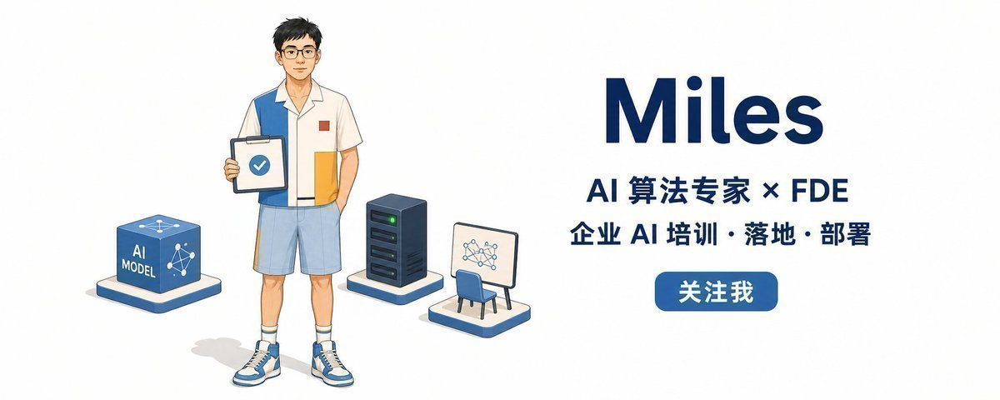

## 相关页面

- [[patterns/payment-platform-selection]]
- [[concepts/adsense-english-site-guide]]
- [[concepts/seo-basics]]
