# Mina（@minaoneday）：我做了一个丝袜材质提示词 Skill——输入厚度和颜色，输出直用材质提示词

> 深耕 AI 图像生成细节控制的极简专业级 Skill：针对 AI 绘图中高频翻车的丝袜与织物材质（反光感、透肤度、丹尼尔数 D 数、织物纹理），抽象出精准参数映射表；只需输入厚度（如 15D/80D）与颜色，自动生成可直接粘贴至 Midjourney / Flux 的高精度质感提示词，大幅降低人像创作废片率。

<!-- more -->

我做了一个丝袜 Skill。

输入厚度和颜色，输出一段能直接粘进提示词的材质。

只写 black stockings，模型经常把腿涂成半透明黑。

光滑，漂亮，没有织物。

真实丝袜不是颜色。

是皮肤上方的一层尼龙：织纹、张力、拉伸处密度会变、高光只在纤维上。

人物、姿势、镜头你自己锁。

这个 Skill 不管脸，只管这一层。

黑丝

不要整段一样黑。

拉伸处要变浅，未拉伸处更密。

禁止单独一句 black stockings。

禁止 shiny。

厚度：

5D 极薄黑　皮肤是主角。尼龙只在高光和脚踝。模型弱 = 裸腿。

10D 超薄黑　尼龙刚能看见，仍是皮肤主导。

15D 烟黑　尼龙和肤色平衡。默认档。

20D 哑光黑　接近 15D，高光更死，更像手机随手拍。

30D 柔雾黑　丝袜成为主体，皮肤细节下降。

60D 半不透明黑　按衣服写，不是透明材质。

15D 黑默认句：

text

15-denier smoky black sheer nylon stockings,

skin visible beneath fine weave,

density changes at knees and ankles,

restrained natural sheen, not shiny,

fabric on the skin, not a black overlay.

白色

白丝用的人很多，也比黑丝更容易穿帮。

模型会出纯白、塑料、乳胶。

不要写 white stockings。

写 ivory / milky。

白色不是把腿刷白，是半透明白尼龙乘以底下肤色。

5D 白　几乎只剩肤色，白只出现在高光和脚踝。

15D 白　能看出一层奶白色尼龙，皮肤大量可见。

30D 白　白织物开始成为主体，仍要透一点肤色。

60D 白　按白衣服写，禁止灯泡白。

15D 白默认句：

text

sheer ivory / milky-white nylon stockings,

skin undertone visible beneath the fibers,

fine weave still readable,

no pure digital white,

no plastic gloss,

soft sheen only on stretched fibers.

其它颜色和纹理

珠光灰　织纹最好认。禁止金属反光。

暖咖啡　最终色 = 半透明棕纤维 × 皮肤，不是把腿涂棕。

肤色丝袜　必须写 visible weave，否则模型会把织物删掉。

背缝　一条贴在腿后侧的真缝，不能像贴纸。

极细点纹　点在织物上，随拉伸变形。点太大就变网袜。

15D 微光泽黑　和烟黑同厚度，只加一条沿腿弧的细高光。再多就是塑料。

Skill

输入：15D 烟黑 哑光 / 15D 白 象牙 / 60D 黑 / 肤色 5D

输出：只给材质段。不要解释。

硬规则

黑色：拉伸处不能一样黑。

白色：ivory / milky，必须透肤色，禁止纯白和塑料高光。

肤色：必须写 visible weave。

禁止：sexy，shiny stockings，perfect legs，单独一句 black / white stockings。

看图三问

膝盖密度有没有变。

脚踝有没有张力。

高光是纤维上的，还是一条画上去的白边。

三处都没有，丢掉重出。

Mina

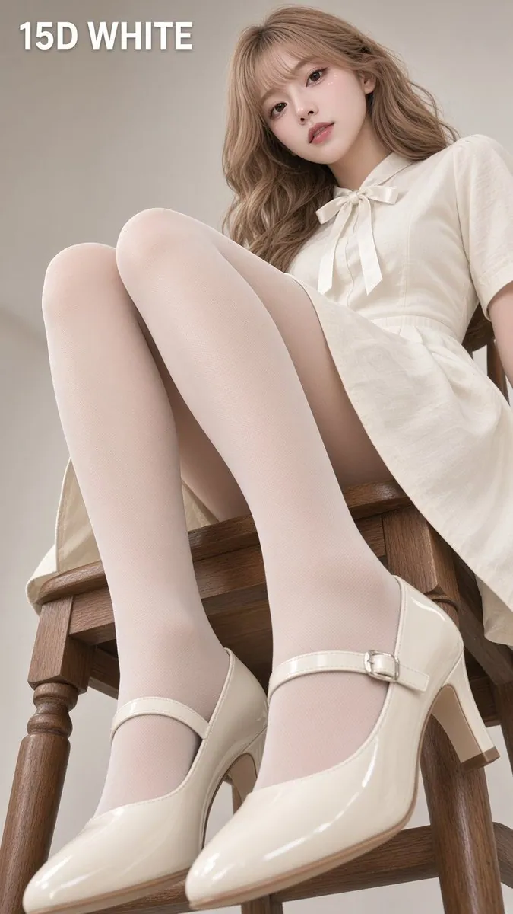

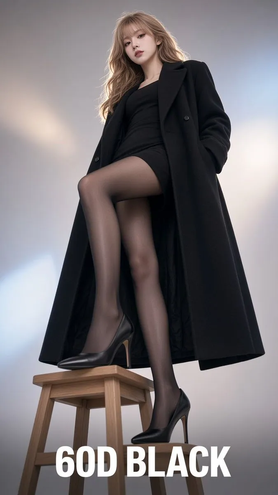

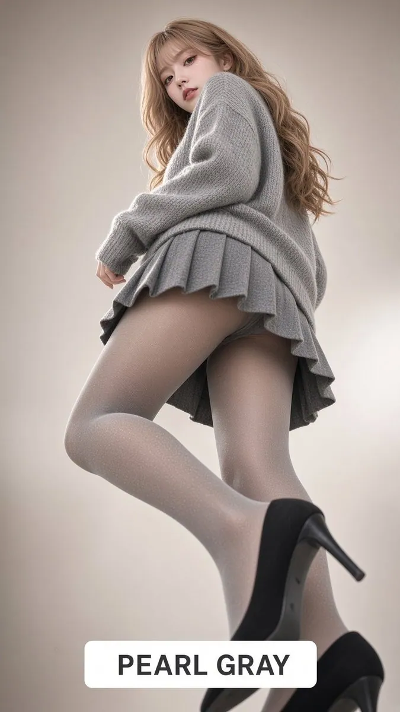

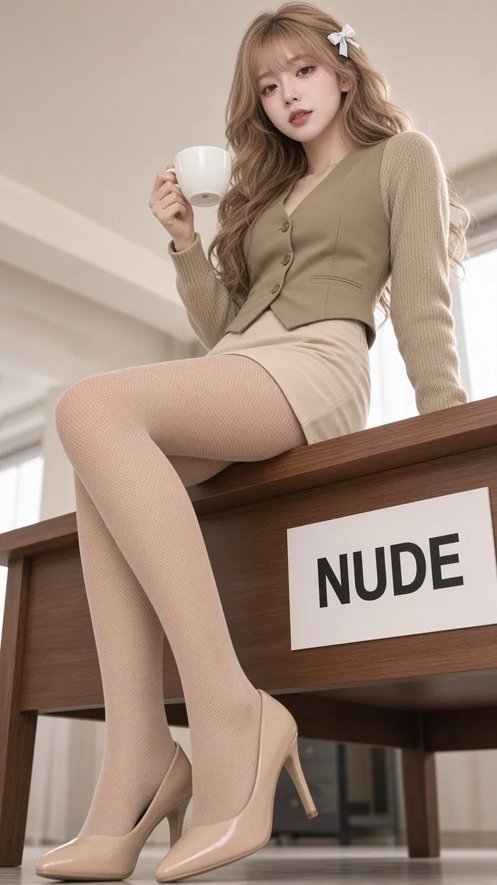

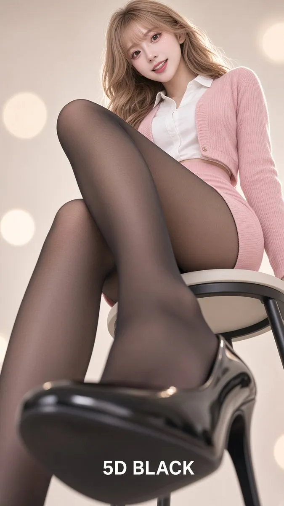

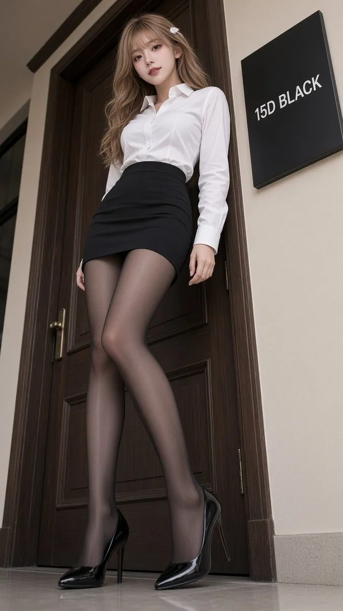

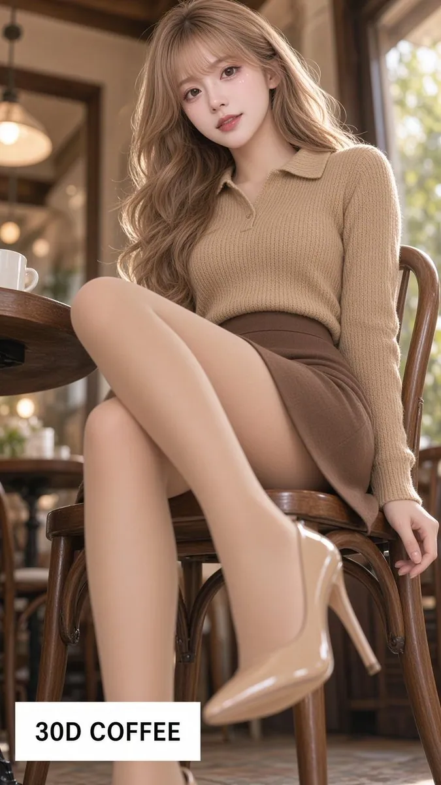

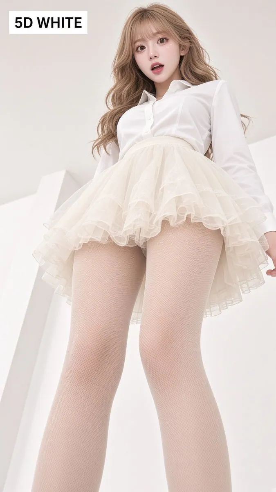

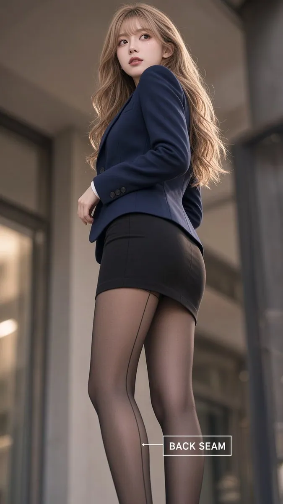

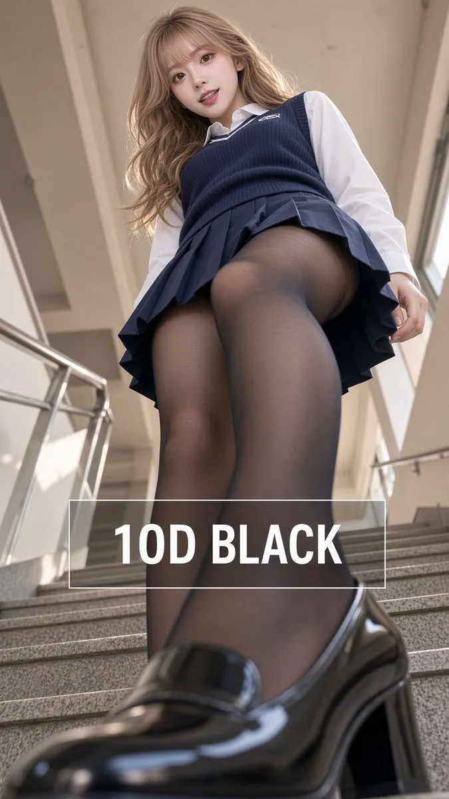

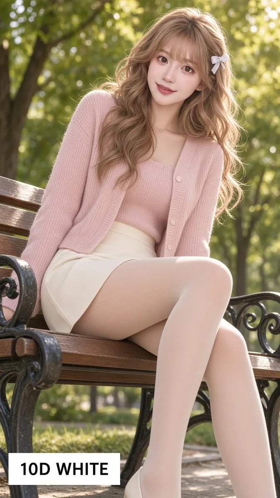

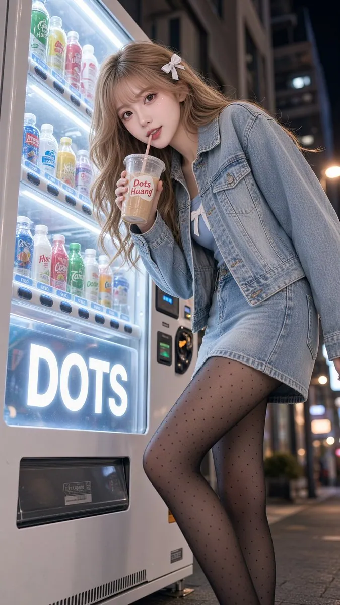

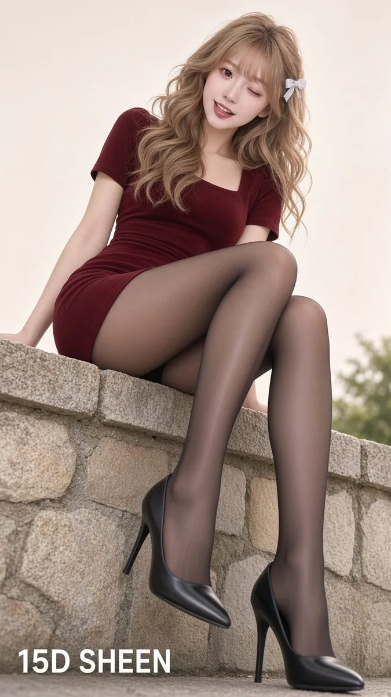

## 相关页面

- [[sources/leo-xiaolei-ai-character-consistency-skill]]
- [[sources/aiwarts-awesome-seedance-463-ai-video-skills]]
- [[concepts/prompt-engineering]]
- [[concepts/agent-skill]]
