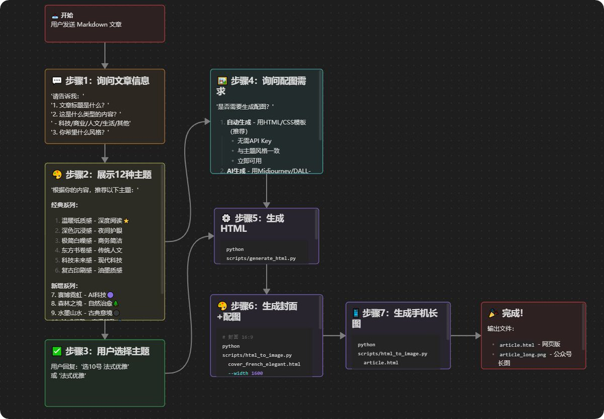
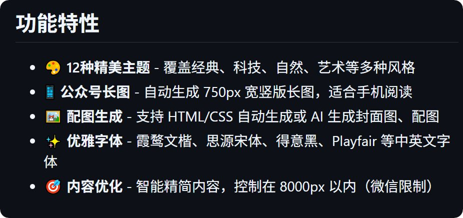
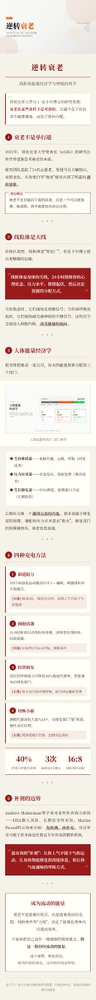
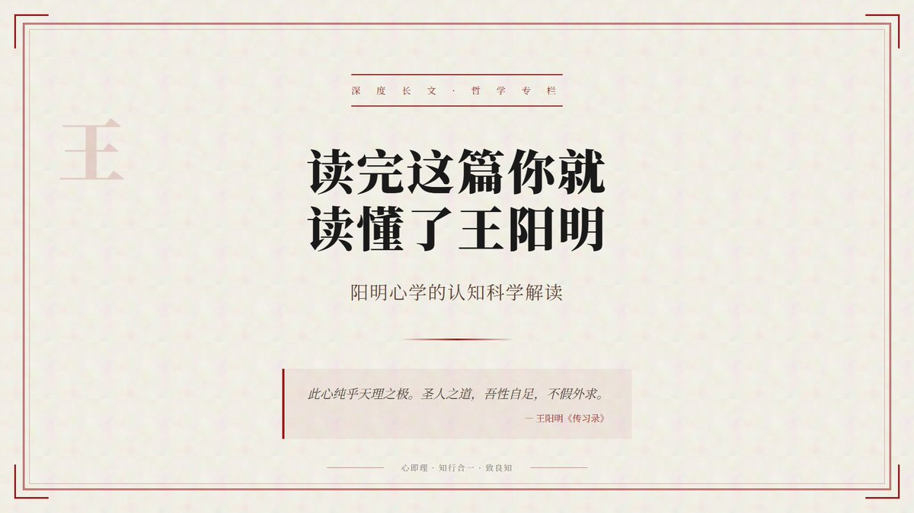
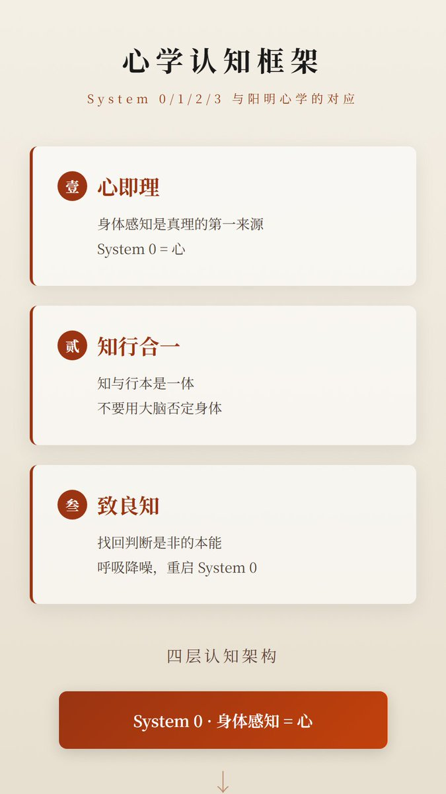
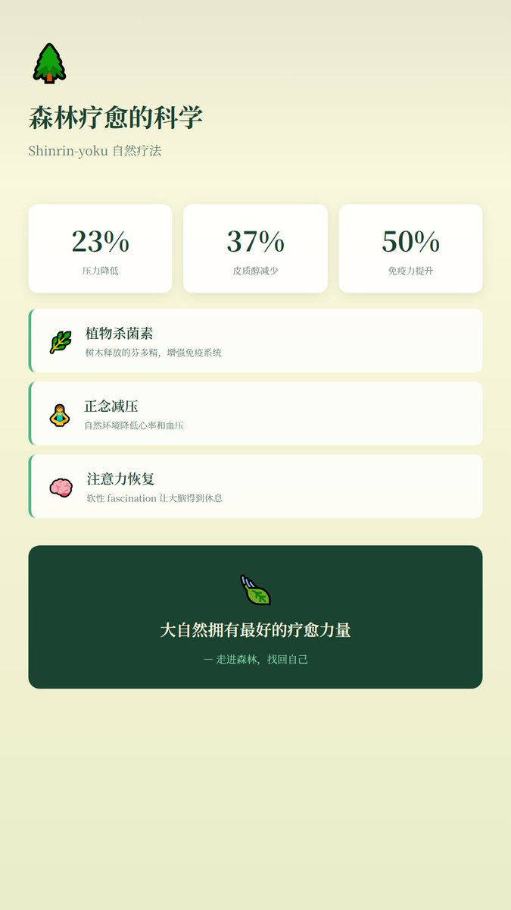

# MindfulReturn（@MindfulReturn）：把公众号做成长图——开源 wechatlongpic 解决长文卡死与排版难题（12 套精美主题）

> 针对微信公众号网页后台粘贴长文卡死、复杂排版耗时费力的痛点，开源 wechatlongpic 工具：将 Markdown 转化为适配手机阅读的超高清长图，内置复古印刷、科技未来、水墨山水、工业硬核等 12 种精心设计的主题，配合 Playwright 自动生成配图与封面截图，一键直发公众号。

<!-- more -->

你一定试过这个，但你就是不说：

用 chrome 在微信公众号端黏贴长文的时候，浏览器必卡死。我换到 IE 浏览器才没问题。

用公众号编辑器开始修改格式才是你噩梦的开始。

简单的还行，想再美观点，就难了，我试过那种改代码的 SVG 图片方式，更别提多麻烦了。

所以，我做了一个 skill，wechatlongpic，名字很直白：WeChat + Long Picture，专门为微信公众号长图排版设计。

把你的 MD 格式文章，排版做成 HTML，再生成图片插图在相应位置（AI 或者 CSS）。

然后把这个 HTML 做成适合手机阅读版本的长图。

这样你发表公众号也就一步：上传图片，写入 SEO 摘要和标题。然后发表就可。

也别折腾什么自动发布到草稿了，很多时候会出错。白名单，乱码，AI 给你乱改，最后给你加个 AI 生成字眼，都会出现。到头来你还得自己动手调整。

整个 skill 流程图如下：

## 它有什么特别之处？

##

1. 12 种精心设计主题

而是针对不同类型的内容做了专门设计：

12 种主题，为不同内容气质量身定制：

深度长文 → 复古印刷感（思源宋体，油墨质感）

科技前沿 → 科技未来感（得意黑 + Inter，荧光蓝点缀）

人文哲学 → 东方书卷感（悠哉手写体，禅意留白）

商务报告 → 极简白噪感（Inter + 霞鹜文楷，极简留白）

夜间阅读 → 深色沉浸感（霞鹜文楷，翠绿主色护眼）

生活随笔 → 温暖纸质感（霞鹜文楷，米白暖调）

AI 元宇宙 → 赛博霓虹（得意黑，霓虹光效 + 紫青渐变）

环保健康 → 森林之境（霞鹜文楷，自然治愈系）

中国诗词 → 水墨山水（思源宋体，水墨纹理 + 宣纸晕染）

时尚艺术 → 法式优雅（Playfair Display + 思源宋体，极简留白）

娱乐创意 → 波普活力（得意黑，几何撞色 + 年轻张扬）

技术教程 → 工业硬核（JetBrains Mono，机械感等宽字体）

##

2. 配套图片一键生成

封面图、配图、首图...内置了 HTML 模板，用 Playwright 自动截图，告别版权焦虑。

## 三步上手

第一步：准备 Markdown 文章

第二步：选择主题，生成 配图和封面，生成 html 并插入配图（配图有两种方式，一种 AI 图，需要你配置 key，一种是 CSS 图不需要 key）

第三步：生成公众号长图

搞定。一张精美的公众号长图就生成了。

下载地址

https://github.com/rebootmindful/wechatlongpic

欢迎各位继续完善，增加更多主题。

## 相关页面

- [[sources/kongge-creator-buddy-10-wechat-skills]]
- [[sources/ryan-muse-wechat-tietu-step-by-step-guide]]
- [[concepts/claude-skills]]
- [[concepts/agent-skill]]
