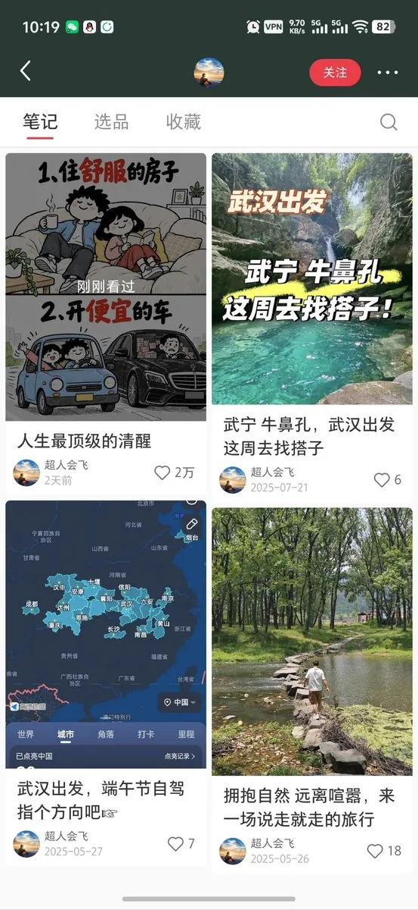
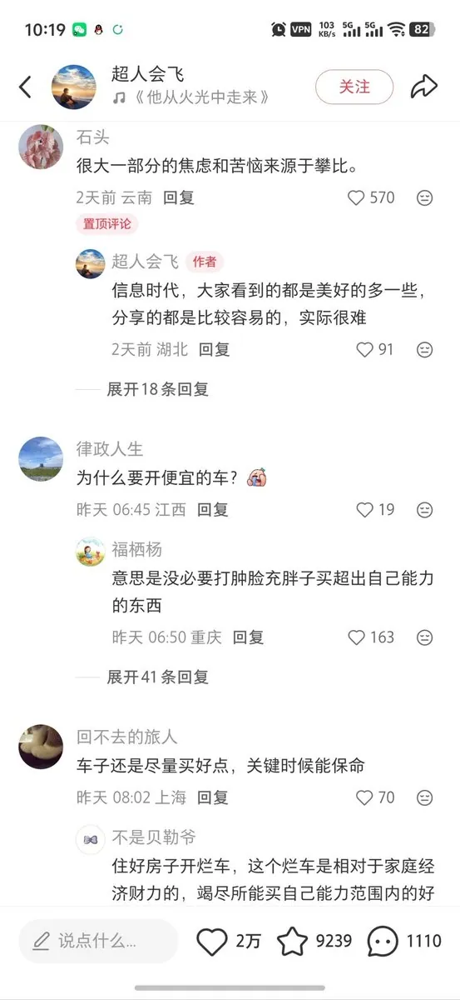

# 壹新（@Missle8z）：发 4 篇笔记爆了 2 万赞——AI 走心人生建议图文全平台分发与变现

> 拆解小红书 4 篇笔记爆款 2 万赞的走心人生建议图文赛道：全程利用 AI 生图构建上下结构卡片，主打情绪价值与走心哲理；成型素材可同时分发小红书、微信小绿书贴图号及抖音图文，后端通过技能教程、模版分发与社群收徒完成变现闭环。

<!-- more -->

这个作者就发了 4 篇笔记，用 AI 做的人生建议帖直接爆了，拿了 2 万赞，一千一百多条评论。

图全是 AI 生成的。这种上下排版、讲人生感悟、走心道理的图文，本身就很容易起流量。

AI 做好之后，既能发小红书、小绿书做贴图号，抖音图文也能发。

后面路子还挺宽，可以出对应的技能课、收徒变现。

## 相关页面

- [[sources/wechat-tietu-money-playbook]]
- [[sources/missle8z-information-arbitrage-8-business-models]]
- [[concepts/wechat-image-post-account]]
- [[concepts/selfmedia-compound-model]]
