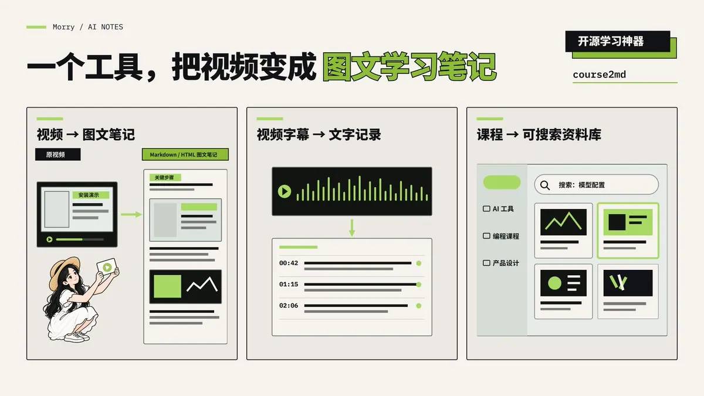

# Morry.AI（@Morry4AI）：course2md 学习神器——把 YouTube/B 站/本地视频一键转为带截图的 Markdown 笔记

> 开源工具 course2md 深度解析：针对长视频教程自动分析画面变化并截取对应演示帧，提取或离线语音转写字幕对应到截图下方，生成图文并茂的 Markdown/HTML 笔记，内置分类课程库解决音视频教程检索困难痛点。

<!-- more -->

这个开源工具：course2md，可以说是学习神器了。

它可以把 YouTube、Bilibili 或本地视频，转换成带截图的 Markdown / HTML 学习笔记。

比如一段两小时的 AI 工具教程，可以直接实现：

从视频中提取画面 → 获取字幕 / 语音转写 → 生成图文笔记。

我用了一段时间，觉得这 3 个功能比较实用。

——

01｜自动生成带截图的学习笔记

这是 course2md 最核心的功能。

它会分析视频中的画面变化，自动截取相应的画面，并把字幕或语音转写内容整理到截图下方。

比如一段讲解 AI 工具的教程：

讲到安装步骤时，保留对应的操作画面。

讲到功能介绍时，提取相应的演示截图。

再把讲解内容整理成文字，最终生成一份图文结合的笔记。

相比于只有文字的转写稿，这种方式更适合需要结合画面理解的教程。

尤其是软件操作、PPT 课程和技术教学视频。

——

02｜没有字幕，也能进行语音转写

语音转文字有两种处理方式：

有平台字幕时，优先提取字幕。

没有字幕时，可以通过语音识别，把视频中的讲解转换成文字。

语音识别可以选择在本地或者云端进行。

不过，首次使用可能需要下载模型，实际识别速度和准确率也会受到设备性能、音质及语言等因素影响。

——

03｜把视频整理成可以搜索的知识库

我觉得这个功能对长期学习的人很有价值。

平时收藏了几十个教程视频，真正需要某个知识点时，经常想不起它在哪一集、哪个时间段。

course2md 有一个课程库功能，可以把生成的笔记集中整理。

支持文件夹分类、搜索，以及在阅读器中查找内容。

而且生成的笔记可以导出为 Markdown 和 HTML 文件。

对于经常学习 AI 工具、编程或者其他专业课程的人来说，可以逐渐建立自己的视频学习资料库。

——

我觉得 course2md 真正实用的地方，是把原本需要反复拖动进度条才能找到的信息，整理成有画面、有文字、可以检索的学习资料。

对于经常看网课、教程、会议录像的人来说，能减少不少重复整理的工作。

如果你是内容创作者，还可以把生成的 Markdown 笔记交给 Codex 等 AI 工具，进一步提炼观点、整理教程或者制作文章。

开源库：https://github.com/mizorewww/course2md

希望可以帮到你～

英伟达 NVIDIA 开源了一个专门扫描 AI Agent Skills 的工具，叫 SkillSpector。

可以直接扫描本地 Skill 文件夹，也能扫描 GitHub 仓库。

主要检查的风险包括：

提示词注入、数据外传、危险代码、越权操作、供应链问题，以及 MCP 相关的权限风险。

——

01｜如何安装？

最简单的方法是打开 Codex 等 Agent，直接对它说：

—

帮我安装 NVIDIA 开源的 SkillSpector：

https://github.com/NVIDIA/SkillSpector

用项目推荐的方式完成安装，缺少必要工具时帮我补齐，最后验证它能正常运行。需要我授权的操作先说明，暂时不配置 MCP、外部模型或 API Key。

—

安装好以后，如果想检查 GitHub 上的某个 Skill，可以直接对 Codex 说：

—

用 SkillSpector 检查这个仓库里的 Skill 是否安全：

（附上仓库链接）

先做不使用外部模型的静态扫描，不要执行仓库里的脚本。请用简单的话告诉我风险点，以及建议安装还是不安装。

—

如果想检查电脑上已经下载的 Skill，就对 Codex 说：

—

请用 SkillSpector 检查这个本地 Skill 文件夹：

[把文件夹拖到这里，或填写文件夹路径]

先做不使用外部模型的静态扫描，不要执行其中的脚本。请用简单的话告诉我风险点，以及建议安装还是不安装。

—

这里先做静态扫描，是为了不使用额外的 API Key，同时避免把待扫描的文件内容发给外部模型服务。

依赖包的名称和版本仍可能发送给 OSV. dev，用来查询已知漏洞。

——

02｜扫描报告怎么看？

别只看最终一个风险分数，建议重点关注三个点：

第一，有没有出现高严重度的危险行为，例如读取敏感文件、将数据上传到外部地址，或者尝试执行高风险命令。

第二，风险来自哪份文件、哪条规则；如果是误报，需要回头检查原始代码，而不是直接忽略。

第三，扫描是否覆盖了目标文件。扫描不完整、部分依赖未覆盖，和「确定安全」完全不是一回事。

——

最后再分享一下我平时安装 Skill 的顺序：

看来源 → 检查文件和权限 → 扫描风险 → 小范围测试 → 确认后再正式使用。

尤其是能访问钱包、邮箱、云盘、GitHub 或本机文件的 Skill，安装前多花一点时间检查。

对于经常折腾各种 Skill 的朋友，这个项目建议收藏。

希望可以帮到你～

## 相关页面

- [[concepts/ai-content-pipeline]]
- [[concepts/problem-driven-learning-wheel]]
