# Nenly：万字复盘——0 代码基础如何用 AI 做出 10 万人玩过的独立游戏

> 零游戏开发经验、零代码基础，3 个月独立完成 Steam 抢先体验游戏《群侠传：幸存者》，累计 20 万玩家入库、2100+ 条评测 97% 好评。本文完整复盘 AI 辅助的开发工作流：美术、代码、动画、音乐、配音的 AI 协作方式，AI 辅助上架与运营，以及玩家反馈与人的判断边界。

<!-- more -->

::: info 系列说明
本文是作者同系列 4 篇长文的第 4 篇，原文只展开了第 8 章「AI 辅助发布与运营」与第 9 章「开发心得」。上方大纲中的第 1–7 章（项目背景、时间线与技术栈、需求澄清、AI Coding、AI 美术、AI 动画、AI 音频）在同系列的前 3 篇中。
:::

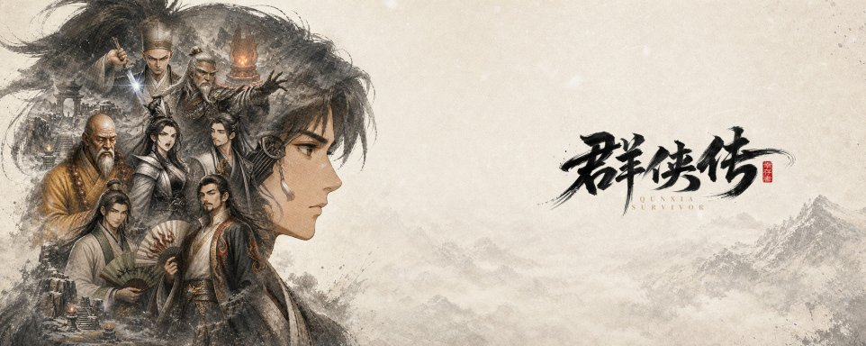

今年 8 月，我做的第一款单机独立游戏《群侠传：幸存者》在 Steam 上线了，以抢先体验（EA）的形式免费开放。

截至本文写作时，它在 Steam 上有 2100 多条评测，97% 是好评，被标记为“好评如潮”。累计超过 20 万玩家入库。

这个数据其实远远超出了我当时对它的预期。临近发售时，它的愿望单才堪堪超过 1000 个。一开始，我只是把它当作探索游戏开发和 Vibe Coding 的一个小作业，从没想过会有这么多人玩过它，还愿意给出积极的评价。

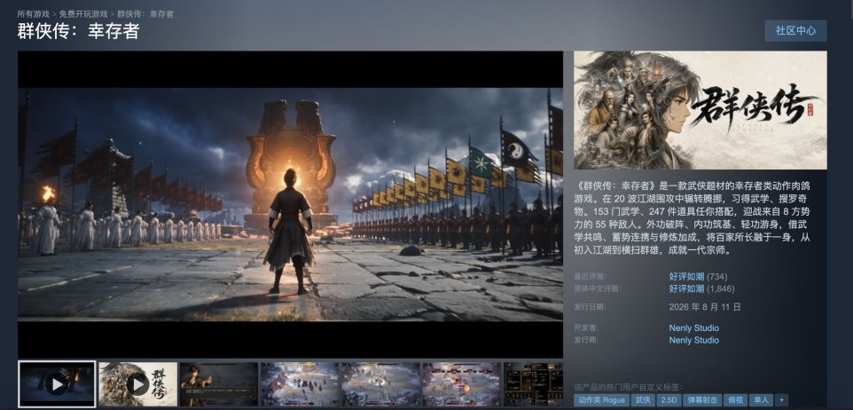

今年 4 月，给这个项目提交第一个 Commit 的时候，我没有任何游戏开发经验，没打开过游戏引擎，甚至一行代码也没写过，是个彻头彻尾的“小白”。但那时的我就想试试看，能不能用现有的这些 AI 工具，把我想要的这个游戏给做出来。

从结果看我应该是成功了——这里面的代码、美术、动画、音乐和配音，绝大部分都是我使用一系列的 AI 模型、Agent，在大约 3 个月里完成的。

早在今年 7 月的一条视频里，我就和大家分享过制作这个游戏的全套工作流程。但受视频篇幅和呈现形式所限，很多技术细节没能完整交代。之前想做的系列视频，也因为一些原因迟迟未能动工……

所以在这篇文章里，我想尽可能完整地写下这套工作流程，分享过程中碰到的问题，以及最后的解决方式：早期的需求和调研怎么做，代码怎么交给 Agent 写，美术和动画怎么从 AI 生成的素材变成游戏里能用的成品，以及音频和配音是怎么处理的，最后再到上线以后，AI 又怎么帮我做一些发布、运营的工作。每个环节用到的模型、工具，实践中行之有效的 Prompt，还有踩过的坑、绕过的弯路，我都尽量写进来了。

虽然这个游戏体量很小，题材略显老套，目前也还比较粗糙，但我仍然希望这套制作流程，能给正在或打算用 AI 做游戏的朋友一些帮助。

先上个大纲：

1. 游戏介绍与项目背景

2. 开发时间线、技术栈与工作流

3. 需求澄清与对标调研

4. AI Coding：引擎、模型与协作方式

5. AI 美术：风格统一与资产制作

6. AI 动画、特效与 CG

7. AI 音频：音乐、音效与配音

8. AI 辅助发布与运营

9. 开发心得：玩家反馈与人的判断

## 八、AI 辅助发布与运营

### 出包、上传与更新公告

上架 Steam 其实很辛苦，有一大堆要做的东西：平面物料、商店详情页、宣传片、成就系统……只能一件一件地做。

但其中和开发有关的部分我还是让 AI 来帮我代劳。比如最重要的导出和传包，我一开始也是不知道该怎么做的，而我的 AI 只是简单地遍历了一下 Steam 的文档库，就告诉我要安装 Steamworks SDK 和 SteamCMD，然后在命令行里弹出了让我辅助登录的通知，并最后指导我完成了一系列上传后在 Steamworks 后台设置 Depot 和分支的操作。

直到现在，每次做完一个小版本，确认所有内容符合要求以后，我只需要一句话就能完成一次发布，比如：

```
清理工作树，分批提交，然后出包，版本号为0.1.2，上传Steam以后写提交日记，然后向我汇报自0.1.1.5以来所有的更新内容，这份汇报是我撰写更新公告的参考。
```

它就会帮我做完下面这些事情了：

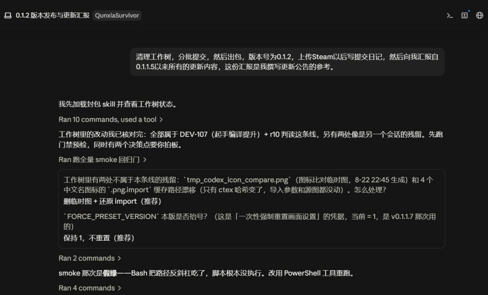

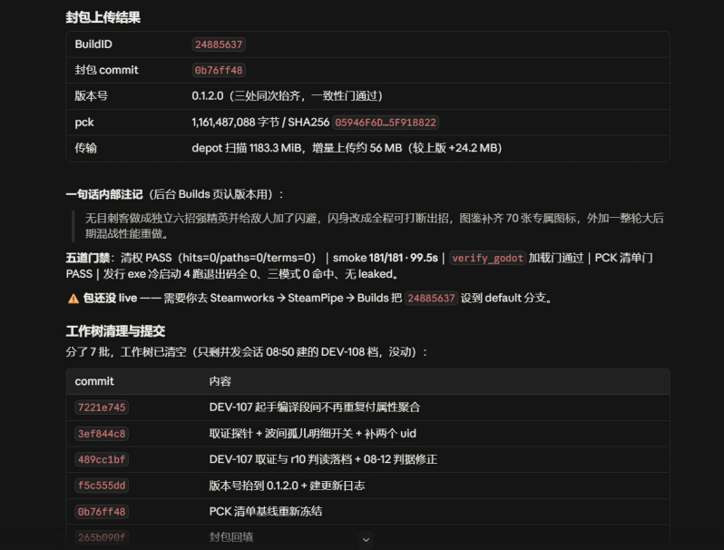

根据我设计的 Skill，它还会自动读取这段时间的 Commit 记录，并汇总成一个新增/修复/变动的清单，给我写公告用。

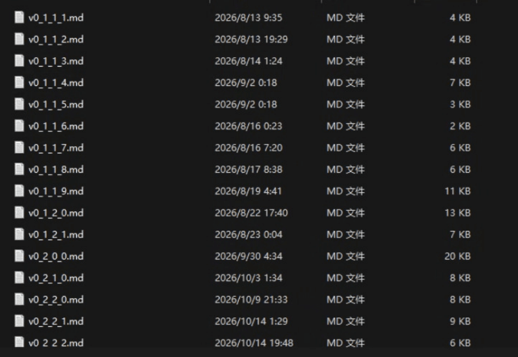

更新公告后面的大长串清单多数时候都是 AI 帮我写的。前面的亮点段落多数时候则会是我自己起草，然后让 AI 来帮我搜集相关素材并润色。

### 成就配置与 SteamStats 数据分析

Steam 游戏的一个很重要的部分是成就。目前我的游戏里一共有 61 个成就。图标就不说了，AI 生成的嘛。但是还有一个很烦人的过程是要把它们上传到 Steam 的后台上。Steam 后台的表单需要填写它们的名字、描述和对应的 API Name。我感觉手填太累了，就直接问 GPT 能不能 Browser-use 给我填了，吃了个饭回来就全搞好了。

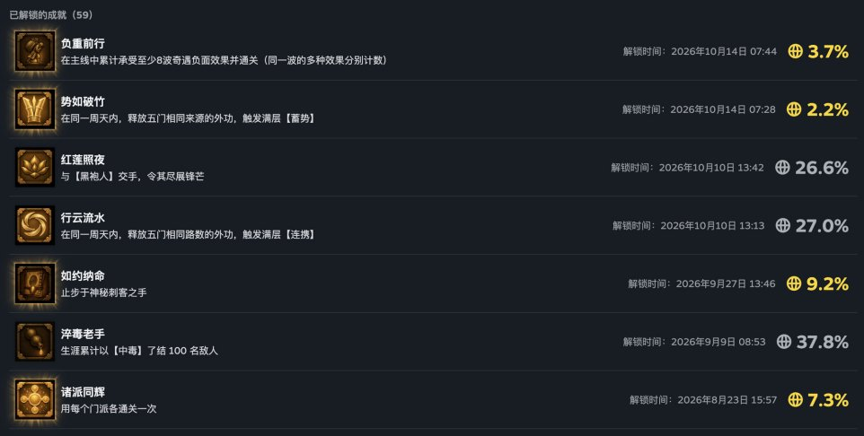

对了，我通过 SteamStats 收集的 1700 多个数据项目也是这样填完的。

Steam 是支持匿名性质的数据聚合收集的，我现在收集的数据主要包括：

• 性能数据：每一波的帧率摘要。本地记一份，玩家提交反馈时随诊断包附上；再通过 Steam 的匿名聚合，看全体玩家的低帧波次占比。用它定位掉帧，排优化的优先级。

• 玩法数据：武学、道具的选取率和胜率，用来观察平衡和内容方向。

除了用 AI 辅助我完成了这个收集过程以外，我还让 AI 帮助我去对它们做详细的分析、归档，并且为我提供像这样的阶段性报告。

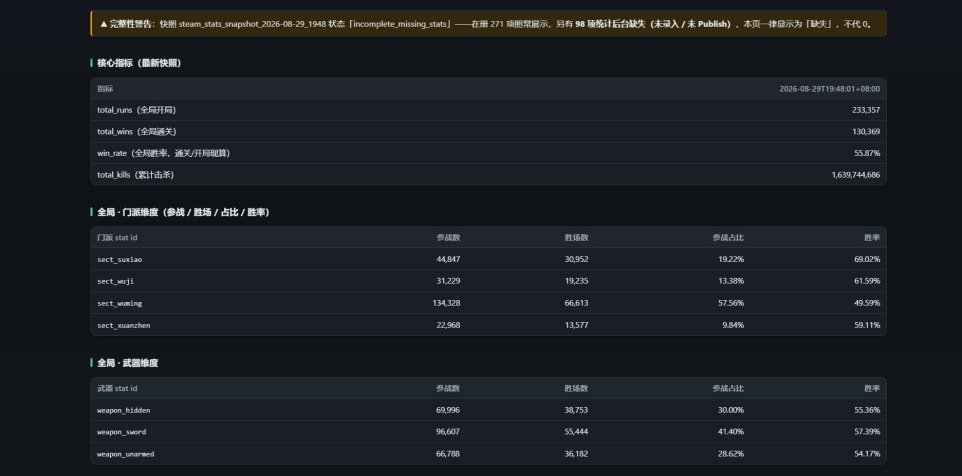

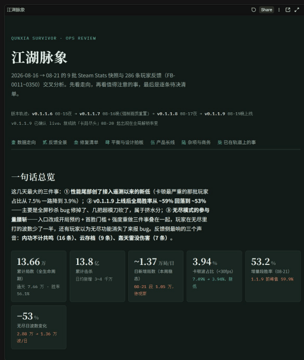

### 玩家反馈：收集、归类与迭

另外一个比较重要的部分，则是玩家的反馈。

我在游戏主菜单的「制作人的一封信」里，预埋了一个反馈入口，直达一张飞书表单，分成 Bug、崩溃报告、玩法建议几类，尽量降低大家提交的成本。

这个表单是一个飞书的多维表格，而飞书自己的命令行工具 lark-cli 在登录后是可以自行拉取相关数据甚至是回填标记的。我也利用它，把表格和本地的数据存档连了起来。

这些反馈我同样不用一条条去审核。每天 AI 把数据拉下来、去重、聚类，告诉我这个版本可能有什么问题，哪些已经修掉了，哪些还要继续动，我再来拍板。

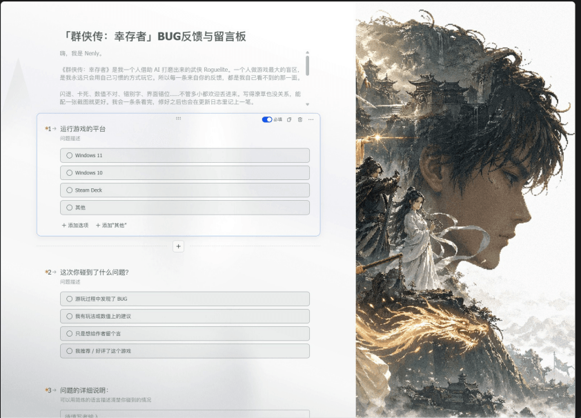

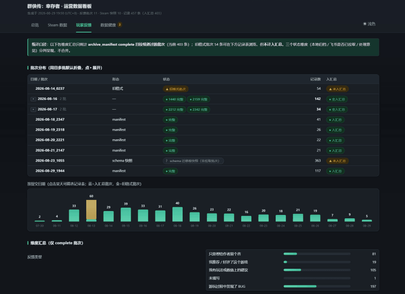

其他一些更日常化的工作，可能类似于：玩家在群里说一句话，我复制粘贴给 AI，跟它说：「你评估一下，能做吗？」如果能做，它就会落实到我下一版的更新里。

这些持续收集的反馈和信号，帮我在两个月里密集迭代，解决了很多上线之初的问题，让游戏逐步变成了现在的样子。

## 九、开发心得：玩家反馈与人的判断

### 上线前后的反馈

老实说，刚发布这个游戏的时候，我其实并没有对它寄予非常高的期望。

7 月初我在我的社交媒体上第一次发布了这个游戏的宣传片。在那时，我其实并没有看到任何关于这个游戏能受到大家欢迎的信号——评论区里主要都是一些「又多了一个垃圾 AI 游戏」、「浓浓的页游风味」这样的评价，也有人好像并不相信我真的把它做了出来。

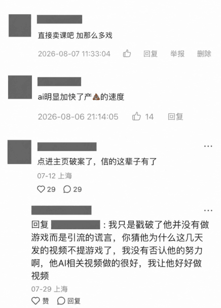

而我的频道观众似乎也是关注这个游戏本身的制作过程多过想玩这个游戏本身。直到上线前两天，游戏的愿望单才堪堪超过了 1000 个。

所以那段时间，我其实一直在反复安慰自己。和我太太聊起这个游戏时，我经常搬出那句“一个制作人的前十个作品都是垃圾，所以尽快做完它们吧”，试图跟她解释：像我这种半路出家的人，做出来的第一个游戏，多少应该得到一点宽容。我还会补上一句：这个游戏至少已经帮我做出了两期视频——虽然播放量都很一般。说这些，既是在向她解释，也是在说服自己：这两个月的工作，总归不是毫无价值。

但上线以后，这个游戏所经历的，就是我没曾预料到的了：

• 上线第二天一觉醒来，激活数一个晚上涨到了五六千，抖音上一位做游戏介绍的老哥特意介绍了它，帮我捕获了第一批种子玩家；

• 第三天，就有玩家玩了超过 10 个、20 个小时；

• 上线 5 天左右，玩家在游戏里累计砍掉的敌人，超过了 10 亿只；

• 后台反馈大概三天就收到了 200 多条；

再后来，有非常知名的主播老师在直播中做了试玩，一些国内媒体也先后写了报道，它还上过一次 Steam 首页「人气蹿升的免费游戏」的第二位。很多人是知道这个游戏用了 AI 的，但他们照样愿意下载、玩下去，也认真地给我提意见。

所以现在回头看，AI 固然会影响玩家对一个游戏的第一印象；但最终一款用 AI 做的游戏可以走多远，玩家愿不愿意留下、愿不愿意给予好的评价，最后还是看游戏好不好玩。

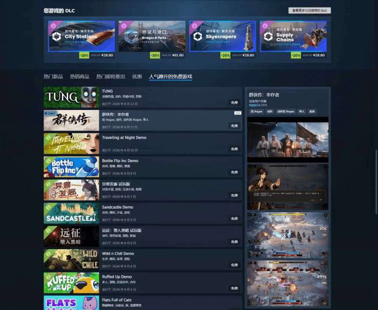

### 人的判断：测试、感受与取舍

这个游戏也教会了我许多事情，其中最重要的一件，或许是 AI 时代人的价值所在。

你固然可以用 AI 帮助你完成一个游戏开发过程中 90%的所谓“工作”。但最终决定这个游戏好不好玩，或者说能不能成功的，可能往往就是剩余要人来决定的那 10%。

我在很多次分享、很多个视频里都反复提到这样一件事情：AI 固然可以在 5 分钟里，给我做出几十个技能的草案、几百个道具的效果，甚至几千字的对话文案。但这些技能，玩家用起来真的爽吗？这个道具让构筑更有意思了，还是只让数字变得更大？这些对话，真的能让玩家感受到我想在剧情里表达的东西吗？

这些问题，AI 回答不了。最终还是得我作为一个人，去测试、去感受、去拍板。

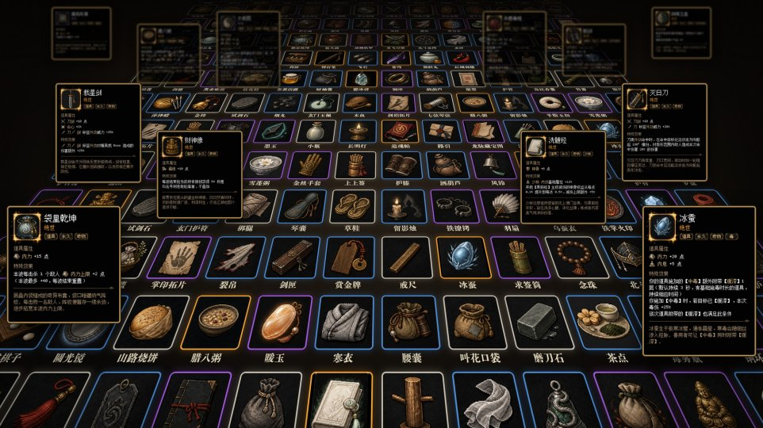

所以，当 AI 可以帮我们做程序、美术、动画、音乐，甚至承担上架和运营工作时，对一个游戏来说，最重要的是什么呢？

我觉得，是人啊。

那个知道游戏到底好不好玩，并且愿意为了一个好玩的游戏，不断努力迭代，付出这些时间精力的人啊。

现在对于想做游戏的独立开发者们来说，我觉得真的是一个最好的时代了。换在 10 年前、20 年前，光是掌握做游戏所需要的一个技能分支，可能就要几个月甚至几年；只靠一个人的力量去开发一款游戏，简直无法想象。

但在今天，只要你愿意付出时间、努力和耐心，再借助 AI，哪怕你只是一个人，也可能真的撬动以往只有大公司、大团队才能做到的事情。

如果这篇文章也让你想起了一些你自己曾经有过的、想去做点什么的念头，我想跟你说：快去做吧。我这种人都能把一个游戏做出来、走到上架这一步，你也一定可以的。

感谢你看到最后。因为篇幅所限，这篇文章介绍的流程很长，难免有一些细节没能讲透。但如果你对这里面的一些技术细节感兴趣，请一定要通过留言和我交流。知无不言！

祝你也能做出那个你想要的游戏 ;-)

## 相关页面

- [[patterns/zero-code-vibe-coding-game-workflow]]
- [[concepts/ai-oneperson-company]]
- [[sources/leaf-sanren-seecut-video-pipeline]]
