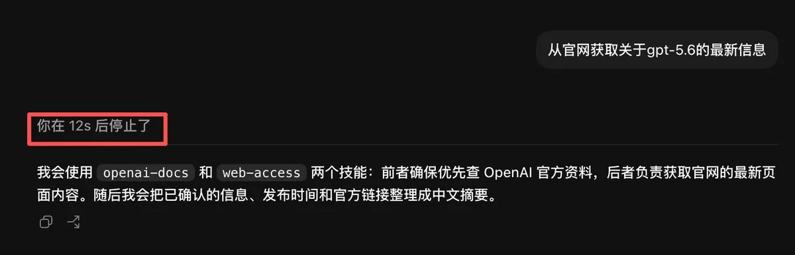
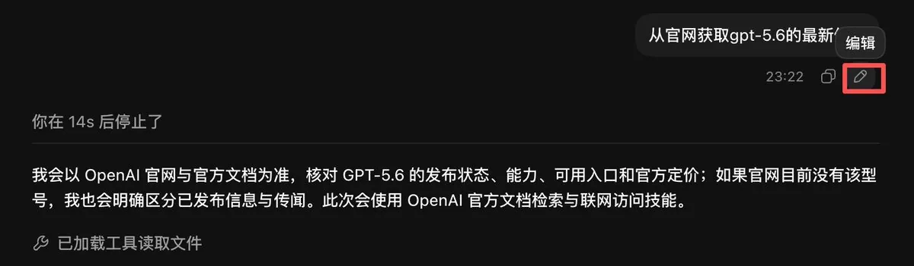
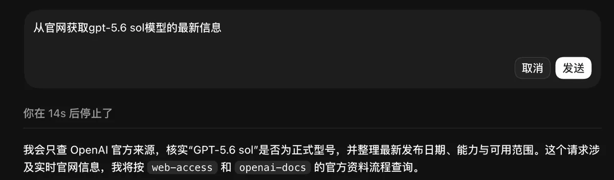
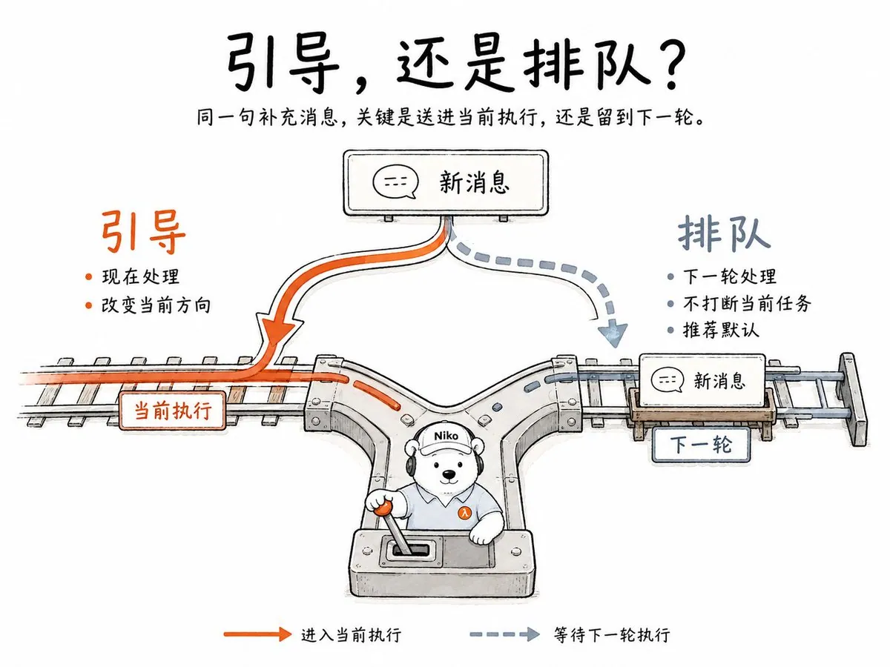
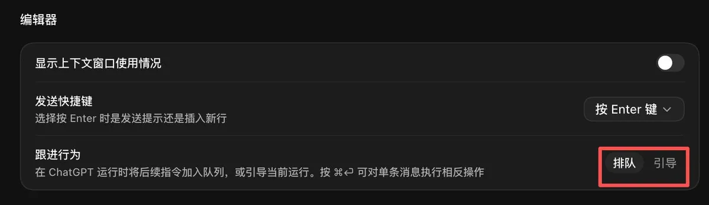
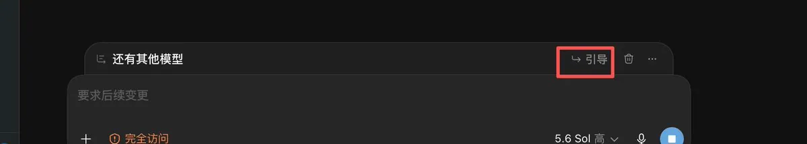
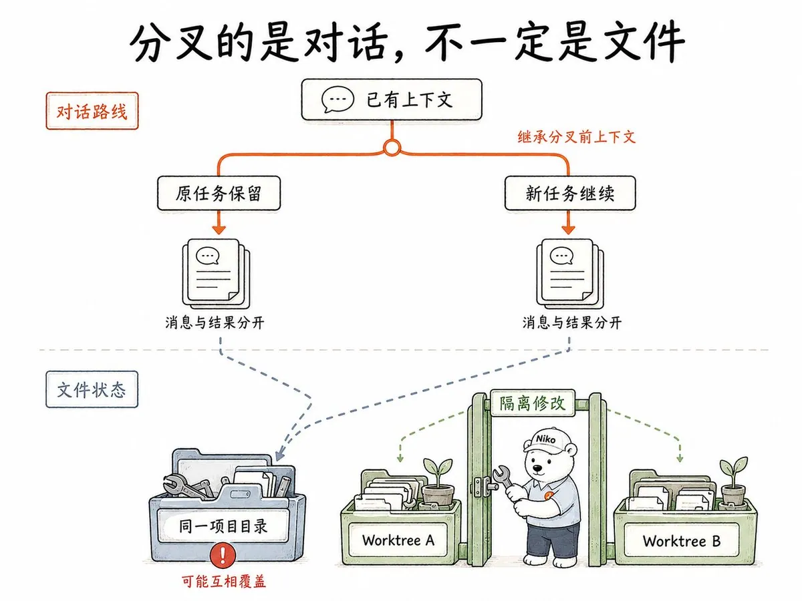
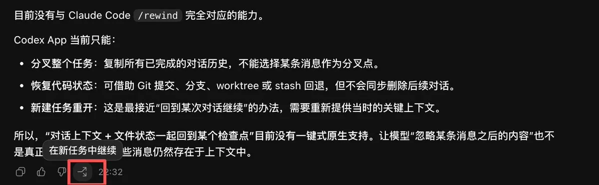
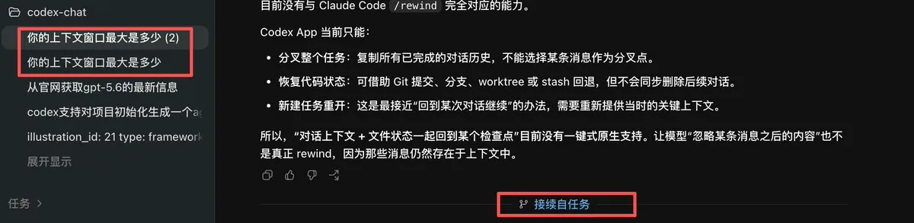

# Niko 爱学习（@ai_super_niko）：掌控 Codex 对话节奏——打断、排队、引导和分叉

> 进阶开发者与 Codex/Claude Code 等编程智能体协同的节奏把控秘籍：深入剖析对话中的即时打断（Interrupt）、任务排队（Queueing）、渐进式引导（Steering）与会话分支（Branching）机制，帮助工程师像指挥交响乐一样优雅驾驭多轮复杂代码重构。

<!-- more -->

Codex 开始执行后，你并不只能等它跑完。

方向错了，可以打断；上一条说错了，可以直接编辑；新消息可以选择引导当前执行，也可以排到下一轮；想试另一种思路，还可以从当前任务分叉。

这篇文章就讲清这些操作。它们不复杂，却决定了你是在被动等结果，还是在主动控制对话节奏。

如果把 Codex 比作一个正在工位上帮你干活的同事，下面这些动作分别是刹车、改工单、现场提醒、待办便签和复制工作台。

## 一、方向不对时，双击 Esc 叫停

假设你让 Codex：

帮我整理这个项目的代码，但不要修改数据库部分。

执行一会儿后，你发现它正在查看数据库文件，或者你突然想起还有一个重要限制没有说。

这时不用等。

在输入框处连续按两次 Esc，就可以停止当前执行。

第一次按下 Esc，相当于你对正在干活的同事喊了一声：

先停一下。

Codex 会进入停止确认状态。再按一次，才真正结束这一轮工作。这样设计是为了避免误触，毕竟很多人按 Esc，只是想关掉菜单或者退出某个输入状态。

双击 Esc 后，Codex 停止当前执行。

这里要注意，打断不是撤销。

Codex 在停止前已经完成的文件修改，通常仍然保留。它只是不会继续后面的步骤，并不会自动把工作区恢复到执行前。

所以打断之后，可以先问一句：

刚才已经完成了哪些修改，还有哪些没有做？

确认现场，再决定继续、调整还是回退。

这个动作很像踩刹车。踩刹车不是把车倒回出发点，只是先别继续往前开。

## 二、上一句话说错了，直接编辑，不必补十条解释

我们平时和人聊天，说错一句话，往往要在后面补：

不对，我刚才不是这个意思。

上一条里的 A 改成 B。

其他要求保持不变。

补得越多，上下文越乱。Codex 虽然能读懂，但也需要同时记住原要求、纠正说明和新的边界。

更干净的做法，是直接编辑上一条已经发送的消息。

把鼠标移到最近一条自己发送的消息上，选择编辑，修改后重新发送。Codex 会根据修改后的版本重新执行这一轮。

例如原来写的是：

把登录页面改成手机号登录。

后来发现需求其实是：

保留邮箱登录，再增加手机号登录。

与其再发一条长篇解释，不如直接把原消息改准确。

这相当于在工单还没归档前，把错误的工单换成正确版本。接手的人不必同时理解两份互相冲突的要求。

把鼠标移到最近一条消息上，点击编辑按钮。

修改消息内容后重新发送，Codex 会重新执行这一轮。

不过，目前这个能力主要用于最近一次发送的消息，而且需要等当前执行结束或停止后再编辑。它不是任意修改整段历史记录。

如果你想从更早的位置改走另一条路线，后面要讲的“新任务分支”更合适。

## 三、Codex 工作时又想到一句话，先判断是“引导”还是“排队”

Codex 正在执行时，输入框并不会锁住。你仍然可以继续发送消息。

但这条新消息有两种完全不同的去向。

## 引导：现在就告诉它

官方把这种方式叫作 Steer。

引导消息会加入当前正在执行的这一轮，用来改变方向、补充遗漏信息或纠正判断。

例如 Codex 正在重构页面，你突然想起：

不要改现有接口，只调整前端结构。

这条信息会影响眼前的工作，应该使用引导模式。

可以把它理解成同事正在装书架时，你走过去说：

等一下，左边还要留一个插座，别封死。

这句话越早说越好。等书架装完再说，返工就大了。

适合使用引导模式的情况包括：

- 发现当前方向不对
- 补充一个会影响实现的限制
- 告诉 Codex 某个文件不要修改
- 提供刚找到的错误信息
- 要求它先暂停某一步，检查另一个问题

## 排队：这件事等当前工作结束再做

官方把这种方式叫作 Queue。

排队消息不会塞进正在执行的工作里，而是等当前这一轮完成后，再作为下一轮任务处理。

例如 Codex 正在修复登录问题，你又想到：

修完以后，再帮我补一份登录模块说明。

这件事不需要改变当前修复过程，放入排队更合适。

它像是在同事桌上贴了一张便签：

手上的活做完以后，再处理这个。

排队中的消息会显示在输入框上方。你可以继续编辑、调整顺序、立即发送或者删除。

## 小白建议：默认使用排队，需要时再点引导

可以在“设置 > 编辑器 > 跟进行为”中，把默认方式设为排队。

这样，Codex 工作时新发送的消息会先进入待办队列，不会突然改变它正在执行的任务。对于刚开始使用 Codex 的人，这种方式更稳，也更容易判断每条要求到底在哪一轮被处理。

如果某条消息确实需要立即影响当前执行，也不用回到设置里来回切换。输入消息后，直接点击界面提供的“引导”按钮，就能把这条消息立刻加入当前任务。

也就是说，平时把新消息当成待办便签排好队，发现方向需要马上修正时，再按一下引导按钮，走到工位旁边当面提醒。

在设置中把“跟进行为”设为排队。

需要立即影响当前执行时，点击消息旁的引导按钮。

判断方法也很简单，只问自己一句：

这条消息会不会改变 Codex 现在正在做的事？

会改变，就点引导。

不会改变，只是下一件事，就让它继续排队。

## 四、想尝试另一种思路，不要推翻原任务，直接分叉

有时当前对话没有错，只是你想试试另一种可能。

例如你让 Codex 设计一个后台页面，它给出了传统表格方案。你觉得可以，但又想看看卡片式布局会是什么效果。

如果直接在原对话里说：

不要表格了，全部改成卡片。

原来的路线就被覆盖了。试完卡片后如果觉得还是表格好，又要往回走。

更合适的办法，是从当前任务继续到一个新任务，也就是分叉。

新任务会继承分叉点之前的对话背景，但之后拥有自己的消息、结果和执行过程。原任务仍然留在原来的路线，不受新讨论影响。

它很像在地图上的岔路口复制一支队伍。

一支继续走左边，尝试表格方案。

另一支从同一个位置出发，走右边，尝试卡片方案。

最后比较结果，再决定采用哪一条路。

分叉特别适合这些场景：

- 比较两种技术方案
- 尝试不同的页面设计
- 保留稳定方案，同时实验激进改法
- 从同一份分析得出不同版本的文章
- 当前任务已经很长，想把后续子任务单独整理

点击“在新任务中继续”，从当前位置分出另一条路线。

新任务会标出与原任务的接续关系，原来的任务仍然保留。

不过，对话分叉不等于文件也自动复制。

如果两个本地任务操作的是同一个项目目录，它们仍然可能修改同一批文件。两个任务同时动手，很容易互相覆盖。涉及代码实验时，可以为不同任务使用独立的 Git worktree，也就是给每条路线准备一套单独的工作目录。

分叉复制的是对话路线，不一定复制施工现场。

这一点要分清。

## 从“等结果”变成“管过程”

这四个动作，可以记成一张很短的清单：

- 方向明显错了，双击 Esc，先停车
- 最近一条需求写错了，直接编辑，换掉旧工单
- 新消息默认排队，先放进下一轮待办
- 新信息要立刻改变当前工作，点击引导，现场告诉它
- 想尝试另一条路线，用分叉，保留两个方案

刚开始使用 Codex，不需要一上来就研究复杂提示词。

先学会观察它正在做什么，然后在合适的时间叫停、补充、排队或分路，使用体验就会发生很大变化。

因为真正重要的，不是第一句话写得有多完美。

而是当事情开始变化时，你仍然知道该怎么把方向握在手里。

如果这篇文章对你有用，可以分享给刚开始使用 Codex 的朋友。你在使用 Codex 时，最容易失控的是哪一种情况？欢迎留言聊聊。

Hi，我是 爱学习的 Niko。17 年程序员老兵，现在每天用 AI 写代码，搞创作。这里分享学习和使用 AI 的经验、技术思考、踩过的坑、实用工具和 SKILL。关注我，一起学习。

## 历史文章

[从裸奔到全副武装：Claude Code 10 个精选仓库](https://x.com/ai_super_niko/status/2057444411727134926)

[所谓“必装 Skill 清单”，正在毁掉你的 AI](https://x.com/ai_super_niko/status/2055508068281311599)

[我把耳机线控键改成了豆包语音输入](https://x.com/ai_super_niko/status/2064319416096133482)

[一个 SKILL 仓库 13 个文件，只有 1 个真正属于我](https://x.com/ai_super_niko/status/2061348716955816256)

[实测 78k star 的 claude-mem：跨会话记忆让 token 少了一半](https://x.com/ai_super_niko/status/2059584371104113103)

[10 个 AI 写作提示词，让输出真正能用](https://x.com/ai_super_niko/status/2066906451818479854)

## 相关页面

- [[sources/stephan-pi-matt-implement-flow-open-source]]
- [[sources/gkevin-adversarial-subagent-code-review-pitfalls-and-formal-verification]]
- [[concepts/agentic-architectures]]
- [[concepts/engineering-skills]]
