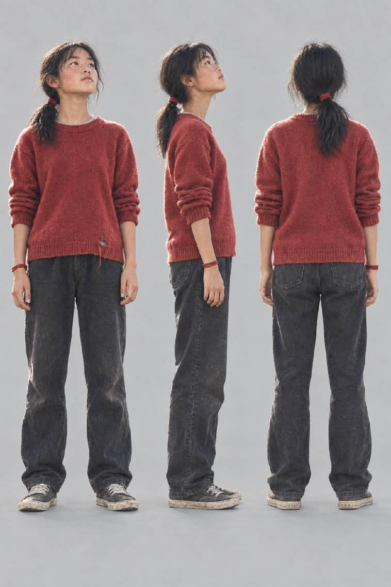
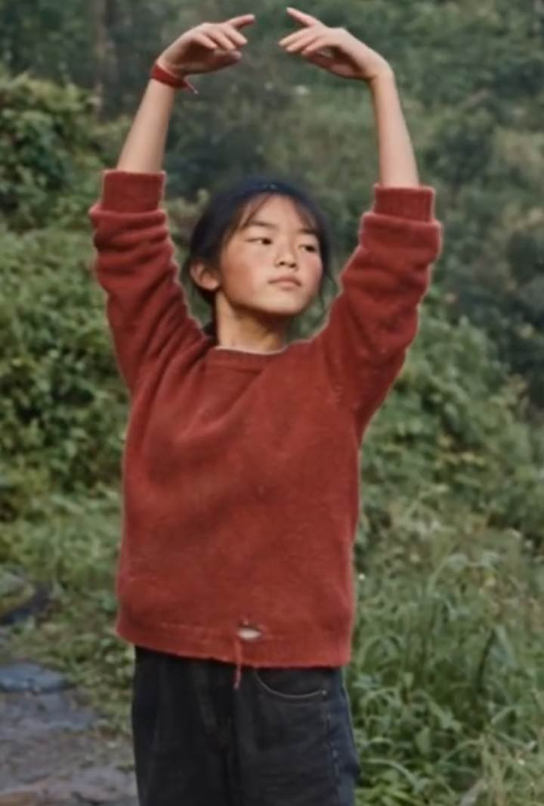
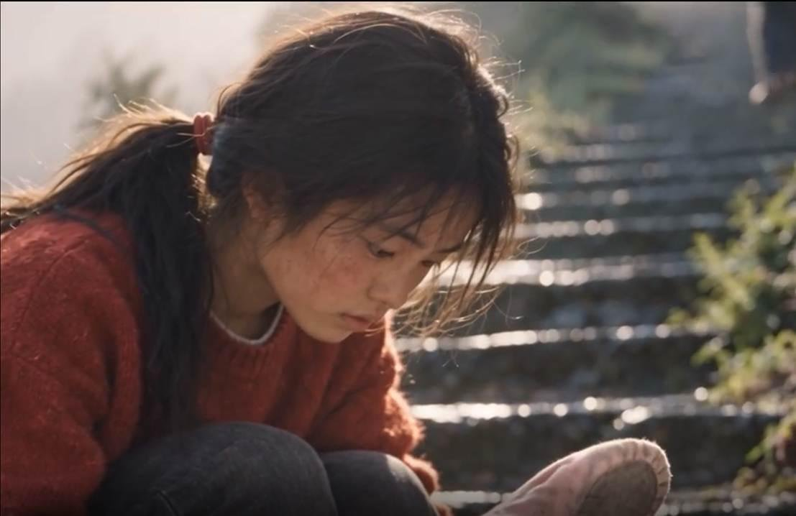
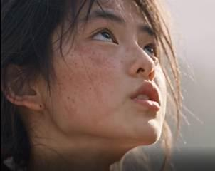
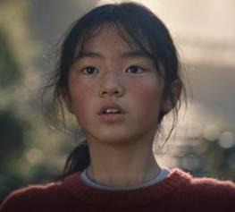
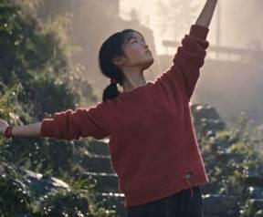
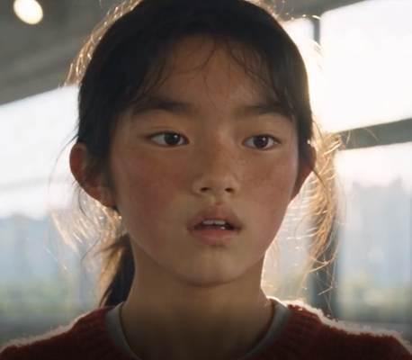
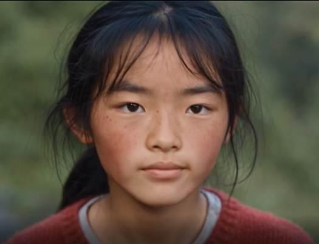
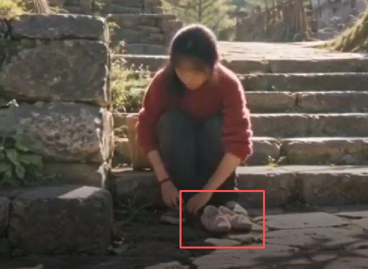
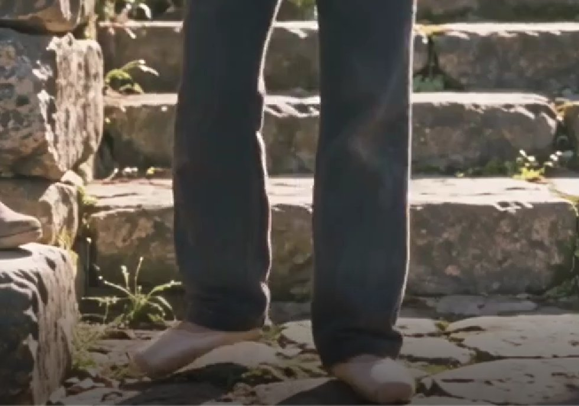

# 我真的没有拼多多（@nopinduoduo）：不会分镜和运镜？普通人到底能不能上手做 AI 漫剧？花 1 万积分的实测教程

> 实测消耗 1 万算力积分提炼的 AI 动态漫剧从 0 到 1 保姆级上手指南：解决新手不懂电影分镜、镜头推拉摇移提示词失控、角色五官崩塌等核心难点；分享 Midjourney/Seedance 关键帧绘制、动态运镜工具衔接与配音音效合成的完整制作管线。

<!-- more -->

最近总有人问我：不会分镜、不会摄影，能不能自己做 AI 漫剧？

以前我会劝他先别急。

不是因为一张好看的图有多难。现在随便一个生图模型，提示词写得还行，都能给你一张够漂亮的角色图。

但想做出一个好的漫剧，真正难的是后面这几步：

你一换场景，主角脸就漂；一换情绪，人就换了；一个镜头坏了，前面好不容易抽中的东西全得重来。

看起来不像在做内容，更像要先学会当导演。

现在 AI 漫剧 最不缺的是“好看”，真正难的是“连续”。

漫剧不是海报，也不是写真。

你不可能只发一张图。

真正开始做剧情之后，问题马上就来了：

同一个主角，换一个场景、换一个动作、换一种情绪之后，她还能不能继续是“同一个人”？

第一镜还是这个脸，第二镜眼睛变了，第三镜下巴又尖了；上一秒穿着旧舞鞋，下一秒鞋子换了；情绪一激烈，连人物气质都跟着漂。

这种问题单看一张图不明显，但只要把几个镜头连起来，观众几乎一眼就能感觉出来：

“这不是刚才那个人了。”

而且它带来的最大问题并不只是观感，而是返工。

因为一旦人物漂了，你不是只改一张图那么简单。它可能会影响后面的构图、动作、视频生成，甚至整个镜头都得重新做。

最后你会发现：

AI 漫剧最贵的，往往不是第一次生成，而是反复重做。

所以这次，我专门拿灵镜做了一个很简单的实验。

我不测试它能不能生成一张漂亮的人物图，我只想回答一个问题：

一个角色，能不能先被“存下来”，然后在后面的剧情里反复调用？

灵镜是 UUMit 自研的 AI 短剧 / 漫剧创作工作台。

简单理解的话，可以把 UUMit 看成一个 AI 创作总工作台，而灵镜是其中专门负责把故事、角色和镜头逐步变成短剧内容的一套工具。

这篇不展开介绍平台功能，我主要看它在一个真实项目里，能不能解决“角色别乱变”这件事。

先来看下我做的这个漫剧的效果吧👇

[video](https://video.twimg.com/amplify_video/2103314084192194560/vid/avc1/960x720/ocNTtusqiCpx0Tg3.mp4?tag=29)

## 一、实验怎么做：我们先把条件固定下来

为了避免变成“挑几张最好看的结果出来展示”，我尽量把测试条件固定。

这次我做的是一个很简单的小故事：

山里的女孩捡到了一双城里人丢掉的旧舞鞋。 她没有真正的舞台，于是把山路上的每一级台阶都当成舞台。 她一直往上跳，直到有一天真的走进城市，却发现最难的从来不是跳舞，而是被人看见。

主角叫阿禾。

16 岁左右，来自西南山村。

她不太爱说话，有点倔，脸上带着长期在山里生活留下的红润感。她不是那种一眼就很“精致”的女主，我更希望她身上有一种很明显的生命力：

人可以被生活往下按，但她的眼睛一直是往上看的。

整个故事的主题，其实也是“向上生长”。

为了专门测试角色连续性，我挑了三种比较典型的情况：

1. 场景一：正常状态，人物情绪平静
2. 场景二：更换景别、角度和动作
3. 场景三：进一步改变人物情绪

全程尽量保持同一个模型、同一画幅，以及同一套核心角色设定。

我不想用“这一张换个模型、下一张重新抽卡”的方式去证明一致性。

因为那样最后得到的只能是“这些图看起来比较像”，而不是这个角色到底有没有真正被延续下来。

## 二、第一步不是出镜头，而是先把“这个人”存下来

我先在灵镜里创建了阿禾。

第一步生成的是角色主图和三视图。

这一部分其实是我整个测试里看得最仔细的地方。

因为一个角色后面能不能稳定，很多基础信息其实在这里就已经埋下来了：

发型怎么走、脸型是什么、衣服是什么版型、主色调是什么、人物的年龄感和气质是什么……

这些东西如果一开始就模糊，后面镜头越多，角色越容易跑。

从实际结果看，主图和三视图里的阿禾整体保持得比较统一。

她身上的几个核心识别点也比较明确：

红色头绳、红扑扑的脸、偏圆但有骨感的下颌线，以及那件非常显眼的红色毛衣。

接下来，我把这个角色的 Appearance 和音色继续绑定到角色资产里。

到这里，阿禾才算真正“立住”。

我觉得这一步其实很关键。

因为它改变了角色存在的方式。

以前用普通生图工具，我对“阿禾”的理解其实是一段 Prompt。

每次重新生成，我都得再次告诉模型：

她是谁、长什么样、穿什么衣服、什么发型、什么年龄……

模型再根据这段描述重新“猜”一次阿禾是谁。

但在灵镜里，这套逻辑变成了：

先把阿禾变成一个角色资产，再让后续镜头调用阿禾。

这两者看起来只是工作流不同，但对漫剧来说区别很大。

前者是在不断生成“像阿禾的人”。

后者才更接近真正做剧时的逻辑：

演员已经定了，接下来只是让她去不同的场景演戏。

## 三、三个镜头，看这个角色到底会不会漂

角色建好之后，我开始真正测试连续性。

结果我按照镜头顺序放出来，你们可以直接自己对比。

- 镜头 1：正常场景，情绪平静

这一镜里，我主要先确认最基础的人物锚点。

包括：

红色头绳、脸型、红扑扑的脸颊，以及红色毛衣。

这些特征共同构成了阿禾最明显的视觉识别度。

只要后面的镜头还能稳定保住这些东西，至少观众第一眼会认为：

“还是她。”

- 换角度、换动作、换景别

第二步，我开始故意增加难度。

同一个角色，不再只是保持类似的正面构图，而是开始切换正面、中景、近景和不同动作。

这一组里，我觉得表现比较明显的一点是：

人物的核心识别特征没有因为景别变化而被重新设计。

红色头绳还在，脸部轮廓基本能对上，肤色和红扑扑的脸颊也保持得比较稳定，红色毛衣更是一个很强的视觉锚点。

至少从连续观看的感受来说，不会出现一种非常突兀的：

“等一下，这怎么突然换演员了？”

当然，这时候还只是改变构图。

真正更容易让 AI 漂掉的，其实是下一步：

情绪。

镜头 3：换情绪

所以第三组，我让阿禾从原本相对平静的状态，开始进入明显的情绪变化。

第一张，她听到老师的话之后，情绪复杂，有一点不可置信。

第二张，她慢慢做出决定，神情从迟疑变得坚定。

这一组我个人是比较满意的。

因为很多 AI 在做角色一致性时，有一个非常典型的问题：

平静脸还能保持，一旦让人物哭、笑、愤怒或者做夸张表情，脸就开始换人。

而这里阿禾的表情确实发生了明显变化，但人物本身的基本识别度还在。

你能感觉到：

她的情绪变了，但人没有完全变掉。

这对漫剧其实非常重要。

因为真正的剧情，不可能所有角色永远只保持同一个表情。

## 四、不完美的地方

这里还是要把不好看的结果一起说。

这次测试下来，一致的地方很明显，但出现偏差的地方同样存在。

稳定得比较好的，主要还是阿禾身上的核心人物特征：

红色毛衣、红色头绳、脸型和脸颊状态。

真正比较容易漂的，反而是一些更细节的物品。

比如鞋子。

前一个镜头里，阿禾脚上还是那双破旧的粉色舞鞋。

切到下一个画面，有时候会突然变成灰色布鞋。

甚至更有意思的是：

明明设定里是一双已经很旧、甚至有点脏的粉色芭蕾舞鞋，但有的镜头重新生成之后，它突然变成了一双干干净净、像刚从商店买回来的新鞋。

这其实很好地说明了目前这类工具的边界。

它已经可以明显提高“人物是谁”这件事的稳定度。

但并不意味着：

整个世界里的每一个细节都会被模型永久记住。

尤其是服装配件、道具状态、复杂动作，以及跨度比较大的镜头，仍然可能发生变化。

所以如果一定让我概括这次测试的结论，我更愿意说：

它把“角色识别度”往前推了一大步，但还没有到完全锁死所有视觉细节的程度。

## 五、真正让我觉得省时间的，其实不是第一次生成

反而是一次返工，让我觉得这套工作流比较有价值。

有一个镜头，我第一次生成出来之后明显不满意。

按照剧情，本来应该是：

阿禾穿着自己的旧布鞋进入画面，将捡到的舞鞋放在一边，然后才慢慢把布鞋脱下来换上舞鞋。

但第一次生成的视频出了一个很典型的连续性 Bug：

阿禾一开始已经穿着舞鞋进场了，还是一双干净的舞鞋。

反而将自己的旧布鞋放在一旁，省略了我中间的步骤。

也就是说，同一个镜头里面已经出现了明显的逻辑冲突。

[video](https://video.twimg.com/tweet_video/HTB2lD_akAArRuh.mp4)

如果放在以前我的工作流里，这种错误其实很烦。

因为前面角色、画面、动作好不容易都抽到了一个还能接受的版本，你会开始纠结：

到底要不要整条重新生成？

重新生成之后，原来满意的东西会不会又变掉？

但这一次，我没有动前后的内容。

我的处理非常简单：

只重新生成这一镜。

如果生成之后还有一点问题，再调整这一镜的描述继续跑。

角色资产不动。

场景不动。

其他已经满意的镜头也不动。

最后重新生成出来的版本里，阿禾终于先穿着原本的鞋进入画面，再完成后续动作。

[video](https://video.twimg.com/tweet_video/HTB3E2KakAA05sE.mp4)

而这一次局部返工实际消耗了 84 积分。

这其实是整个实验里，我觉得比“生成得漂不漂亮”更重要的一件事。

因为做内容做到后面，你会慢慢发现：

真正吞时间、吞积分、吞耐心的，从来不是第一次生成，而是为了修一个小错误，把前面所有东西全部推倒重来。

如果人物、镜头、场景能够拆开管理，那至少意味着：

一个镜头坏了，不一定要赔上一整条片。

## 六、三个你可以自己核对的证据

所以这篇我不太想一直说“这个工具很强”。

我更希望把能自己验证的东西摆出来。

第一个是角色跨镜头连续性。

同一个阿禾连续出现在多个镜头里，在正常表情、不同景别以及明显情绪变化下，核心人物特征仍然能够保持。

前面的截图可以直接对照。

第二个是局部重新生成。

其中一个镜头出现问题之后，我只重新生成了这个镜头，没有把已经完成的其他镜头一起推倒重来。

这部分第五节的前后版本也可以直接比较。

第三个是积分消耗和流水。

我把实际生成过程里的积分记录一起放出来

这里特别说明一下：

价格、积分规则以及会员权益，我使用的都是测试当天页面里显示的信息。

模型目录和积分消耗规则后面都有可能调整，所以这篇里的截图只能代表我测试时的情况。

实际使用时，以你自己当天看到的页面为准。

## 七、它现在依然有几个很明显的问题

如果只是展示成功案例，这篇其实写到这里就可以结束了。

但真正做完整个实验之后，我觉得有几个问题还是必须讲。

1. 一致性明显有帮助，但不是绝对稳定

角色资产确实能减少人物乱漂。

尤其是固定发型、服装和脸部特征之后，同一个人物跨镜头的可识别度会高很多。

但当动作幅度明显增加、镜头角度比较极端，或者人物进入很强烈的表情状态时，还是可能产生差异。

所以目前依然需要：

自己筛结果、自己比较、必要的时候重新生成。

它不是角色一绑定，后面就永远不会出错。

2. 人物运动还有明显的 AI 感

另一个比较明显的问题是动作。

比如我只笼统地写一句：

“阿禾开始跳舞。”

模型确实会让她跳。

但“会动”和“真的像人在跳舞”，是两件完全不同的事。

一些动作还是会显得比较僵，缺少真实的人体重心变化、准备动作和动作之间的过渡。

所以碰到舞蹈、奔跑、快速转身这种动作，我还是需要自己继续细化动作描述。

[video](https://video.twimg.com/tweet_video/HTB3mAubwAE1KGA.mp4)

3. 镜头之间的物品连续性仍然要人工盯

这次最明显的就是舞鞋。

上一镜是什么状态，下一镜不一定会自动继承。

这种问题不仅会发生在鞋子上。

理论上，包、首饰、手里的道具、衣服的某个局部，以及物体摆放位置，都可能出现类似情况。

所以现在想做真正连续的剧情，我的建议依然是：

重要道具不要只依赖文字描述，能作为引用资产固定的，就尽量固定。

4. 它不是“一键出成片”

这一点反而是我觉得最容易被误解的地方。

灵镜给你的，更像是一个：

可以持续修改的 AI 漫剧项目。

而不是按一下按钮，就直接给你一个完全不用改的成片。

如果你的期待是：

输入故事 → 点一下 → 完美短剧直接发布，

那大概率还是会失望。

你依然需要自己判断镜头、筛选结果、发现穿帮、调整动作和处理连续性。

但如果你本来就愿意改内容，那么这种角色资产 + 镜头级修改的结构，会明显减少一种最让人难受的返工：

为了改一处问题，把前面满意的东西一起丢掉。

## 八、做完以后，我对“AI 漫剧工具”的判断变了一点

以前我测试 AI 视频工具，最容易看的指标其实是：

清晰不清晰？

人物好不好看？

动作炸不炸？

但真的开始做连续剧情之后，我越来越觉得这些东西只是第一层。

一张图好看，甚至一个 5 秒视频很炸，现在已经越来越容易做到。

但“剧”真正困难的地方，是：

第 1 镜的人，第 10 镜还能不能是她。

她今天穿的衣服，下一镜还在不在。

她拿起来的东西，下一秒有没有凭空消失。

她哭的时候，还是不是刚才那个角色。

以及最现实的一点：

当其中一个镜头坏掉的时候，你到底是只重做这个镜头，还是整条全部推倒重来。

这也是为什么这次测试下来，我真正认可灵镜的地方，不是它某一张图生成得多惊艳。

而是：

一个角色，包括她的视觉特征和声音特征，可以在同一个项目里持续被调用；镜头也可以独立修改，同时每一步消耗了多少积分，我自己能看得见。

对于第一次做 AI 漫剧的人，或者需要快速生产短剧内容的人，这种工作流会比单纯不断抽图更接近真正的“做剧”。

当然，它目前最需要继续提升的地方也很明确：

镜头与镜头之间更细颗粒度的连续性，以及复杂人物动作。

如果以后不仅能记住“这是阿禾”，还能同时记住：

她上一镜穿的哪双鞋、鞋子有多旧、手里拿着什么、刚才站在哪里，以及接下来动作应该怎样自然衔接——

那 AI 漫剧的生产方式才会真正发生更大的变化。

所以这次实验做完，我最大的感受还是标题这句话：

AI 漫剧最难的从来不是好看，是主角别换人。

真正能把一个角色存下来，让她穿过一个又一个镜头，继续成为“她自己”，才算是在做一部剧。

否则，我们其实只是在不断生成一张又一张很好看的头像。

## 九、如果你也想自己试

灵镜入口：

https://lingjing.uumit.com/?invite=DUAJSV

## 相关页面

- [[sources/adrian-ai-video-fundamentals-framing-camera-and-continuity]]
- [[sources/leo-xiaolei-ai-character-consistency-skill]]
- [[concepts/prompt-engineering]]
- [[concepts/ai-content-pipeline]]
