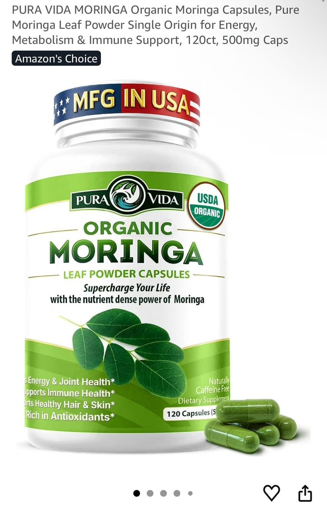
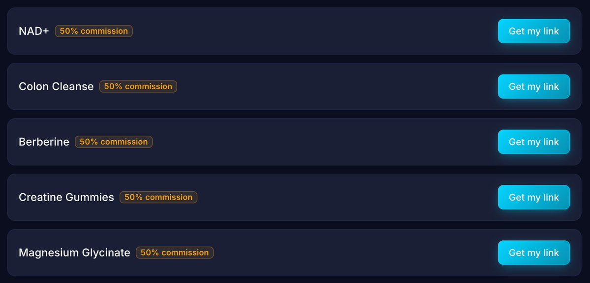

# Tapa（@onlytapa）：这个 AI 非洲奶奶账号每月赚 $7,020——OpenArt 造角色加补剂联盟加 ManyChat 自动私信全拆解

> 一个由匿名运营者管理、每周只花 3-5 小时的 AI 非洲奶奶 Instagram 页，已有 120k followers，最近 90 条帖子平均每条 196,000 views，内容全部是健康类，每条视频里奶奶都会说 comment ’yes’ if you want to see more posts like this，用户评论 yes 后由 DM automation 自动推送补剂联盟链接，bio 里也放了链接。作者给两套收入估算：一是按 AI faceless 页 $0.20 到 $4 per follower 的区间，极保守取 $0.20/follower 得 $24k、该页发了 4 个月即约 $6k/month；二是按每天 2 条乘 196,000 views = 11.7 million views/月，补剂售价 $60、佣金约 50%、每 50,000 views 出 1 单，得出 $7,020/month。复刻五步：OpenArt 用提示词生成 70 多岁非洲女性角色模板；把脚本交给 Claude、ChatGPT 或 Grok 写「unknown esoteric health tips」类选题并配音；一条视频 5-10 分钟就能做完，也可以拿别人的 Instagram 视频用 Kling 2.6 换脸；选品是最难的环节，多数联盟只给 5-10% 佣金（5% 佣金下月入 $1k 的号若换成 50% 佣金同样精力能做到 $10k/month），作者的解法是直接跟 Amazon 和 Shopify 上的补剂公司谈更高费率；发布端用 bio 联盟链接、视频结尾口播、以及 ManyChat 评论触发（例如 comment FLOW）自动私信，并同步 Instagram、TikTok、Facebook（最适合触达察觉不出是 AI 的 boomers）、YouTube Shorts、Snapchat spotlight。放大阶段把流程 screen record 后招 VA，假设 10 个号每号每天 3 条 = 每天 30 条，按每条 10,000 views 计是 27,000,000 月播放，每 50,000 播放 1 单即 $13.5k/month，扣掉 VA 和软件成本约 $12.5k/month 纯利；作者另提到已有 AI 账号拿到公司开的 $3-10k/month retainers 加销售分成。

<!-- more -->

If you’re on Instagram, you might’ve seen this page.

This page is being run by someone anonymous, and they’re spending 3-5 hours/week posting videos to this page and making $Xk/m+ in the process.

I know, because I run a ton of pages like this too that I make $10,000s a month from.

In this article I’m going to break down exactly how he’s doing it and how you can too:

## How it makes money

This AI page has 120k followers on Instagram, and is averaging 196,000 views per video across the last 90 posts.

This is an example of what they’re posting (watch it to understand this next part):

[video](https://video.twimg.com/amplify_video/2111797754049748993/vid/avc1/720x1280/atpDZkvI_p8dRuJC.mp4?tag=29)

All of the grandma’s videos are health related. In every video she says “comment ‘yes’ if you want to see more posts like this”.

When people comment yes, they’re using a DM automation to automatically send out a DM with some copy and a link to the supplement they’re affiliating for on Amazon.

It’s also in the pages bio:

There’s 2 ways I’m estimating the page earnings:

1. Follower count

I’ve seen AI faceless pages make anywhere from $0.20 to $4 per follower they have.

Let’s be very conservative and say this page is doing $0.20 per follower → that’s $24k

This page has been posting for 4 months, meaning it’s $6k/month (BUT this is just the Instagram stats, the page has also gone viral on facebook and this figure is conservative even for the Instagram page alone)

2. View count

Let’s say they’re posting 2x a day with his average views being 196,000 per video → that’s 11.7 million views per month for this page.

The owner of the page is likely either on a commission basis (if so, around 50% would be normal in the supplements affiliate space) and the product costs $60.

That means that if they just get 1 sale for every 50,000 views, that’s $7,020/month (this is also very conservative estimate, and doesn’t take into account their facebook page

Crazy money from just posting some AI videos, but let’s get into how YOU can actually do this too 👇

## Step 1: Creating the AI Character

This part is super easy.

Go into OpenArt and type in a prompt to get a photo of your AI character.

An example prompt could be:

“Photo-realistic image of an old African woman in her 70s, traditional African village elder clothing, white background. Vertical 9:16, phone-camera look.”

This will be your basis AI character template that you can use when creating future videos

## Step 2: Creating content with the AI character

This obviously depends on what you’re selling, but let’s say it’s a supplement that helps support blood flow like the AI monk in the video I showed.

Go into Claude, ChatGPT, Grok or whatever AI you use and ask:

“Give me ideas for a script about unknown esoteric health tips most people don’t know about”

It’ll give you a list of problems, then choose the best ones and say:

“I want you to write a script for an Instagram video on how to help with XYZ problem”

Then add the script and have the AI do a voice-over of her talking about whatever specific problem you made the script around → and it’s literally THAT easy.

You can make other images in OpenArt and add motion to them, or even just take other people’s videos from Instagram and use Kling 2.6 to add your characters face to it instead

A full video can be made with AI in 5-10 minutes.

## Step 3: Finding a product to promote

This is the hardest part of the whole process to be honest.

Most affiliate offers online are ass - they’ll give you like 5-10% commission per sale, which is nothing.

On 5% commission your page that’s making $1k/month WOULD be making $10k/month if you were at 50% commissions, for the same amount of effort too.

For me, I’ve had to directly negotiate with different supplement companies on Amazon and Shopify to negotiate better rates.

Your other option could be to create your own Shopify supplement brand - but that’s obviously a ton of effort, which is why I prefer to just negotiate better commission rates for existing products that already have great reviews.

## Step 4: Posting and making sales

You should have your affiliate link in your bio, but now you need to drive traffic to it.

Here’s ways you can do it:

1. Talk about it at the end of every video (go to my link in bio plug)
2. Talk about it in captions (not recommended as much, can hurt your reach a little bit)
3. Get users to comment something and set up an automated DM campaign on ManyChat (e.g. comment “FLOW” and I’ll tell you my secrets on healthy blood flow, automatically DM them some value and the link to the supplements page)

Since you’re going to the effort of creating the videos, you’ll want to post them on as many platforms as possible to maximize your chances of getting sales:

- Instagram
- TikTok
- Facebook (great for reaching boomers who don’t realize it’s AI)
- YouTube Shorts
- Snapchat spotlight (less recommended, but if you have the time you might as well test it)

## Step 5: Scaling + other monetization options

Having one account is great, but you know what’s even better?

Having 5, 10, 20 AI accounts all promoting products and making money.

This is basically impossible to do by yourself, but you can easily outsource it to Virtual Assistants on websites like onlinejobs(.)ph or Upwork.

Upload a job listing, filter through the applications, get the better candidates to make test videos following your process, then hire the best one (or multiple depending on the amount of pages you have).

You should screen record your exact process for them, review the videos they make and show them how they can be better, then once the VA is used to it - it’s pretty much on autopilot from there.

Imagine you have 10 AI accounts all posting on Instagram, TikTok and Facebook 3x a day each - that’s 30 videos being posted a day.

If you’re averaging 10,000 views a video (conservative, if you know what you’re doing you’ll have videos blowing up to 1M+ views like this monk guy is) → that’s 27,000,000 monthly views across your accounts

If you get 1 sale every 50,000 views (also conservative), that’s $13.5k/month

After paying your VAs and software costs that’s probably $12.5k/month in pure profit with no more work on your part

Insane!

There’s other monetization options too → I’ve seen AI accounts getting offered $3-10k/month retainers by companies to promote their products, as well as a % commission on every product they sell.

## 相关页面

- [[patterns/ai-agent-content-farm]]
- [[concepts/overseas-tool-stack]]
- [[concepts/b2c-conversion]]
