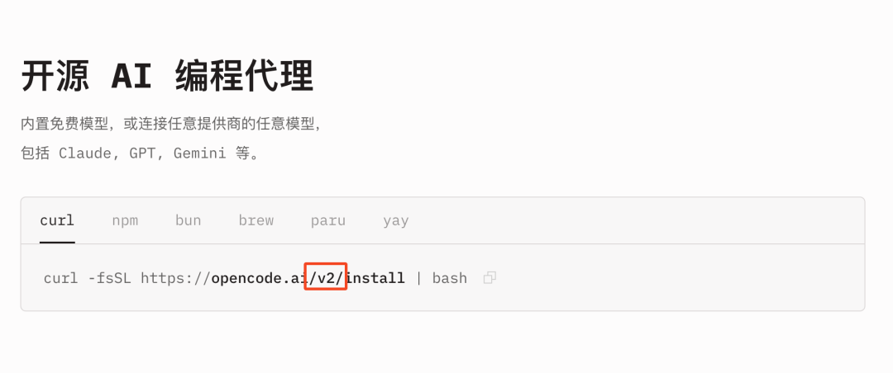
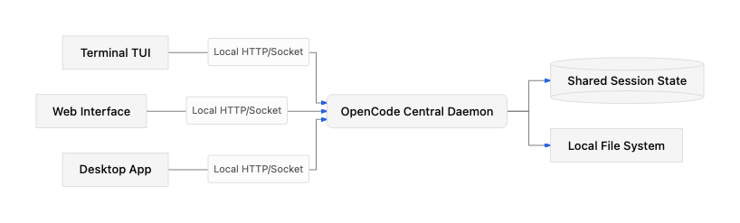

# OpenCode 2.0：从一次性脚本到常驻服务的架构重构

> 大部分 AI 编程工具的工作模式依然类似于一次性的脚本程序。你在终端运行命令，它读取上下文、发送 Prompt，然后返回结果。一旦关闭终端，运行状态就随之消失。

## 核心架构变化

Anomaly 近期发布了 OpenCode 2.0，这次更新没有去拼凑最新的大模型接入点，而是进行了一次**彻底的架构重构**：

- 放弃了早期单点触发的模式
- 将系统转变为真正的本地常驻后台进程
- 重写了 API 规范
- 引入了**微型 JavaScript 解释器**来接管复杂的控制流

## C/S 架构：从可选项到默认

在早期版本中，OpenCode 确实支持 Client/Server 模型，但它并非默认行为。这种老旧设计的局限在于，一旦业务场景复杂，多个客户端尝试同时操作同一套本地代码库或会话时，文件系统的状态同步会变得非常脆弱。

**2.0 版本直接将服务器作为单一后台进程（opencodepid）在本地运行。**

无论开发者通过 TUI、Web 界面还是原生的桌面应用唤起操作，所有的交互最终都路由到这个唯一的中央进程。



这种收口带来的直接工程收益是**接口的可编程性大幅提升**：

- 开发团队可以通过 `@opencode/client` 包（原生支持 JavaScript 与 Effect 框架）编写自定义脚本
- 脚本会自动发现本地的服务端口并直接通信
- 通过 CLI 暴露的 `opencode api` 命令和 `/pair` 机制，将当前服务暴露给其他宿主机，或者与其他应用做集成

## 丢弃旧 API，引入接口自反性设计

Anomaly 在官方博客中坦承，旧版 API 设计得很糟糕。这是早期 Agent 开发的通病：随着对业务场景认知的变化，API 往往是针对零散需求东拼西凑的产物。

重写后的 2.0 API 基于其数百万用户的真实边缘场景做了梳理。其中最值得关注的改动，是引入了类似**反射的调用机制**。

OpenCode 内部集成了自身的 API 客户端，大模型可以直接调用这套 API 对当前的开发会话、乃至整个系统级进程进行管理。

### 跨会话干预机制示例

当你在新会话中输入"在一个新的工作区中开始对上传接口做限流"，Agent 会执行以下操作栈：

1. 调用 `opencode.worktree_create[name=rate-limit]` 创建新的 Git Worktree
2. 调用 `opencode.session_rename[title=Rate limit uploads]` 重命名当前会话上下文
3. 调用 `opencode.session_move[directory=~/worktrees/rate-limit]` 将会话的工作目录切换到新的分支环境

如果你发现某个运行测试的后台会话卡死了，可以在当前的对话窗口中直接要求 Agent 处理：

1. 拉取当前的进程列表（session_list）
2. 定位到卡死状态的 ID 并发送中断指令（session_interrupt）
3. 向那个被中断的会话注入新的 Prompt 要求隔离该测试用例
4. 清理无用的 Tab 界面（tab_close）

将多进程调度和工作区管理的工作，通过明确的 API 边界交给大模型来编排，有效减少了宿主程序的硬编码逻辑。

## Code Mode：用代码解释器替代函数调用链

在处理批量和具备强逻辑依赖的任务时，目前常规的 Function Calling 机制存在**致命的性能瓶颈**。

如果你要求大模型"获取 GitHub 上的 bug 并建入 Linear 追踪"，传统的 Agent 会：

1. 调用 GitHub API 工具
2. 等待 LLM 接收并解析返回的大段 JSON
3. 在一个循环里连续生成几十次 Linear API 的工具调用

这中间每次往返产生的网络延迟和 Token 生成开销是不可接受的，且极易因为某次解析错误导致整个流程中断。

### 大模型最擅长写代码

OpenCode 2.0 在 `@opencode/codemode` 模块中内置了一个**极简的 JavaScript 解释器**。

面对上述需求，模型不再机械地输出离散的工具调用指令，而是直接写一段脚本，在脚本内原生调用外部的 MCP (Model Context Protocol) 服务器：

```javascript
const { issues } = await tools.github.list_issues({
  owner: "anomalyco",
  repo: "opencode",
  labels: ["bug"],
  state: "OPEN",
})

const filed = await Promise.all(issues.map(({ title }) =>
  tools.linear.save_issue({ team: "OC", title })
))

return filed.map(issue => issue.identifier)
```

通过引入这种模式，**控制流（如 Promise.all 异步并发和 map 数据映射）回到了宿主环境的确定性解释器中执行**。

大模型只需要在任务起点进行一次推理并生成对应代码，后续的批量 IO 操作完全由本地脚本引擎接管。

用传统的确定性代码解决循环和高频 IO 操作，用 LLM 解决自然语言的意图理解和代码生成。这种设计剥离了模型不擅长的精细流控制作。



## 思考：AI 编程工具从玩具走向生产力的核心路径

完全依赖 LLM 推理来控制每一个微小的执行细节，在实际工程中不仅成本过高，而且缺乏确定性。

OpenCode 2.0 提供了一个极具实操性的参考架构：

1. **将状态收敛到常驻后台**
2. **把系统级 API 开放给模型去灵活调度**
3. **用确定性的 JS 解释器接管复杂的业务控制流**

减少对大模型推理过程的滥用，回归经典的客户端-服务器设计模式，也许才是 AI 编程工具从玩具走向重度生产力的核心路径。

只是，当一个本地常驻的后台进程能够根据语言输入，动态生成并直接执行 JavaScript 来操作系统级 IO 时，**如何构建出足够强壮的安全隔离沙盒，将是这套架构必须面临的下一道技术门槛**。
