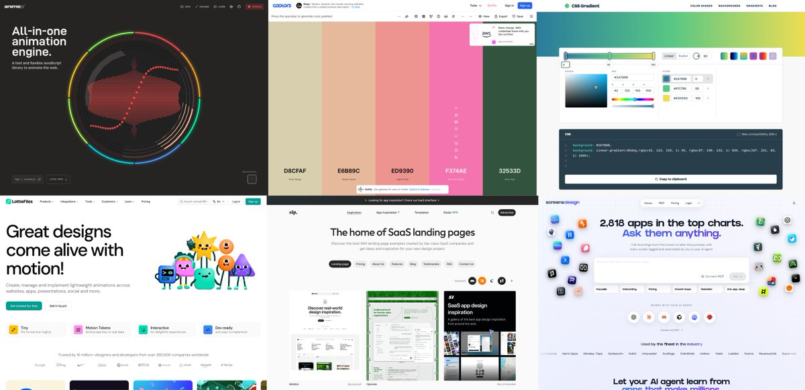
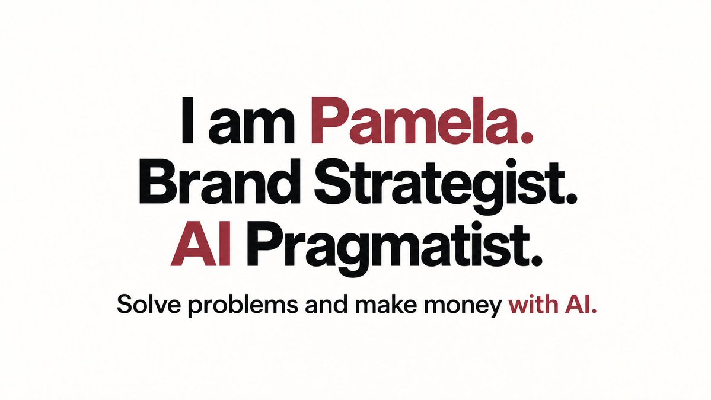

# PamelaAI·H（@pamelaaaaa1218）：从 0 搭建个人网站——8 大类 60+ UI 设计必备清单

> 个人独立站与作品集视觉设计的终极自检清单：系统拆解 Hero 首屏视觉、导航栏布局、项目卡片展示、社交媒体入口、关于我模块、博客列表、响应式排版到移动端适配的 8 大维度 60+ 个细分 UI 元素，帮助开发者彻底告别「页面粗糙、排版混乱」的素人感。

<!-- more -->

搭建个人网站的时候，直接让 AI 做往往效果很差、不够个性化。最佳做法是：找好看的网站 → 让 AI 抓代码/截图/风格关键词 → 整合制作。

以下 8 大类共 60 多个网页资源——组件库、动效、Landing/Hero、移动端 UI、交互、配色素材、AI 建站、Claude Skills。这些基本都能直接抓代码、抓 Prompt 复用，并且每个都附上了特色和用法，改名或迁移的入口也补了说明。想从 0 搭建网站或者迭代优化，打开这份清单完全够用，记得收藏。

## 01 新建飞书文档把内容理清楚

用 AI 做自己的个人/品牌网站，需要先让 AI 了解你是谁、想展示什么。

我建议大家把个人介绍、项目案例、作品素材和服务内容等所有想展示的内容，先整理进一份飞书文档，让 AI 用飞书 Cli 去调用。这是我在“飞书绝活大会”上跟王大仙学到的方法，就是把内容逻辑先理清楚再干。

这样做有两个好处：

1. 内容不七零八落：省去到处改、反复同步的麻烦，效率高很多。
2. 飞书当资源库和链接源：后续有修改直接在文档里改，再把链接发给 AI 就能近乎实时更新；AI 也能持续基于这些内容维护你的网站。

## 02 组件：选好部件再拼成网页

按钮、表单、导航、卡片，这些组成页面的小部件，可以先找现成的，再交给 AI 拼接成适配自己网站的样子。

1. [shadcn/ui](https://ui.shadcn.com/)｜基础组件 · 源码可改 · 统一样式

按钮、表单、弹窗等常用部件比较齐，组件源码可以放进项目里继续修改。

用法： 先选需要的组件，把对应的安装说明交给 AI 接入项目，再统一调整颜色、圆角和尺寸。适合先搭出一套风格一致的基础界面。

2. [Aceternity UI](https://ui.aceternity.com/)｜立体卡片 · 光效背景 · 视觉动效

聚光灯、背景光束、立体卡片这类视觉效果比较有辨识度，适合放在首屏或重点展示区域。

用法： 先在预览里体验鼠标移动、滚动后的效果，再把组件的安装说明交给 AI，替换成自己的图片和文字，并调整效果强弱。

3. [Magic UI](https://magicui.design/)｜文字动画 · 数字滚动 · 动态边框

以 React 和 Tailwind CSS 为主的动效组件库，适合给首屏标题、数据展示和按钮增加细节。

用法： 从文字、数字或边框效果里挑一个，在组件页查看预览和接入说明，交给 AI 安装。再换成自己的内容，调整颜色、速度和尺寸，放进需要强调的区域。

4. [React Bits](https://reactbits.dev/)｜文字动画 · 动态背景 · 参数可调

可以挑选文字变化、背景动画等效果，并选择适合项目的代码版本。

用法： 先确定要给哪段文字或哪个区域加效果，再选组件、查看代码和依赖，让 AI 调整文案、颜色、速度。适合给页面增加一两个亮点。

5. [Cult UI](https://cult-ui.com/)｜特色卡片 · 设备模型 · shadcn 组件

围绕 shadcn/ui 提供带设计感的组件，卡片、设备展示和动效适合用来呈现作品。

用法： 展示 App 或网站项目时，可以先挑一个设备模型或作品卡片，把项目截图、名称和链接替换进去，再请 AI 统一留白和交互。

6. [KokonutUI](https://kokonutui.com/)｜交互组件 · AI 界面 · 页面区块

有按钮、导航、卡片等组件，也能找到聊天输入等 AI 产品界面的参考。

用法： 按要做的页面选组件，先看预览，再把官方接入说明交给 AI。比如先搭好输入区和操作按钮，再替换文案、图标和发送后的反馈。

7. [HyperUI](https://hyperui.dev/)｜Tailwind CSS · 营销区块 · 应用组件

按营销网站、应用界面等用途整理 Tailwind CSS 组件，适合先搭页面结构。

用法： 需要导航、价格卡片或常见问题时，找到对应区块并复制代码，让 AI 按项目结构接入，再统一字体、间距和品牌色。

8. [Float UI](https://floatui.com/)｜响应式组件 · 多框架 · 网站模板

提供 Tailwind CSS 组件和模板，可按项目需要选择 HTML、React、Vue 等版本。

用法： 先确认项目使用的框架，再选相应版本的导航、团队介绍或表单区块。接入后替换自己的内容，并检查手机上是否需要换行或调整排列。

9. [Park UI](https://park-ui.com/)｜设计系统 · Ark UI · Panda CSS

基于 Ark UI 和 Panda CSS 构建组件，适合给项目建立一套统一的界面规范。

用法： 先按项目框架查看安装说明，接入需要的按钮、输入框、弹窗等组件，再统一主题颜色、尺寸和间距。已有项目先让 AI 检查是否适合接入这套方案。

10. [Tailwind UI](https://tailwindui.com/)｜现 Tailwind Plus · 官方区块 · 付费模板

现在名为 [Tailwind Plus](https://tailwindcss.com/plus)，是 Tailwind 官方的组件和模板资源，适合希望直接使用成套设计的人。

用法： 先预览模板和区块，确认是否覆盖自己的官网或应用需求；需要付费内容时按对应方案获取，再交给 AI 替换文案、素材和页面结构，沿用同一套样式。

11. [shadcn blocks](https://ui.shadcn.com/blocks)｜官方区块 · 侧边导航 · 登录与后台

这是 shadcn/ui 官方的 Blocks 页面，比单个按钮更完整，可以直接参考一整段页面结构。

用法： 需要登录页、侧边栏或后台布局时，先预览相应区块，按安装说明加入项目，再把菜单、表单字段和数据换成自己的。

12. [shadcnblocks.com](https://www.shadcnblocks.com/)｜营销页面 · 成段区块 · shadcn 生态

这是第三方区块库，围绕 shadcn/ui 提供首屏、功能介绍、价格和评价等页面区块，便于搭出完整落地页。

用法： 先列出网站需要的区块，再按首屏、作品或功能、用户评价、联系入口的顺序挑选。接入后统一字体和配色，让不同区块看起来像同一个网站。

13. [21st.dev](https://21st.dev/)｜组件集合 · 页面区块 · AI 提示词

可以集中比较不同作者做的导航、首屏、卡片等组件，组件页提供交给 AI 工具使用的接入提示词。

用法： 选中一个区块，预览后复制它的提示词，补上「放在哪一页、换成什么内容、沿用什么配色」，再交给 AI 适配。

14. [Origin UI](https://originui.com/)｜现 coss ui · Base UI · 基础界面组件

原入口现转到 [coss ui](https://coss.com/ui)，可以查找基于 Base UI 的界面组件和不同变体。

用法： 需要输入框、下拉框或表格时，先挑符合场景的样式，按当前文档接入，再让 AI 补齐禁用、报错、加载等状态，并统一整站样式。

15. [Skiper UI](https://skiper-ui.com/)｜创意交互 · 图片揭示 · 鼠标效果

偏向有表现力的交互组件，可以找到图片揭示、拖动、滚动和鼠标跟随等效果。

用法： 先挑一个适合展示作品的效果，体验它在悬停、拖动或滚动时的变化，再按组件说明接入。换成自己的素材，调整移动幅度和触发位置。

这类组件有各自支持的开发环境。接入前，把安装说明交给 AI 检查一下与现有项目是否兼容。

## 03 动效与 3D：让页面里的元素动起来

如果想自己控制动画的节奏、顺序，或者加入可互动的 3D 内容，可以看这一类。

1. [Motion](https://motion.dev/)｜淡入淡出 · 拖拽交互 · 布局过渡

适合处理按钮反馈、卡片展开、元素进出场等界面动画，让页面状态切换更自然。

用法： 从官方示例挑一个接近需求的效果，把示例和目标一起交给 AI。例如「这组卡片依次出现，鼠标移上去时轻微抬起」，再调整速度和幅度。

2. [GSAP](https://gsap.com/)｜动画时间轴 · 滚动联动 · 多元素编排

适合安排一连串动画，比如标题先出现、图片随后移动、背景随着滚动变化。

用法： 先写清楚「谁先动、谁后动、什么时候触发」，再让 AI 参照官方示例接入；需要跟随滚动时，再加入对应的滚动插件。

3. [Anime.js](https://animejs.com/)｜JavaScript 动画 · SVG 路径 · 动作编排

可以通过代码控制网页元素、SVG 图形等的运动，适合需要精细调整的局部动画。

用法： 先从官方示例里找接近需求的效果，比如图标路径逐步绘制、标题依次出现，再让 AI 替换目标元素，调整持续时间、延迟和运动曲线。

4. [LottieFiles](https://lottiefiles.com/)｜矢量动画 · 动画素材 · 加载反馈

可以查找和预览 Lottie 动画，也提供编辑与交付工具，适合加载、成功提示等小动画。

用法： 按 loading、success 等场景找素材，先预览节奏并调整颜色，再按网站技术栈选择播放器接入。请 AI 设置尺寸、是否循环，以及什么时候开始或停止播放。

5. [Shadertoy](https://www.shadertoy.com/)｜着色器作品 · 流体光效 · 程序化视觉

社区创作者用着色器代码制作噪声、流体、光影等视觉效果，可以边看作品边研究代码。

用法： 先挑一个适合背景的效果，记下喜欢的颜色、运动方式和密度。需要使用公开代码时查看作品授权，再让 AI 做网页适配，调低强度并检查手机表现。

6. [The Book of Shaders](https://thebookofshaders.com/)｜着色器入门 · 图形原理 · 互动示例

这是讲解着色器原理的教程，适合理解渐变、形状、噪声等效果是怎样画出来的。

用法： 对某种背景感兴趣时，先读对应章节，在交互示例里改颜色和参数；确定效果后，把示例与需求交给 AI，继续实现适合网页的版本。

7. [Three.js Examples](https://threejs.org/examples)｜官方 3D 示例 · 材质光照 · 场景交互

Three.js 官方示例目录，可以按效果查看材质、灯光、模型和交互的实现。

用法： 先找与产品展示接近的示例，点开源码让 AI 解释结构，再替换模型、背景和相机角度。先做一个小场景，确认加载和操作正常后再放进页面。

8. [Spline](https://spline.design/)｜可视化 3D · 鼠标互动 · 网页嵌入

可以在浏览器里编辑 3D 物体和场景，再给它们设置点击、鼠标跟随等互动。

用法： 从社区里选择可以再编辑（Remix）的场景，修改模型、颜色和交互，再通过导出里的 Viewer 入口，把嵌入代码放进网站。适合展示一个可互动的产品或视觉主角。

9. [Rive](https://rive.app/)｜交互动画 · 状态切换 · 点击反馈

把图形设计、动画和交互逻辑放在一起，适合制作会响应操作的图标、按钮或角色。

用法： 先设计默认、悬停、点击等状态，用状态机连接它们；导出后按项目框架接入运行库，再让 AI 把网页里的事件接到动画输入上。

## 04 整站灵感：先看网站可以长什么样

这一类适合找整体风格、内容结构和排版参考。选中案例后，最好点进实际网站看一遍。

1. [Godly](https://godly.website/)｜现 Recent · 创意网页 · 品牌视觉

Godly 的入口现转到 [Recent](https://recent.design/)，可以浏览网页、界面、品牌和动效等设计案例。

用法： 先挑两三个符合品牌气质的案例，分别记下字体、配色和首屏布局。把想参考的部分说清楚，再让 AI 结合自己的内容做一版设计。

2. [Land-book](https://land-book.com/)｜行业筛选 · 风格筛选 · 页面区块

可以按行业、网站类型和视觉风格找案例，也有拆开的页面区块可看。

用法： 先找与自己用途接近的网站，确定整体方向；只缺首屏、定价或功能介绍时，再去 Sections 找对应区块，截图并标出想参考的排版。

3. [Lapa Ninja](https://www.lapa.ninja/)｜落地页合集 · 行业分类 · 首屏参考

按类别收集落地页案例，适合比较同一种业务有哪些不同的页面表达。

用法： 先选接近自己的行业或用途，找三个案例，对比标题、配图和按钮怎样配合，再把自己的卖点按合适的顺序放进去。

4. [One Page Love](https://onepagelove.com/)｜单页网站 · 个人作品集 · 内容结构

重点收录单页网站，适合参考个人主页、作品集、活动页怎样在一页里把事情说清楚。

用法： 找一个用途接近的案例，列出它的内容顺序，比如「我是谁→展示作品→介绍服务→联系方式」，再换成自己的内容，让 AI 搭出页面。

5. [SaaS Landing Page](https://saaslandingpage.com/)｜软件官网 · 功能介绍 · 定价区块

围绕软件产品收集官网和营销页面，也适合参考功能、定价、常见问题等区块。

用法： 做工具或服务网站时，先找同类产品，拆出「解决什么问题、怎么使用、有什么证明、下一步做什么」，再让 AI 用自己的信息重新组织页面。

6. [httpster](https://httpster.net/)｜独立网站 · 大图展示 · 风格参考

精选具有鲜明视觉风格的网站，适合观察图片、文字和页面构图的整体关系。

用法： 先选自己喜欢的案例，再把偏好拆成具体要求，例如大标题、窄正文、通栏图片或大胆配色，附上参考让 AI 设计，避免只说「高级一点」。

7. [Awwwards](https://www.awwwards.com/)｜获奖网站 · 创意交互 · 滚动体验

适合看完成度较高的网站，以及滚动、鼠标操作和画面变化怎样配合。

用法： 打开案例对应的实际网站，体验完整的滚动和交互，挑出一个想借鉴的细节，再把「什么操作触发什么变化」描述给 AI。

8. [CSS Design Awards](https://www.cssdesignawards.com/)｜获奖网站 · 视觉设计 · 交互体验

通过网站评选展示视觉、体验和创新方面突出的作品，适合寻找有特点的表现方式。

用法： 点进案例的实际网站体验，选一个与自己内容有关的细节，比如导航展开或章节切换，写清触发条件和变化，再让 AI 先做小样。

9. [SiteInspire](https://www.siteinspire.com/)｜风格筛选 · 网站类型 · 排版参考

按风格、类型等维度组织网页案例，适合从大量网站里缩小自己的参考范围。

用法： 先按作品集、个人网站等用途筛选，再比较几个案例的文字大小、网格和图片比例。保留适合自己内容的排版关系，交给 AI 做页面。

10. [Minimal Gallery](https://minimal.gallery/)｜精选案例 · 字体层级 · 留白比例

适合集中观察文字、图片和空白怎么安排，也能按个人网站、作品集等类型查找。

用法： 截取喜欢的一段页面，标出标题大小、正文宽度和图片比例，让 AI 参考这些关系。适合先把自己的视觉偏好说具体。

11. [MotionSites](https://motionsites.ai/)｜AI 网页提示词 · 首屏设计 · 动效参考

提供带视觉预览的 AI 网页设计提示词，可以按首屏、定价等页面区块寻找方向。

用法： 先看预览，挑一个符合项目气质的方案，获取对应提示词后补上自己的品牌、文案、配色和技术要求，再交给建站工具生成并调整。

12. [Variant](https://variant.fun/)｜网页设计探索 · 风格参考 · 入口待确认

作为网页设计与风格探索入口保留。本次未能正常打开这个地址，当前功能和可用状态暂未确认。

用法： 可以先保存原链接，待可访问时再查看实际功能。现在需要探索多版界面，可以先用 Google Stitch，把页面用途、品牌气质和内容写清楚后比较方案。

## 05 产品界面与流程：参考真实产品怎么用

网站里如果还有注册、登录、搜索、订阅、付款等功能，可以借鉴真实产品的处理方式。

1. [Mobbin](https://mobbin.com/)｜真实产品 · 界面检索 · 设计模式

收录已上线产品的界面与流程，适合横向比较同一种页面有哪些做法。

用法： 搜索要做的界面，例如登录页或订阅页，对比几个产品的字段、按钮和信息顺序，再整理成自己的页面要求交给 AI。

2. [Page Flows](https://pageflows.com/)｜操作录屏 · 步骤注释 · 完整流程

重点看一件事怎样完成，例如用户从哪里进入注册、填完后看到什么、下一步去哪里。

用法： 搜索对应任务，看完一条流程后写下「入口→操作→反馈→下一步」，再让 AI 补齐需要的页面和状态。适合梳理页面之间的衔接。

3. [screenlane](https://screenlane.com/)｜真实界面参考 · 旧站入口 · 已并入 Page Flows

原先用于收集网页和移动端界面，后来与 Page Collective 合并为 Page Flows。旧链接保留在这里，当前可以直接用 [Page Flows](https://pageflows.com/)。

用法： 需要参考登录、订阅或设置页时，转到 Page Flows 搜索对应任务，对照页面字段、按钮和操作反馈，再整理自己的界面要求。

4. [UI Sources](https://www.uisources.com/)｜现 ScreensDesign · App 界面 · 流程录屏

原入口现转到 [ScreensDesign](https://screensdesign.com/)，适合看真实 App 的界面和连续操作过程。

用法： 带着一个任务看录屏，比如首次打开到完成注册，记下每一步的入口、操作和反馈，再让 AI 补齐自己的页面状态和跳转。

5. [Refero](https://refero.design/)｜真实产品 · 网页与 App · 信息布局

收集真实产品的界面参考，适合比较内容较多的页面怎样安排导航、信息和操作。

用法： 先搜索具体页面，例如数据面板或账号设置，再对照几个案例的信息层级。把布局中的模块换成自己的内容和数据，让 AI 做成符合业务的页面。

## 06 局部灵感与微交互：把小细节做好

一个按钮、一个菜单、一段加载动画，也可以单独找参考。

1. [CodePen](https://codepen.io/)｜在线预览 · 代码实验 · 复制修改

能一边看网页效果，一边看实现代码，适合研究按钮、加载动画、鼠标悬停等局部效果。

用法： 找到接近需求的公开作品，Fork 一份作为自己的副本，先改颜色、大小或动画速度，再把代码和依赖交给 AI 适配项目。

2. [Codrops](https://tympanus.net/codrops)｜交互教程 · 效果演示 · 实现思路

适合从一个视觉效果继续往下看，了解它是怎样做出来的；部分教程附有演示和示例代码。

用法： 先体验效果演示，挑出需要的部分，再查看教程使用的技术和代码入口。让 AI 先做一个独立小样，确认表现合适后再放进网站。

3. [UI Movement](https://uimovement.com/)｜交互灵感 · 旧站名称 · UI 细节

这是早期的 UI 动效灵感站，后来更名为 Screenlane，后续资源又并入 Page Flows。这里保留旧入口，查看现有流程可用 [Page Flows](https://pageflows.com/)。

用法： 现在可以在 Page Flows 的实际操作录屏里看按钮、菜单和切换反馈，记下「什么操作触发什么变化」，再让 AI 实现适合自己页面的交互。

4. [Dribbble](https://dribbble.com/)｜设计作品 · 界面构图 · 品牌视觉

适合比较设计师怎样处理颜色、卡片、插画和界面展示，也可以找品牌表达的方向。

用法： 用 landing page、portfolio、dashboard 等页面关键词搜索，选出喜欢的作品，标注具体的配色或构图细节，再用自己的内容重新设计。作品展示不一定附带代码。

5. [Behance](https://www.behance.net/)｜完整项目 · 品牌设计 · 作品呈现

设计师以完整项目展示品牌、界面和视觉成果，比单张效果图更适合研究一套设计怎样展开。

用法： 搜索与自己业务接近的项目，从品牌气质、字体配色一路看到应用页面，提炼可借鉴的规则，再让 AI 用自己的素材做一套连贯的设计。

## 07 配色、图标与素材：把整站风格统一起来

主色、字体、图标、插画和照片尽量放在一起考虑，做出来的网站更容易保持一致。

1. [CSS Gradient](https://cssgradient.io/)｜渐变生成 · 角度调整 · CSS 代码

可以在页面上调整渐变色标、位置和角度，同时查看预览与生成的 CSS。

用法： 先输入品牌主色，再添加搭配色，调整渐变角度和过渡位置。满意后复制 CSS，告诉 AI 用在首屏背景、按钮还是卡片上。

2. [uiGradients](https://uigradients.com/)｜现成渐变 · 整屏预览 · 颜色组合

适合在没有配色方向时浏览现成的渐变，用大面积预览判断颜色搭配是否合适。

用法： 先选一组接近品牌气质的组合，复制颜色值或 CSS，再请 AI 调整明暗和透明度，用在指定区块里，并检查文字是否清楚。

3. [Coolors](https://coolors.co/)｜配色生成 · 锁定主色 · 图片取色

适合从一个已有颜色继续搭配，也能从喜欢的图片里提取配色。

用法： 有 Logo 主色时，先输入并锁定它，再生成其余搭配；没有方向时，可以从图片提色。选好后，把颜色值交给 AI，说明哪些用于背景、文字和按钮。

4. [Realtime Colors](https://realtimecolors.com/)｜网页预览 · 配色试搭 · 字体搭配

把颜色和字体直接放进示例网页里，方便看它们用在标题、正文和按钮上是什么效果。

用法： 填入准备使用的颜色和字体，看看整页的阅读感受，检查文字与背景是否清楚，再导出需要的配置交给 AI。

5. [TweakCN](https://tweakcn.com/)｜主题编辑 · shadcn 配套 · 可视化调整

适合使用 shadcn/ui 的项目，在可视化界面里调整和比较组件主题。

用法： 从接近自己品牌的主题开始修改，预览按钮、卡片等部件的整体效果，再把主题配置应用到项目，让整站沿用同一套样式。

6. [Hero Patterns](https://heropatterns.com/)｜SVG 纹理 · 重复背景 · 透明度可调

提供可重复铺开的 SVG 图案，可以调整前景色、背景色和透明度。

用法： 想让纯色背景多一点细节时，选一个纹理，把颜色改成品牌配色、透明度调低，再复制生成的背景 CSS，让 AI 放到指定区域。

7. [Hero Icons](https://heroicons.com/)｜Tailwind 团队 · SVG 图标 · 轮廓与实心

由 Tailwind CSS 团队制作的图标库，可以直接使用 SVG，也有 React、Vue 等接入方式。

用法： 先确定使用轮廓还是实心风格，再为导航、功能介绍和联系方式挑图标。把 SVG 或安装说明交给 AI，统一尺寸、颜色和对齐方式。

8. [Lucide](https://lucide.dev/)｜线性图标 · 风格统一 · 颜色粗细可调

图标遵循统一的设计规则，适合导航、功能介绍和操作按钮。

用法： 搜索需要表达的含义，选好图标后统一尺寸、颜色和线条粗细，再把 SVG 或组件用法交给 AI 接入，保持全站图标一致。

9. [Phosphor Icons](https://phosphoricons.com/)｜多种字重 · 图标系列 · 风格统一

同一个图标提供多种线条粗细和表现形式，便于匹配轻巧、厚重等不同页面气质。

用法： 先选一种适合品牌的字重，再从同一套里挑导航和功能图标。让 AI 沿用统一尺寸和字重，必要时用更明显的样式区分选中状态。

10. [unDraw](https://undraw.co/)｜场景插画 · 主色可改 · 品牌配图

有工作、学习、协作等场景插画，可以调整主色来搭配网站。

用法： 搜索与页面内容有关的主题，把插画主色换成自己的品牌色后下载，放在服务介绍、空白状态或引导区域。

11. [Storyset](https://storyset.com/)｜场景插画 · 风格可选 · 在线改色与动画

按场景提供插画，可以切换画风、修改颜色和背景，也能在在线编辑器里添加动画。

用法： 先按服务内容搜索场景，再选定一种画风，把主色改成品牌色。下载适用格式放进服务介绍或引导区域；需要动画时再调整具体元素的运动。

12. [Pexels](https://www.pexels.com/)｜摄影图片 · 视频素材 · 场景搜索

可以按主题寻找照片和视频，适合补充人物、空间、工作过程等真实场景画面。

用法： 先确定图片要表达什么，再用具体场景关键词搜索，挑选色调接近、方便裁切的素材，按使用位置下载，交给 AI 放进首屏或内容区。

13. [Unsplash](https://unsplash.com/)｜摄影素材 · 氛围图片 · 主题搜索

摄影素材涵盖人物、建筑、自然和工作场景，适合确定网站的画面气质。

用法： 先找一张适合首屏的主图，再按相近色调和场景挑补充图片。告诉 AI 统一裁切比例，并给标题和按钮留出足够空间。

## 08 AI 生成界面与建站：先把第一版做出来

准备好网站用途、页面内容和参考材料后，可以用这些工具起步，再一轮轮修改。

1. [v0](https://v0.dev/)｜界面生成 · 网站应用 · Vercel 生态

Vercel 出品，可以通过描述和参考材料生成网页界面，继续补功能，并预览、发布网站应用。

用法： 把自己的职业、目标访客、作品和联系方式写清楚，附上参考图，让它完成首页；再逐项调整首屏、作品展示和手机排版，检查链接后再发布。

2. [Lovable](https://lovable.dev/)｜对话建站 · 可视化修改 · 功能整合

适合通过聊天搭建网站，也能在预览中继续调整页面元素、补充表单或账号等功能。

用法： 先提供个人介绍、服务内容和希望访客完成的动作，生成内容完整的品牌网站；再调整页面元素，添加咨询表单，并测试能否正常提交。

3. [Bolt.new](https://bolt.new/)｜浏览器开发 · 运行预览 · 代码编辑

可以在浏览器里生成、运行和修改项目，也能在聊天修改与代码编辑之间切换。

用法： 写清作品筛选、服务介绍、联系入口等需求，先做一个能运行的版本；再逐页点击检查，把具体问题告诉它修改，确认后使用发布功能。

4. [Google Stitch](https://stitch.withgoogle.com/)｜界面设计 · 方案探索 · 交互原型

适合先探索网页或 App 的界面方向，再整理页面之间的连接和交互。

用法： 输入页面需求和参考材料，先比较不同设计方案，再把选中的界面连成原型、调整流程，之后交给开发工具继续实现。

5. [Figma Make](https://www.figma.com/make)｜Figma 生态 · AI 原型 · 可交互页面

可以通过提示词创建可交互的原型，也适合把已有 Figma 设计继续变成能操作的页面。

用法： 把已有设计或页面需求交给它，说明按钮点击后做什么、页面怎样跳转，先生成可操作版本，再逐项验证菜单、表单和页面衔接。

6. [Subframe](https://www.subframe.com/)｜设计画布 · 浏览器预览 · 编码代理

把可视化设计、浏览器预览和编码代理放在一起，适合边看页面边调整设计与实现。

用法： 先把页面内容和布局整理好，在画布里调整模块，再让编码代理把修改实现到项目中。对照预览继续改字体、间距和手机布局。

7. [Galileo AI](https://www.usegalileo.ai/)｜原 AI 界面工具 · 已转至 Stitch · 旧入口保留

原 Galileo AI 地址目前会转到 [Google Stitch](https://stitch.withgoogle.com/)。这两个入口现在指向同一工具。

用法： 打开后按 Stitch 的流程使用：描述页面用途、内容和风格，补上参考材料，比较生成方案，再选定一版继续细化页面与交互。

## 09 设计 Skill 与提示词：让 AI 按一套设计要求做事

Skill 可以理解为给 AI 编程助手的一套工作说明，里面写着设计原则、检查项和操作方法。这一类也放了查找 Skill 的目录和帮助表达需求的提示词资料。

1. [UI Skills](https://www.ui-skills.com/skills)｜Skill 目录 · 分类查找 · 设计工程

这是查找设计相关 Skill 的目录，可以按需要挑规则和能力。

用法： 先确定要处理字体、动画、布局还是其他细节，再查找对应 Skill，点进详情看适用工具与安装方式，选需要的加入自己的工作流。

2. [Anthropic frontend-design](https://github.com/anthropics/skills/tree/main/skills/frontend-design)｜前端设计 · 视觉方向 · 页面实现

Anthropic 官方提供的前端设计 Skill，帮助 AI 在做页面时考虑字体、配色、布局和视觉表达。

用法： 按官方说明，在支持它的 AI 工具里安装并启用。再写清网站用途、品牌气质和必备内容，让 AI 结合这些要求设计和实现页面。

3. [pbakaus 设计 Skill](https://github.com/pbakaus)｜Impeccable · 设计审查 · 细节精修

可以从作者主页找到 [Impeccable](https://impeccable.style/) 等设计项目；Impeccable 提供面向 AI 编程助手的设计审查和改进指令。

用法： 先按项目说明安装，补充自己的品牌和设计背景。页面有初稿后，让 AI 审查层级、排版和间距，再按优先级逐项修改。

4. [z1han 提示词库](https://ai.z1han.com/prompt)｜提示词资料 · 网页需求 · 表达参考

提供提示词参考，适合借鉴如何向 AI 说明设计方向、页面结构和实现要求。

用法： 找到接近网页设计任务的提示词，保留有用的描述结构，把品牌、受众、内容和约束全部换成自己的，再交给 AI，并根据第一版结果继续补充要求。

写在最后：大家不需要一次用完上面这些工具～先选一个建站工具、一个参考站和一套配色，把自己的第一页做出来，再不断迭代和完善。

我是 Pamela，品牌人 → AI Builder 转型中，初来乍到，请大家多多指教～会继续分享更多干货合集，以及用 AI 搞钱的实操经验，本人致力于用 AI 解决实际问题，顺便赚点钱钱（上班真的太无聊了）～有用的都会分享出来～

## 相关页面

- [[sources/kongge-space-resume-as-personal-website-skill]]
- [[sources/adrian-mckinsey-style-consulting-visual-prompts]]
- [[concepts/indie-product]]
- [[concepts/engineering-skills]]
