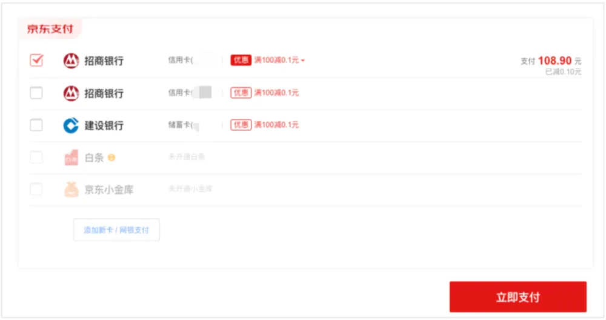
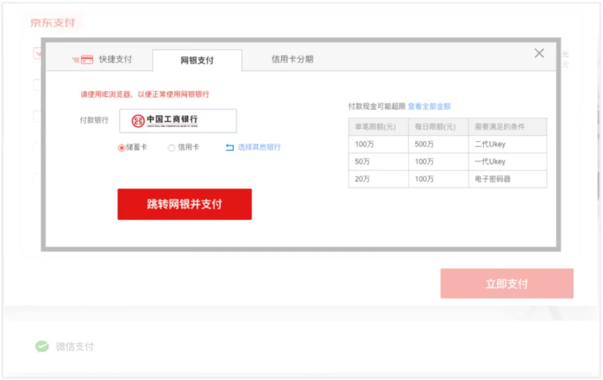
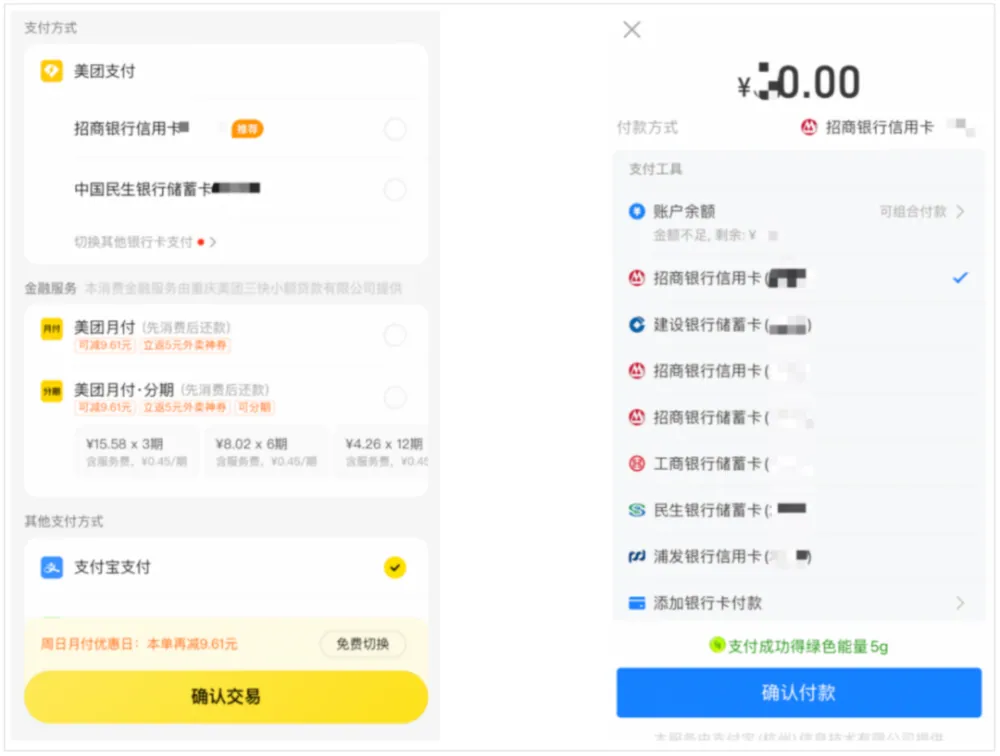
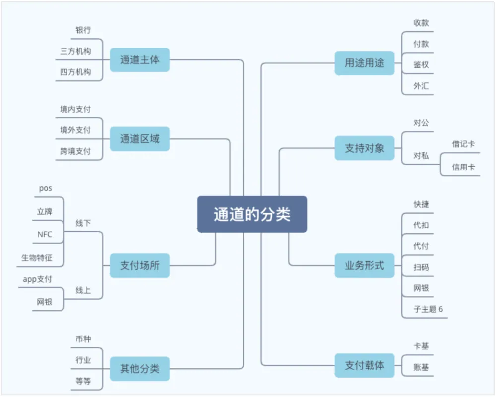

# 陈天宇宙：详解「支付通道」管理系统——基础概念、全生命周期与产品原型设计

> 支付的本质是货币债权的转移，而支付通道是在支付过程中提供货币债权转移服务的底层基石。三方支付机构基于支付通道而立，没有通道，再强大的交易清算系统也只是空中楼阁。本文系统梳理支付通道的定义（直连与间联、卡基与账基）、多维分类、生命周期管理（准入、对接、成本分润、健康巡检、路由调度），以及中大型支付企业如何从零构建高可用通道管理系统的方法与原型设计。

<!-- more -->

## 01. 通道与通道系统基础

### 1.1 通道的概念

在支付体系中，“通道”到底意味着什么？我们可以先回顾支付的经典定义：**发生在收款人和付款人之间的货币债权转移的过程。**

> **通道定义**：在支付过程中进行货币债权（资金）转移的服务提供方。

举个日常例子：你在便利店买早餐，用支付宝刷招行信用卡，老板的工行卡收到款项，收款工具是“收钱吧”，收钱吧使用的清算结算通道是银联。在这一流程中：
- 钱由付款人招行卡转移到收款人工行卡，招行是**收款通道**，工行是**结算通道**；
- 狭义上，所有资金终局都在银行或持牌钱包机构手中；
- 广义上，正如超市并不直接与成千上万家工厂对接、而是通过中间批发商供货一样，聚合了各种银行渠道的三方支付公司、第四方聚合支付机构，在广义上同样是商户的“供货通道”。

由此形成了**直连通道**与**间联通道**：
- **直连通道**：支付机构直接连接银行内部核心主机；
- **间联通道**：通过银联、网联、支付宝、收钱吧等清算机构或聚合服务商间接转接。

从业者必须具备“通道意识”：**我们在对接上游通道的同时，在下游客户眼中，我们本身也就是通道。**

---

### 1.2 通道的重要性与分类维度


*图 1：主流电商与本地生活平台收银台的通道分类聚合*


*图 2：收银台页面按照银行卡、分期、钱包余额与第三方工具分类*


*图 3：支付宝各类绑卡与信用账户组合展示*

常见通道分类包括：
1. **按支付载体**：卡基（银行卡直扣）与账基（电子钱包余额）；
2. **按服务主体**：银行直接通道、持牌第三方支付机构、第四方聚合服务商；
3. **按支付场所**：线上支付（App SDK、WAP/H5、网银跳转）与线下支付（POS、静态码牌、主扫/被扫盒子、NFC、刷脸）；
4. **按业务方向**：收款通道（Inbound）、付款/代发通道（Outbound）、实名认证鉴权通道、跨境结售汇通道；
5. **按业务模式**：协议快捷支付、代扣代缴、B2C/B2B 网银；
6. **按账户属性**：对公账户通道与对私借记卡/信用卡通道。


*图 4：多维度支付通道分类图谱*

---

### 1.3 为什么需要通道管理系统？

企业业务在不同阶段对通道系统的依赖程度完全不同：

| 阶段 | 特征 | 管理方式 | 是否需要系统 |
|---|---|---|---|
| **第一阶段** | 业务模式单一、通道数量极少（1~2 条） | 人工备注、配置写死在代码或简单配置表 | ❌ 不需要搭建专门系统 |
| **第二阶段** | 通道逐步增多（5~10 条），出现功能重叠 | 结构化 Excel 表格维护，运营人员手工监控 | ⚠️ 建议轻量化模块，不急于全面铺开 |
| **第三阶段** | 跨国、跨境、多主体、上百条通道并发，涉及动态费率与高并发容灾 | 人工管理必出事故，部门间信息脱节，自动化路由与成本核算迫切 | ✅ 必须建立全生命周期通道管理系统 |

通道的多样性与业务复杂度，是构建通道管理系统的先决条件。

---

## 02. 通道全生命周期管理

一条支付通道从引入到下线，经历五个核心阶段：

```
商务谈判与准入评估 → 技术对接与沙箱验收 → 生产放量与动态路由 → 日常健康监控与成本分润 → 规则降级与清退下线
```

1. **准入评估**：资质合法性核验、业务场景匹配度、结算周期（T+0/T+1）、费率阶梯与备付金保证金要求；
2. **技术对接**：接口协议规范（RESTful/JSON/XML）、密钥交换（RSA/SM2/SM4 国密）、异步回调 Webhook 稳定性测试；
3. **动态路由（Routing Engine）**：结合交易金额、银行卡 BIN 码、成功率漏斗、通道实时成本（成本优先 vs 体验优先）动态选择最优通道；
4. **健康度巡检**：毫秒级心跳检测、失败率连续阈值熔断、自动切换备用通道；
5. **对账与清算核算**：每日对账单（Reconciliation File）自动化下载、勾兑平账、差错单冲正与长款/短款处理。

---

## 相关页面

- [[sources/missle8z-information-arbitrage-8-business-models]]
- [[sources/pengpai-wanghou-psychological-accounts-to-b-monetization]]
- [[concepts/boss-business-model]]
- [[concepts/b2c-conversion]]
