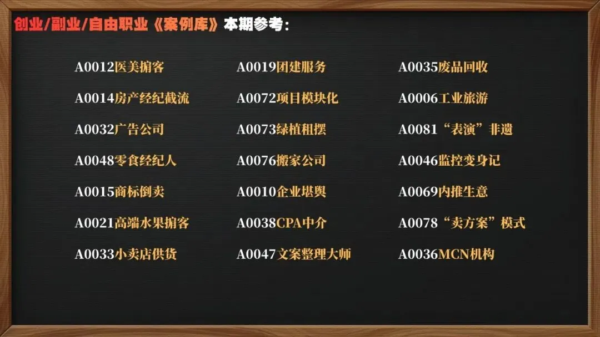
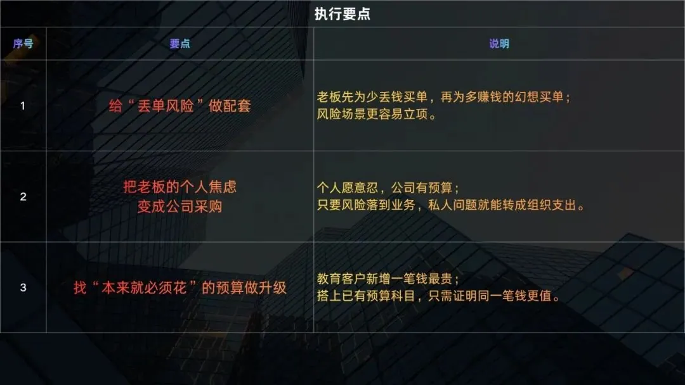
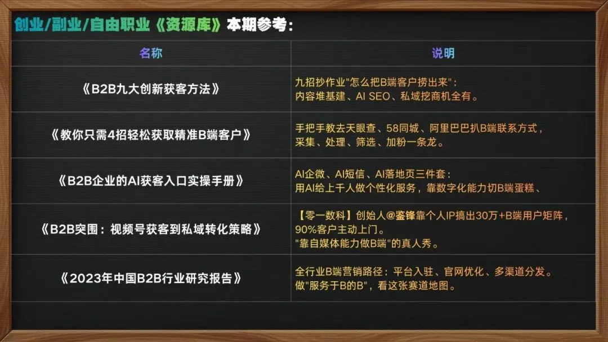

# 澎湃王侯：赚钱不难——给人换个理由花钱（心理账户迁移与普通人做 ToB 生意的 8 种路径）

> 《低成本创收图谱》系列第 8 期：商业思维的核心往往不在于创造全新产品，而在于改变用户花钱的「心理账户」。如果把产品或服务从个体的“消费支出”翻译升级为企业的“投资资产”，把 C 端定位包装成 B 端服务，转化率与客单价就能成倍提升。本文系统梳理个体与小团队做 ToB 业务的 8 大具体路径与 16 个真实实操案例。

<!-- more -->

很多时候，商业思维其实非常朴素：**同一笔钱，换个用途，在消费者心中的意义完全不同。**

如果我们把自己的产品或服务，从一种「消费支出」翻译或升级成一种「投资收益」，把原本面向 C 端的产品重塑为 B 端工具或服务，就能利用调动受众「心理账户（Mental Accounting）」的方式大幅提升转化率与客单价。

每个人心中都有不同的独立子账户：生活必要开支账户、个人发展账户、休闲娱乐账户、搞钱投资账户等。其中最有钱、最舍得花钱的永远是**搞钱与投资账户**。

凡是 ToB 产品或服务，自带天生的高溢价与高利润属性。特别是在超级个体、独立开发者、个人 IP 与人人自媒体的时代，遍地都是微型 B 端需求。做「服务于 B 的 B」往往是极佳的高效选择。你并不需要发明全新技能，只需要把你已经在做的事情，从受众的「消费账户」搬运到「投资账户」。

以下梳理个体切入 B 端生意的 8 大具体思路与案例：

---

## 1. 靠技能：重构定位，新瓶装旧酒

保留原有的专业技能，只调整受众定位与服务表达方式，把个人消费包装成企业经营刚需：

- **典型案例**：以前做普通的「个人形象设计 / 化妆造型」，客单价受限；后来转型做「创始人形象顾问」。小老板与创业者参加融资路演、公开演讲、自媒体录播或拍摄官方媒体照时，视觉形象直接决定外界的第一印象与商业信任度。
- **底层逻辑**：此时购买的不再是“打扮自己”，而是“在商业关键场合为公司降低沟通与获客成本”，直接进入企业的公关与商务预算。

---

## 2. 靠脑洞：C 端业务 B 端化，切入企业心理

把本属于大众 C 端的心理需求业务，拔高为面向小微企业主的定制服务：

- **典型案例**：以前做 C 端个人玄学命理；后来转向初创企业人群，为新注册公司提供远程视频「办公室风水与开业堪舆业务」。初创公司大多资金相对充裕、心气高、极度希望图个好彩头。
- **获客渠道**：
  1. 通过企查查、天眼查等平台批量获取全国各地最新注册的企业名单，进行定向触达；
  2. 与 58 同城等平台上的本地工商注册、财税代办公司合作：遇到新办营业执照的客户主动推荐，成交后给予代办公司 50% 销售分成。

---

## 3. 靠数字能力：生产力工具的远程外包与 SOP 封装

年轻群体对现代软硬件与协作工具熟悉，但对中小微企业主而言，配置这些工具如同“伺候祖宗”：

- **多维表格与模板化产品**：
  - 用飞书多维表格搭建「公司团建投票 + 报销 + 请假」闭环模板，单份定价 29 元，在小红书热销上千份；
  - 用 Notion 制作「考研/考证复习进度 + 错题库」模板，单份 19.9 元附带 30 分钟远程演示，迅速走红。
- **中小企业数据与资产整理**：专门为小微企业清理乱七八糟的电脑与网盘服务器，将多年沉淀的文档、表格按逻辑归档重组。
- **生产力工具远程保姆**：市面上的 Notion、Obsidian、多维表格、Worktile、墨刀等工具功能强大但门槛不低。普通自由职业者通过提供咨询答疑、流程搭建、自动化插件与定期维护，充当远程数字化运维，显著帮助小团队提效 30% 以上。
- **标准化 SOP 跨行业迁移**：针对修手机、修电脑、改衣服等流程琐碎、定制化强的实体店，将成熟汽车 4S 店的流程（预检清单、报价确认、进度推送、完工交付、回访提醒）改造为精简的《SOP 手册 + 话术库 + 客户档案表》，单套收费数百至上千元。

---

## 4. 靠信息能力：本地同城竞品情报汇总

利用熟练的网络信息检索与结构化整理能力，为本地实体老板节省精力：

- **典型案例**：专门为本地餐饮老板做同城信息日报。每天监测竞品团购价波动、主要批发市场食材菜价涨价预警、本地新开网红店的引流套路与差评反馈。
- **盈利模式**：单店老板每月收取 199 元订阅费，维护几十家长期客户即可稳定月入过万。这些都是老板备货、调价最刚需的决策情报。

---

## 5. 靠自媒体能力：传统行业的数字化赋能与外包服务

- **老手艺人的商业化经纪人**：许多老艺人有精湛手艺但完全不懂网络传播与短视频表达。经纪人扮演其“互联网嘴替”与“幕后推手”，负责视听语言包装、平台分发与商业选品，吃透品牌方与手艺人之间的信息差红利。
- **内推求职社群与自动化变现**：利用大厂内推奖励机制，在知乎引流互联网求职者，建立细分付费社群（年费 66 元），两头拿佣金；随后进一步开发求职分销小程序实现自动化裂变。
- **直播间专业硬件与声光搭建**：许多传统老板转战直播带货却被复杂的灯光、麦克风声卡与推流设置阻碍。熟练的数码玩家承接直播间一体化软硬件配置与色彩调校，单次收费几千元，交付即可直接开播。

---

## 6. 靠交际沟通：穿针引线与货源掮客

- **特殊垂直场景资源对接**：连接医美机构与特定高消费线下服务行业（如夜场领班），组织团购分成。
- **轻资产食品品牌推广人**：与家乡休闲零食厂家协商作为无底薪的编外推广人员（带货即拿提成），在抖音寻找 5万–10万 粉丝的中腰部吃播博主寄送样品合作。起量后以此向厂家争取更低底价，再向更大体量的博主拓展，形成正向飞轮。
- **高端稀缺水果产地团长**：水果店老板转型深入全国核心产地，精选高品质差异化水果货源，建立全国水果店主批发群统一分发订单与朋友圈实景采摘素材，做高利润的高端直采枢纽。

---

## 7. 靠供货：高毛利的配套与周边租赁

避开门槛极高的大宗主营货源，切入企业本来就必须支出、但又不愿费心打理的周边服务：

- **写字楼与商超绿植租赁养护**：商超、酒店、写字楼与学校的观赏性绿植大多“以租代买”，绿植公司不仅提供盆栽，还按合同定期上门浇水、施肥、修剪与枯叶更换。除长期包月合同外，还覆盖展会与庆典等短期租摆业务。

---

## 8. 靠体力：实时行踪与一线信息摆渡

哪怕缺乏专业硬技能，只要有时间与执行力，也能切入特定群体的痛点：

- **夜市商户实时预警群**：有骑手在夜间烧烤摊与路边摊商户群中提供城市管理巡查车辆的实时动态与街道定位，每半小时更新一次。对于摆摊商户而言，极低的信息费能大幅降低扣车与罚款风险，商户付费意愿极高。

---

## 总结：B 端生意的实操心法

1. **给 B 端风险做配套**：将老板的个人焦虑（如丢单风险、合规风险、运营效率低下）转化为公司的标准采购预算。
2. **切入本来就必须花的预算**：不要试图教育用户去创造全新需求，而是找到企业本就存在、不得不花钱的痛点进行体验与效率升级。
3. **商业核心在心理账户的重塑**：不造新技能，只找旧本事的新买家；值钱的从来不是资源本身，而是看懂了如何帮客户找到花钱的理由。

---

## 相关页面

- [[sources/lin-crypto-15-human-nature-monetization-models]]
- [[sources/missle8z-information-arbitrage-8-business-models]]
- [[concepts/boss-business-model]]
- [[concepts/selfmedia-compound-model]]
- [[concepts/b2c-conversion]]
