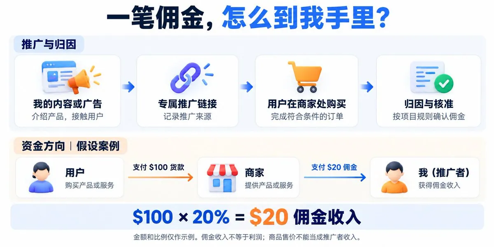
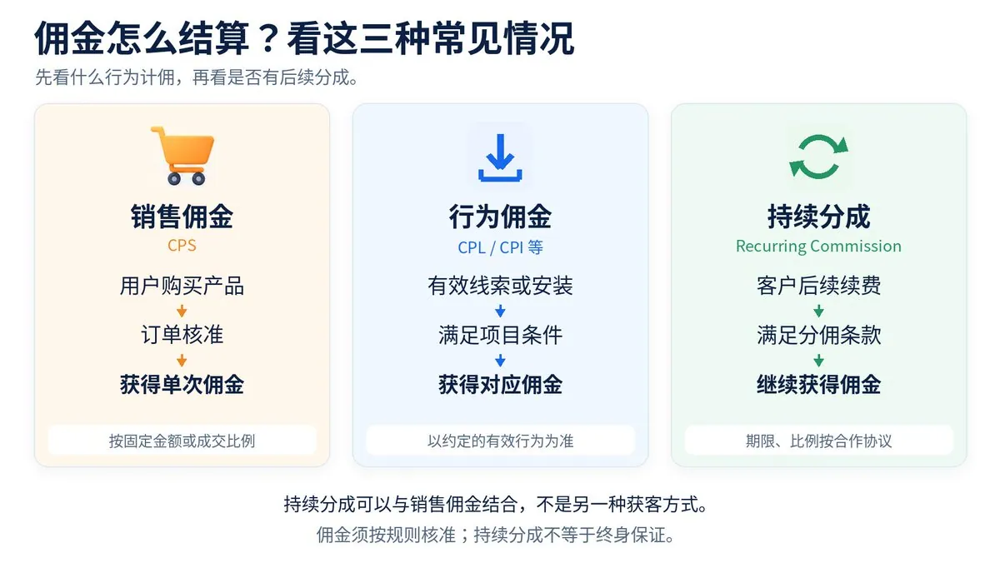
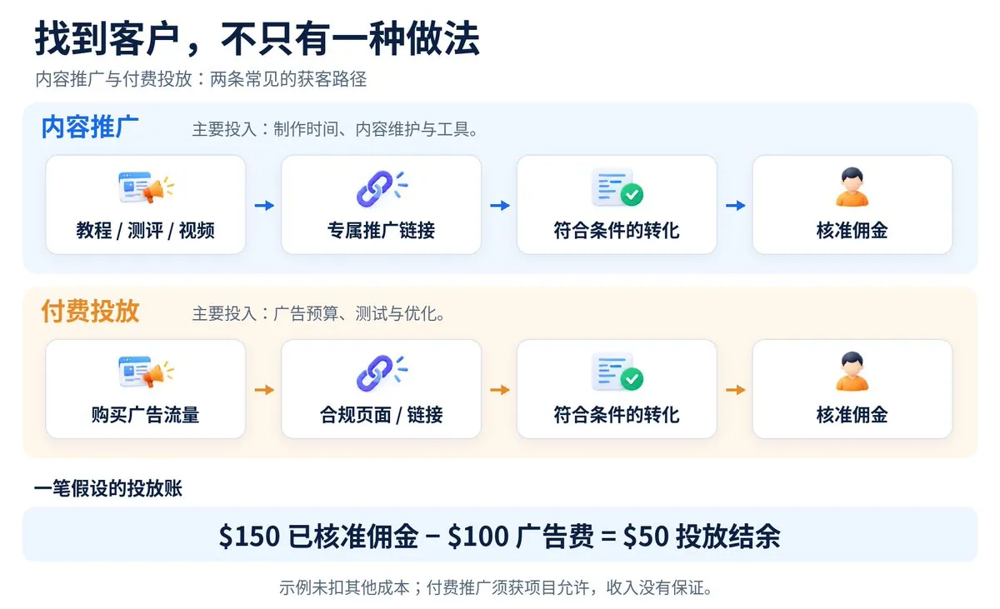

# Peter Yang（@affnom_y）：什么是联盟营销？——一文带你走进海外美金世界

> 海外流量套利者系统拆解联盟营销（Affiliate Marketing）商业模式本质：不生产产品而推广他人产品赚取佣金，按成交、线索等结果依规则结算；覆盖三类主流变现载体——教程推荐、产品测评与付费投放获客；深入分析联盟营销的收益结构、结算周期与风控红线，揭示这是出海者低成本试水海外美金的低门槛路径。

<!-- more -->

Hi，我是 Peter。

前面聊了永久佣金，也聊了流量套利。今天把一个更基础的问题讲清楚：

不自己做产品，靠推广别人的产品赚佣金，到底是一门什么生意？

这就是联盟营销，英文叫 Affiliate Marketing。你推广商家的产品或服务，带来符合约定的购买、线索等结果，商家按规则支付佣金。

你可以通过一篇教程推荐软件，也可以做产品测评，或者像我一样，把付费投放作为主要的获客方式。

但先别急着注册平台、申请链接。从一笔最简单的交易开始，就容易理解了。

## 01｜你不用做产品，但要帮产品找到客户

假设有一款软件，售价 100 美元。

它的推广计划规定：你带来一笔符合条件的订单，给你 20% 的佣金。

你实际使用之后，写了一篇教程，讲清楚它能解决什么问题、适合谁、不适合谁，并放上自己的推广链接。

读者通过链接购买，订单被正确归因给你，并且通过审核，你就获得：

100 美元 × 20%＝20 美元佣金。

这就是一次最简单的联盟营销。

在这个例子里，软件不是你开发的，100 美元也不是你的实际收入。

你参与的是推广环节，拿到的是 20 美元佣金。再扣掉你为这次推广付出的成本，才能算利润。

那商家为什么愿意给钱？

站在商家的角度，产品做出来，不等于客户会自己找上门。

假设它评估后，认为花 20 美元获得一个新客户值得，那么这笔佣金就是它愿意承担的获客成本。

商家负责提供产品，你负责把合适的人带过来。

这不是商家平白送你钱，而是你参与了它的销售过程。

现实里，Amazon Associates 就采用这样的合作模式：创作者、网站经营者和博主使用推广链接推荐商品，从符合条件的购买或其他项目行为中获得佣金。

所以，不必一开始就想着我要开发什么产品。

也可以先问自己：我能帮什么产品找到客户？

## 02｜怎么证明这个客户是你带来的？

靠追踪和归因。

专属推广链接里通常带有你的识别信息。用户点击后，系统记录来源，再根据项目规则，把符合条件的订单或行为关联到你。佣金经过核准，再进入结算流程。

把它拆开，就是：

你的内容或广告 → 推广链接 → 用户完成约定行为 → 系统归因 → 核准佣金 → 结算。

但这里有一个容易误解的地方：

他点过我的链接，以后买什么都算我的。

不一定。

项目会规定归因期限和条件。超过期限、其他推广渠道参与了成交、订单被取消，都可能影响你最终拿到的佣金。后台出现一笔待审核收入，也不等于这笔钱已经可以提现。

所以，看一个项目，不能只看宣传页上写着最高多少佣金。

你要更关心：什么情况才计佣，怎样确认归属，什么情况会被取消，以及什么时候结算。

佣金比例决定一笔能拿多少，归因和结算规则决定这笔钱能不能拿到。

## 03｜佣金不只有卖一单，拿一笔

先认识三种常见情况。

第一种：销售佣金

用户完成符合条件的购买，你拿固定金额，或者按成交金额分成。

前面 100 美元订单，20% 佣金的例子，就是按销售结算，常见缩写是 CPS。

第二种：有效行为佣金

不一定非得卖出产品，商家也可能为有效线索或安装付钱。

例如，用户提交符合要求的询价表单，属于常见的 CPL，按有效线索结算；通过推广带来符合条件的应用安装，则可能采用 CPI，按安装结算。

这里的关键不是填过表和下载过，而是有没有满足项目约定的有效条件。

项目要求有效客户，你不能拿随便填写的信息当成有效线索。

第三种：持续分成

首次成交以后，客户继续付费，你还可能按规则获得后续佣金。

比如，HubSpot 官方列出的入门档合作条件是 30% 持续佣金，最长一年。它不是只有首次成交给钱，但也不是无限期分成。

这就是为什么我前面聊永久佣金时，更想让大家理解它背后的逻辑：

你推荐的产品，对方愿意长期使用，项目才有可能从后续收入里继续分一部分给你。

不过，按什么行为付钱和能分多久是两个维度。销售佣金也可以附带续费分成，它们不是互相排斥的玩法。

## 04｜没有很多粉丝，能不能做？

不能单一只用粉丝数量判断。

你要先思考：准备通过什么方式接触用户？

这里有两条常见路径：一条通过内容，一条通过付费投放。内容可以承载推广链接；付费推广则必须确认项目允许使用的渠道和方式。

一条是内容推广

假设你很熟悉建站工具。

与其发一句这个工具很好，快来注册，大家更愿意看到一篇具体的教程：

一个完全不会写代码的人，怎样用它做出自己的第一个网站？需要花多少钱？有哪些限制？什么情况下不建议买？

你先帮读者解决问题，再让他判断这个工具是否适合自己。

这时，推广链接是内容的一部分，不是内容存在的唯一理由。

我更愿意把内容推广的投入理解为：学习产品、实际测试、写作制作，以及后续维护。

不能因为没有直接购买广告，就把自己的时间当成零成本。

另一条是付费推广

我的工作更接近这一条：选择垂类，准备素材和页面，购买广告流量，再看这批流量能带来多少有效转化。

假设花了 100 美元广告费，最终带来 10 笔核准转化，每笔佣金 15 美元。

那么：

佣金收入：10 × 15＝150 美元。

扣除广告费：150－100＝50 美元。

这 50 美元是投放结余，还没扣工具等其他经营成本。

但如果同样花 100 美元，最后只有 4 笔核准转化：

4 × 15－100＝亏损 40 美元。

这也是我想表达的：

佣金高，不等于好做。佣金、转化率、获客成本，必须放在一起看。

拿到推广链接，也不等于可以随便投。部分项目会限制品牌词竞价、广告直链或某些流量来源，开跑前必须读清楚。

## 05｜它和流量套利、接广告有什么区别？

我喜欢用不同的问题来区分。

联盟营销问的是：我替谁推广，带来什么结果，对方给我多少佣金？

流量套利问的是：我花钱买来的流量，最后能不能变现出更多收入？

你花钱买流量，去推广联盟产品，二者就有交集。

但你通过一篇教程获得自然访问，再赚取销售佣金，也是在做联盟营销，不一定涉及买量。

所以，别把 Affiliate 简单理解成投广告。

至于接广告，我会先看合同按什么付钱。

假设品牌给我一笔固定费用，请我写一篇文章，那么这笔费用主要对应内容制作和发布服务。

如果约定的是每带来一笔核准订单支付佣金，我的收入就取决于实际结果。

同一份合作也可以约定固定费用＋佣金。对我来说，重要的不是它叫什么名字，而是我承担什么工作和风险，按什么条件获得收入。

## 06｜去哪里找到可以推广的产品？

不需要一上来就记住几十个平台。

先分清两种入口。

一种是商家自己的推广计划。

例如 Amazon Associates，以及面向内容创作者、教育者等群体的 Shopify Affiliate Program。你申请的是具体商家的合作计划，准入和计佣规则由项目规定。

另一种是联盟平台。

例如 Awin，会连接商家与推广者，并提供追踪、账户管理和结算等服务。一个平台里可以有多个商家的推广计划。

对新手来说，我更建议反过来找：

先找到自己了解、确实愿意推荐的产品，再确认它有没有合适的推广计划。

而不是先看到佣金很高，再临时找理由说这个产品好。

产品和人群不匹配，佣金比例再高，也很难跑通。

注意本文讨论的是：你能不能把自己的内容、专业经验或获客能力，放到更大的市场里使用。

## 07｜普通人第一步，应该做什么？

我的建议是：先完成一次真实、有效的推荐。

选一个你了解的产品。

你能不能不看宣传页，就讲清楚它解决什么问题？有什么缺点？适合哪类用户？

然后读清楚合作规则。

把计佣条件、归因期限、允许的推广方式、结算周期和收款要求确认下来。这些也是评估推广计划时需要核对的内容。

接着，做一份真正有帮助的内容。

可以是教程、实际测评，也可以是一次具体问题的解决过程。标准很简单：

即使读者最后不点推广链接，这份内容也应该对他有用。

发布以后，再看有没有点击、有没有符合条件的转化、佣金有没有核准、最后能不能收到。

这条链路跑通了，再考虑增加内容或预算。

推广时，也把利益关系说清楚。例如：“通过这个链接购买，我可能获得佣金。”这种情况下，读者不会过于厌烦。

我不觉得拿佣金和帮助别人天然冲突。

但我会问自己一个问题：

假如这个产品不给佣金，我还愿不愿意推荐它？

至少，这能提醒我别让佣金替自己做判断。

## 一点思考：AI 能帮忙，但生意要自己看懂

我也在用 AI 和自动化工具参与投放工作。

对我来说，联盟营销最值得理解的一点是：

你不一定要先拥有一个产品，才能参与一门生意。

你可以先学会理解需求，把合适的产品讲明白，再通过真实的推广结果获得收入。

但钱不会因为换成美元，就突然变得好赚。

一条链接不是生意。你能不能持续找到合适的人，提供有用的信息，并把成本和收入算清楚，才是值得练的能力。

先帮助一个人做对选择，再赚到第一笔有依据、能结算的佣金。

这比同时收藏一百个美金项目，更接近真正的开始。

希望这篇文章能帮你理解海外联盟营销，打开你的思路。Enjoying！

## 相关页面

- [[sources/missle8z-information-arbitrage-8-business-models]]
- [[sources/yaohongan-18-days-10-sites-meme-traffic-playbook]]
- [[concepts/selfmedia-compound-model]]
- [[concepts/b2c-conversion]]
