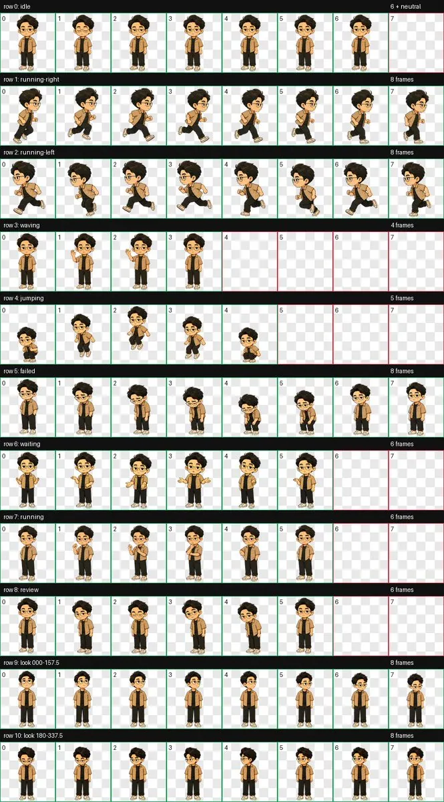
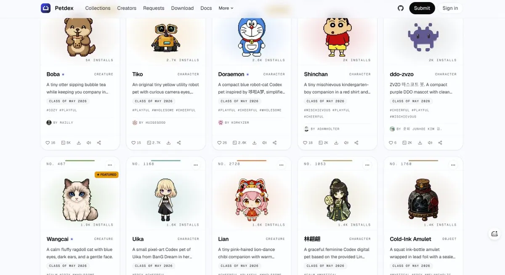
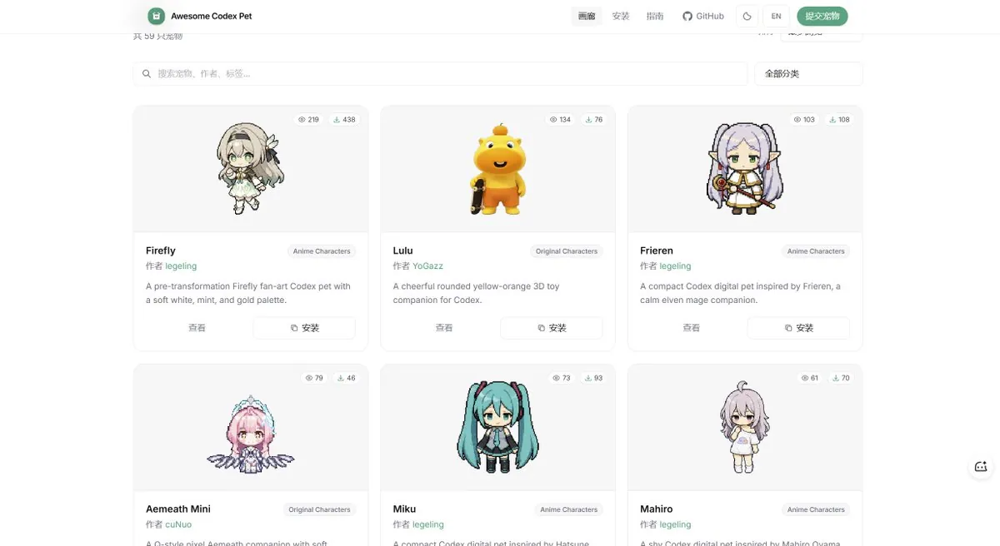
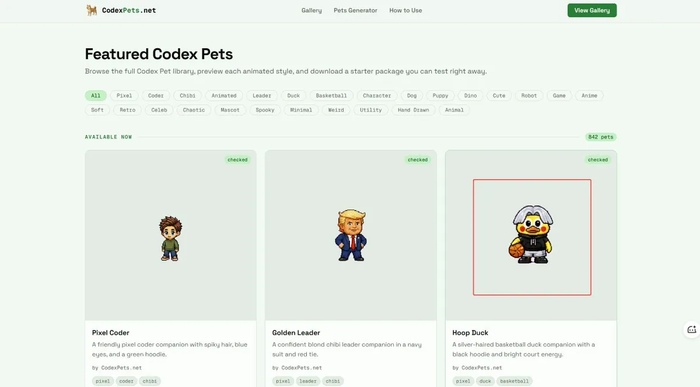
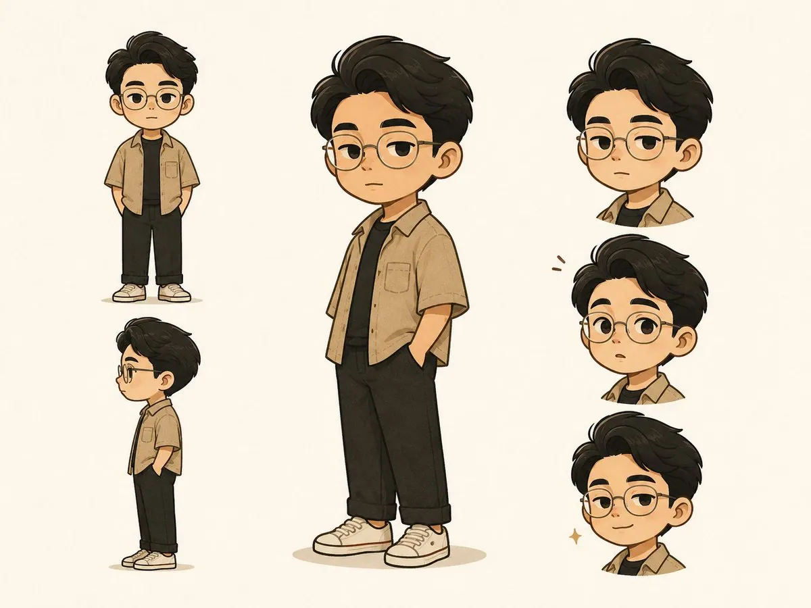
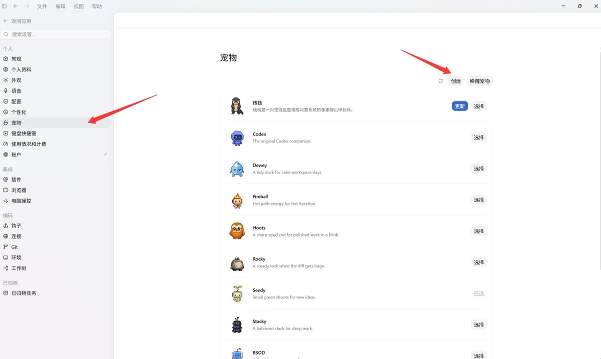
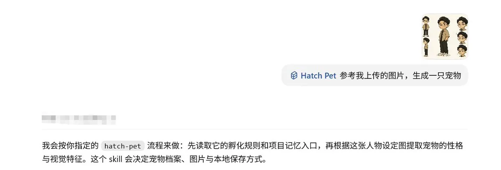
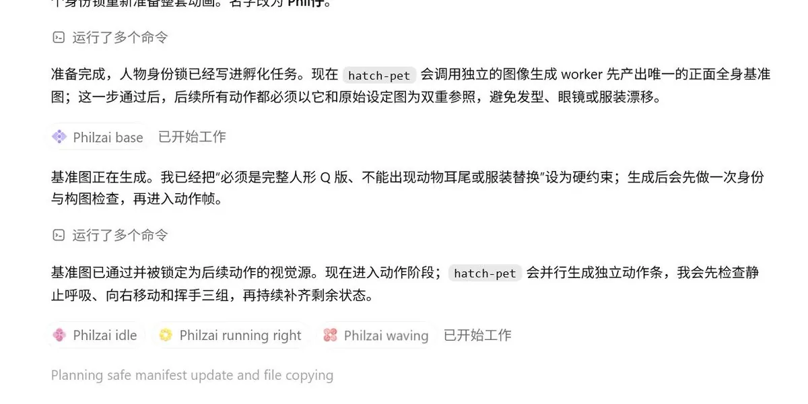
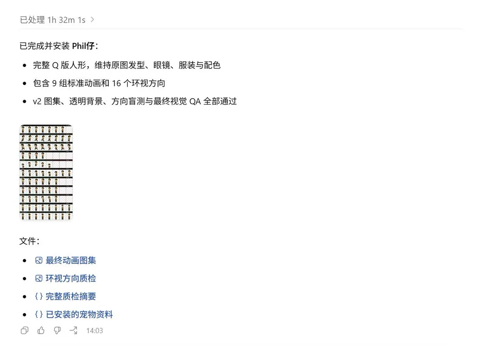
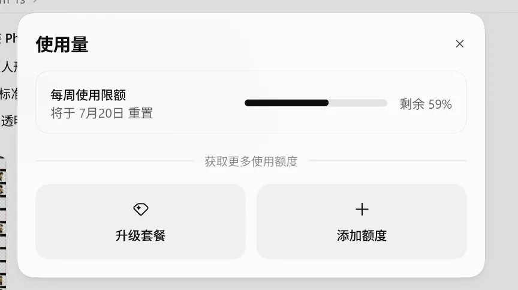

# 阿哲 Phil（@Formulasearch）：快速上手设计一款个人 IP，并做成 Codex 宠物（附提示词和链接）

> 个性化数字 IP 与 AI 桌面宠物打造指南：手把手指导如何利用图像生成模型定制独一无二的可爱卡通吉祥物，并将其集成接入 Codex CLI/IDE 环境中作为全天候陪伴式开发助理，附全套角色设计提示词与本地配置链接。

<!-- more -->

## 快速上手设计一款个人 IP，做成你的 Codex 宠物（附提示词和链接）

来试试把自己的头像做成一个个人 IP，做成桌宠，陪自己 vibe coding，还能分享给别人~

Codex 的宠物功能很有意思：你可以上传自己的头像、真人照片、品牌吉祥物，甚至是一张随手画的草图，让它自动变成一只会动的桌宠。

它会待机、走动、挥手，也会跟着 Codex 的工作状态做反应：任务跑起来它就开始忙，需要你确认就停下来等，任务失败还会露个沮丧的表情。



这篇文章分享一下如何准备自己的形象、怎么让 Codex 自动生成，以及去哪里直接下载别人做好的桌宠。

完整流程只有两段：先根据参考图生成一个基础 IP 形象，再把这张图上传给 Codex，让它调用 Hatch Pet 自动生成桌宠。

### 直接用：领养现成的宠物（比如一只鸡哥：D）

如果只是想马上体验，可以直接下载现成的桌宠。

- [Petdex](https://petdex.dev/)：社区画廊比较大，支持浏览、安装和投稿。



- [Awesome Codex Pet](https://awesome-codex-pet.pages.dev/)：数量不算多，但有动漫角色、动物、原创角色、机器人等分类。



- [CodexPets.net](https://codexpets.net/)：可以直接下载完整宠物包，再导入 Codex。



例如在 Petdex 找到喜欢的宠物后，可以复制页面给出的安装命令：

```bash
npx petdex install 宠物名称
```

安装完成后，打开：

```text
Codex → Settings → Appearance → Pets
```

在自定义宠物里选中它，再点击唤醒就可以了。

如果你已经在做个人 IP，建议自己生成一只，别人做好的宠物再可爱，也是别人的角色。读者看到轮廓、颜色和动作就知道这是你，这才有记忆点。

### 第一步：上传你的形象

先在 Codex 里新建一个普通对话，把参考图片上传进去。这里先不急着生成桌宠，我们先把角色的样子定下来。

你可以上传的东西很多：

- 一张个人头像或正面照
- 已经在使用的卡通形象
- 品牌 Logo 或吉祥物
- 产品角色设定图
- 手绘草图
- 宠物照片

最好选一张主体完整、轮廓清楚、光线正常的图片。正面或轻微侧面的全身图，比只有半张脸的自拍更好用。

如果图片中有多个主体，尽量裁掉不相关的人或物。实在没法裁，也要明确告诉 Codex：只选择画面里最突出、最完整的主体。

### 第二步：生成基础 IP 图像（附完整提示词）

先生成一张基础 IP 图像，确认这个角色到底长什么样。

这张图负责把照片中的特征变成稳定的 IP 形象。发型、眼睛、配色、轮廓和气质在这里定下来，后面的动画直接交给 Codex。

下面这段可以直接复制：

```text
请以我上传的图片为主要视觉参考，选择画面中最突出、最完整的主体，将它重新设计成一个辨识度高、适合长期使用的小型原创 IP 角色。

请提炼主体最容易被记住的 3—5 个特征，例如轮廓、比例、五官、发型或毛发、主色、服装和标志性配饰。保留它原本的身份与气质，不要直接描摹照片。你可以自由调整比例、造型、材质和细节表达，让角色更简洁、更有性格，也更容易重复绘制；但最终仍要让人一眼看出它来自参考图。

角色整体可爱但不过度幼稚，轮廓完整，缩小后依然容易辨认。默认采用高完成度的二维角色插画，将现代扁平设计与轻微手绘质感结合；如果参考主体更适合其他视觉语言，可以自由发挥。最终形象应便于继续扩展为头像、表情包、贴纸、社交媒体形象和品牌吉祥物。

生成一张完整的 IP 角色设计展示图：
画面中央放置一个最大的角色主形象，使用最能体现其性格的招牌动作；旁边展示一个正面小全身、一个侧面小形象，以及三个不同情绪的头部表情。所有形象属于同一个角色，核心特征、比例和配色保持一致。使用暖白色或浅色纯净背景，版式整洁，保留留白，不添加角色名称和大段文字。

如果主体是动物，保留品种、毛色和身体结构；如果是人物，保留脸型、发型、服装和标志性配饰，再转化为非写实角色；如果是物品或产品，可以将关键结构拟人化，但不必套用真实人类身体。

避免套用普通卡通模板、模仿迪士尼等现有 IP 风格、改变主体身份、丢失标志性颜色，或让不同视图出现角色设定漂移。除此之外，请在构图、动作、表情和细节上自由发挥。
```



生成满意后，把这张基础 IP 图像下载保存。桌宠最终显示得很小，细节堆得越多，缩小后越容易糊成一团。它更像做一个图标，而不是画一张海报。

### 第三步：上传给 Codex，自动生成桌宠

现在打开 Codex 的设置：

```text
设置 → 宠物 → 创建
```



上传刚才下载的基础 IP 图像，Codex 就可以调用 Hatch Pet，继续生成待机、走动、挥手、失败和等待等整套动画。

可以把下面这段作为最后一条要求：

```text
请以我上传的 IP 图像作为主要身份参考，调用 Hatch Pet 把它制作成 Codex 桌宠。保留角色的核心轮廓、主色和标志性特征，动作与表情可以根据不同工作状态自由设计，要维持角色一致性。
```

主形象确认后，剩下的工作可以交给 Codex。



Hatch Pet 会先生成主形象，再继续制作待机、左右移动、挥手、跳跃、失败、等待、运行中和检查结果等动画。图片裁切、对齐、去背景和文件打包，也会在同一条流程里完成。这个期间会自动调用很多个 subagent 去帮你生成素材。



不需要自己把几十张图拼成动图，也不用手写配置文件。生成完成后，宠物通常会出现在：



```text
~/.codex/pets/你的宠物名称/
```

里面最关键的是两个文件：

```text
pet.json
spritesheet.webp
```

回到：

```text
设置 → 宠物
```

选中刚刚生成的角色，再点击唤醒。你的个人 IP 就会出现在桌面上。

但是注意，整个过程需要生成多组动画，通常会比普通对话慢，也会消耗更多额度，比如这一轮就用了一个半小时，消耗了接近一半的 PLUS 额度...



### 做完以后，可以下载、备份，也可以分享

宠物设计完成后，可以在 Codex 的宠物设置里打开自定义宠物文件夹，把整只宠物的文件夹复制出来。换电脑时放回 ~/.codex/pets/，也可以发给朋友直接导入。

如果想公开分享，可以提交到 Petdex：

```bash
npx petdex login
npx petdex submit ~/.codex/pets/你的宠物名称
```

### 个人 IP 与宠物

一说个人 IP，通常先想到 Logo、标准色、字体、表情包和整套视觉规范，其实可以反过来。

先选一个你愿意每天看到的形象，把它做成桌宠。角色一旦“活”起来，会待机、会工作，可以跟你一起互动，一个会做出反应的角色，才开始有性格。

同一套形象还可以接着用在社交头像、文章配图、视频角标这些地方。Codex 桌宠只是其中的一环，但它足够具体：每天打开电脑，你都能看到这个 IP。

现在就来试试吧，做一个自己的卡通分身，或者把家里的猫猫狗狗也做成桌宠~

🥳感谢看到这里，我是 Phil，前建筑师 → AI 产品。

如果这篇文章对你有帮助，欢迎关注我 @Formulasearch。

我会持续输出 AI 工具和产品方面的内容，欢迎与我交流

## 相关页面

- [[sources/aphil-fde-role-real-ai-implementation-guide]]
- [[sources/zhouluobo-design-personal-agent-learns-visual-style]]
- [[concepts/agent-skill]]
- [[concepts/prompt-engineering]]
