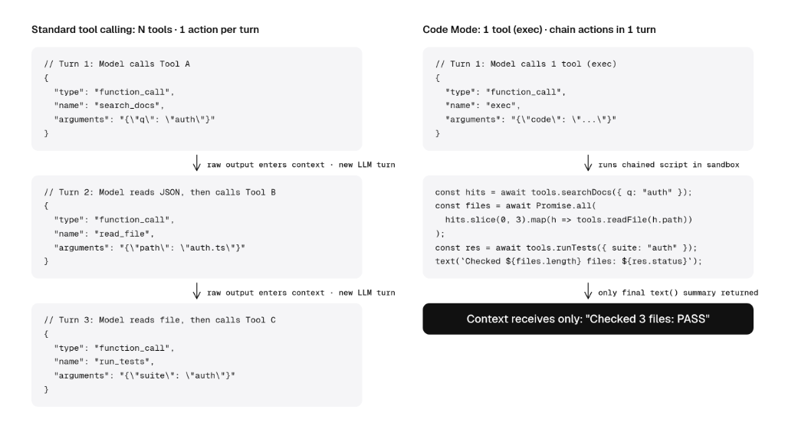
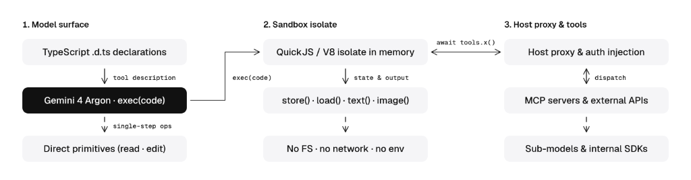

# Philipp Schmid：为什么未来的智能体很快将只剩下一个工具（Code Mode 深度解析）

> 原文标题：Why Agents Are Soon Only Going to Have 1 Tool。在过去两年中，构建高能力 Agent 意味着设计复杂的工具目录、决定工具粒度模式、在多轮对话中让模型逐一挑选调用。这一范式正在剧烈转变：全行业 Agent 正在通过将所有工具收敛为单一的 `exec(code)` 工具来实现架构倒塌，即 **Code Mode（程序化工具调用）**。模型不再在每一轮来回往返中触发单一工具，而是在隔离的 JS/Python 沙箱中编写短脚本，单轮内完成过滤、跨工具串联、依赖调用与结果裁剪。

<!-- more -->

过去两年，构建具备实际能力的 AI Agent 意味着精心设计工具目录：推敲哪些动作能帮模型完成任务、决定每个工具的 schema 需要多细粒度、或者不断优化系统指令模板。这一切正在发生翻天覆地的变化。Agent 的演进方向正在彻底反转——把整个工具目录收敛并坍缩为**单一工具**：`exec`。

这被称为 **Code Mode（代码模式，或程序化工具调用 Programmatic Tool Calling）**。Harness 不再强迫模型跨轮次（turn-by-turn）一次触发一个工具，而是给模型暴露一个单独的 `exec(code)` 工具。模型直接编写一段简短的 TypeScript 或 Python 脚本，在隔离的沙箱环境里完成各种动作的链接、组合、循环和 `await`。



## 一、从单步动作走向代码中的工作流串联

要理解为什么 Agent 正在收敛至单一的 `exec` 工具，我们需要回顾工具调用（Tool Calling）的技术演化史：

1. **早期**：我们只给 Agent 提供少数几个工具，因为模型面对大目录时根本无法准确挑选和过滤。
2. **中期**：随着模型推理能力增强，我们连接了数十个工具和成堆的 MCP Server，但迅速撞上了上下文窗口极限。社区通过**工具搜索**和**渐进式披露（Progressive Disclosure）** 解决了这一问题，让 Agent 按需检索工具。
3. **传统瓶颈**：即便实现了动态加载，我们仍然受制于标准工具调用的死穴——**每一轮只能做单步操作**。

在传统工具调用模式下，模型生成一个结构化 JSON 对象定义单次动作（或者充其量是一批平行的互不依赖调用，比如同时读 3 个文件），然后停下来等待宿主返回原始输出，把结果塞进 Prompt 历史，大模型再次推理，再决定下一步干嘛。

但根据我自己的实战经验，由于前沿模型在单步内可靠组合依赖动作的能力发生了质的飞跃：

- **调研与过滤（Research and filtering）**：以前是第 1 轮拉取来源列表，第 2 轮逐个读取，第 3 轮交叉比对。在 Code Mode 下，模型编写一段脚本直接查询多个源，在沙箱内存中过滤掉无关项，一步提取出最终答案。
- **多文件编辑与即时验证（Multi-file edits and inline verification）**：传统工具一次只能编辑一个文件。通过 Code Mode，模型可以在一个脚本里协同修改多个文件、直接跑测试校验、检查输出，并在同一个脚本内根据测试 pass/fail 走不同的逻辑分支。
- **浏览器与计算机操控（Browser and computer use）**：UI 自动化动作链非常明确（点按钮、填表单、等选择器、在循环里分页翻表）。不用为每次点击或按键支付一次完整的模型往返（round-trip）成本，模型可以在单轮中把整套动作序列或循环全部用代码写完，只有在页面状态真正发生关键改变时才返回。
- **并行扇出与子代理（Parallel fan-out and sub-agents）**：当需要并发运行 20 次检索或调用专业子模型并将结果喂给后续 API 时，模型可以直接 `await Promise.all(...)`，在沙箱中对数组做 transform 并调用下一个函数，中途根本无需通过 LLM 上下文窗口来回折腾。

促成这一转变的核心支柱在于：前沿模型在大规模代码数据上受过深度训练；各家厂商已经开始针对 Code Mode 进行后训练（Post-training）；同时 MCP Server 现在广泛在 `inputSchema` 之外附带了 `outputSchema`，让模型在**实际看到运行期输出之前**，就能获知返回值类型，从而在一个脚本里把 Tool A 的输出安全注入 Tool B。

## 二、Code Mode 的运作机制

Code Mode 在模型表面上把所有工具目录坍缩为单一工具：`exec(code)`。

Agent 不再向模型 API 传递 80 个独立的 JSON Schema 对象，而是将这些 schema 编译为极其紧凑的 TypeScript 类型声明（`declare namespace tools { ... }`）。当模型需要跨外部系统组合动作时，它调用 `exec` 并编写包含 `await tools.<server>.<tool>(args)` 的脚本。

```typescript
// 伪代码：暴露给模型的 TypeScript 类型声明
declare namespace tools {
  namespace linear {
    function listProjects(): Promise<Array<{ id: string; name: string }>>;
    function listIssues(args: { projectId: string }): Promise<Array<{ id: string; title: string; assignee?: string }>>;
    function archiveIssue(args: { id: string }): Promise<{ ok: boolean }>;
  }
}

// 可选：当包含数百个工具时，无需提前暴露完整命名空间，直接在沙箱提供全局映射供模型过滤
declare const ALL_TOOLS: Record<string, { description: string; signature: string }>;

// 多模态输出辅助函数：只有传给这些函数的数据才会进入模型的上下文窗口
declare function text(output: string): void;
declare function image(data: string | Uint8Array, mimeType?: string): void;
declare function audio(data: string | Uint8Array, mimeType?: string): void;

// 跨轮次状态管理：在宿主内存中持久化数据，无需支付 Token 成本
declare function store(key: string, value: unknown): void;
declare function load<T = unknown>(key: string): T;
```

模型在一个单独的 `exec()` 调用中产出以下代码：

```typescript
// 伪代码：模型在单次 exec() 调用中生成的脚本
const projects = await tools.linear.listProjects();
const issueBatches = await Promise.all(
  projects.map((p) => tools.linear.listIssues({ projectId: p.id }))
);

const unassigned = issueBatches.flat().filter((issue) => !issue.assignee);
await Promise.all(unassigned.map((issue) => tools.linear.archiveIssue({ id: issue.id })));

text(`Archived ${unassigned.length} unassigned issues across ${projects.length} projects.`);
```

**沙箱在内存中执行完所有 55 次底层 API 调用，过滤掉海量数据载荷，只向模型的上下文窗口返回单行字符串**：`"Archived 42 unassigned issues across 12 projects."`。



### 为什么选择 JS/Python 沙箱而不是纯 Bash？

你当然也能在 `bash` 里构建工具代理，但在像 JavaScript 或 Python 这类现代编程语言运行时中编排工具，具有 `bash` 难以企及的优势：

1. **类型化函数**：MCP 和内部 API 直接映射为带原生对象、`Promise.all` 和 `try/catch` 异常处理的类型化调用，避免了脆弱易错的 Bash 字符串转义。
2. **免除 CLI 探索税（No CLI exploration tax）**：面对自定义 CLI 脚本时，模型倾向于在行动前反复跑 `--help` 或阅读脚本源码来摸清参数和输出格式，白白消耗大量轮次和 Token。类型化接口声明提前给出了契约，Agent 拿起来就能动手。
3. **多模态上下文**：Shell 只能返回 stdout 文本。多模态模型如果想看图片，无法通过 `cat screenshot.png` 达成；而在 `exec` 沙箱中，调用 `image(screenshot)` 或 `audio(clip)` 就能直接把多媒体数据作为 Part 挂载到下一轮。
4. **凭据与策略代理（Credential and policy proxy）**：每一次 `await tools.*` 跨越结构化桥梁到达宿主运行时，宿主可以在沙箱外部注入 OAuth Token、校验模式，或在执行破坏性调用时暂停等待用户确认。
5. **状态管理**：传统模式下 Prompt 历史是唯一的状态存储区，复用一次大查询意味着每一轮都要携带沉重的 JSON。沙箱暴露 KV 存储接口，让 Agent 可以把状态保存在上下文窗口之外。

## 三、主流 Agent Harness 正在将 Code Mode 作为默认项

在整个生态中，编码 Agent 和开发者框架正在迅速把 Code Mode 选为默认的工具编排模式：

- **Harness 框架**：Pi（pi.dev）、Factory Droid、OpenAI Codex 均已内置或默认启用 Code Mode。Factory 将 Droid 1.0 切换到 Code Mode 后，其 Terminal-Bench 4 得分提升了 3.5 分，且**模型费用降低了 15%**。
- **Agent SDK**：Pydantic AI、LangChain、Cloudflare Agents SDK 均已全面支持类似的 Code Mode 工具范式。

## 四、未来展望

这是否意味着所有 Agent 很快都将只剩下一个 `exec` 工具？不一定。这既是一个产品形态问题，也是一个 Harness 工程设计问题。

当你开始尝试 Code Mode 时，你会很快发现很多原先为 `bash` 和人类阅读优化过的 CLI 和 Agent Skills，在直接集成时并不丝滑，因为它们不是为强类型代码执行设计的。这将促使开发者重新审视并精简自己的 Agent 真正需要什么样的工具。

## 相关页面

- [[sources/chencheng-code-mode-evolution-and-durable-execution]]
- [[sources/fanbing-dsh-superagent-engineering-common-sense]]
- [[concepts/durable-execution]]
- [[concepts/agent-token-architecture]]
