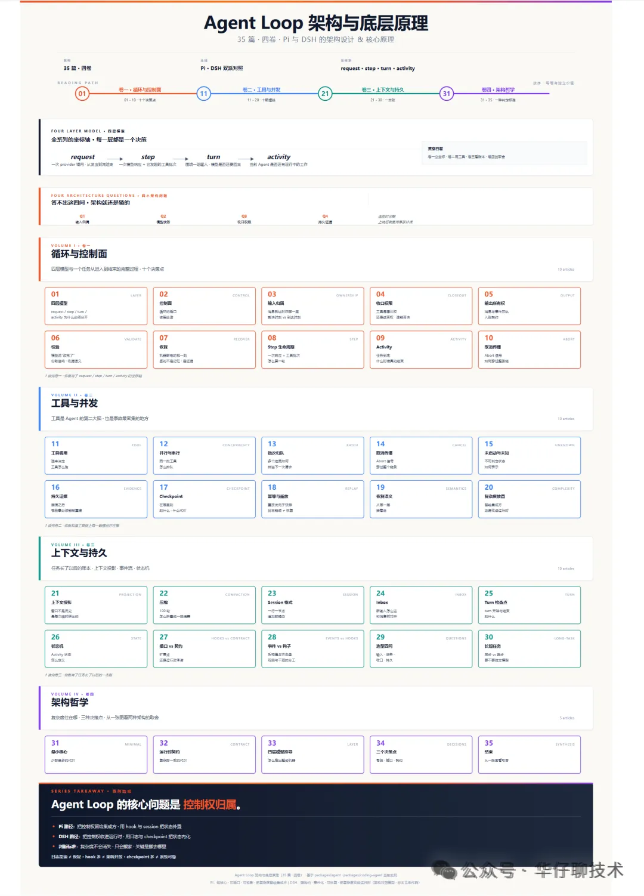
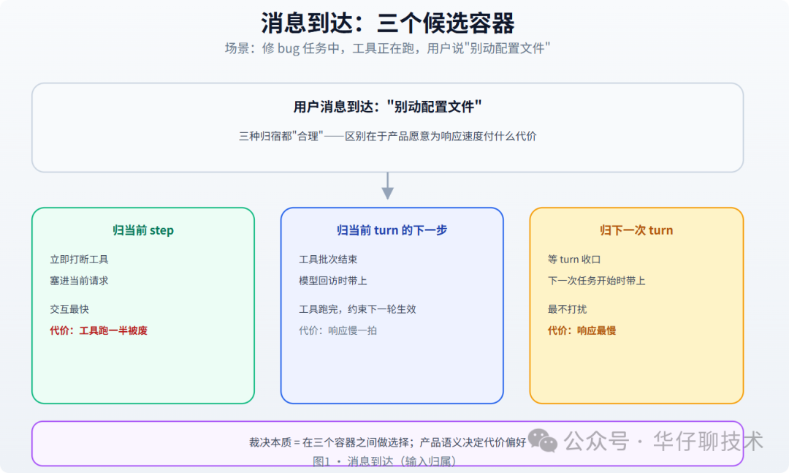
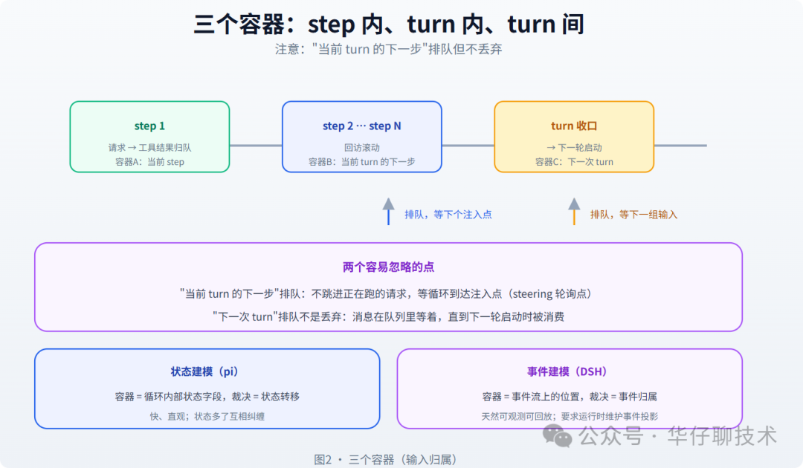
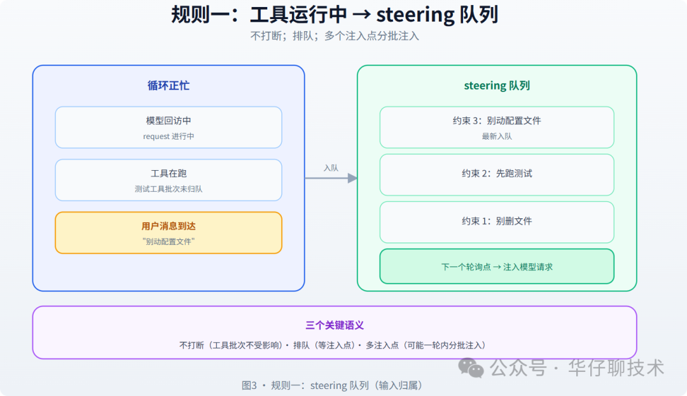
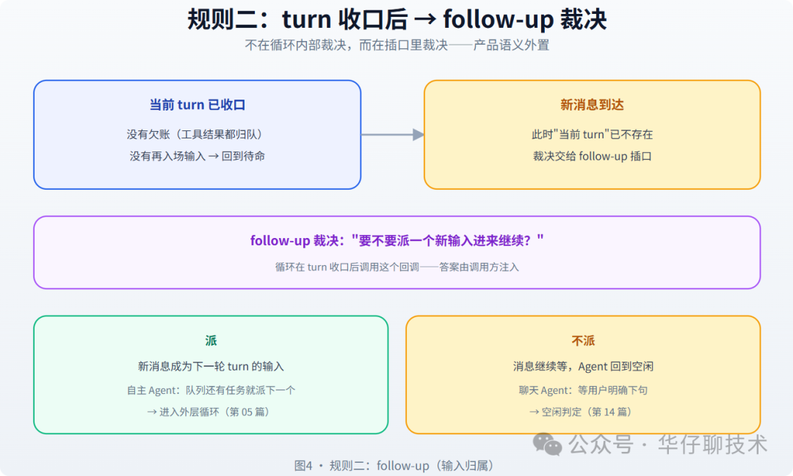
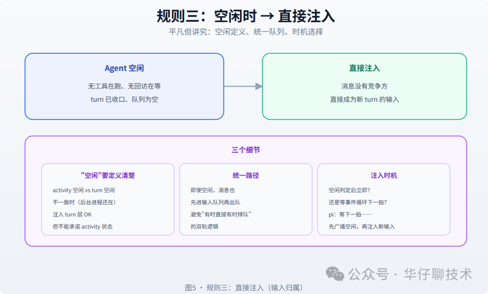
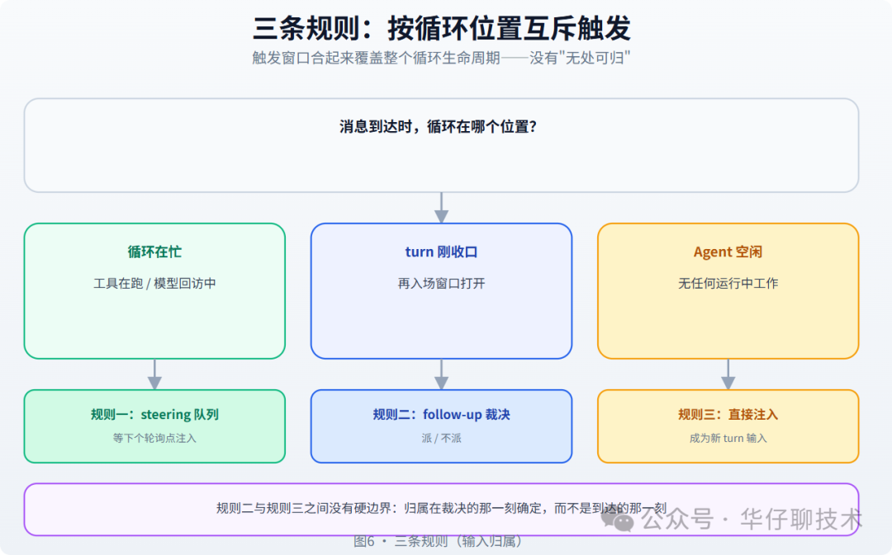
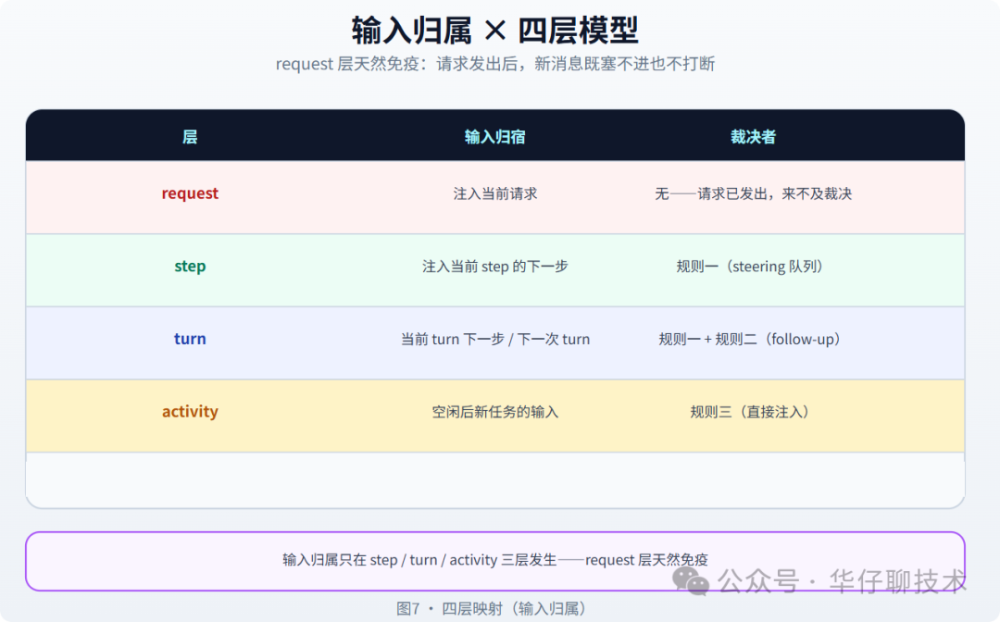

# Pi 与 DSH 的输入归属：一条消息到达时，它属于哪一层

> 一条消息到达时，系统凭什么决定它属于"当前 step 的下一步"、"当前 turn 的下一步"还是"下一次 turn"？这是输入归属问题。

## 问题引入

想象一个正在跑的场景：Agent 执行"修 bug"任务，模型调用了测试工具，工具正在跑。这时用户补了一句"别动配置文件"。这句消息有「三种合理的归宿」：

- 立即打断工具，把"别动配置文件"塞进当前请求——交互最快，但工具跑了一半被废
- 等当前工具批次结束，模型回访时带上"别动配置文件"——工具跑完，约束生效在下一轮
- 等这一整轮 turn 收口，下一次任务开始时才带上——最不打扰，但响应最慢

三种归宿都"合理"，区别在于「产品愿意为响应速度付什么代价」。输入的裁决，本质是在三个容器之间做选择。

先把两个项目的分野摆到桌面上：

- **pi** 选择「归属规则固定、裁决点固定」，三条规则写在循环里、集成方不能改
- **DSH** 选择「归属规则可插拔」，通过 hook 让集成方在具体消息上声明归属

先给结论：**输入归属的裁决规则只有三条，按到达时的循环位置执行**——工具运行中归 steering 队列，turn 收口后归 follow-up 裁决，空闲时直接注入。

## 三个候选容器

**容器边界与输入归宿**：

| 容器 | 边界 | 输入进去后 |
|------|------|-----------|
| 当前 step | 请求发出 → 工具结果归队 | 立即进当前上下文，模型下次输出就能用 |
| 当前 turn 的下一步 | step 收口 → turn 收口 | 排队，等下一次模型回访时注入 |
| 下一次 turn | turn 收口 → 下一轮开始 | 排队，等下一组输入启动 |

两个容易被忽略的点：

1. **「当前 turn 的下一步」是排队的**——不会自己跳进正在跑的请求，而是等循环到达下一个注入点（steering 轮询点）
2. **「下一次 turn」的排队不是丢弃**——消息在队列里等着，直到下一轮启动时被消费

三个容器之间还有一个微妙点：**它们不是严格的队列层级，而是归属语义的容器**。"当前 step 的下一步"与"当前 turn 的下一步"在实现上可能是同一条队列的不同消费时机，但归属语义完全不同。

「实现可以共用队列，语义必须分清楚」，否则"这条消息什么时候被看见"会变成玄学。

## 裁决规则一：steering 队列（工具运行中）

第一条规则覆盖最常见的插话场景——「循环正忙（工具在跑、模型在回访）」。裁决很简单：进入 steering 队列，等下一个轮询点注入。

pi 的做法是：循环在每个"轮询点"调用 `getSteeringMessages?.()`，把返回的消息注入下一次模型请求。

三个关键语义：

- 正在跑的工具批次不受影响，队列只在下一次回访前清空注入——"当前工作优先，约束排队进场"
- 轮询点不止一个（模型回访前、steering 判定时），不是只有 turn 边界——队列里的消息可能在一个 turn 内被多次分批注入
- 全部清空注入 vs 逐条注入：前者适合"补一句完整的约束"，后者适合"边跑边喂"

### 为什么不是优先队列

一个常见疑问："三个容器，为什么不做成优先级队列，让消息按重要程度插队？"原因有三：

- "用户打断 vs 任务续跑谁优先"每个产品答案不同——放进通用机制就回到了第 02 篇批评的配置开关问题
- 同一次模型请求里，输入集应该是确定的。运行中插队 = 请求飞到一半换参数——结果不可复现，调试灾难
- 轮询点就是天然的"插队窗口"——想优先，让 steering 在下一个轮询点返回它；不想优先，让 follow-up 等下一轮

所以 pi 的答案是：「队列保证顺序（机制），优先级交给裁决点（插口）」。

## 裁决规则二：follow-up（turn 收口后）

第二条规则覆盖「turn 收口后」的场景。此时当前 turn 已经结束（没有再入场的新输入就 idle），新消息到达——它不再有"当前 turn"可以归，裁决交给 follow-up 插口。

follow-up 是调用方注入的回调，循环在 turn 收口后问它："要不要派一个新输入进来继续？"

- 「派」：新消息成为下一轮 turn 的输入，进入外层循环
- 「不派」：消息继续等，Agent 回到空闲

这一条规则的关键是：**它不在循环内部裁决，而在插口里裁决**。为什么？因为"turn 收口后，用户的补充该不该开启新任务"是产品语义——聊天 Agent 会说"等用户明确下句"，自主 Agent 会说"有补充就继续"。

## 裁决规则三：直接注入（空闲时）

第三条规则最平凡也最容易被低估：「Agent 空闲时，新消息直接注入」。

三个细节：

- 是 activity 层空闲还是 turn 层空闲？两者不一致时（turn 收口了但后台进程还在），消息注入进 turn 层没问题，但「不能承诺 activity 层状态」
- 即使空闲，消息也先进输入队列再出队，保持"输入必须排队"的统一路径——避免双轨逻辑
- 空闲判定后立即，还是等事件循环的下一拍？pi 的选择是等下一拍——让空闲事件先广播，再注入新输入（避免"以为还忙"的竞态）

### 空闲判定的竞态

"空闲时直接注入"看似简单，藏着一个经典的竞态：「判定空闲与注入消息之间，可能插入另一个动作」。

设想：循环判定 Agent 空闲，正要广播空闲事件——此刻订阅方 A 收到"空闲"，立即派了一个新任务；同一时刻用户的消息也到了。两个输入同时想成为"下一个 turn"。

pi 的处理原则是「单消费点」：无论消息来自规则二的 follow-up、规则三的直接注入，还是队列里早就排着的旧消息，都统一进输入队列、由同一个出队点消费——先到先得，绝不让两条输入同时启动两个 turn。

## 三条规则的优先级与时间窗口

三条规则按「循环位置」互斥触发：

| 消息到达时 | 规则 |
|-----------|------|
| 循环在忙（工具在跑 / 模型回访中） | 规则一：steering 队列 |
| turn 刚收口（再入场窗口打开） | 规则二：follow-up 裁决 |
| Agent 空闲（无任何运行中工作） | 规则三：直接注入 |

三条规则的触发窗口合起来覆盖整个循环生命周期，没有"消息到达却无处可归"的情况。

还有一个值得注意的架构点：**规则二和规则三之间没有硬边界**。turn 收口后、follow-up 裁决前，如果回调立即返回"派"，消息就从"下一次 turn"变成了"当前新 turn"——同一个消息，裁决前后归属变了。

「归属在裁决的那一刻确定，而不是到达的那一刻」。

### 边界情况：消息在裁决中到达

「规则二正在裁决（follow-up 回调执行中），新消息又到了」。此时循环状态是"turn 已收口、再入场未定"。

答案是后者：「裁决不重入」。follow-up 执行期间到达的消息，不打断裁决，而是先进输入队列，等本轮裁决返回后再按规则二/三的结论处理（裁决返回"派"则与队列里的旧消息一起成为下一轮输入；返回"不派"则消息继续等空闲注入）。

这条边界规则保证了「裁决过程对输入不可见」——回调不用防重入，这是插口设计里少见的"把复杂留给框架"的体贴。

## 输入归属与四层模型的对应

| 层 | 输入归宿 | 裁决者 |
|----|---------|--------|
| request | 注入当前请求 | 无（请求已发出，来不及裁决） |
| step | 注入当前 step 的下一步 | 规则一（steering 队列） |
| turn | 当前 turn 的下一步 / 下一次 turn | 规则一 + 规则二（follow-up） |
| activity | 空闲后新任务的输入 | 规则三（直接注入） |

这张表透露一个细节：「request 层没有输入归属问题」——请求发出后，新消息既不能塞进已发出的请求，也不该打断它。

所以输入归属只在 step / turn / activity 三层发生，request 层天然免疫。

## 实战：两种产品接线

同样的三条规则，两个接线，两种产品。

**「交互式聊天 Agent」**（用户随时插话，希望立刻响应）：
- 规则一：steering 返回"打断式"约束——工具批次被标记为可取消，模型回访时立即带上新约束
- 规则二：follow-up 返回"不派"——turn 收口后不自动开新轮
- 规则三：直接注入，消息立即成为新 turn

**「自主执行 Agent」**（任务队列驱动，用户插话排后面）：
- 规则一：steering 返回"排队式"约束——绝不打断工具，约束在下一轮回访生效
- 规则二：follow-up 返回"派"——只要队列还有任务，turn 收口后立即派下一个
- 规则三：直接注入，但消息排进任务队列

「输入归属的裁决规则是共享的，裁决的参数是产品的」——这正是第 02 篇"骨架 + 插口"哲学的延伸。

### 裁决日志是调试神器

给裁决点埋一条结构化日志就够了：`{ 到达时刻, 循环位置, 归入容器, 裁决者 }`。

一个真实的排查例子：用户抱怨"我补的约束 5 秒后才生效"——日志显示消息到达时工具正在跑，归入了 steering 队列，而 QueueMode 是逐条注入，约束被排在更早的三条之后。改参数（全部清空注入）问题即解。

「归属问题的排查，永远先看裁决日志，而不是先看消息」。

## 避坑清单

1. 枚举循环的每个时刻（请求中、工具中、回访中、收口后、空闲），确认消息都能落进某个容器——"无处可归"就是丢消息
2. 调试时看裁决点的时机，别以为"这条消息早就该在这"——同一消息，裁决前归"下一次 turn"，裁决后归"当前新 turn"，位置随裁决时刻漂移是正常的
3. 进 steering 队列的消息必须最终被注入——测试时专门验证"工具跑 40 秒期间补三句"三句全在后续回访里出现
4. 请求发出后新消息只能等注入点，别在请求中途改上下文——这是最常见的输入归属 bug
5. follow-up 回调必须在 turn 收口后、下一轮启动前被调用——阻塞它 = 阻塞整个循环的再入场
6. 没有日志，三条规则的现场无从重建——归属 bug 会伪装成"消息丢了"或"延迟了"
7. 给循环的每个位置各写一条"此时消息到达"的测试，全部要有明确归宿

## 总结

输入归属 = 三条按循环位置互斥的裁决规则：工具运行中进 steering 队列，turn 收口后由 follow-up 裁决，空闲时直接注入。规则人人共享（骨架），参数产品各异（插口）。

再回看第 02 篇的体检清单，输入归属对应其中第 2 条（"集成方代码里有没有重复了十遍的判定？"）：

- 如果多个集成方都在写"消息到达先看循环忙不忙"，说明归属规则该收进骨架
- 如果都在写"打断还是排队"，说明参数该留在插口

「骨架与插口的边界在输入归属上，恰好划在'归哪个容器'与'容器怎么处理'之间」——前者人人相同收进骨架，后者产品各异留成插口。

这条边界线值得记住，它是整个控制面设计的缩影。

下一篇先走进 steering 队列：工具跑着的时候，用户补的每一句话是怎么排队、怎么被分批喂回模型的。

留一个自测问题：「你的 Agent 里，用户说'先别跑测试'的那一秒，这条消息停在哪？」如果你回答不上来，说明你的输入归属还没有明确的裁决规则——而这正是下一轮的起点。

