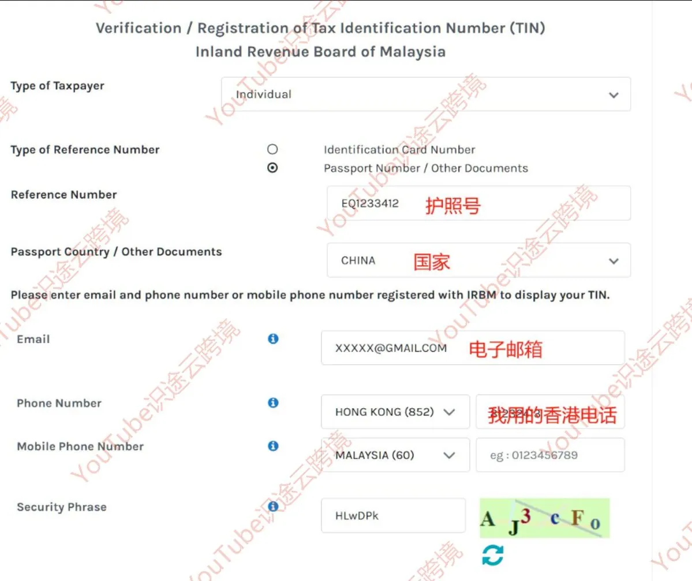
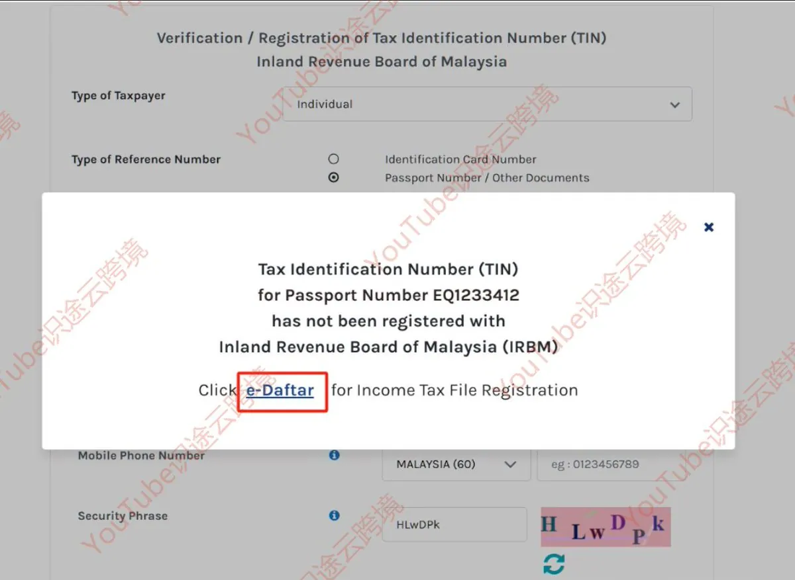
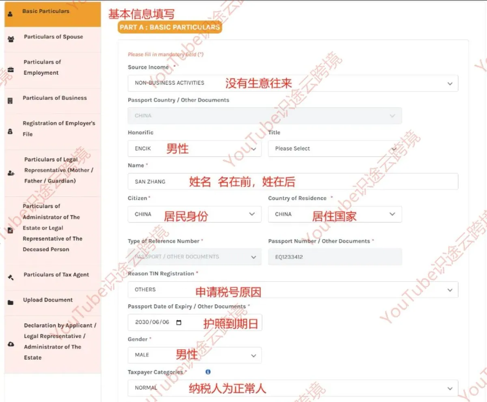
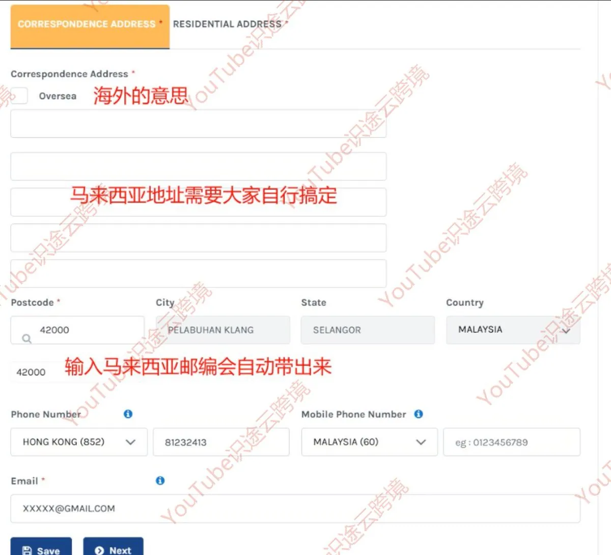
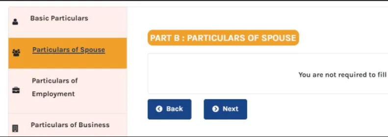
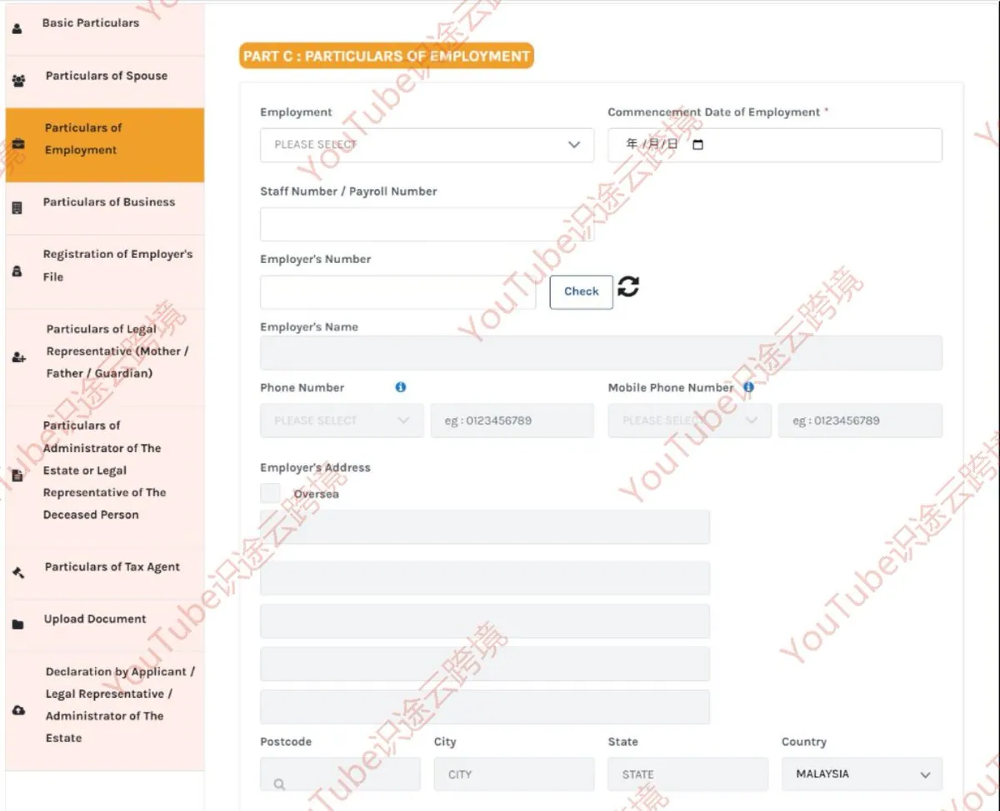
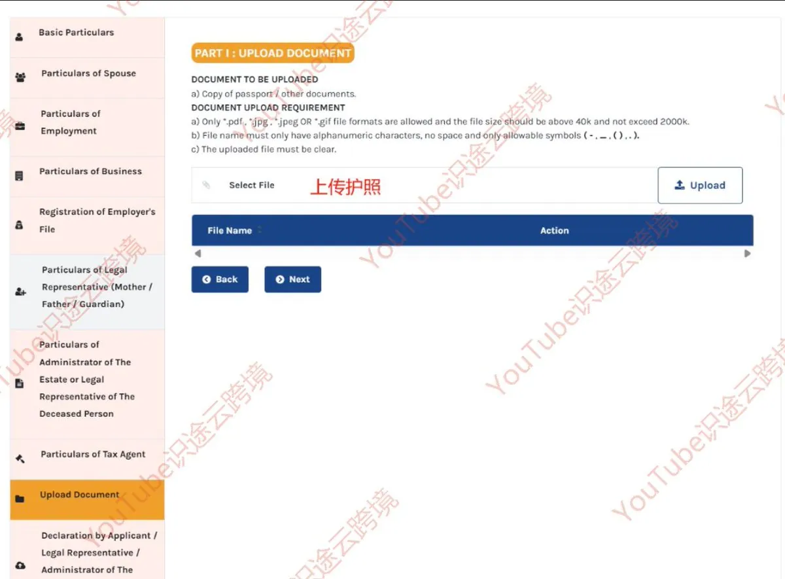

# pinminlw（@pinminlw）：🇲🇾 马来西亚个人税号（TIN）免费申请攻略——手把手教你线上办理

> 出海数字游民身份与税务合规搭建必备教程：详解通过马来西亚税务局官网（HASiL e-Daftar）全线上、零成本免费申请个人税号（TIN）的完整步骤；整理所需护照信息、居住证明填写规范、审核周期与税号获取凭据，为开通海外券商、银行账户与支付平台提供合规身份凭证支持。

<!-- more -->

## 马来西亚 TIN 税号是什么？有什么用？

### 一、TIN 是什么？有什么用？

TIN（Tax Identification Number）就是税务识别号码，由马来西亚税务局 LHDNM / HASiL 管理。

申请马来西亚 TIN 后，在符合相关要求的情况下，可以用于以下场景：

- 🧾 报税与税务申报：办理相关税务事务。
- 🏦 海外银行开户：部分银行开户时可能要求提供税号或税务居民信息。
- 📈 海外券商开户：部分券商会要求填写税务识别号码。
- 🧾 电子发票相关事务：在适用的情况下，用于相关税务业务。

简单来说，如果你经常办理海外金融业务，或者需要填写税务识别号码，那么马来西亚 TIN 就是一个值得了解的工具。

### 二、哪些人可以申请？

如果你持有中国护照，即使不是马来西亚税务居民，也可以进一步了解自己是否符合申请条件。

🏠 没有马来西亚地址怎么办？

可以根据申请系统的要求填写中国的真实地址，并使用英文填写。

不过要注意，能否申请、需要满足哪些条件，最终以马来西亚税务局的官方规定和审核结果为准，并非所有非居民都一定符合申请资格。

### 三、申请费用是多少？

💰 官方申请通常不收取 TIN 注册费用。

如果符合申请条件，可以通过官方渠道在线办理。

建议大家直接使用马来西亚税务局的官方系统，避免通过不明第三方网站提交护照等个人资料，也不要为所谓的“加急审批”随意付费。

### 四、申请前需要准备哪些材料？

建议提前准备好以下资料，避免填写到一半才发现材料不齐全。👇

1. 中国护照

准备护照个人信息页的清晰照片或扫描件。

确保护照上的姓名、护照号码、出生日期等信息清楚可辨，避免反光、模糊或裁切不完整。

2. 邮箱地址 📧

准备一个可以正常接收邮件的邮箱，用于接收审核通知或其他申请相关信息。

3. 手机号码 📱

中国大陆手机号或其他符合系统要求的号码均可尝试使用。

填写时注意检查国家区号是否正确，避免因为区号错误而无法接收验证码。

4. 通讯地址与住宅地址 🏠

提前准备自己的真实地址。

如果申请系统允许填写中国地址，可以使用中国地址，并按照页面要求转换成英文格式。

注意区分 Mailing Address（通讯地址） 和 Residential Address（住宅地址），如果两者不同，应根据实际情况填写。

5. 护照信息页文件要求 📄

上传之前，建议检查文件是否符合申请页面的具体要求：

- 文件格式：以页面支持的格式为准，例如 JPG、JPEG 或 PDF。
- 文件大小：如果页面明确要求 40KB～300KB，就需要控制在这个范围内。
- 文件名：如果系统限制文件名，只使用英文字母和数字，不添加空格或特殊符号。
- 照片清晰度：护照信息必须清晰完整，不能模糊、反光或缺少边角。

### 五、分步骤教程

🇲🇾 第 1 步：进入马来西亚税务局官网

首先，打开马来西亚税务局（LHDNM / HASiL）的官方系统：

🔗 官网地址：[ https://mytax.hasil.gov.m](https://mytax.hasil.gov.my/)y

进入网站后，找到并点击 「e-Daftar」，进入税号注册相关页面。

🇲🇾 第 2 步：进入 e-Daftar，填写个人资料

进入 e-Daftar 页面后，根据页面提示填写个人信息。建议提前准备好护照和邮箱，按照下面的说明逐项填写。👇

1. Type of Taxpayer（纳税人类型）

选择 Individual（个人）。

2. Type of Reference Number（证件类型）

选择 Passport Number / Other Documents（护照号码 / 其他证件）。

3. Reference Number（证件号码）

填写你的中国护照号码，请仔细核对，确保没有输入错误。

4. Passport Country / Other Documents（护照签发国家）

选择 CHINA（中国）。

5. Email（电子邮箱） 📧

填写一个可以正常接收邮件的邮箱，方便接收后续通知。

6. Mobile Phone Number（手机号码） 📱

先将默认国家区号 MALAYSIA (+60) 修改为你实际使用的手机号所属国家或地区，再填写手机号码。

例如，使用中国大陆手机号时，选择对应的中国区号 +86。

注意：请按照页面要求填写号码，避免重复填写国家区号。

7. Security Phrase（安全验证码）

按照页面显示的验证码图片输入对应字符。如果看不清楚，可以尝试刷新验证码后重新填写。

✅ 提交前检查

确认纳税人类型、护照号码、护照国家、邮箱和手机号码均填写正确后，再按照页面提示继续操作。

🇲🇾 第 3 步：查询是否已有 TIN 记录

填写完护照号码、国家、邮箱、手机号以及验证码后，点击 「Search」 进行查询。

🔎 这一步主要是检查：你的护照号码是否已经存在对应的 TIN 注册记录。

接下来分两种情况：

✅ 情况一：系统没有查到你的 TIN 记录

如果马来西亚税务局系统没有找到与你填写的信息相匹配的记录，页面可能会显示相应的提示。

这时，你只需要点击 「e-Daftar」，进入后续的注册表单，继续填写个人基本信息即可。

⚠️ 情况二：系统已经找到相关记录

如果查询结果显示已有匹配记录，建议先核对信息，并按照官网提示处理，不要直接重复申请。

填写注册表（BAHAGIAN A 基本信息）

进入注册表后，找到 「BAHAGIAN A」，也就是基本信息填写部分。

按照页面要求，逐项填写个人资料。建议对照护照核对姓名、证件号码等信息，确保填写准确。📋

填写完成后，按照以下步骤操作：

1. 点击「Save」保存

确认信息无误后，点击 「Save」。

如果页面提示保存成功，就说明当前填写的信息已经保存。

2. 点击「Next」进入下一步

保存成功后，点击 「Next」，继续填写后续的注册资料。

可以用中国地址，也可以用马来西亚地址。马来西亚地址可以通过 Google 地图查找。

选单身，这步可以跳过，如果前面选已婚 ，这里是需要填配偶的信息

在马来西亚没有工作，part C 直接留空 点击 next

🇲🇾 第 4 步：上传护照信息页

完成前面的基本信息填写后，继续按照页面提示操作。

1. PART C 到 PART H

按照原教程的操作，这几个部分先检查页面要求。如果确实不是必填项，且不适用于你的情况，可以留空；如果系统要求填写，则需要根据实际情况如实填写。

2. 找到 PART I

继续往下浏览，进入 PART I 页面，找到护照资料上传区域。

3. 上传护照信息页 🛂

上传自己的中国护照个人信息页照片或扫描件，确保以下内容清晰可见：

- 护照姓名
- 护照号码
- 出生日期
- 护照照片及其他相关信息

4. 检查上传结果

上传完成后，确认文件已经成功显示在页面中，再按照系统提示继续下一步。

🇲🇾 第 6 步：申请人声明并提交

完成前面的资料填写和护照上传后，进入 Declaration by Applicant（申请人声明） 页面。

1. 阅读申请人声明

页面会显示以下英文声明：

I hereby declare that the information given in this form is true, correct and complete.

意思是：本人声明，本表格中提供的所有信息均真实、准确且完整。

2. 勾选 Applicant

阅读并确认声明内容后，根据页面要求勾选 「Applicant」，表示你已确认相关声明。

3. 再次核对个人信息 🔍

提交之前，建议把所有已填写的信息重新检查一遍，尤其要注意：

- 护照号码是否正确
- 姓名是否与护照一致
- 邮箱和手机号码是否填写正确
- 上传的护照文件是否清晰完整

确认所有信息真实、准确后，点击 「Submit」 提交申请。

⏳ 第 7 步：提交成功，等待审核

提交完成后，如果页面显示：

「Application is being Processed」

说明申请已经进入处理流程。✅

页面还可能显示以下提示：

You will be notified via email within 7 working days.

意思是：你将在 7 个工作日内通过电子邮件收到通知。

📧 接下来，记得定期查看注册时填写的邮箱，包括垃圾邮件文件夹，留意马来西亚税务局发送的审核通知。

## 🇲🇾 六、提交后：查收 TIN 税号并激活账号

完成申请提交后，接下来就是等待审核邮件，并按照提示激活 MyTax 账号。

### 1️⃣ 查收审核邮件 📧

提交申请后，留意注册时填写的邮箱。

按照页面提示，通常会在 7 个工作日内收到相关通知。部分申请可能处理得更快，原教程中提到实际第二天就收到了邮件，但具体时间以税务局的处理进度为准。

收到邮件后，查看其中是否包含你的 **TIN（税务识别号码）**及后续操作说明。

### 2️⃣ 激活 MyTax 账号 🔐

打开马来西亚税务局 MyTax 官方网站：

🔗[ https://mytax.hasil.gov.my](https://mytax.hasil.gov.my/)/

按照以下步骤操作：

① 选择 Passport No 登录方式

在登录页面找到护照号码相关的登录选项，按照系统提示继续。

② 选择 e-CP55D

根据页面指引选择 「e-CP55D」，进入相关的账号激活流程。

③ 确认注册邮箱

核对页面显示的邮箱地址，确保能够正常接收验证邮件。

④ 查收验证邮件并完成激活

打开邮箱，找到 MyTax 发送的验证邮件，按照邮件中的链接或指引完成激活。

📌 如果页面选项与教程不同，请以当前官网实际显示的流程为准。

### 3️⃣ 设置登录密码

完成邮箱验证后，按照系统提示设置 MyTax 账号密码，并提交保存。

建议设置一个安全性较高、自己能够妥善保管的密码。🔒

### 4️⃣ 登录查看 TIN 税号

账号激活并设置好密码后，返回 MyTax 官网登录。

按照系统支持的方式，使用 Passport No（护照号码）及设置好的密码进入账户。

登录成功后，进入 Profile（个人中心），查找自己的 TIN 税号信息。

如果页面提供打印机图标，可以点击该图标，按照系统提示打印或下载 PDF 文件，方便后续保存和使用。📄

✅ 最后检查

- 已收到税号申请结果邮件
- 已完成 MyTax 账号激活
- 已设置登录密码
- 已成功登录并查看 TIN
- 已保存税号信息或下载相关文件

## 🇲🇾 七、非税务居民报税提醒：没有收入也要申报吗？

成功申请马来西亚 TIN 后，还有一个需要特别注意的问题：是否需要提交税务申报，不能只根据有没有马来西亚收入来判断，还需要看你的纳税身份及税务局的具体要求。

如果你是非马来西亚税务居民，而且没有马来西亚来源收入，建议先确认自己是否需要申报，再按照官方要求办理。

### 📅 1️⃣ 注意申报截止日期

原教程提到的申报截止日期为次年 4 月 30 日。

例如，若某一年度适用这一截止日期，则需要在次年 4 月 30 日前完成申报。

⚠️ 注意：不同纳税人类别、申报表类型及申报年度的截止日期可能不同。 不要直接将 4 月 30 日视为所有个人纳税人的统一截止日期，应以马来西亚税务局（LHDNM / HASiL）针对你个人情况的最新规定为准。

### 📝 2️⃣ 如何进入 MyTax 申报页面？

如果确认自己需要提交申报，可以参考以下操作路径：

① 登录 MyTax

打开马来西亚税务局官网：

🔗[ https://mytax.hasil.gov.my](https://mytax.hasil.gov.my/)/

使用自己的账户登录。

② 进入申报入口

在对应年度下，查找：

「Click Here For Filling And Submission」

点击后，根据系统显示的选项继续。

③ 选择申报表类型

按照页面指引选择 「e-M」，并在 Year of Assessment（课税年度） 中选择对应年份。

📌 请先确认 e-M 是否适用于你的纳税人类别，不要仅因为是外国护照持有人就直接选择该表格。

④ 核对个人资料

按照系统要求核对或填写相关信息，例如：

- 护照号码
- 护照有效期
- 性别
- 婚姻状况
- 永久地址

如果系统允许填写境外地址，可以按照要求填写真实的中国地址。

⑤ 填写收入及税务信息

如果确实没有相关收入或其他应申报项目，应根据实际情况和表格说明填写。

⚠️ 不要为了完成所谓的「0 申报」而将所有字段一律填 0 或留空。 有些项目可能要求填写实际金额、选择不适用选项，或提供其他资料，应以表格说明为准。

⑥ 签署并提交

提交前，仔细检查所有信息，确认无误后再点击 「Sign and Submit」。

提交成功后，建议保存申报确认页面或回执，方便日后查询。

## ⚠️ 八、注意事项：这几个细节千万别忽略！

申请马来西亚个人税号（TIN）的过程中，有几个细节一定要特别注意。提前检查好，可以避免填错资料，减少重复申请的麻烦。👇

1. 护照号码务必逐字核对 🛂

护照号码是整个申请过程中最关键的信息之一。

填写时一定要对照护照信息页，逐位检查字母和数字是否正确。

我们实际操作时就曾经填错过一次，发现问题后，只能返回重新走完整个流程。

📌 建议提交前再核对一遍，尤其注意容易混淆的字母和数字，避免因信息错误影响申请。

2. 手机号区号记得修改 📱

填写手机号时，页面默认的国家区号可能是马来西亚 +60。

如果使用中国大陆或其他国家和地区的手机号，记得先切换到对应的国家或地区区号，再填写手机号码。

例如：

- 🇨🇳 中国大陆：+86
- 🇬🇧 英国：+44
- 🇲🇾 马来西亚：+60

具体以页面提供的选项为准。

3. 地址尽量使用英文填写 🏠

填写通讯地址时，如果页面提供 「Oversea」 选项，可以根据实际情况选择，并按照系统要求填写中国地址。

英文地址可以参考以下顺序组织：

门牌号 → 街道 → 镇 / 区 → 城市 → 省份 → 国家

例如，按照实际地址信息逐项填写，不要随意编造地址，也要注意区分通讯地址与住宅地址。

国外手机号码购买：[https://shoplsd.org/shop/](https://shoplsd.org/shop/)

博主自用的，家庭宽带 IP 机场：

[https://tagss.pro/#/auth/9T67ROt7](https://tagss.pro/#/auth/9T67ROt7)

GPT plus/奈飞/油管/Spotify 优惠订阅：[https://nf.video/J4OqA](https://nf.video/J4OqA)

苹果谷歌号，电报号等海外社媒账号购买：[https://accboyytbdjlsd.acceboy.com](https://accboyytbdjlsd.acceboy.com/)

## 相关页面

- [[sources/jason-zhu-chiang-mai-university-language-program-guide]]
- [[sources/kk-ai-notes-opc-wanlihui-overseas-address-proof]]
- [[concepts/overseas-tool-stack]]
- [[concepts/digital-products-side-income]]
