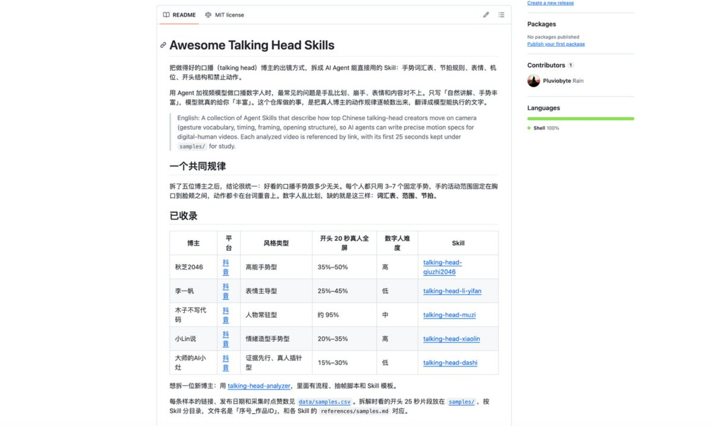
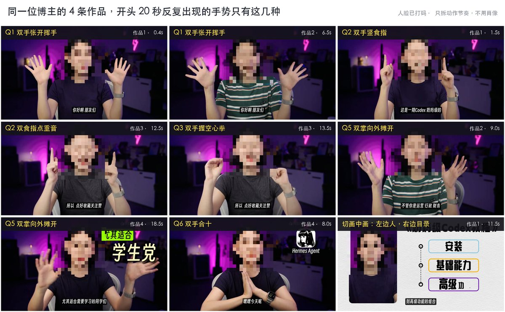
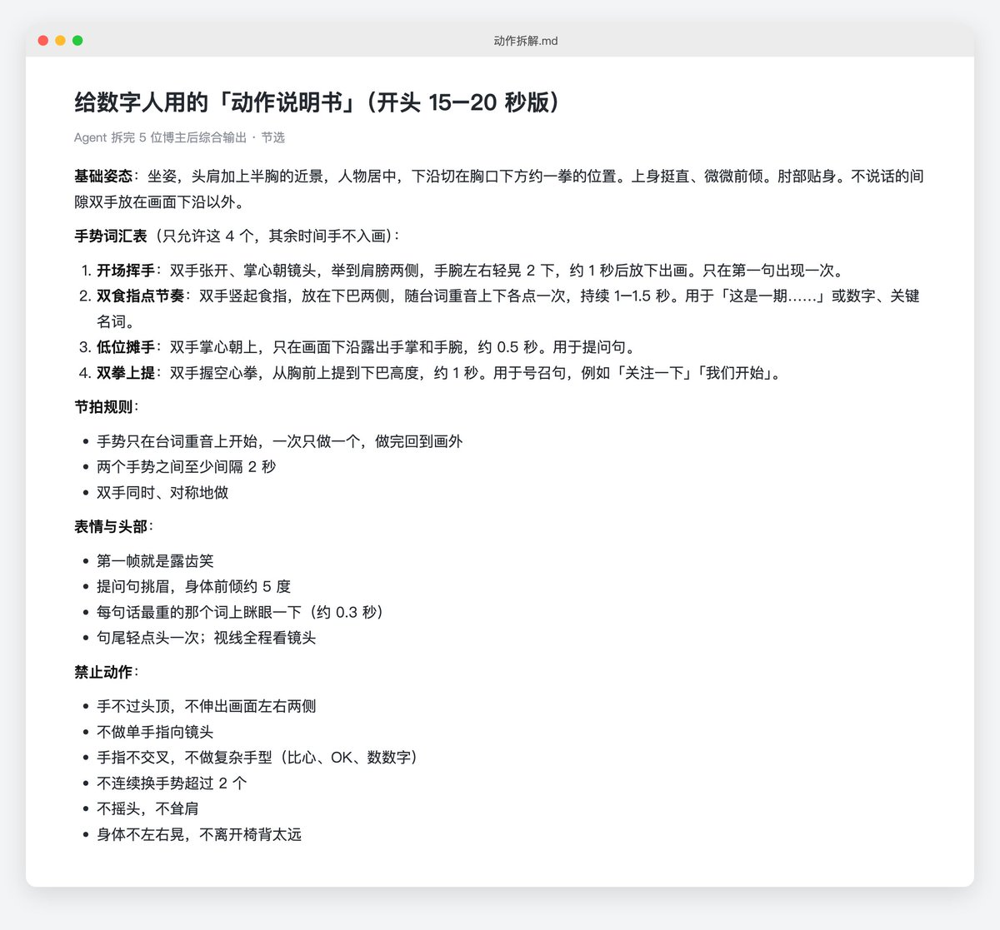
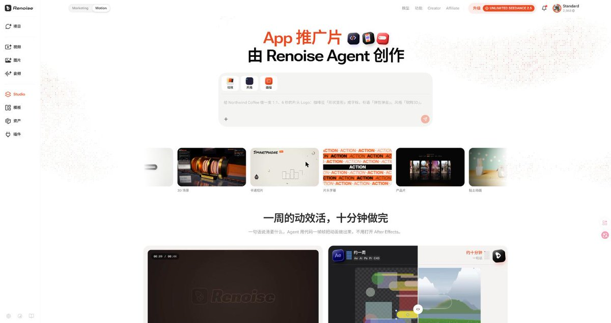

# 雪踏乌云：不露脸做口播数字人——先让 Agent 拉片写出「动作说明书」

> 数字人「假」的根子在动作描述：提示词只写「自然讲解、手势丰富」，模型就把动作频率拉满。四步流程：① 挑 3 位风格错开的真人博主（坐姿知识类／站姿观点类／快节奏资讯类），只学动作节奏，不拿肖像服饰场景，参考视频只给 Agent 拉片、不喂生图生视频模型；② 让 Agent 逐项提取基础体态、手势清单、头部与视线、停顿、强调方式，综合成一份不含博主姓名和外貌的纯文字「动作说明书」，禁词只写可量化动作、单独列「禁止动作」；③ 接视频 MCP 打通生图、生成、云端剪辑、字幕、配乐；④ 参考图 + 说明书 + 文案一起交给 Agent，先看分镜和预计积分再确认生成。多段拼接的接缝用剪辑解决（交界处切两秒 B-roll 或切微特写），不用死磕抽卡。

<!-- more -->

这条视频里的人物动作、对口型、空镜插片，以及后期的花字和背景音乐，全是在一个 Agent(Codex) 对话框里跑出来的，没有打开过剪映或 Premiere。

[video](https://video.twimg.com/amplify_video/2115412992083021824/vid/avc1/1280x720/DSvYNGIn6guQ023J.mp4?tag=29)

搭配很简单：一个支持 MCP 的 Agent，Claude Code、Codex、WorkBuddy 都行，接上任意一个视频生成模型，这里我们以 Renoise MCP 为例。

同时，我蒸馏了几个大博主的全身出镜视频，制作数字人的时候，只需要准备好一张照片和一个视频生成模型，使用相似的风格，即可产出类似于秋芝、木子、小 Lin 说等博主的出镜风格视频

[https://github.com/Pluviobyte/awesome-talking-head-skills](https://github.com/Pluviobyte/awesome-talking-head-skills)

这个仓库我也会不断完善和增进，多收集一些博主的案例，然后将他们的风格都整理一下，争取后面数字人能够有越来越多的参考

所以我们的这个方案是凭空创造数字人。如果你还是想用自己当作数字人，我这里还是推荐之前推荐过多次的 HeyGen Avatar 5 模型，能够保持人物的真实性，这种情况下效果比较好。缺点是价格比较贵，而且可调整性比较差，这方面就不如视频模型了。

## 数字人的“假”，毛病通常出在动作描述

只要是做过数字人的，大概率都踩过这三个坑：

1. 手乱比划、崩手：一两句话手就频繁抬起，甚至伸出画面，手指粘连、扭曲；
2. 表情和内容脱节：讲到干货面无表情，轻松处反而皱眉，眼神空洞地盯着镜头；
3. 多段拼接跳帧：长文案要分段生成，段与段之间站位、比例和光影对不齐，硬切像在抽搐。

前两个，根子在提示词只有一句“自然讲解，手势丰富”。模型拿到“丰富”，就把动作频率拉满。

而观感舒服的真人知识博主，肢体其实很克制：双手大多收在身前或搭在桌上，只在抛结论、强调数字、列步骤时做一个小幅手势；讲完一个点，身体归位，眼神短暂移开，形成呼吸感。

这些规律看得出来，但逐帧拉片、再翻译成模型能执行的文字，又枯燥又费时。这一步交给 Agent。

## 第一步：挑选 3 位风格错开的真人博主

建议选 3 位不同类型的口播博主：

- 坐姿、冷静的知识类：学稳定的躯干、微小的点头和视线停顿；
- 站姿、情绪饱满的观点类：学情绪推高时的手势幅度和重音顿挫；
- 语速快的资讯或带货类：学利落的手势收放，以及怎么避免无效晃动。

选 3 种，是为了让 Agent 归纳出“动作公约数”，避免照搬某一个人。

底线：只学动作节奏，不拿对方的肖像、服饰和场景。参考视频只给 Agent 拉片，不要喂给生图或生视频模型，否则别人的外貌会串进成片。这一步的产出，是一份不含博主姓名和外貌的纯文字动作规范。

## 第二步：让 Agent 生成标准「动作说明书」

把参考视频交给 Agent，发这段任务：

你是口播动作拆解师。我会提供 3 段不同风格的真人博主口播视频。忽略长相、服装、音色和背景，只拆肢体、表情和讲话节奏，结果里不出现博主名字。

先逐项提取：

1. 基础体态：站或坐、景别、躯干倾斜角度；
2. 手势清单：每种手势在什么内容（数字/对比/重点/设问）时出现，幅度（贴身/胸前/过肩）、持续秒数、频率；
3. 头部与视线：点头、侧头的时机，看镜头和移开视线的比例与时长；
4. 停顿：句间停多久，停顿时手和表情怎么收；
5. 强调方式：靠手势、表情还是停顿。

再综合 3 位的优点，整合成一份给视频模型执行的「动作说明书」：

- 不用“自然、生动、有感染力”这类词，只写具体、可量化、可复现的动作；
- 单独列「禁止动作」；
- 注明哪些来自观察，哪些是你的建议。

下面是一份原创示例（不对应任何真实博主）：

【基础体态】坐姿中景（腰部以上），身体向一侧微偏 5 度，正面朝镜头。双手平放在桌面边缘，肩部放松，躯干不晃。

【手势】只在讲步骤序号或核心论点时抬起单手，其余时间归位；手势保持在胸口以下、两肩以内，掌心微斜向内；定格 1.5 秒后回落，平均 12–15 秒一次；遇到递进结论，双手可向前微推一次。

【头部与视线】约 85% 时间看镜头，换论点时视线向右下移开 0.5 秒再回来；陈述句尾小幅低头一次，幅度小于 5 度。

【停顿】逗号约 0.3 秒，句号约 0.6 秒，停顿时双手静止，嘴角微收。

【禁止动作】手不过下巴和肩；手指不交叉；食指不指向镜头；连续比划不超过 3 秒；不频繁耸肩。

「禁止动作」格外重要。长指令下模型容易发散，提前写死负面约束，能减少手指变形、粘连和乱动。

## 第三步：接入 Renoise MCP，打通全流程链路

以前这一步要先生图、再抽卡、再拖进剪辑软件对音频、铺字幕。

这里用的是 [Renoise](https://renoise.ai/) 的 MCP。Renoise 是一站式 AI 视频平台，接了 Seedance、Kling、MiniMax、Wan、GPT Image、Midjourney、Nano Banana 等约 30 个模型，新模型 24 小时内上线。

Renoise MCP 相当于给 Agent 接上手脚和工作台：在对话里提需求，Agent 会出创意和分镜、调模型生成音画素材，并在 Renoise 的云端环境写代码完成剪辑、字幕和音效，直接出片，还能导出剪映或 Premiere 草稿。

## 第四步：参考图 + 说明书，驱动 Agent 自动剪辑成片

参考图选正面或微侧的半身照，双手露出，背景干净。可以用授权的个人肖像，也可以让 Agent 用文生图模型生成原创形象。

声音可以用 Renoise 内置配音，也可以上传自己的克隆音频对口型。Renoise 里的 Seedance 2.5 支持原生语音和口型同步，单段最长 30 秒，60 秒左右的口播拼两到三段。

把参考图、说明书和文案一起交给 Agent：

用 Renoise 帮我做一条约【待补：60】秒的口播视频，画幅【待补：16:9 横屏 / 9:16 竖屏】。

- 形象：以我上传的图片为准，全片外观和衣着一致；
- 文案：按台词朗读，语速适中，发音清晰；
- 声音：【用 Renoise 配音 / 用我上传的音频】，口型对齐；
- 动作：严格执行「动作说明书」，尤其是「禁止动作」；
- 包装：每 10–15 秒插一段贴合内容的 B-roll，分段交界处用 B-roll 或推近镜头盖住，加关键词花字、字幕和轻音乐；
- 先给我分镜和预计积分，确认后再生成；
- 输出高清成片，另附一份剪映草稿。

生成前，Renoise 会列出要用的模型和预计积分，确认后才开始。

这里要讲清楚 Renoise 的核心优势：多段拼接的接缝，用剪辑就能解决，不用死磕抽卡。很多人为了光影一致反复重抽十几遍，其实在段落交界处切两秒 B-roll，或者把中景切成微特写，观众就看不出差异。以前这要拖进剪辑软件逐帧去贴，Renoise 在云端用代码完成切分、字幕卡点、花字和配乐混音。这是它和单纯生成素材的工具最大的区别。

## 为什么不同 Agent 都能跑出专业质感

分镜、调度、云端剪辑这么长的链路，是不是得靠顶级模型才能跑顺？

不需要。Renoise MCP 内置了大量现成的 Skill，覆盖产品宣传片、电商广告、动效包装、爆款复刻等场景，模型链路、剪辑规则和分镜逻辑都已经写好。Agent 只要听懂你的需求，对上现成的流程。

所以：任何 Agent 搭配 Renoise MCP，都能做出 Opus 5.5 的效果。Codex、WorkBuddy、豆包，只要能接入，都能当这个导演和剪辑师。

## 实操层面的几点注意事项

1. 形象：参考图只用自己有版权的肖像，或 AI 生成的原创形象；拆别人只学动作节奏，不克隆脸和声音；
2. 标注：发抖音、小红书、B 站等平台，按要求标注“AI 生成内容”；
3. 复用：说明书调好一次，同系列视频直接套用，每期只换台词和 B-roll 描述。

## 结语

数字人好不好看，关键在于给模型的执行标准够不够清晰。逐帧观察、提炼规律交给 Agent，多模型调度和代码剪辑交给 Renoise MCP，不露脸做口播就跑通了。

## 相关页面

- [[patterns/video-prompt-reverse-engineering]]
- [[patterns/story-studio-video-pipeline]]
- [[sources/aaronyi-image-story-video-wizard]]
