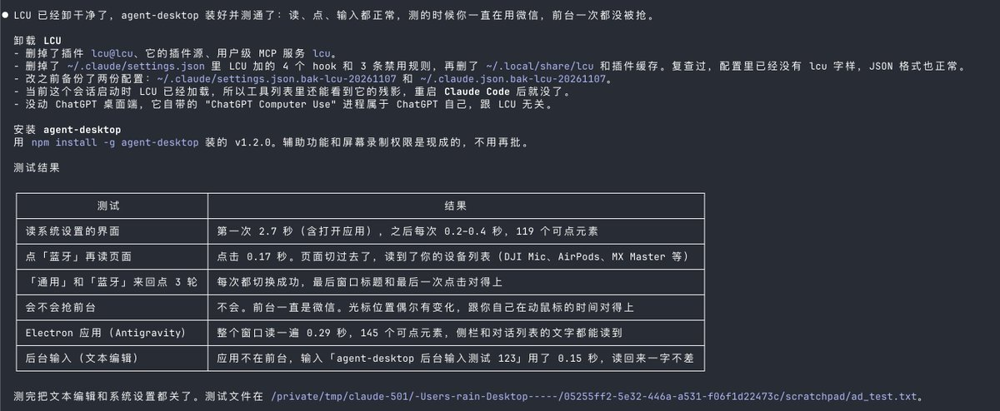

# 雪踏乌云（@Pluvio9yte）：Vercel 推出的 agent-desktop 才是 Agent 操控电脑的真神

> Vercel Labs 开源的 agent-desktop（Apache-2.0，1.8 万 star）实测：作为命令行工具让 Claude Code、Codex 等 Agent 直接操作电脑上的 App（点按钮、填表单、打字、切菜单、读界面）。核心机制突破——**不截图**，而是直接读系统无障碍树（读屏软件那套接口）给界面上每个按钮与输入框编号，Agent 按编号操作，因此不会点歪；且**默认不动鼠标、不把窗口切到前台**，Agent 后台操作时人可照常刷微信。需要物理鼠标键盘时再加 --headed。实测数据：读完系统设置整个界面约 0.3 秒、点击「蓝牙」0.17 秒、给非前台文本编辑器输入中英文加数字 0.15 秒且读回一字不差、Electron 应用也能读（侧栏与对话列表文字均可获取）。相比之下此前用的 LCU 依赖 ChatGPT 桌面端内部运行时，ChatGPT 一更新就可能坏。安装两步：`npm install -g agent-desktop` 与 `agent-desktop permissions --guide`（Mac 上逐步引导开启辅助功能权限），再在 AGENTS.md / CLAUDE.md 加一句 Use `agent-desktop` to see and operate desktop apps…；支持 macOS(Intel/M 芯片)、Windows、Linux，60 个命令覆盖窗口管理、剪贴板、通知、菜单栏，可当 MCP 服务接入且自带模型无关。

<!-- more -->

全体起立，Vercel 推出的 agent-desktop 现在才是 Agent 操控电脑的真神。

它是 Vercel Labs 的开源项目，Apache-2.0 协议，GitHub 已经有 1.8 万 star，仓库地址在下面

它是一个命令行工具，让 Claude Code、Codex 这类 Agent 直接操作你电脑上的 App：点按钮、填表单、打字、切菜单、读界面。

之前大部分 Computer Use 的做法是截图，再让模型猜该点哪个坐标。慢，还容易点歪。

agent-desktop 不截图。它直接读系统的无障碍树（就是读屏软件用的那套接口），给界面上每个按钮、输入框编一个号，Agent 按编号去点、去输入。

最关键的一点：它默认不动你的鼠标，也不把窗口切到前台。

Agent 在后台操作电脑的时候，你可以照常刷微信、写东西，两边互不干扰。真要用物理鼠标键盘时，再加 --headed。

我在自己的 Mac 上实测了一轮：

- 打开系统设置，读完整个界面 0.3 秒左右
- 点击「蓝牙」0.17 秒，页面切过去了，设备列表也读出来了
- 给不在前台的文本编辑输入一段中英文加数字，0.15 秒，读回来一字不差
- Electron 写的 App 也能读，侧栏、对话列表的文字都拿得到
- 整个过程我一直在用微信，前台一次都没被抢

我原来用 LCU，它要借 ChatGPT 桌面端里面的运行时，ChatGPT 一更新就可能坏，也卡过。今天卸了，换成 agent-desktop。

几个让我决定换的点：

1. 不依赖任何 App，npm 一装就能用
2. macOS（Intel 和 M 芯片）、Windows、Linux 都支持
3. 自己不带模型，任何能跑命令的 Agent 都能用，也可以当 MCP 服务接进去
4. 60 个命令，窗口管理、剪贴板、通知、菜单栏都包了

安装就两步：

npm install -g agent-desktop

agent-desktop permissions --guide

第二条在 Mac 上会一步步引导你打开辅助功能权限。

然后在 AGENTS.md 或 CLAUDE.md 里加一句：

Use `agent-desktop` to see and operate desktop apps. Before the first use, run

`agent-desktop skills get desktop` and `agent-desktop skills get platform`, and follow them.

你的 Agent 就会用了。

仓库：https://t.co/LqimXMvIZ6

实测截图👇

https://t.co/a7AMmp7Js1

大家都在聊 AI 怎么帮你管钱、自动付账单，但很多人忽略了一点：黑客其实也早就用上大模型了。

大模型几秒钟就能生成逼真的假脸去刷脸过 KYC，还能自动写攻击脚本，一秒钟去测几万次支付接口。

以前银行那种靠人工对账、定期补漏的土办法，面对这种全天候的自动化攻击，基本就是慢半拍。

正好刷到圣基茨和尼维斯通过支付法的新闻，顺便说下这条新闻到底在干啥。

9 月 18 日，圣基茨议会通过了《支付系统和服务法》，替换掉了原来那套老法。以前那套东西是几十年前给传统大银行写的，但现在大家出门买东西都掏手机、刷电子钱包，很多根本不是银行的公司也在经手老百姓的钱，老法管不住。

所以新法要求：以后这类搞电子钱包、非银行支付的公司，全部得拿牌照，而且牌照里卡得很严的一条就是“网络安全风险”。

有意思的是他们后面的操作。法案刚通过第二天，在圣基茨当了 20 年总理的现任外长道格拉斯，就跑去签了协议，出任全球网络安全联盟（GCSA）的战略伙伴。

说白了，加勒比小岛国搞数字支付，本地根本没有那么多顶尖网安人才去防全球黑客的 AI 脚本，最省事的办法就是直接找懂 AI 渗透测试和实时反洗钱的国际安全联盟来兜底当外援。

黑客用 AI 攻，系统就得用 AI 防。大家平时用电子钱包或者生物识别付款时，有没有遇到过什么离谱的盗刷或安全 bug？

Codex 的电脑操控是比这个好的，我一般是给 claude 和 kimi 用

https://t.co/ptEF12OHO5

agent 操控电脑的工具到底哪个更好用？cua 和 agent-desktop 对比实测👇

(lcu 已经被淘汰，codex 原生的当之无愧第一，下面只讨论在 claude code 这种电脑操控功能差的 agent 框架上的适配性)

测试方案：

两边跑同一组任务，每项重复 10–20 次。

每次操作完，换另一个工具去核对结果，具自己说的“成功”。

测试全程我照常用电脑，看它会不会跟我抢鼠标和屏幕

结果：

① 系统设置，「通用」「蓝牙」来回切 20 次

agent-desktop 20/20，每次约 2.2 秒

Cua 20/20，每次约 2.0 秒

② 计算器算 6×7=42，10 轮，每轮先清零

agent-desktop 10/10，每轮约 1.4 秒

Cua 10/10，每轮约 5 秒

③ 后台给文本编辑输入中英混排，10 次

agent-desktop 10/10，约 0.2 秒

Cua 10/10，约 0.7 秒

④ 抢前台 / 动鼠标

两边都没有

⑤ Electron 应用（Cursor）

两边都读不到正文。agent-desktop 超时，Cua 只读到窗口框架和菜单。

准确率：常规任务打平，都是全对。

速度：点击和输入 agent-desktop 明显更快。Cua 每次点击要等结果确认，大约 1 秒。

综合下来，我觉得还是 agent-desktop 更好用。

## 相关页面

- [[sources/diygod-pinky-open-source-phone-remote-control-for-ai-agents]]
- [[sources/agent-sandbox-k8s]]
- [[concepts/agentic-architectures]]
- [[concepts/agent-skill]]
