# 雪踏乌云（@Pluvio9yte）：Cloudflare 域名邮箱，每月只需 5 美金——保姆级配置教程

> 极低成本打造专业出海企业域名邮箱的完整指南：对比 Google Workspace / Fastmail 高昂订阅费用，详细讲解如何基于 Cloudflare Email Routing 路由配合主流发信 SMTP 服务（如 Resend / Amazon SES），以每月 5 美元甚至免费的成本配齐带自身域名的官方商务收发信系统，并搞定 SPF/DKIM/DMARC 邮件防垃圾拦截认证。

<!-- more -->

Cloudflare 绝对是目前最便宜、最稳定的域名邮箱方案！！！

如果你在 Cloudflare 托管域名，可以直接在控制台配置自定义邮箱地址。收信转发免费，发信功能每月 5 美元，包含 3,000 封额度。

我刚给自己的出海站配了一遍。这篇文章把收信和发信两部分的步骤、费用算法和限制写清楚，关键步骤都配了截图。文中用 yourdomain.com 代替真实域名。

如果你觉得步骤较为复杂，也可以将这篇文章发给 Codex，让 Codex 阅读这篇文章配置。注意：模型建议使用 5.6sol，因为 6astra 模型在配置的时候会有模型的道德限制，并不会很顺畅地进行配置完毕。

## 收信和发信功能划分

控制台左侧的 Compute > Email Service 包含两个独立功能：

- Email Routing（收信）：把发到 support@yourdomain.com 的邮件转发给你的个人邮箱，例如 Gmail。免费版和付费版 Workers 都可以用，没有转发数量限制。
- Email Sending（发信）：供系统外发通知或验证码。发给外部收件人需要开通 Workers Paid 套餐，每月 5 美元，目前是 Beta。

我两种都需要：用户写信到 support@yourdomain.com 找我，网站系统要给注册用户发验证邮件。

## 第一部分 配置收信（免费）

### 第 1 步 打开 Email Routing

进入 Compute > Email Service > Email Routing，选中要配置的域名。域名还不在列表里的话，点 Onboard Domain 把它加进来。

刚打开时，右侧 Configuration summary 里的 DNS records 显示 Not configured，下面 Next Steps 的第一条就是 Fix DNS records。

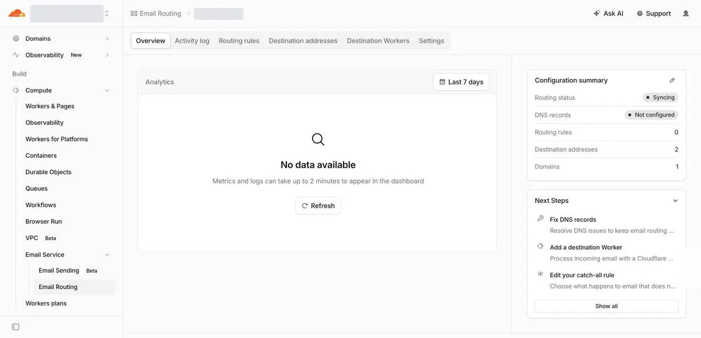

### 第 2 步 添加解析记录

切到 Settings 标签，往下找到 DNS records。这里列出了收信需要的 5 条记录，都标着红色的 Missing：

- 3 条 MX 记录，分别指向 route1.mx.cloudflare.net、route2.mx.cloudflare.net、route3.mx.cloudflare.net，作用是把发往这个域名的邮件交给 Cloudflare
- 1 条 SPF 的 TXT 记录，值是 v=spf1 include:_spf.mx.cloudflare.net ~all
- 1 条 DKIM 的 TXT 记录，主机名是 cf2024-1._domainkey.yourdomain.com

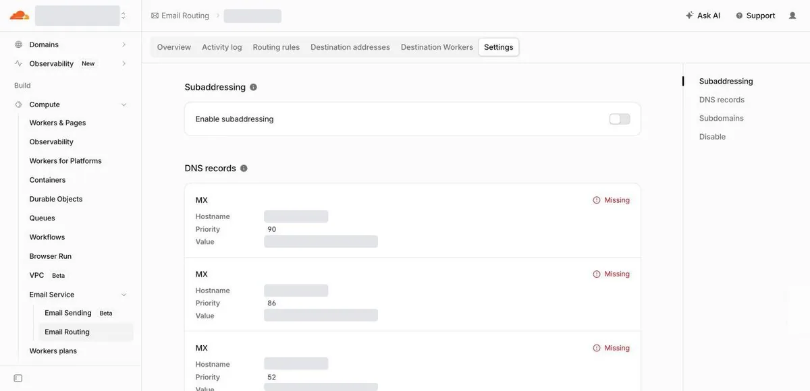

这 5 条记录不用手动抄。滚到列表底部，点蓝色的 Add missing records，Cloudflare 会自动写进域名的 DNS。

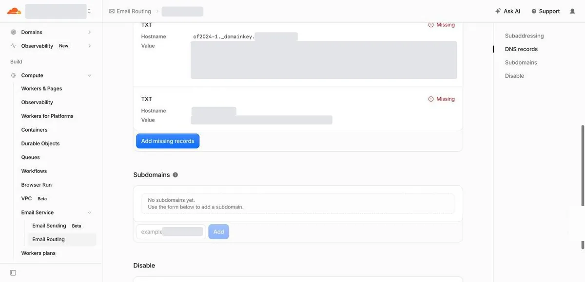

添加完成后，红色的 Missing 换成了 Locked 或 Unlocked。按官方文档的说法，两种状态都表示记录配置正确。Locked 的记录由 Email Service 托管，在 DNS 记录页里不能直接编辑或删除，防止误改之后收不到信。

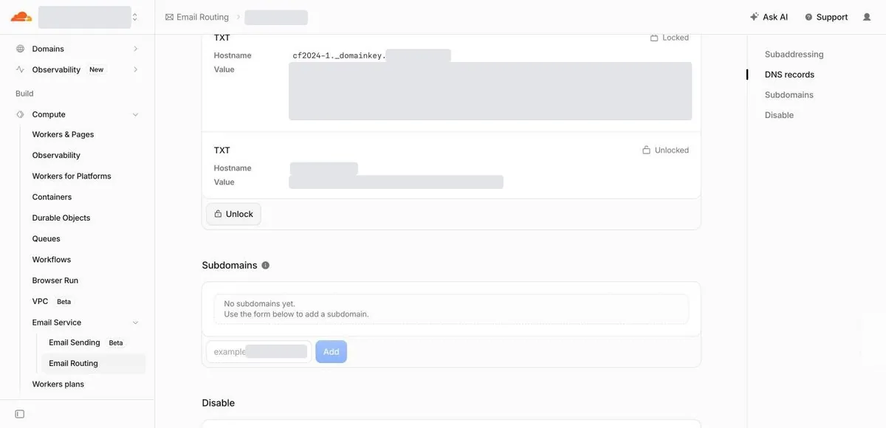

我用 dig 查了一遍，3 条 MX 记录已经生效：

```bash
$ dig +short MX yourdomain.com
52 route3.mx.cloudflare.net.
86 route2.mx.cloudflare.net.
90 route1.mx.cloudflare.net.
```

添加解析记录有个前提。Email Routing 要求域名的 MX 记录指向 Cloudflare，官方文档写明不能和外部邮件服务器同时使用。域名上如果已经挂着 Google Workspace 或其他企业邮箱的 MX 记录，开启 Email Routing 就得把它们换掉，原来的邮箱会收不到信。

### 第 3 步 验证转发目标邮箱

切到 Destination addresses 标签。转发的目标邮箱必须先验证，才能在规则里选到。

我的账号里已经有两个以前验证过的邮箱，状态是 Verified，可以直接用。第一次配置的话，在页面底部的输入框填上邮箱，点 Add address，然后去那个邮箱里打开 Cloudflare 发来的验证邮件，点 Verify email address。

目标邮箱是账号级别的。页面上写着 “Destination addresses are shared across every zone on this account”，验证一次，账号下所有域名都能用。一个账号最多 200 个。

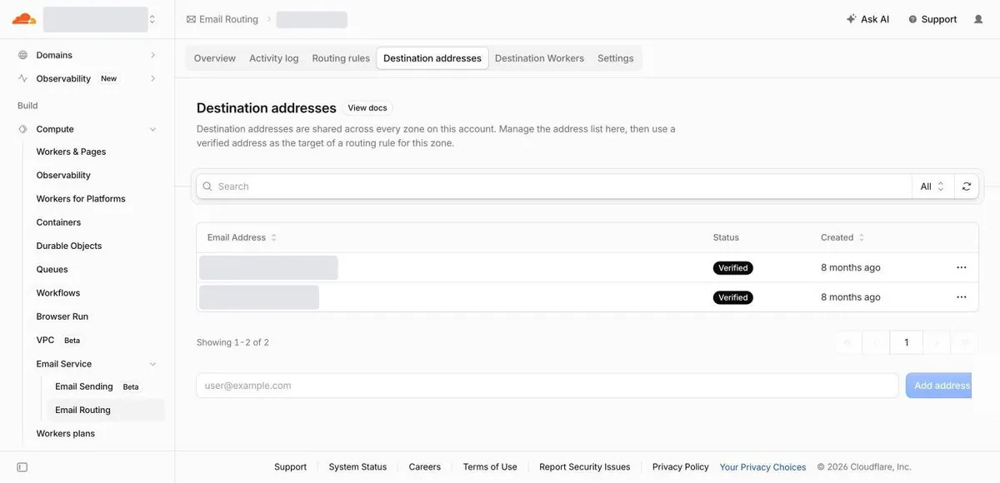

### 第 4 步 创建转发规则

切到 Routing rules 标签。新域名默认只有一条 Catch-all 规则，动作是 Drop，状态是 Disabled。

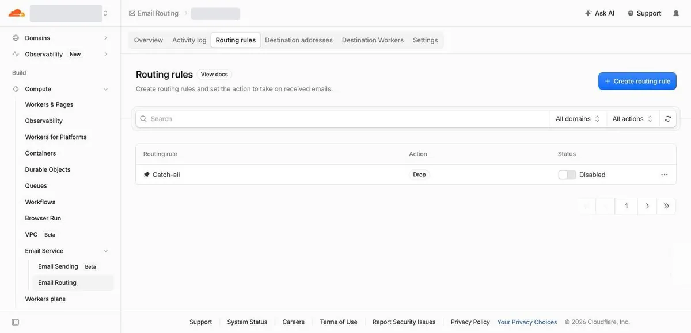

点右上角的 Create routing rule，弹出的表单里填三项：

- Email pattern 填 support，后面的域名选你的域名
- Action 选 Send to an email
- Destination 选上一步验证过的邮箱

Action 一共三个选项：Send to an email 是转发到邮箱，Send to a Worker 是交给 Worker 用代码处理，Drop 是直接丢弃。

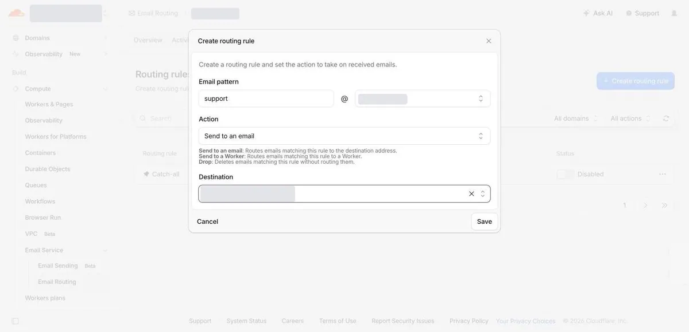

点 Save，规则列表里多了一行 support@yourdomain.com，状态是 Active。收信到这里就配完了。

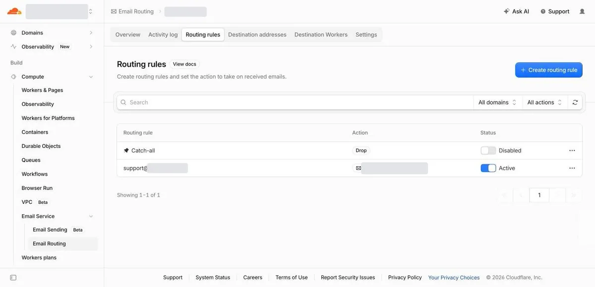

现在只有 support@ 这一个地址会转发。Catch-all 规则管的是没有匹配到任何规则的来信，想让任意前缀都能收到，可以把 Catch-all 打开并把动作改成转发。

### 第 5 步 发一封信测试

用另一个邮箱给 support@yourdomain.com 发一封信，然后去目标邮箱的收件箱看。官方文档提醒，测试时发件邮箱不要用目标邮箱本身，有些邮箱服务商会丢弃看起来是自己发给自己的邮件。没收到就先翻垃圾箱。

### 收信限制说明

- Email Routing 只做转发，没有独立收件箱。发到 support@yourdomain.com 的邮件最后落在我的 Gmail 里。
- 在 Gmail 里直接点回复，对方看到的发件人是我的 Gmail 地址。想用 support@yourdomain.com 的名义回信，要在 Gmail 设置里添加“用这个地址发送邮件”，这项设置需要填一个 SMTP 服务器。Cloudflare 的发信功能提供 SMTP 接入，参数写在第 9 步。
- 一条规则只能对应一个目标邮箱。同一个地址要转给多个人，得写一个 Worker 逐个转发。每个域名最多 200 条规则。
- 单封来信上限 25 MiB，超过会被拒收。

## 第二部分 开通发信（每月 5 美元）

### 费用与额度规则

发信功能挂在 Workers Paid 套餐下面，每月 5 美元。这笔钱买的是整个 Workers Paid 套餐，邮件是其中一项，付款页上列出的还有 Workers 每月 1,000 万次请求等额度。

邮件部分的计费规则来自官方定价页和额度页，核对日期为 2026 年 10 月 10 日：

- 每月含 3,000 封，超出后每 1,000 封加收 0.35 美元。
- 3,000 封按账号算，账号下所有域名共用。官方原话是 “The 3,000 included emails apply per account, per month”。
- 硬退信的邮件也计入额度。被接口直接拒绝的不计，比如收件人在屏蔽名单里。
- 发给账号里已验证的目标邮箱不收费，也不占额度。官方文档写明这一条在 Free 套餐下同样成立。
- 每日发送上限也按账号算。新账号起步额度比较保守，文档没给具体数字，我的新账号在控制台里看到的是每天 1,000 封。额度会随发信表现自动上调，也可以向官方申请提额。
- 官方把 Email Sending 定位为事务邮件，营销群发目前不支持。

### 第 6 步 升级 Workers Paid

在左侧菜单点 Email Sending。Free 套餐下页面只有一句提示 “Email Sending is currently only available with the Workers Paid plan”，和一个 Purchase Workers Paid 按钮。

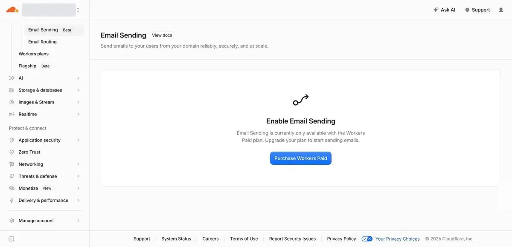

点按钮进入付款确认页。页面上有三块内容：套餐价格 $5 / month 和包含的 Workers 额度，扣款的银行卡，还有两个必须勾选的选项。第一个选项是同意服务条款和隐私政策。第二个选项是授权 Cloudflare 每月对超出免费额度的用量扣这张卡，直到取消订阅，取消在当前账单周期结束时生效。

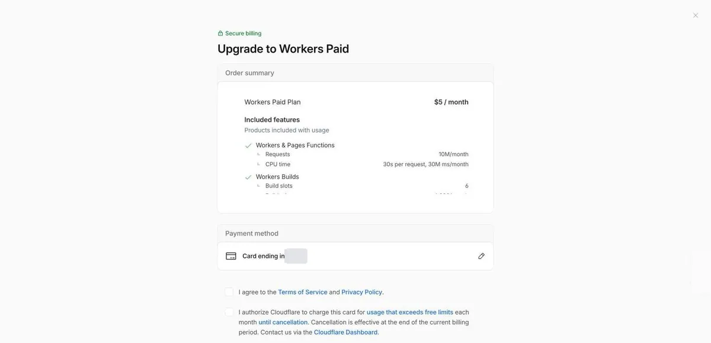

付款完成后回到 Email Sending 页面，原来的提示换成了 Onboard Domain 按钮，右侧多了一个 Usage 面板，显示当前账单周期的计费用量。

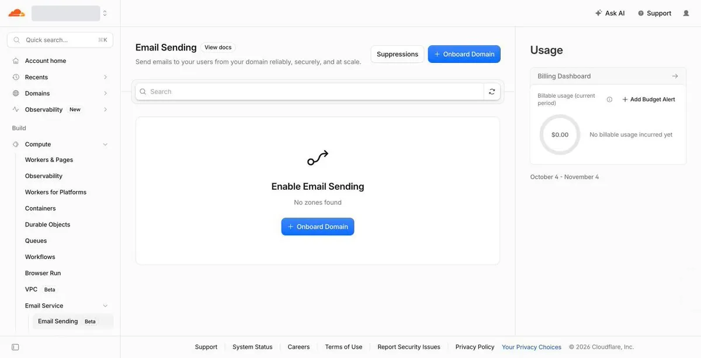

5 美元是底价，用量超出套餐额度会继续扣费。Usage 面板上有 Add Budget Alert 入口，可以设预算提醒，例如每个账单周期 10 美元。预算提醒只发邮件通知，不会自动停掉服务。

### 第 7 步 添加发信域名

点 Onboard Domain，进入一个两步的向导。

向导第一步是 Select domain。Zone 里选要发信的域名，Subdomain 留空，表示直接用顶级域名发信，发件地址的格式是 xxx@yourdomain.com。填好后点 Continue。

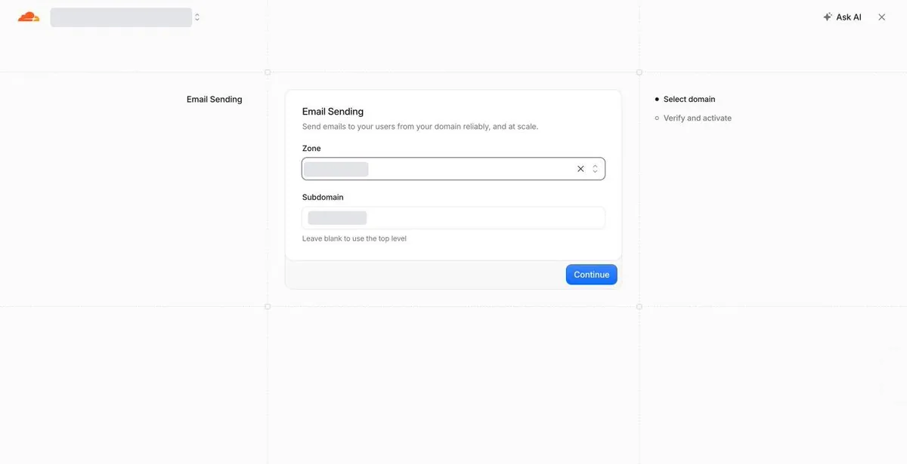

向导第二步是 Verify and activate。页面列出了将要写入域名的 6 条解析记录：

- 3 条 MX 记录，主机名是 cf-bounce.yourdomain.com，用来接收退信
- 1 条 SPF 的 TXT 记录，同样加在 cf-bounce.yourdomain.com 上
- 1 条 DKIM 的 TXT 记录，主机名是 cf-bounce._domainkey.yourdomain.com
- 1 条 DMARC 的 TXT 记录，主机名是 _dmarc.yourdomain.com，值是 v=DMARC1; p=reject;

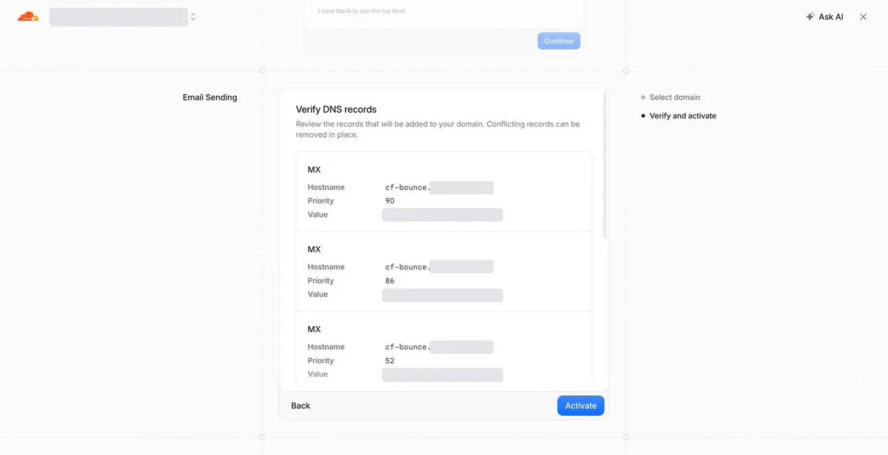

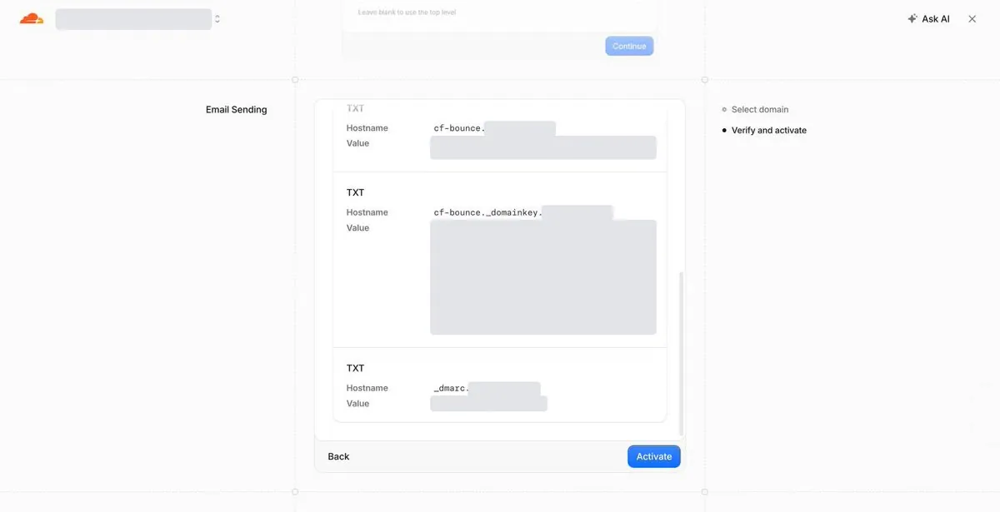

发信的 MX、SPF、DKIM 记录都放在 cf-bounce 子域下，和第 2 步加在根域名上的收信记录分开。

DMARC 记录的值要留意。p=reject 的意思是，发件人写着这个域名、却没有通过 SPF 或 DKIM 校验的邮件，收件方会直接拒收。别人冒用你的域名发信会被拦下。你自己通过没有给这个域名配置过校验的渠道发信，同样会被拒收。

点 Activate，页面跳到这个域名的 Overview。右侧 Sending status 显示 Enabled，DNS records 显示 Configured，发信域名开通完成。

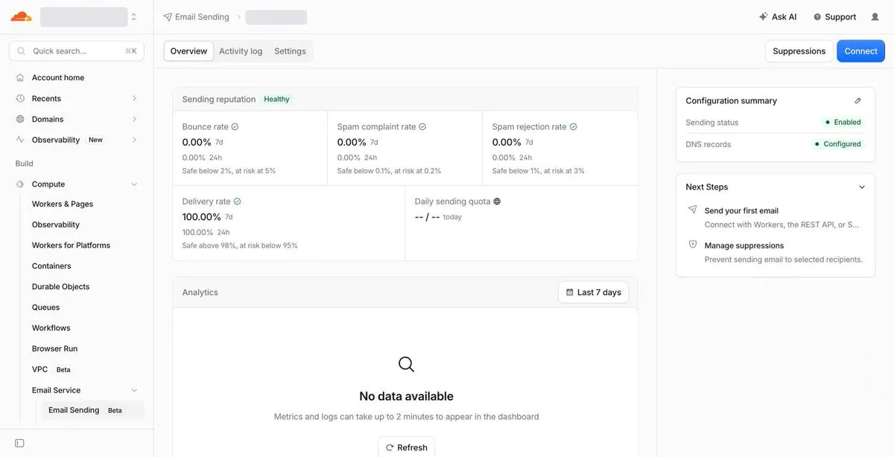

激活后我用 dig 查了 cf-bounce 子域的 MX 记录和 _dmarc 上的 TXT 记录，都已经生效。

Overview 上监控四个发信质量指标，每个指标都标了警戒线：

- 退信率：低于 2% 算安全，到 5% 有风险
- 垃圾邮件投诉率：低于 0.1% 算安全，到 0.2% 有风险
- 垃圾邮件拒收率：低于 1% 算安全，到 3% 有风险
- 投递率：高于 98% 算安全，低于 95% 有风险

刚开通时 Daily sending quota 一栏还没有数字，过了半个小时显示为 0 / 1000，我这个新账号每天可以发 1,000 封。添加发信域名之前只能发给账号里已验证的目标邮箱，添加完成后可以发给任意收件人。

### 第 8 步 创建 API 令牌

在域名的 Overview 页面点右上角的 Connect，进入 Connect to Email Service 页面。页面上有 Workers、REST API、SMTP 三个标签，对应三种发信方式。

切到 REST API 标签。Get an API token 下面有一个 Create Email Sending token 按钮。下方示例代码的接口地址里已经带上了账号的 Account ID，配环境变量时要用。

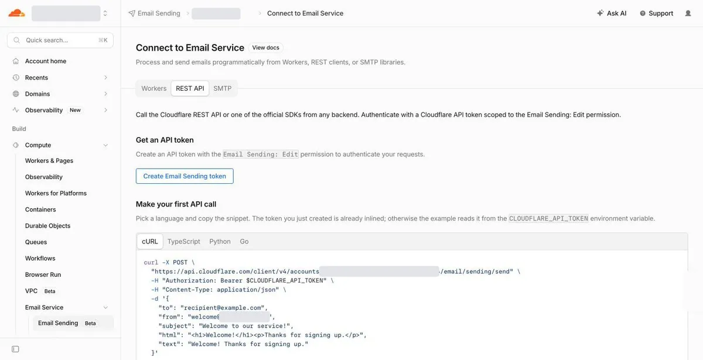

点 Create Email Sending token，右侧滑出 Create an Email Sending API token 面板。Permissions 已经预先选好 Account、Email Sending、Edit，Account Resources 选的是当前账号，填上 Token name。

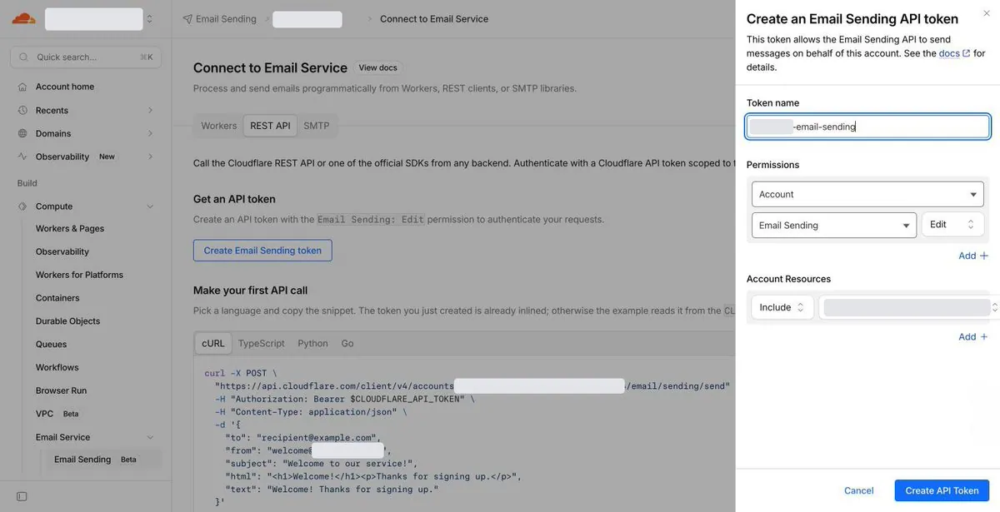

点 Create API Token，面板变成 API Token Created，提示 “Make sure to copy your API token now, this will not be shown again”。令牌只显示这一次，要当场点 Copy API Token 复制下来。新令牌同时会被填进页面下方的示例代码。

这个令牌要当密码保管。拿到令牌的人可以用这个账号下任何已添加的域名发邮件。令牌放在服务器的环境变量里，不要写进代码仓库。

### 第 9 步 发第一封邮件

Cloudflare 提供三种发信方式：Workers 绑定给本来就跑在 Workers 上的项目用，不需要 API 令牌；REST API 可以在任何服务器上调用；SMTP 留给只支持 SMTP 的现成程序和邮件客户端。

我的站跑在自己的服务器上，选了 REST API，网站不用搬到 Workers。REST API 标签下有示例代码，复制 cURL 那一段就能测：

```bash
curl -X POST \
  "https://api.cloudflare.com/client/v4/accounts/{account_id}/email/sending/send" \
  -H "Authorization: Bearer $CLOUDFLARE_API_TOKEN" \
  -H "Content-Type: application/json" \
  -d '{
    "to": "recipient@example.com",
    "from": "welcome@yourdomain.com",
    "subject": "Welcome to our service!",
    "html": "<h1>Welcome!</h1><p>Thanks for signing up.</p>",
    "text": "Welcome! Thanks for signing up."
  }'
```

成功时，接口返回每个收件人的投递状态：

```json
{
  "success": true,
  "errors": [],
  "messages": [],
  "result": {
    "delivered": ["recipient@example.com"],
    "permanent_bounces": [],
    "queued": []
  }
}
```

delivered 是已经投递的地址，queued 是排队稍后投递的地址，permanent_bounces 是永久退信的地址。

排查时先看 HTTP 状态码：401 是令牌缺失或无效；403 分两种情况，forbidden 是令牌没有发信权限，not_entitled 是账号没有 Email Sending 的使用资格；429 是触发了发送频率限制。

走 SMTP 的话，切到 SMTP 标签，Credentials 里列出了连接参数：

- Host：smtp.mx.cloudflare.net
- Port：465，隐式 TLS。587 端口的 STARTTLS 不支持
- Username：固定填 api_token
- Password：填第 8 步创建的 API 令牌

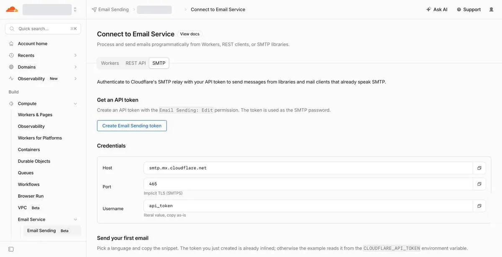

### 接进网站代码

我用的建站模板默认通过 Resend 发信。我加了一个 Cloudflare 的发信实现，发信的部分就是下面这个请求：

```typescript
const response = await fetch(
  `https://api.cloudflare.com/client/v4/accounts/${accountId}/email/sending/send`,
  {
    method: 'POST',
    headers: {
      Authorization: `Bearer ${token}`,
      'Content-Type': 'application/json',
    },
    body: JSON.stringify({ to, from, subject, html, text }),
  }
);
const json = await response.json();
if (!response.ok || !json.success) {
  throw new Error(json.errors?.map((e) => e.message).join('; '));
}
```

服务器上配两个环境变量：CLOUDFLARE_ACCOUNT_ID 和 CLOUDFLARE_EMAIL_API_TOKEN。

配好这两个环境变量并重新部署后，我在网站上用邮箱注册了一次。验证邮件进了 Gmail 的收件箱，没有被归到垃圾邮件，发件人显示为 support@yourdomain.com。

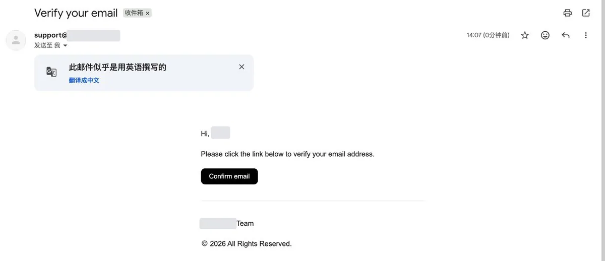

## Cloudflare 和 Resend 的选择

Resend 是很多建站模板默认的发信服务。它的免费档每月 3,000 封，每天最多 100 封，不花钱，模板代码也不用改，不过只支持 3 个域名。

Cloudflare 这边每月 5 美元，同样含 3,000 封。多出来的好处有三个：域名本来就在 Cloudflare，解析记录自动配好；整个账号的域名共用一份额度；5 美元里还附带 Workers 的计算额度。

只有一个站、只发注册验证邮件的话，Resend 免费档就够用。

收信这一半没花钱。从打开页面到规则生效，我手动填的只有 support 这个前缀和一个目标邮箱，解析记录都是 Cloudflare 自动加的。发信这一半每月 5 美元，添加域名时点 Onboard Domain、Continue、Activate 三个按钮，解析记录同样是自动加的。

## 相关页面

- [[sources/elliothux-open-source-cloudflare-workers-architecture]]
- [[sources/xaiwind-github-complete-beginner-to-master-guide]]
- [[concepts/overseas-tool-stack]]
- [[concepts/engineering-skills]]
