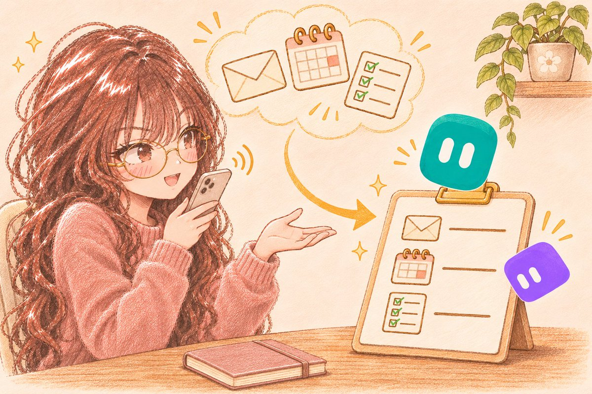

# Lauren Tan：Automate Anything with Grok Bot（原文）

> 自动化的思考方式：任何人都能学——系统地、有逻辑地思考，心里盯着一个目标，同时把事情拆成一小步一小步。它由两部分组成：目标与过程（做苹果派的例子）。文中还介绍 Dr Eggbot：把作者知道的关于自动化工作的一切都教给了它，让它帮你设计 bot。此条为英文原文，与本库已有的中文译文互为对照。

<!-- more -->

Automation can be surprisingly hard to get right, even for people who do it every day. I’d like to share how I approach it, at work and in my personal life, and how Grok Bot can help you take on more ambitious goals.

## A way of thinking

Automation is really just a way of thinking that anyone can learn. It's about thinking systematically and logically, breaking things down into small steps while keeping a goal in mind.

There are 2 parts to it: a goal, and a process.

An everyday example of this is baking an apple pie (the goal). You follow a recipe or process which has clearly laid out steps - buying and preparing the right ingredients, assembling the pie and decorating it, baking it, letting it cool, and so on. Or if you're replacing a flat tire (also a goal), you might need to find a way to jack the car up so you can reach the tire, find the tools to remove and replace it with a new one, and then put everything back together again.

Simply put, the goal is what you want at the end, and the process is how you get there.

Automation is the same thing: a goal and a process, but with the addition of something like a machine, like the ones a bakery might use to bake lots of apple pies. Or code, what software engineers used to write by hand to automate stuff that could be done by a computer. It's about breaking things down into steps towards a goal, then automating the process so you don't have to personally do it every time.

## Grok Bot is automation for everyone

Just a year or two ago, automation was limited to those with the technical know-how of how to build or put together machines or write code. With Grok Bot, automating anything that can be done with a computer is now in reach even for people who aren't technical or software engineers! And the really surprising thing is just how much computers can do, even on tasks that you might not think a bot is capable of doing.

You don’t need to know how to write code to start automating tasks with Grok Bot. You can describe what you want in plain English, then work with your bot to figure out the steps. Bots can write code for you, and use its own computer to do pretty much anything that you can do on your own computer or smartphone.

If you're not technical, I want you to suspend your disbelief for a moment. Bots really can do anything that you can do on a computer. It can move its own mouse around and click on things, install or connect to apps and software that you use everyday, browse the internet on its own browser, join meetings and take notes for you, and so much more.

And because so much of our work and life these days relies on technology, it means that more and more work can be done by a bot instead, freeing you up to focus on other things.

Start with the goal

To make this concrete, let's build a new bot together that will automate something for you. Go to Grok Bot, then make a new bot and give it any name you like. If you're struggling to find a name, just call it Potato and ask it to name itself later.

Before we start chatting with the bot: when I think about automation, I always start with thinking about the goal. What are we trying to do here?

One mistake I often see is that people confuse the process for the goal. For example, you may already have a well-defined process at work for the tasks that you do. But the goal is not to fill up a form, or to send an email. That's just a step in the process.

Instead, think about the goal at the end: what is this process for, and where does it fit into the business? Does it help increase revenue (eg processing a sale, building new features), or does it reduce costs (eg ordering just the right amount of inventory)? If you're not sure, chat with your manager or colleagues, or even ask Bot to help you figure it out!

Clarifying what the goal is the best place to start because it focuses you and Grok Bot on the end result. You may actually find that bots can figure out how to make the process more efficient too, so it's important not to be too attached to a specific process, since it's a means to an end after all.

Once you're figured out the goal, start by describing it to the new bot, then ask it to pick a name for itself if you'd rather not call it Potato.

"Hi Potato, this is the goal I want you to be responsible for: `<goal>`. Pick out a name and picture for yourself based on it."

Here are some starter goal ideas you can tell your bot:

- Save money towards buying a new car, house, college fund for my kids
- Schedule new customer bookings for my small business
- Improve my customer experience for my small business so they leave me good reviews
- Hire new employee for my small business
- Gather feedback for my product so I can make improvements to it
- Prepare slides for a weekly meeting
- Build new features for my product

If you're not quite sure how to describe your goal, ask Potato to help you! Tell it:

"Hi Potato, I'd like you to be responsible for a goal, but I'm not sure how to best describe it. Can you ask me some questions and interview me until we have a goal that I'm happy with?"

## The process

Once you've told it your goal, think about how you would achieve this goal if you were doing it, then ask the bot to see where it can make things more efficient. If you'd rather it do a task exactly following your process, you can tell it that too.

The best way to give bot this information is to use voice dictation in Grok Bot and speak for a while, brain dump everything it needs to know to do the job, and don't worry about the stream of consciousness or organizing your thoughts first. Tell it:

- The steps you usually take
- The things you watch out for and pay attention to
- The apps and tools you use to do it
- How you check that the work was done right
- Where you get the information you need to do it (eg email, Slack/Teams, a ticket, an app or website)
- Where you get feedback on how it went (eg customer feedback/review, feedback from colleagues)

"Potato, this is how I usually do this goal myself: `<process>`

I want you to think about how you can take this over completely from me. Before you begin, restate what you think my goal and process is in simple English so I can give you feedback and confirm it. I don't want you to start executing on this yet, let's focus on getting the process planned first."

Don't worry about getting it right on the first pass. Review what the bot says and then correct it by giving it more information. Once you've done this a few times, you should have something you're happy with. You can then tell bot to proceed, and to start connecting to the apps and tools it needs to do the job correctly.

If you're feeling ambitious, you can even ask it to review the process against the goal and see if it can think of a better or more efficient way to do it.

"Review our process against my original goal, and if you see a way to make it better or more efficient, let me know."

## Teach your bot how you think

One thing that's easy to forget when explaining a process is how much you do without really thinking about it. If you're booking customers, you probably know which services take longer, who can do each job, and when to leave extra time between appointments. These decisions might feel obvious to you, but your bot needs that context too. Think about what you're paying attention to when you do the task yourself, and what makes you do something differently.

Tell it where you get that information and how you check that the work is done right. For example, if an email and your booking system show different appointment times, which should it trust? A booking also isn't finished just because an email was sent. The appointment needs to be saved correctly and the customer needs a confirmation. If you're still waiting for details, have the bot keep track of that so it can pick things back up later without accidentally creating another booking.

Don't worry about explaining every possible situation upfront. Start with a few real examples, including ones where something went wrong or you had to do something differently. Ask the bot how it would handle them, then give it feedback. You can also ask it to help you figure out what you've forgotten to explain!

“Potato, help me figure out what I haven't told you about this process yet. Ask me questions about how I make decisions, where I get my information, how I check the work, and when you should ask me for help. Ask one question at a time, then walk me through a few examples so I can give you feedback before we automate this.”

## Let your bots improve themselves

Once your bot is performing the workflow, it's important to give it feedback so it can improve. The best way to do it is to equip your bot with the apps and tools it needs to get that feedback for itself. The way I approach this is to think about what I would do if it was me doing the task and I wanted to self improve.

For example, if your bot is managing new customer bookings for you, a way to let it improve itself is by letting it monitor your emails, social media, or Google/Yelp reviews for customer feedback. It can look out for that feedback and then take the initiative to propose improvements to your process.

Maybe a customer says on Yelp that they had to wait very long before someone could attend to them. If your bot can look up this information on Yelp for itself, and also look up any records you have for the customer that day, it could see what might have gone wrong.

In that sense, the more computerized your business is, the better for bots and automation. The availability of that data is what gives your bot the ability to come up with better improvements. And the best part is that Grok Bot can build tools for you to get this data! For example, if you're operating a car repair service, you could ask bot to build you an app that you can use on your computer and phone to log details about a customer visit.

If you log the time of:

- when they got to your shop
- when they were able to speak to a service rep
- when you took possession of their keys
- when service started and finished

You could work out how long they spent waiting and better diagnose why. This is just a simple example, but the key lesson here is that the more data you have available to Grok Bot, the better it can help you and your business and work.

Bots can also cross reference data across multiple sources if you have something like an ID - some kind of number or unique text like an email address that gives that data an identity. This could be a customer ID or email address, an order number, a part number, a barcode, an employee ID, and so on. If you use multiple apps and services, having unique and consistent IDs across all these tools will help you bring that data together so bot can fully understand what's going on.

## Making bots do work automatically

The next thing is, when should the bot do the work? Should it start when an email arrives, when someone sends a message, or on a regular schedule? In Grok Bot, you set this up with routines.

Without a routine, bots will only do the work when you ask them to. This is fine when you're first starting out with using bot, but if you want to streamline things, you'll want to figure out how to get the bot to do it automatically, so you're no longer the bottleneck.

Usually, the work happens with some kind of trigger like an email or Slack/Teams message. Or maybe it happens on a regular schedule, like once a week or every other day. Either way, if you ask your bot to set it up, it will!

## Install Dr Eggbot

I taught everything I know about automating work to Dr Eggbot, so if you want to start automating your work more, install it and ask it to help you! Dr Eggbot is a bot designer - it will create high quality bots for you.

https://x.ai/bot/rJW52lmFLtCvy2tSHcIag

Thanks for reading!

## 相关页面

- [[sources/maiyang-lauren-tan-grok-bot-automation]]
- [[sources/grok-bot-app-research]]
