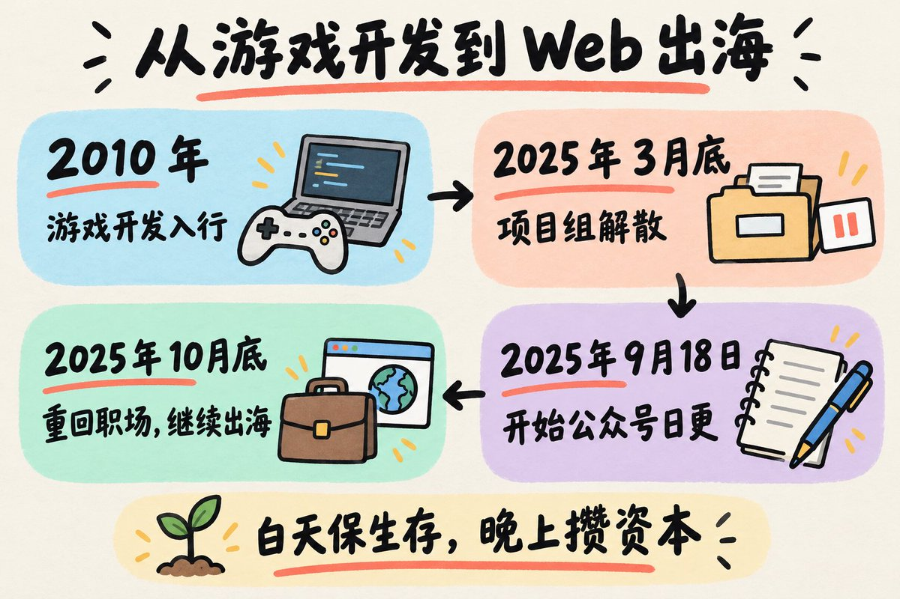
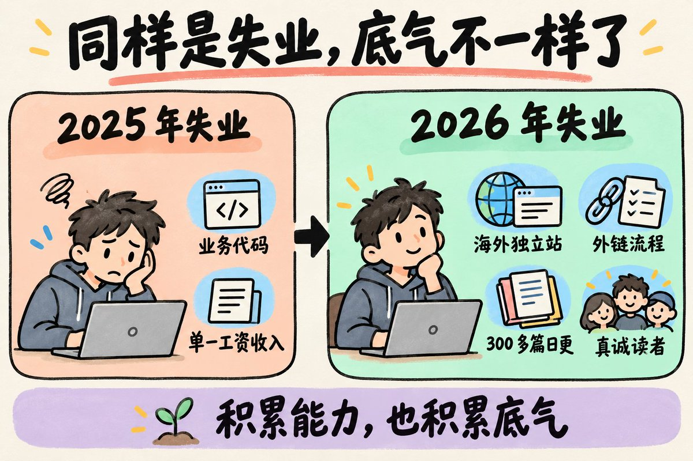
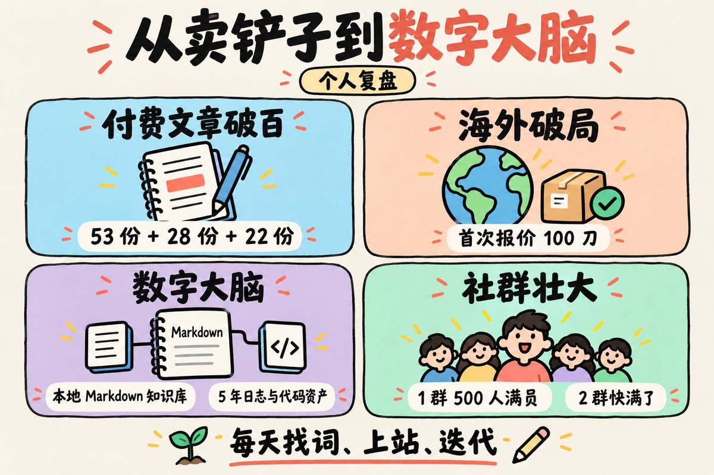
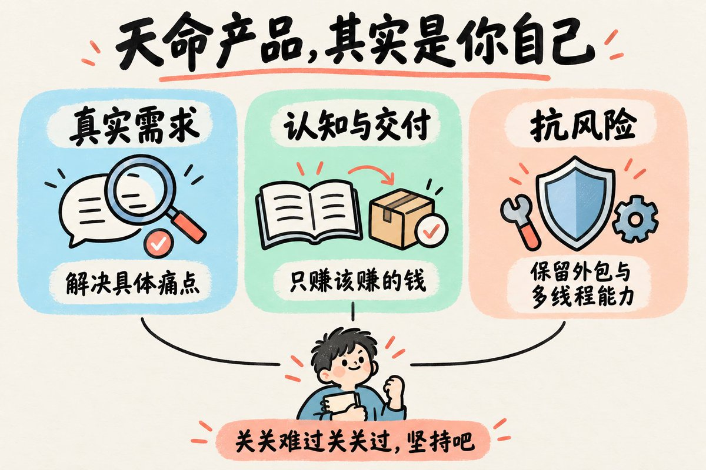

# 浅水虾（@qianshuixia2026）：从大龄失业 8 个月到出海破局——一个 14 年游戏老兵的年度全景复盘

> 浅水虾 2026 年 10 月 14 日的年度全景复盘：89 年出生、2010 年入行、14 年游戏开发一线，2025 年 3 月底任客户端主程的模拟经营加 SLG 项目因商业化数据未达预期被砍、项目组原地解散，此后整整 8 个月家里蹲。他解释选 Web 出海的原因：游戏行业动辄几百上千万成本、要版号要团队要买量，个人玩不起，而工具站单兵作战、面向全球赚美金、靠 SEO 和自然流量沉淀为睡后资产。起步极寒酸——所谓「出海收入翻了 70 多倍」其实只是从 0.01 刀涨到 0.77 刀，期间经历过 AdSense 被拒、被封、限流和几周零点击；练手站做到谷歌第一页第四名。2026 年 7 月 28 日前司宣布小游戏项目现金流短缺、7 月 31 日最后一天上班，第二次失业他却「一点都不慌」，因为手里有跑通的海外独立站、自研外链流程和一年积累的 300 多篇真实日更。拐点数字：公众号付费文章累计卖出上百份，《自动化外链》53 份，另两篇分别 28 份和 22 份；第一次给老外报 100 刀对方秒付款；出海 1 群 500 人满员、2 群快满。他的两条核心结论是「单一工资收入是极度脆弱的假象」和「AI 只是放大的 0，你自己才是那个最核心的 1」，并反思曾跟风配置多智能体互跑、两个 Bot 在后台死循环刷屏只浪费 Token。

<!-- more -->

大家好，今天是 2026 年 10 月 14 日，周三。

昨晚整理笔记的时候，又翻到了 2024 年底我在笔记本里摘录《穷查理宝典》的那句话：

> “生活最大的悲哀在于，我们总是老得太快，而又聪明得太慢。”

当年每天清晨 6 点半赶早高峰公交、被颠得反胃的时候读到这句话，只觉得写得真透彻；

直到经历了这几年的风浪，才真正体会到这句话有多扎心。

不知不觉，从去年 9 月 18 日写下第一篇日更《35 岁的我，失业半年了》到现在，我这个公众号居然整整写满一年多了。

最近后台加我微信的兄弟特别多，群里新来的虾友也常私聊问我：

“虾哥，你之前到底是干啥的啊？”

“怎么一个干了十几年的老程序员，突然跑来搞 Web 出海了，还天天逼着自己日更？”

平时在文章里我都是零零碎散提几句，从来没有正儿八经展开聊过。

择日不如撞日。

今天索性不聊具体的技术和工具，彻底掏心窝子，跟各位虾友完完整整复盘一次我这 14 年的职场路径，以及这一年做出海的真实心路历程。

不怕大家笑话，因为今天全都是大实话。

## 一、十四年游戏老兵：从“大作梦”到买量换皮

在搞 Web 出海之前，我在游戏开发一线整整摸爬滚打了 14 年。

2010 年入行，最早在广州写 Java 服务端，后来一头扎进游戏客户端 / 前端开发。

从页游时代的 ActionScript 3.0，一路干到手游和 H5 时代的白鹭、Layabox、Cocos。

做过 ARPG、做过 SLG、做过卡牌、做过捕鱼，中间甚至还碰过一阵子海外链游。

年轻的时候，谁还没个大作梦呢？

那时候满腔热血，总想着有朝一日能参与做出一款像《魔兽世界》那样名垂青史的伟大作品。

但现实往往很骨感。

十几年里，大部分时间都是在跟各种祖传代码搏斗，在各种买量换皮游戏里反复打转。

我自己甚至都不爱玩自己参与做出来的那些换皮游戏。

后来，我跳槽去了一家业内比较出名的公司当客户端主程，带着团队从零开始攻坚一款模拟经营加 SLG 的项目。

每天早晨 6 点半起床洗漱赶公交地铁，小闺女拉着我的衣角哭着唠叨“不要爸爸去上班”；

早高峰坐公交颠得恶心反胃，颈椎受损，严重腰疼，2025 年春节回老家过年，初一到初九因为腰痛只能趴着休养……

但只要项目能成，这些身体上的苦咬咬牙也就忍了。

结果呢？

2025 年 3 月底，现实直接当头给了我一记闷棍：

项目因为商业化数据未达预期，高层决定直接砍掉，整个项目组原地解散。

## 二、八个月家里蹲：中年失业与 0.01 刀的破晓

其实失业这事，在我十几年的职业生涯里经历过很多次，大家看我的履历也能看出来，在游戏圈打滚的人，项目解散换地方是家常便饭。

但是 2025 年 3 月底那次，完全不一样。

经济下行，大环境非常差，整个游戏行业都在缩紧。再加上我自己也早已过了 35 岁的坎（89 年出生的我，一晃眼都 37 了），大龄程序员在市场上有多被动，懂的都懂。

公司解散后，我投出去的简历基本上全都石沉大海。

两个女儿要养，广州的房贷每月雷打不动要扣，上有老下有小。

整整 8 个月家里蹲，整个人“内心慌得一批”。

也就是在那段极度焦虑的至暗时刻里，我痛彻心扉地领悟了一件事：

单一工资收入是极度脆弱的假象。

在公司里，哪怕你代码写得再溜、当上主程把祖传架构重构成花，大势一变、项目一砍，你在公司财报上不过是一行必须被优化的成本。

如果你自己没有亲手获取流量、从外部赚到钱的能力，所谓的“稳定”就是一张薄纸。

可能大家会问：既然要搞副业，为什么选择 Web 出海这条赛道？

说白了，原因很简单：

游戏行业太重了，动辄几百上千万成本，要版号、要团队、要买量，个人根本玩不起。

而 Web 工具站是典型的轻资产：单兵作战，面向全球赚美金，靠 SEO 和自然流量能够真正沉淀为睡后资产。

2025 年 9 月 18 日，在家里蹲了半年、心态极度煎熬的时候，我敲下了第一篇文章，把公众号当成了自己的树洞和救命稻草。

当时我每天在家里瞎忙，学 AI、学 SEO、做练手网站，居然做到了谷歌第一页第四名。

那时候看哥飞的公众号学到了很多，飞哥算是我出海上站的贵人，也是我的精神导师。

当时我手头拮据，甚至不好意思进飞哥的付费社群。跟飞哥聊的时候，飞哥很真诚地劝我：先养活自己，然后再想其他。

10 月底朋友内推，我进了一家小游戏公司继续当前端主程。

白天当牛马搞钱保生存，晚上回家死磕出海攒资本。

刚开始做站有多寒酸？

出海收入翻了 70 多倍，其实只是从 0.01 刀涨到了 0.77 刀……

但即便每天只赚 0.1 美金，我都开心得像个孩子。

经历过 AdSense 被拒、被封、限流，经历过站点几周没有一个点击的漫长绝望，但这一次，我没有退路。

## 三、踩坑全自动化与第二次裁员：心态彻底蜕变

在摸索出海的过程中，我也走过不少弯路。

有一阵子我跟风沉迷各种“全自动化”概念，甚至配置了多智能体相互跑。

结果发现两个 Bot 在后台死循环疯狂刷屏，除了浪费 Token，没有任何业务增量。

我果断把那些花架子全卸了。

AI 只是放大的 0，你自己才是那个最核心的 1。

动起手来，肉身下场去挖词、去分析需求、去写代码，所有问题都不是问题；不动手，全指望自动化，那一切都是伪勤奋。

转折点发生在今年 7 月底。

2026 年 7 月 28 日，前司宣布小游戏项目现金流短缺，无力继续。

7 月 31 日最后一天上班，散伙饭喝到宿醉。

我又一次失业了。

但是这一次，奇迹般地，我内心一点都不慌了。

> 相比较去年那次失业而言，我的心态和底气已经好了很多。

为什么？

因为去年失业时，我手里除了几行随时会被淘汰的业务代码，一无所有；

而今年失业时，我手头有跑通的海外独立站、有自研的外链流程、有一年积累的 300 多篇真实日更，还有一群一路陪我走过来的真诚读者。

从 8 月底开始，我把发文时间提前到早晨 7 点：

再不自我拯救，浅水虾真的就要被煮成“红壳虾”了。

## 四、拐点降临：从卖铲子到数字大脑

置之死地而后生。

这两个月多线程折腾下来，业务迎来了意想不到的爆发：

1. 付费文章破百：公众号相关的付费文章累计卖出了上百份，其中《自动化外链》卖出 53 份，另外两篇付费文章分别售出 28 份和 22 份；
2. 海外破局：第一次随手给老外报了 100 刀，对方秒付款，第一次切身体会到海外对效率工具的付费意愿；
3. 数字大脑：我用本地 Markdown 搭建了自己的知识库，把散落在各处 5 年的几百篇日志和代码资产全部盘活；
4. 社群壮大：我们的出海 1 群 500 人迅速满员，连我的精神导师哥飞都进群发了大红包肯定成绩，现在 2 群都快满了。

从最开始每天盯着 0.01 刀看半天，到现在真正跑通了属于自己的闭环。

这一切不是靠什么玄学，就是靠每天笨拙的找词、上站、迭代，每天老老实实面对现实。

## 五、未来方向：你真正的天命产品，其实是你自己

经常有朋友在后台问我：虾哥，你接下来打算怎么做？

其实我的原则非常简单：

第一，不盲目跟风，坚决不做自己不懂的虚假需求。大站和虚火的需求我不碰，只死磕真正能解决具体痛点的小众垂直需求。

第二，搞钱要有底线，坚决不割韭菜。加我微信的人再多，社群依然坚持免费开放。钱谁都想赚，但我只赚该赚的钱，靠认知和交付自然变现。

第三，手头依然保留外包与多线程能力。成年人的世界不是非黑即白的选择题，抗风险永远放在第一位。

上个月写过一句话，我特别喜欢，今天送给大家也送给我自己：

“10 年敲代码不如 1 年做出海。你真正的天命产品，其实是你自己。”

敲了 14 年代码，我花了整整一年才明白：

所有写过的框架、踩过的坑、调过的模型、赚过的美金，最终都是为了蒸馏沉淀到你自己身上。

现在的隐忍、克制、苦哈哈地搞钱，都是为了给将来的“任性”攒资本。

路还要继续走，关关难过关关过，坚持吧。

## 相关页面

- [[patterns/ai-unemployment-pattern]]
- [[concepts/ai-local-brain]]
- [[sources/gefei-seo-selling-courses-community]]
