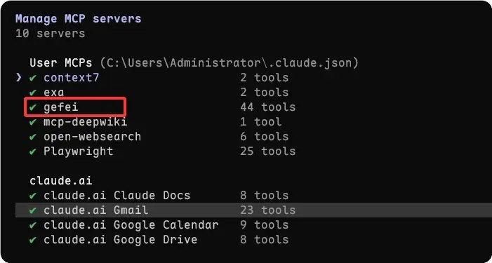
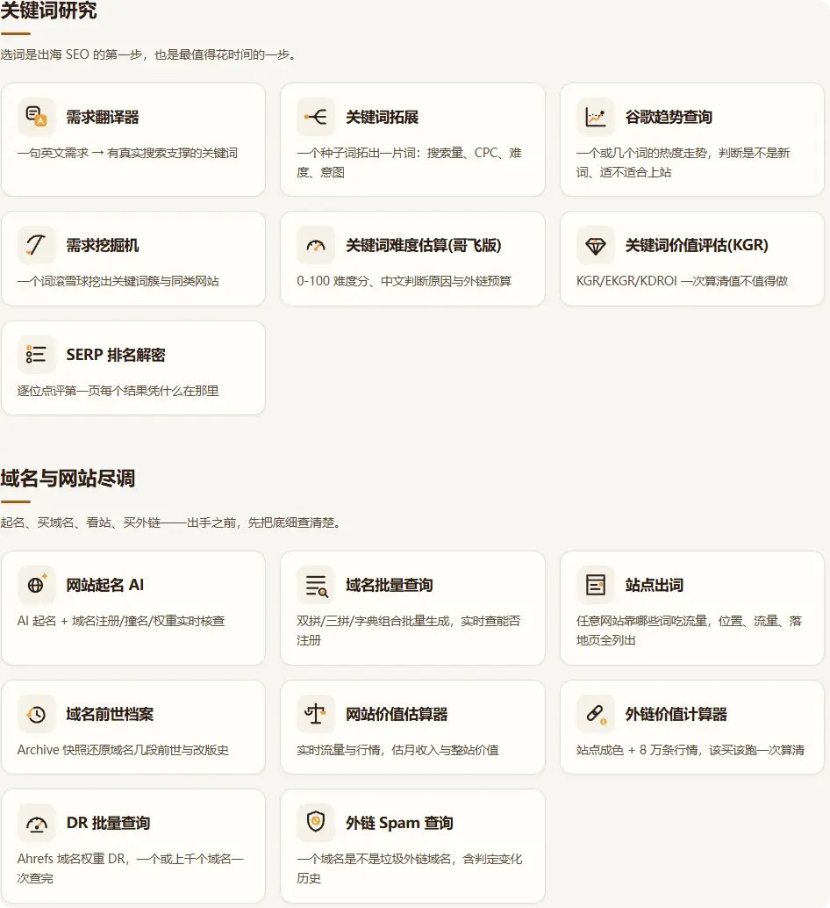
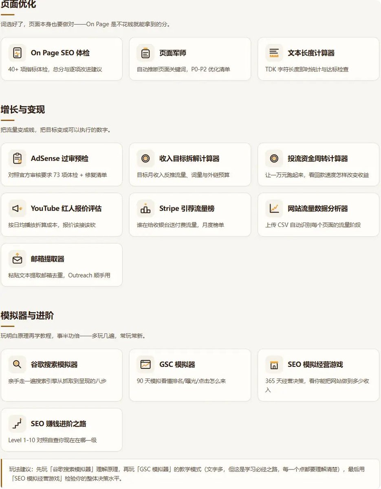
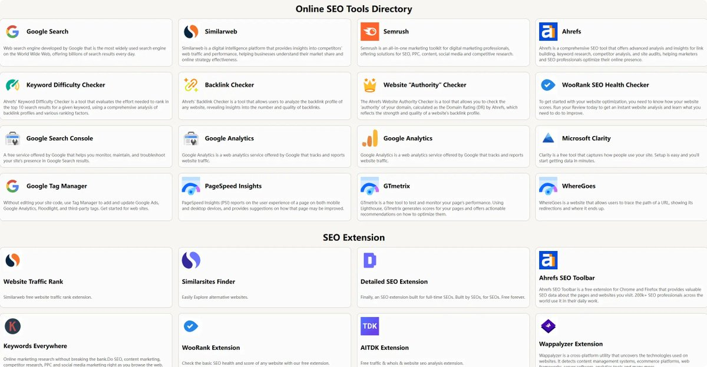

# 浅水虾（@qianshuixia2026）：把哥飞 SEO 接进 Claude Code——警惕 AI 时代的精力陷阱与两条腿走路

> 独立开发者将哥飞 SEO Agent 接入 Claude Code 的实战手记：实现查词、审站与 GEO 优化一键流式处理。深入反思 AI 编程时代的「精力陷阱」：一人包揽前后端看似高效，多开 4-5 个窗口人脑认知极易过载卡死；与其盲目折腾未成熟的 super-agent，不如坚持「左手项目保现金流，右手上站」的双轮稳妥策略。

<!-- more -->

大家好，今天是 2026 年 11 月 3 日，周二。

前天加入哥飞社群之后，我优先将哥飞社群的 SEO Agent 接入到了我的 Claude Code 中。

当然，这里需要提醒一下，如果是使用 API 调用哥飞这些 SEO 工具的话，赠送的积分是没办法用的，只能自己付费购买。会员的话，50 块钱 2000 积分，可以用好久了。

通过这些工具，就可以对网站的 SEO，GEO，流量，关键词等等进行相关的评审和优化了。

不过这里要再次提醒一下，API 调用的相关 SEO 数据是有缓存的，所以需要大家进行交叉验证。

这里还有一个 SEO 相关工具的站点 seo.box，大家可以直接复制到浏览器输入，都是一些比较常规的工具。

## 个人 + Agent 增长系统：新站尝试与出单心愿

然后这两天还在推特上面看到 Manus 的大佬胡二虎的分享，搭建个人 + Agent 的增长系统。

引用推文：Will Hu 🐯 胡二虎 (@willlhhh)

Hello，我是二虎🐯，也可以叫我 Will。 2021 年毕业后一直在创业公司做 SaaS 出海。做过 3 年产品经理，现在在 Manus 负责广告和 SEO，也兼职干点商业化产品经理的活。 3 年前立的 flag 还在：希望自己能在 AI 这件事上热爱 10 年。 重新介绍一下自己。先聊聊我现在最关心的 Agent、广告和 SEO，再讲这些想法是怎么一路长出来的。 01 / Agent：我的新职业，可能是制造员和驾驶者 我越来越相信：以后一个负责经营和增长的组织里，Agent 的数量会比人多。 我想象中的样子是：投放调价、SEO 维护、素材分...

https://x.com/willlhhh/status/2116823249497768270

其实我最近也一直在尝试，只不过一直都是在摸索。

当然，目前还没有啥成绩，所以我也一直都没有拿出来说。

但是看到大佬已经拿到实际的结果了，我的信心就更大了。

总之，继续完善吧，最近新站的增长就在尝试这么搞，坑非常多，要补充的也非常多，慢慢来吧。

现在就希望今年过年之前能破除不能出单的魔咒，给我自己增加点信心 Orz。

## 拒绝陷入“精力陷阱”：两条腿走路才最稳妥

朋友那边的项目，因为有 AI 加持，我现在前后端的功能直接一起开发了，今天也是高强度的折腾了一天，脑子要裂开咯。

虽然有了 AI，但是感觉自己比以前更忙了，并没有因为 AI 的提效而闲下来。

但是目前因为个人精力的问题，同时最多也就盯着 4、5 个窗口，再多人的脑子就要分裂，或者某些任务完成之后就停滞在那里，直到你想起来才回去继续安排。

这也是 DeepSeek 最近这两天发文谈到的 super-agent 了。

当然，我已经对研究这个没兴趣咯，坐等大佬把工具做好端出来，我们再去用得了。否则，又只会让自己陷入新的精力陷阱中。

对我来说，当下就两件事：左手游戏开发，右手上站。两条腿走路才是最稳妥的，毕竟真的非常需要现金流。

https://new.web.cafe/r/MAD2N7

好咯，今天就到这里啦，我们明天见。

## 相关页面

- [[sources/gefei-products-remade-for-ai-via-mcp]]
- [[sources/willhu-wigent-ai-growth-system-and-agent-pilot]]
- [[concepts/gefei-seo-keywords]]
- [[concepts/cognitive-load-three-element-model]]
