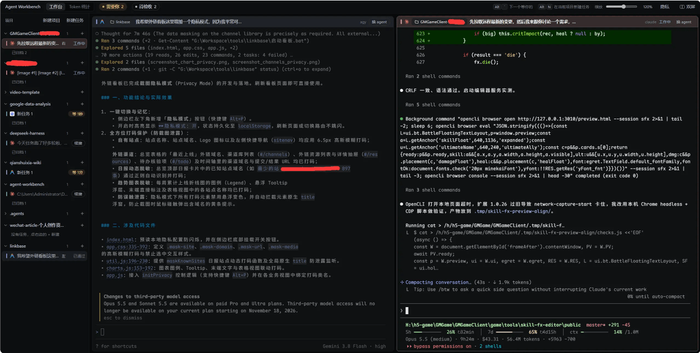
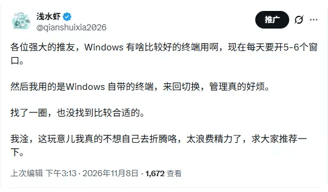
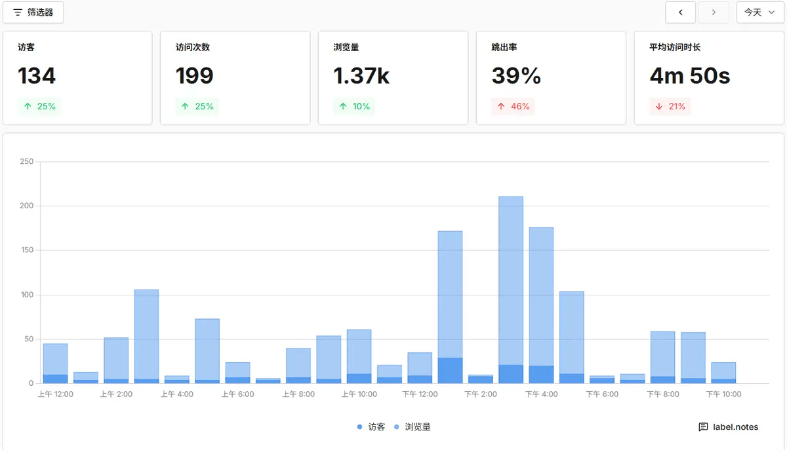
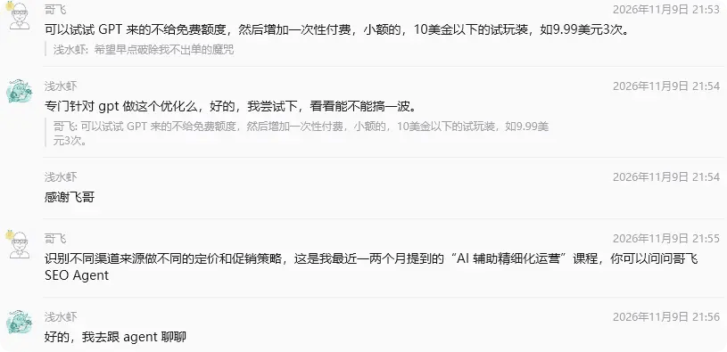

# 浅水虾：被 GPT 推荐却不出单？流量来了之后改了积分规则

> 新站被 GPT 推荐带来流量、谷歌也跟曝光，却零开单：请教哥飞后按渠道分组（GPT vs 其他）调整积分规则；同时分享他自研的多会话终端管理工具（类似 Warp 但对 Windows 友好，96GB 内存下闪崩无碍）。

<!-- more -->

大家好，今天是 2026 年 11 月 10 日，周二。

这两天又折腾了一个新的工具，起因是我现在每天同时开着一堆会话窗口，管理起来太烦了。

我也使用了类似于 Warp 这类工具，但是普遍对 Windows 的优化都不太好。

我特喵的 96 GB 的内存，Warp 也会直接闪崩。

没办法的情况下，我在推特上面吼了一嗓子，希望大家推荐一些工具。

大家五花八门，推荐了好多。

诸如 Xshell、Herdr、Orca 等，我看了一下，最终决定还是自己使用 AI 撸一个出来。

我的想法是终端部分只使用各大厂商自家的 CLI，然后我自己再往上抽象一层，能够方便地按照项目进行分类来对所有的终端进行统一的管理。

后续我应该还会接入手机端，到时候如果外出，我就不用背着一台笔记本远程操作了。

这个工具，等我打磨好了，我再开源出来吧，有兴趣的朋友可以蹲一波，没兴趣就无视。

## GPT 推荐带来流量！谷歌也跟着给曝光了

再一个好消息就是新站被 GPT 推荐咯，目前已经有流量了。

因为 GPT 的推荐，带动了网站数据的上涨，所以谷歌这边也给了曝光，也有了一些点击。

## 有流量却不出单？请教哥飞后的转化调整

但是依然还是没有出单，特喵的，抓狂。

然后我去问了飞哥，飞哥做了如下解答：

然后我去找哥飞 SEO Agent 交流了一番。

最终按照建议针对流量来源进行了分组，目前粗暴一点就是 GPT 和其他，给予不同的积分规则。

如果还不能开单，那我感觉可能就是我产品没做到位，再打磨打磨。搞定了流量和产品，我不信我就真的开不了这个单了。

当然，现在流程依然还在优化中，具体的再看吧。

好咯，今天就到这里啦，我们明天见。

我是浅水虾，记录出海建站路上的真实折腾，踩过的坑都写出来。

