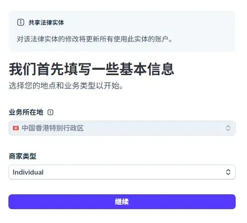
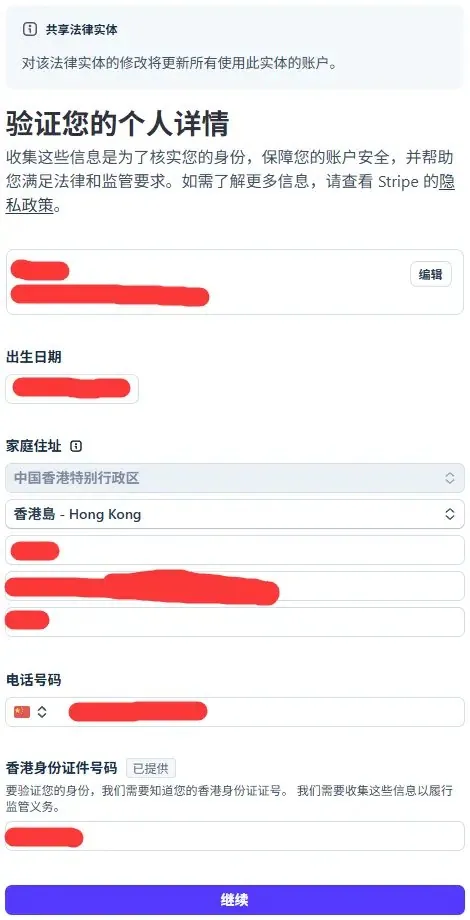
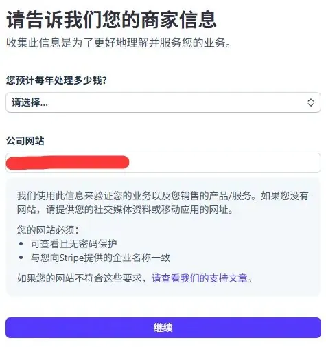
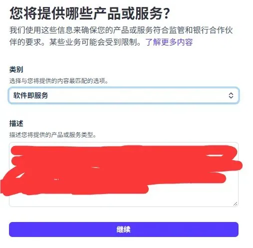
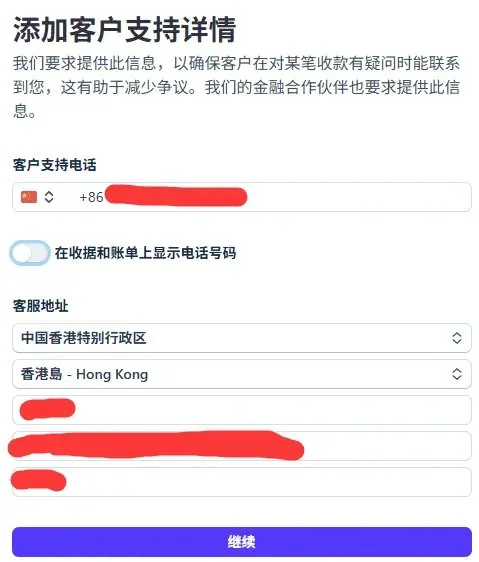
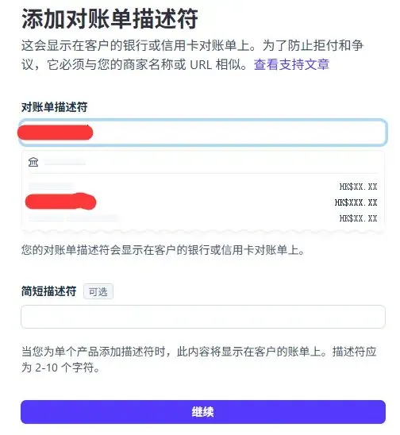
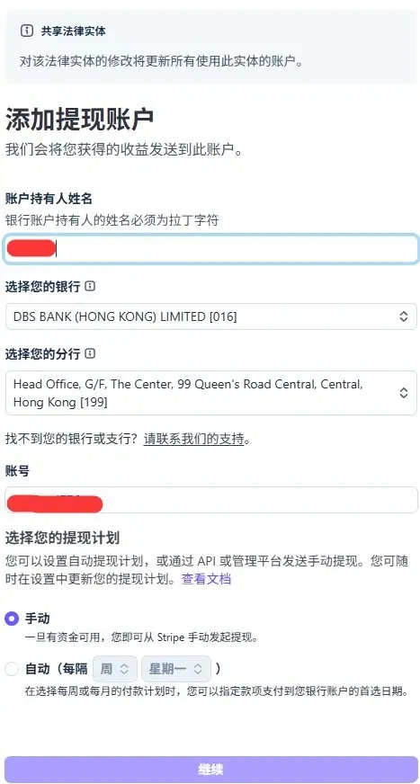
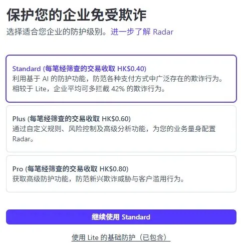

# 浅水虾（@qianshuixia2026）：Wise 港卡搞定 Stripe！避开号码泄露，送大家出海“三通一达”

> 出海独立开发者收款基础设施的极简低成本跑通方案：利用 Wise 配合香港银行卡搞定 Stripe 验证；分享虚拟手机号防泄露安全隔离技巧、解决注册地址与身份验证的“三通一达”合规闭环，帮助普通人平稳迈出海外收款第一步。

<!-- more -->

大家好，今天是 2026 年 10 月 19 日，星期一。

昨天为我的新站开通了 Stripe 支付，以后新站优先使用 Stripe 收款。至于 Waffo 等其他收款平台，我也会逐个加进来。

现在我把 Stripe 接入流程稍微记录一下，权当笔记，也算是给大家一个参考。

## 手把手笔记：用 Wise 港卡注册 Stripe 的关键细节

首先是商家类型，选择个人就行。

业务所在地就按照你开的卡所在地来选，我这里是 Wise 的港卡，所以选择就是香港。

然后是个人详情，香港身份证件号码这里填的是个人护照，号码就填国内的电话号码，住址我是填的银行地址。

反正个人信息尽量按照真实数据来填，不要乱填哈。

然后验证身份的时候，直接使用个人护照就行。

商家信息这里填你网站地址即可：

产品或者服务这里选择软件即服务，也就是 SaaS。

公开详情这里记得把客户支持电话给去掉，否则你的电话就暴露出来了。

对账单描述这里描述符记得跟域名差不多或者相同，不要乱填。

提现账户这里填你能提现的银行卡信息即可，我这里是 Wise 港卡，所以填的就是 Wise 港卡银行地址：

欺诈防护选最低的，然后去网上找一些公开的规则，自己填进去就可以了。

## 祝大家出海“三通一达”：通道顺畅，早日出单

弄完以上这些，就可以点击提交审核啦。

审核过了之后就等着收款了，前提是网站已经获得了流量、有了实际的用户，哈哈哈。

祝大家收款通道永远畅通，用户付款永远畅通，提现永远畅通，最终达到自己的预期目标。

这个“三通一达”就送给大家，哈哈哈。

好咯，今天就到这里了，我们明天见。

## 相关页面

- [[sources/noahduck-stripe-complete-guide-from-beginner-to-advanced]]
- [[sources/xiaoer-global-payout-without-hk-company]]
- [[concepts/overseas-tool-stack]]
- [[concepts/b2c-conversion]]
