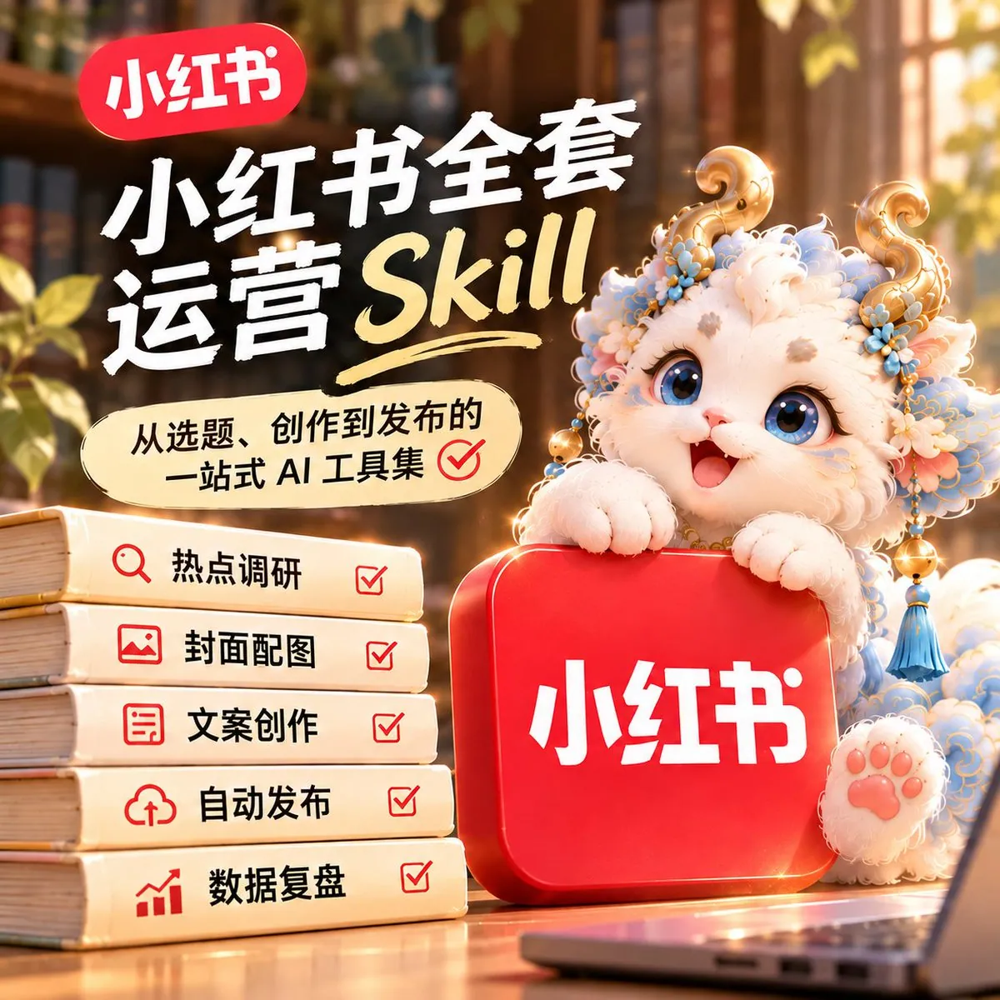
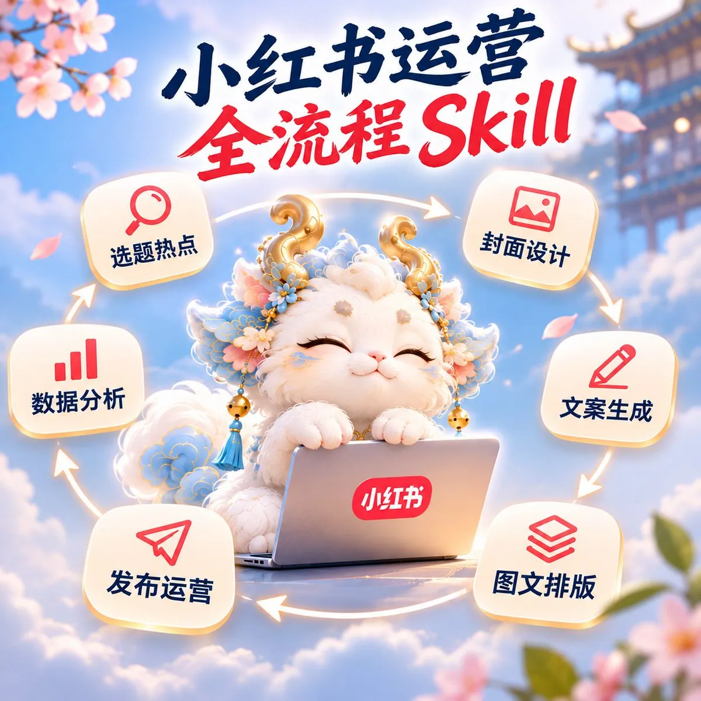

# 柒晨（@qichen1019）：小红书全套运营 Skill 清单——12 款工具串起调研、写作、做图与分发

> 小红书全套运营 Agent Skill 清单汇总：从热点跨平台调研（Agent-Reach）、图文卡片生成（baoyu-xhs-images、guizang-social-card-skill）、排版发布与账号操作（xiaohongshu-mcp、XiaohongshuSkills）、多平台批量分发（social-auto-upload），到选题策略数据诊断（xiaohongshu-ops-skill）与竞品笔记采集（xhs-cli），12 款开源工具与工作流串联方案。

<!-- more -->

小红书全套运营 Skill

1. 热点联动与跨平台调研｜Agent-Reach
   Star：约 107.2k
   功能：搜索和读取小红书、X、YouTube、B 站等平台内容。
   适合人群：需要追踪热点、寻找选题素材和观察跨平台趋势的人。
   简介：作为运营工作流的信息采集层，帮助发现近期热门话题和用户讨论。
   链接：https://github.com/Panniantong/Agent-Reach

2. 封面配图与图文卡片｜baoyu-xhs-images
   Star：所属仓库约 27.1k
   功能：把文章拆成 1～10 张小红书封面和内容卡片。
   适合人群：知识博主、教程类账号、AI 内容创作者。
   简介：支持多种视觉风格、布局、配色和水印，可直接生成系列图文。
   仓库：https://github.com/JimLiu/baoyu-skills

3. 排版发布与账号执行｜xiaohongshu-mcp
   Star：约 16.7k
   功能：登录、搜索笔记、获取详情、发布图文和视频。
   适合人群：需要让 AI 实际操作小红书账号的人。
   简介：负责工作流最后的执行环节，可连接 Codex、Claude 等 Agent 完成上传和发布。
   链接：https://github.com/xpzouying/xiaohongshu-mcp

4. 多平台分发｜social-auto-upload
   Star：约 16.0k
   功能：自动向小红书、抖音、视频号、B 站、TikTok 和 YouTube 上传视频。
   适合人群：短视频矩阵、多账号和多平台运营团队。
   简介：负责成片后的批量分发，减少在不同平台重复上传的时间。
   链接：https://github.com/dreammis/social-auto-upload

5. 图文卡片与高级排版｜guizang-social-card-skill
   Star：约 7.9k
   功能：生成小红书轮播图、知识卡片和公众号封面对。
   适合人群：重视排版质感和视觉统一的内容创作者。
   简介：内置编辑风、瑞士风等视觉体系，提供 28 种版式和 10 套主题。
   链接：https://github.com/op7418/guizang-social-card-skill

6. 发布互动与账号操作｜XiaohongshuSkills
   Star：约 3.5k
   功能：搜索、发布、评论和自动化互动。
   适合人群：Codex、Claude Code 和 OpenClaw 用户。
   简介：把小红书常见操作封装成 Agent Skills，适合作为自动运营的执行工具。
   链接：https://github.com/white0dew/XiaohongshuSkills

7. 选题策略与数据诊断｜xiaohongshu-ops-skill
   Star：约 2.5k
   功能：推荐流分析、账号诊断、选题生成、爆款拆解和数据复盘。
   适合人群：已有账号、但选题散乱或数据不稳定的运营人员。
   简介：结合账号定位、历史表现和平台内容，生成选题并找出数据差异原因。
   仓库：https://github.com/Xiangyu-CAS/xiaohongshu-ops-skill

8. 文案生成与全链路创作｜Auto-Redbook-Skills
   Star：约 2.4k
   功能：生成标题、正文、封面、内容卡片并完成发布。
   适合人群：想快速跑通小红书图文创作流程的新手。
   简介：从主题输入到最终发布基本都能覆盖，适合作为一体化内容生产工具。
   Skill：https://github.com/comeonzhj/Auto-Redbook-Skills

9. 搜索采集与发布互动｜xiaohongshu-skills
   Star：约 2.0k
   功能：搜索笔记、获取内容、发布作品和评论互动。
   适合人群：需要一套小红书基础自动化能力的用户。
   简介：偏平台操作层，可与选题、文案和视觉 Skill 组合使用。
   链接：https://github.com/autoclaw-cc/xiaohongshu-skills

10. 封面策略与视觉导演｜xhs-visual-director-skill
   Star：约 1.5k
   功能：确定视觉方向、图文页数、封面结构和逐页配图方案。
   适合人群：会写内容但不会规划封面和图文视觉的人。
   简介：先分析内容任务，再输出封面、逐页画面、绘图提示词和发布自检清单。
   Skill：https://github.com/ziguishian/xhs-visual-director-skill

11. 封面设计与人物一致性｜gbro-cover-design
   Star：约 937
   功能：生成 3:4 小红书封面构图与绘图提示词。
   适合人群：需要真人出镜封面、保持人物形象一致的账号。
   简介：通过分步提问确认主题、风格和人物要求，再输出封面方案。
   链接：https://github.com/pyang5166/gbro-cover-design

12. 竞品调研与笔记采集｜xhs-cli
   Star：约 675
   功能：搜索、阅读、点赞、收藏、评论和获取小红书内容。
   适合人群：做竞品分析、爆款采集和互动研究的人。
   简介：可作为选题策略前面的数据采集工具，把热门笔记交给分析 Skill 继续处理。
   链接：https://github.com/jackwener/xhs-cli

## 相关页面

- [[sources/lucaspei-ai-xhs-notes-skill-pipeline]]
- [[sources/dongqing-xhs-product-selection]]
- [[concepts/xhs-product-selection]]
- [[patterns/wechat-image-post-account-sop]]
- [[sources/anhao-1439-ai-beauty-poses-database]]
