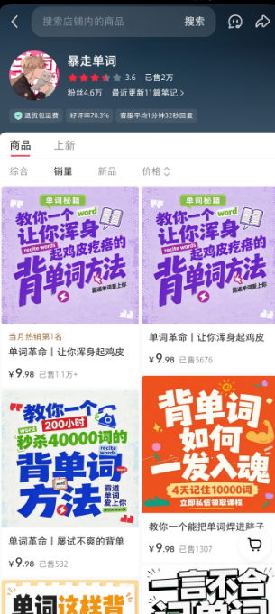
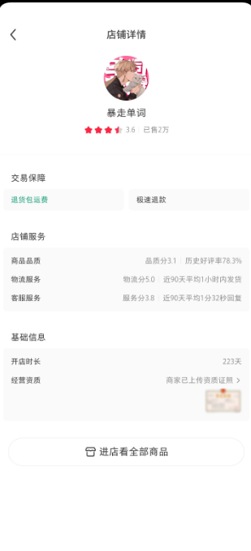

# 启航（@qihang_zeng6688）：靠卖高效背单词资料，小红书虚拟店 223 天卖出 2 万单、总营收 20 万

> 一个具体到可复算的小红书虚拟店案例：售卖的虚拟商品是「高效背单词资料」，开店 223 天、客单价 9.98 元、累计售出 2 万单，意味着总营收约 20 万元、平均月入约 2.6 万元；文章附店铺截图与选品思路。

<!-- more -->

这家小红书虚拟店铺

靠售卖高效背单词的资料赚钱

开店 223 天

客单价 9.98 元

一共售卖了 2w 单

意味着总营收 20w 元

平均一个月赚了 2.6w 元

你觉得这个收入怎么样？ https://t.co/XODtdFqhDo

https://t.co/3gkrB5Yrvj

## 相关页面

- [[sources/qihang-zeng-xhs-virtual-1-year-8-stores-60k-month]]
- [[sources/dongqing-xhs-product-selection]]
- [[concepts/selfmedia-compound-model]]
- [[concepts/digital-products-side-income]]
