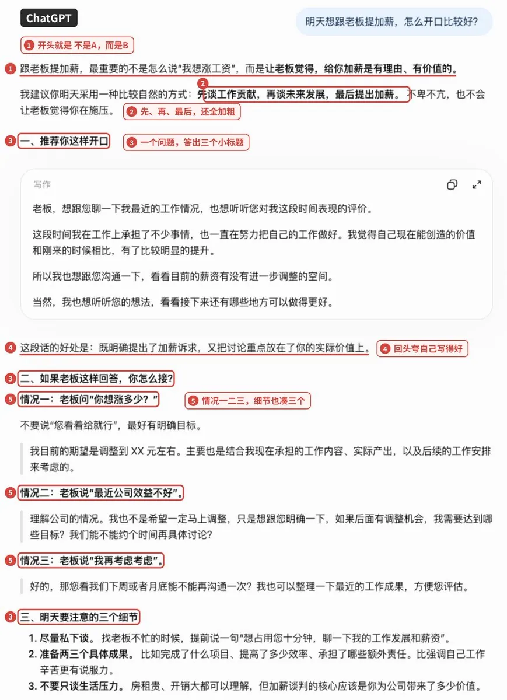
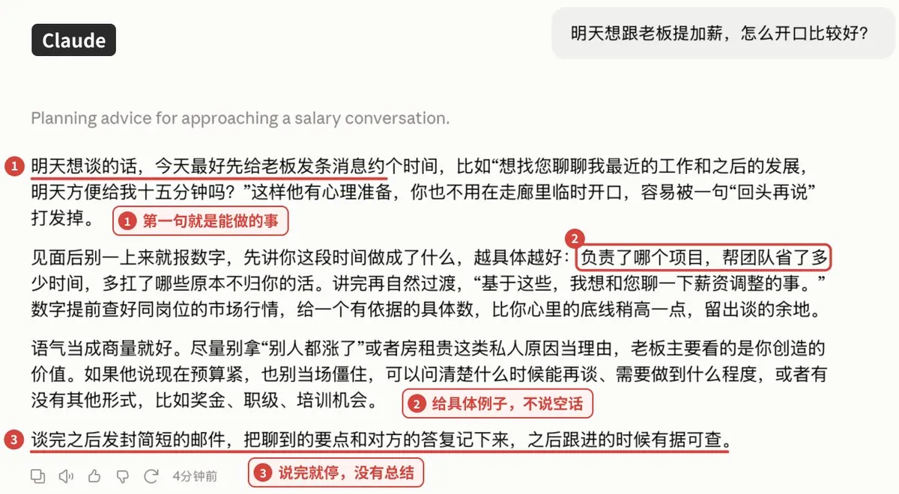
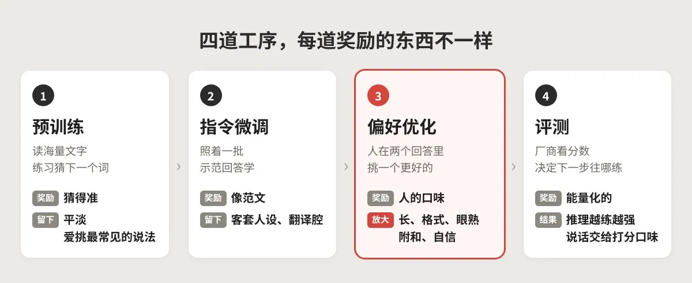
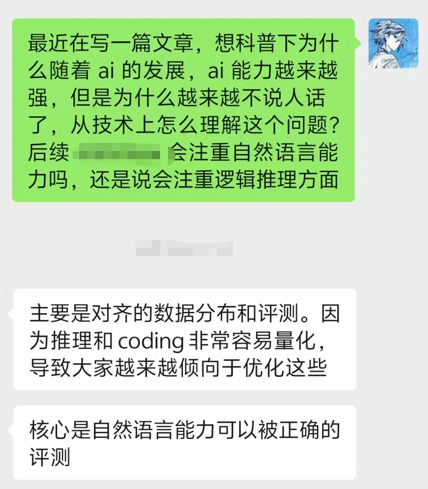
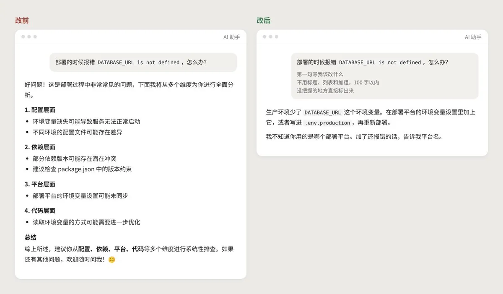
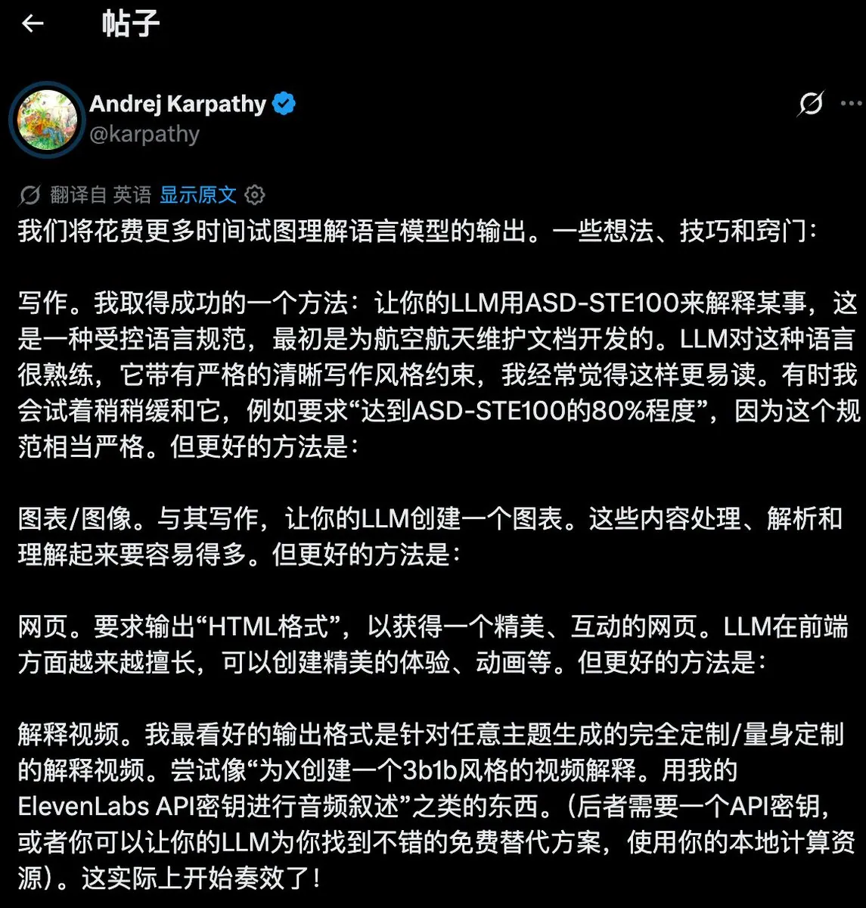
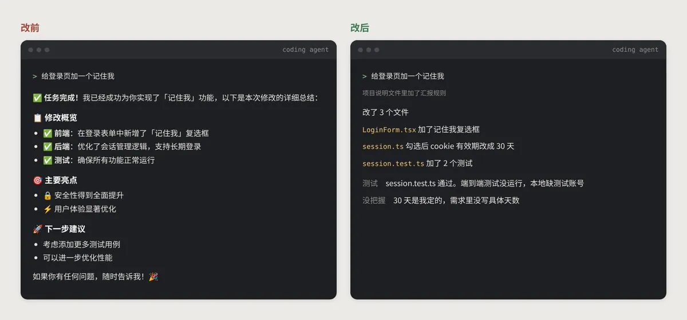
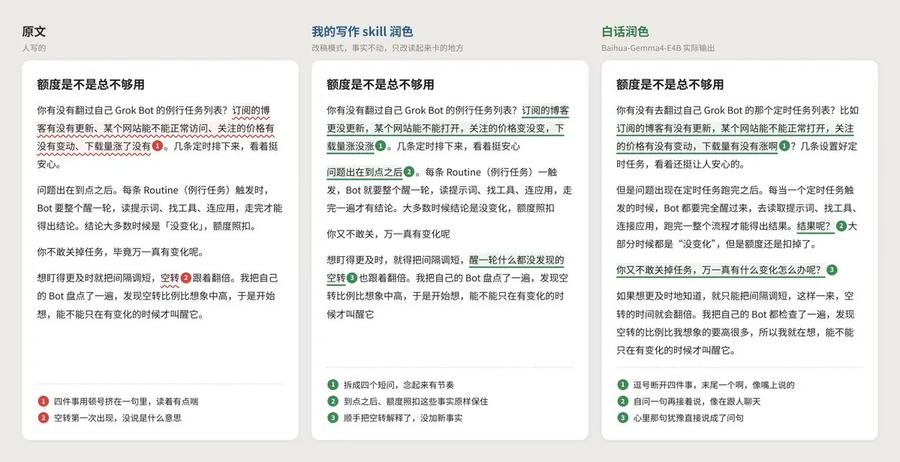

# 情酱（@qingj1314）：怎么让你的 AI 说人话？我整理了一套公式化方案

> 告别 AI 塑料感行文的公式化实操指南：深入解构导致大模型输出机械冷淡、充满官腔套话的底层诱因，提供「角色人设注入 + 认知口语约束 + 否定提示词门禁 + 典型句式替换」的四步清洗方案，让 AI 文本如真实口头对谈般自然有温度。

<!-- more -->

你肯定见过这种回答

问它一个报错怎么办，它先夸你问得好，再列出可能涉及的四个方面，每个方面配一个加粗小标题，最后来一句建议从多个维度排查。三屏看完，你还是不知道该改哪一行

让它帮你写段文案，它给你的就是“在这个快速变化的时代，每个人都在寻找属于自己的答案”这种话，挑不出错，读完也没留下什么价值

很多模型还有自己的一套口头禅。不是...而是...，最直白最不绕弯子，一句话总结。写到抒情的地方，爱情是量子纠缠，分手是熵增

拿一个最普通的问题试试，同样丢给 ChatGPT 和 Claude





ChatGPT 交回来一份文件，三个小标题、三种情况、三个细节，第一句就是不是 A 而是 B。Claude 四段话说完，第一句就告诉你今天先约时间

模型之间确实有差别。我自己的体感是，Claude 和 Gemini 写文字读着顺一些，国内模型的口头禅最多，gpt 的 AI 味最浓

但换哪个模型，AI 味都在，只是轻重不一样

我经常拿 AI 写作，被这股 AI 味烦了很久，这次干脆把它从头到尾查了一遍

看完这篇，你会知道它是怎么被一步步练出来的，也会拿到一整套让 AI 好好说话的办法

## 不说人话，有两种

开头那两种回答，其实是两种不说人话，后面所有的事都会分成这两条线

第一种是日常对话。问个问题，让它总结一下，帮你写封邮件，agent 跟你汇报进度。这里的不说人话，是你要的东西被埋起来了，就像那个三屏的报错回答

第二种是写作。公众号、推文这些，你要发出去给人读的东西。这里的不说人话，是句子都没毛病，但读不出一个具体的人，就像那句快速变化的时代，换谁来写都一样

日常对话里，你要的是一句能照着做的话，它给了你三屏。写作里，你要的是读出一个人，它给了你谁都能写的句子。两种毛病大部分是同一个原因养出来的，但治的时候得分开治

## AI 腔是怎么练出来的

从第一性原理说，模型只会做一件事，往被奖励的方向长。AI 腔，就是一路上被奖励的东西攒出来的

一个聊天模型大概要过四道工序，每一道奖励的东西不一样



第一道是预训练。模型读海量文字，练习猜下一个词，猜得越准越好。它学会的是什么说法最常见，所以天生有点平淡

汇报腔是后面才加上的。有研究拿同一个 Llama 3 的两个版本跟人写的文字比。英文里有种写法，句子说完了再拖一个 ing 尾巴，比如 highlighting the importance of，强调了什么什么的重要性，几乎是英文 AI 腔的标志。只做过预训练的基座版用这种写法的频率跟人差不多，教成助手以后涨到人的两倍多，GPT-4o 是五倍多。完成了对流程的优化这种把动作写成名词的说法也一样，基座版比人用得还少，助手版比人多一半

第二道是指令微调，找人写一批示范回答，模型照着学。这本范文集不用厚，一千条左右就能定下助手的样子。写范文那批人的习惯，开头先说好的、复述一遍你的问题、结尾问还需要什么帮助，就这样被复制进了之后的每一个回答

中文的翻译腔也是这一步带进来的。有研究发现，大模型的英译中将近一半读着有翻译腔，而它学翻译用的参考译文里，四成本身就是翻译腔

第三道是偏好优化，AI 腔主要在这里被放大。模型对同一个问题写两个回答，人选更好的那个，模型就往人选的方向改。问题是人打分有几样很稳定的偏好

一是长。长的回答看着更用心，偏好优化带来的分数提升，七到九成可以只用回答变长来解释。你问一个简单问题，它也要写满三屏

二是格式。加粗和列表看着有条理，用 GPT-4 当裁判时，被选中的回答四成多带加粗，没被选中的不到两成

三是眼熟。看着顺的写法分高，模型就越写越像同一个模子

四是附和。2025 年 4 月 GPT-4o 一次更新后变得特别会拍马屁，OpenAI 几天后就回滚了，复盘时说主要原因是加进了用户点赞点踩的信号。它开口就是好问题、你说得对，也是这么来的

五是自信。含糊的回答分低，所以模型很少说我不确定，哪怕它自信给出的答案里有将近一半是错的

第四道是评测，它决定厂商下一步往哪练

之前和国内一家 AI 厂的高管聊天，我问了他差不多就是这篇文章的问题。AI 能力越来越强，为什么越来越不说人话，从技术上怎么理解



他回了两句

第一句是，主要是对齐的数据分布和评测。因为推理和 coding 非常容易量化，导致大家越来越倾向于优化这些

第二句是，核心是自然语言能力可以被正确的评测

推理和代码有标准答案，对就是对，分数一算就出来，厂商当然往这上面使劲。一段话像不像人没有标准答案，只能交给人或者模型去打分，打分的口味又是上面那几样。排行榜也逃不掉，Chatbot Arena 2024 年把长度和格式的影响扣掉再排名，好几个模型的名次一下子变了

量化得了的越练越强，量化不了的，就交给了打分的口味

放回两条线上看。日常对话吃的是范文里那套客套，加上长、格式、附和、自信这几样偏好。写作吃的是预训练留下的平均，加上眼熟这一样偏好

## 为什么换个模型，腔调也不一样

四道工序各家都走，腔调轻重不同，差在每一道奖励什么。各家具体怎么训练外人看不到，从公开信息能看出三处

一是系统提示，就是聊天产品在你看不到的地方写给模型的那段话。Claude 公开的系统提示明写着不许开头夸用户问题好，要少用加粗、标题和列表。OpenAI 的规范也反对辞藻堆砌，但默认输出仍然是带标题和列表的 Markdown。有研究只换系统提示，同一个模型拒答正常问题的比例就能差出两倍多

二是奖励信号。GPT-4o 那次就是例子，点赞一进奖励，腔就往讨好那边走

三是跟谁学。有研究训练的分类器，能以九成七的准确率认出一段话是哪家模型写的，改写、翻译之后照样认得出。拿谁的输出当训练数据，就带着谁的腔。早一代国内模型跟着 GPT 学过，DeepSeek V3 刚发布时还会自称 ChatGPT

后两条我们管不了，第一条可以。系统提示能决定模型怎么说话，你自己写给它的要求也能。后面的方法，大部分都从这里出发

原因聊完了，下面是这篇文章真正想讲的部分

日常对话和写作的解法正好相反。日常对话要管住，让它少说、说准。写作要放开，让它敢写具体的、有立场的东西。先说日常对话，它更简单，改几句提示词就能立刻见效

## 日常对话，怎么办

日常对话这半，目标就一个，让你要的那句话出现在最前面

最省事的办法，是提问的时候多写几行，先交代清楚读者是谁、读完要做什么决定

```
读者是谁，他读完要做什么决定
第一句写这个决定需要的信息
不用标题、列表和加粗，150 字以内
没把握的地方直接标出来
先指出这个方案最可能出错的地方
```

每一行都对着前面一个偏好。交代读者和决定，它就没法铺垫。限格式和字数，管的是长度和格式偏好。要它标出没把握，是治自信。让它先挑错，是治附和

同一个报错，加不加这几行，差别大概是这样



左边四个层面、四个小标题，最后再来一句从多个维度排查。右边第一句就是该改什么，没把握的部署平台也直接问了你

每次都打一遍太累，可以一次写进设置里。ChatGPT 的自定义指令，Claude 的个人偏好，都能放长期规则。GPT-5.1 之后，ChatGPT 还能直接选 Efficient 这类比较克制的人格预设。可以参考这几句

```
默认用段落回答，除非我要，否则不用标题、列表和加粗
不要夸我的问题，不要复述问题，结尾不要总结
回答长度跟问题匹配，简单问题一两句话就够
不确定就说不确定
```

上面这些只管格式和语气。想让句子本身变清楚，可以借一个航空业的老标准，叫 ASD-STE100

Karpathy 这个月初在 X 上发了一条帖子，第一句就是，我们会花越来越多的时间去理解语言模型的输出

他分享的第一招，就是让模型用 ASD-STE100 来解释东西。模型对这套规范很熟，写出来他常常觉得更好读。嫌太严的时候，他会退一步，只要求做到 ASD-STE100 的八成



帖子后面他还往前推了三步。比写字更好的是让模型画图，再好一点是让它直接生成能交互的网页，他最看好的是给任意主题量身定做的讲解视频。这几样都挺有意思，但日常对话里最常用的还是文字，先把字写清楚，门槛最低

回到 ASD-STE100，很多朋友可能没听过。上世纪 80 年代，欧洲航空业发现，飞机维修手册是英文写的，但很多维修人员英语不是母语，读错一个步骤就可能出事。于是定了一套受控英语，叫简化技术英语

现在的版本有 53 条写作规则，大约 900 个批准词。每个词只许有一个意思、一个词性，操作步骤的句子不能超过 20 个词，描述的句子不能超过 25 个词，用主动语态，一句话只写一个动作。举个例子，close 当形容词用是不批准的，你得写 near，因为 close 已经被拿去表示关上了

把这套规则和前面那些训练偏好放在一起看，挺好笑的。训练把模型推向越写越长，它给句子设了上限。模型爱为了不重复换同义词，它要求一个词一个意思。模型爱把几件事塞进一句话，它要求一句只写一个动作

四十年前的规矩，刚好对着今天的 AI 腔

用法很简单，不用装任何东西，在提示词里加几句就行。第一行就是照 Karpathy 那个八成的说法写的。STE 只有英文版，中文借它的思路

```
按 ASD-STE100 的八成来写
一句只写一件事
同一个东西始终用同一个词
主语和动作放在句子前面
能用常见词就不用术语
```

效果大概是这样，下面是一段周报的示意

改前，本周针对用户反馈的登录问题进行了深入分析与排查，并对相关模块实施了一系列优化措施，整体体验得到显著提升

改后，本周查了用户反馈的登录问题。相关模块改了几处。登录体验好了不少

信息一点没多，只是一句只写一件事，动作也从名词变回了动词

嫌每次都要写，可以把这几行直接放进系统提示词里，ChatGPT 的自定义指令、Claude 的个人偏好都行，之后每次对话都会自动带上。也有人把它做成了 skill，SimpleEnglish、asd-ste100-skill 都能装进 Claude Code 里用

STE 最适合的场景，我觉得是 agent。Claude Code 会读项目里的 CLAUDE.md，Codex 会读 AGENTS.md，把汇报规矩写进去，每次就不用再交代

```
汇报规则
一行只写一件事
先写改了哪些文件，再写哪些测试运行了、哪些没运行
没把握的地方单独列出来
不写总结，不用表情
```



左边那句确保所有功能正常运行，看着很放心。右边一写清楚，端到端测试其实没跑，30 天这个数也是它自己定的。打勾总结的问题就在这，没做完的事也被包装成了做完

agent 之间互相传的指令也一样。asd-ste100-skill 推荐的用法里，就专门列了 agent 之间的指令和工具描述

日常对话里还有一种情况，AI 已经写好了一段周报、一封邮件、一份进度说明，你想把腔去掉。这时候我推荐 shuorenhua 这个 skill 的思路，地址是 github.com/MrGeDiao/shuorenhua。它整套规则就围着一件事转，先保信息，再谈风格

为什么要这么小心，因为去腔最容易出的事，是把意思改了

它列了一张要保住的清单，谁做了什么，数字对应的是什么，条件，范围，否定，可能、可以、会这种语气的差别，事情是做完了还是在做，谁比谁好多少。这些东西哪怕藏在客套话和宣传口气里，也要原样留下

在这个前提下，它默认只做五种改动。删掉纯客套，比如招呼、致谢、没有具体内容的预告。删掉只提示写法的成分，比如值得注意的是、简而言之，留下它引出的内容。删掉完整重复的话。把名词化的写法改回动词，完成了对配置的检查，改成检查了配置。删掉没有依据的身份吹捧，比如你已经达到资深专家的水平

这五种以外，默认都不动

举个例子，下面是一段示意

改前，值得注意的是，本周我们完成了对登录流程的优化，平均耗时从 3.2 秒降到 1.8 秒。总的来说，登录流程已经优化过了

改后，本周优化了登录流程，平均耗时从 3.2 秒降到 1.8 秒

删掉的是写法提示、名词化和最后那句重复。两个数字一个都不能动，也不能改成登录快了很多，更不能自己算出一个百分比加上去

再比如，经理批准以后，我可以周五前交初稿。这句话看着有点啰嗦，但经理批准这个条件、可以这个语气，一个都不能删。改成我周五交初稿，就从一个有条件的可能，变成了一个承诺

它还按稿子长短分了三档改动范围。可以自由删改重排的，只在句子内部清理、不删整句的，只在原位替换、句数都不变的。一千字以上的长文默认用中间那档，免得模型借着润色把你的稿子重写一遍

最后一步是交付前逐句对照，原文有、改稿没了的意思，除非确实是重复，就放回去。拿不准就撤销那处改动

我最想学的是它很克制。正常的文字可以原样返回，没把握就别改

## 写作，怎么办

写作就难一些，改几句提示词不够。有一个排序我很认同，活人感首先来自材料，其次来自说话位置，最后才是语气

所以去 AI 味，别急着让模型口语一点、加点语气词。材料不够的时候，语气词只会让 AI 味更重

下面就按这个顺序来

先说材料。模型手里没有你的事实，就只能写平均句子。专业作者改 AI 写的文字，删得最多的之一就是多余的解释。多余的解释，往往就是因为没东西可写

可以给自己定一个很硬的门槛。准备写一千多字的非虚构文章，动笔前至少要列出五件具体材料，每件都要说得出来路。五件材料还得能串成一件实际发生的事，不能是五句挨在一起的道理

什么算材料，你自己的经历、事实、数字、动作、判断，别人的原话，查到并且能核实的案例和数据。什么不算，模型临时编的比如有个人，没有来源的典型场景，常识推出来的后果，比喻，同一个意思换个说法

最常见的错误是，手里只有三条抽象想法，却要写四千字。于是每条都补上用途、意义、风险和未来，写成十几段。读起来很满，其实手里还是只有三条材料

材料不够的时候，只有三条路。能查的先去查。要你自己经历的，就先回答三个问题，你跟这件事发生过什么关系，哪个瞬间或数字最让你在意，你现在最想说的判断是什么。实在找不到，就把文章写短

宁可短，也别拿假例子和重复解释填满

给模型的时候，可以这样写

```
只用下面这些材料写，没有的不要补
1. 一个具体的事实或数字，以及它从哪来
2. 一个你亲眼看到或亲手做过的场景
3. 一句别人的原话
4. 你自己的判断，哪怕可能是错的
5. 一个你还拿不准的地方
```

最后一条特别容易被忽略。模型被训练得很少承认不确定，你主动把拿不准的地方交给它，它就不用替你装笃定

材料够了，接下来是说话位置。同样的材料，谁在说、为什么现在说，写出来完全不一样。动笔前把这几个问题想清楚，再一起交给模型

```
谁在说这件事，他凭什么知道，哪些地方只是推测
什么事情让他现在想说
手里有哪些东西能撑住文章，动作、数字、时间、原话、失败、代价
他对哪一点有明确判断，依据是什么，到哪里为止
读者看完上一段，最自然会追问什么
```

最后一个问题挺管用。文章往下走，靠的是回答读者刚冒出来的问题，不靠更深一层、真正的问题是这类路标

写第一稿的时候，盯住三件事就够了

一是每个新段落都要带来一件新东西，可以是一个事实、一个动作，也可以是一个例子或者一个后果。同一个观点换个说法，不算往前走

二是主语和动作先出来。那些真正能把 AI 用好的人，往往是，这种句子读到一半还不知道谁干了什么。改成会用 AI 的人，后面直接写他做了什么

三是事情讲完就停。不要强行升华，不要最后一段把全文再总结一遍

还有一个特别常见的坑，假细节。凌晨三点、桌上的冷咖啡、窗外的雨，这些没有来源的画面，越具体 AI 味越重。让人相信的是信息的来路。你在哪儿知道这件事，一开始哪里想错了，哪条材料让你改了主意，哪一块到现在还拿不准

开头写不顺的时候，可以让模型多给几个版本

```
给我 5 个不同写法的开头，每个标上你估计它出现的概率
```

前面说过，打分的人偏爱眼熟的写法，所以模型标的概率最高的那个，往往就是最套路的那个。从概率最低的两三个里挑，离 AI 腔会远一点

初稿出来以后，改稿最好分七遍，一遍只看一件事。我觉得最值钱的是这个顺序本身

先看谁在说，找出哪几段换一个模型也能原样写出来，这种段落优先改，改不了就删。再看文章有没有往前走，给每段标一个作用，事实、动作、解释、例子还是判断，连续几段都在做同一件事，就是在拖。然后去掉表演，单独截图很好看、放回正文什么也没增加的句子，大多删掉。再读一遍中文通不通，主语是不是来得太晚，一句里是不是堆了好几个的。然后才清禁用项，破折号、成串的加粗、硬凑的三个并列、先立一个没人说过的误解再推翻它的翻案句。最后核对事实，再看结尾

句子层面的清理排在第五遍，前面四遍都在看文章有没有人、有没有东西

另外有两个小测试很好用

一个是压缩试验。删掉三分之一，如果事实、动作和判断几乎没变，原稿就是在注水，留删短的那版

一个是冷读。忘掉所有规则，只问自己，哪里让我相信作者真的知道这件事，哪一段像人在处理问题，哪一段像模型在完成任务，哪句话说得比材料大，文章在哪一句其实已经结束了

清禁用项这一步，最好交给脚本或者人自己来。让模型自己标套话，它标出来的连人能标出的三分之一都不到

还有一点，禁词表要在写完之后用，别塞进写作要求里。明确告诉模型别用破折号，有的模型照用不误，禁的东西一多，效果还会往下掉

表达这一步，也可以交给专门的润色模型。比如白话，基于 Gemma 4 E4B，只用 144 组修改配对微调过，本地就能用，模型在 huggingface.co/Roland-Wayne/Baihua-Gemma4-E4B。它的分工很清楚，事实和观点交给上游，它只负责写成口述感的正文

这也正好印证了前面那件事。几百条示范能教会模型一种声音，也能把它往回拉

但这类模型有个通病，润色的时候可能把时间、数字、否定条件一起改掉。所以流程最好是，先把事实和提纲整理好，再交给润色模型，最后让另一个模型帮你对一遍

```
把下面两段文字里所有的数字、日期、人名、否定词和条件词逐条列出来，标出两段不一致的地方
```

去腔改错一个数字，比留一句套话糟糕多了

拿一段我自己写的文字试了一下，三个版本放在一起



我的 skill 改得很克制，顿号挤在一起的四件事拆成了短问，第一次出现的空转顺手解释了一下。白话的口语感最强，多了比如、啊、呢，还会先自问一句结果呢再往下说。这一段两边都没改错事实，但白话的模型卡自己也说了，不是每段都能这么稳

当然，上面这一套不用每次都手动过一遍，你也可以直接用 skill

我最推荐的是 human-writing，上面不少思路就来自它。它会先问你手里有没有东西可写，材料不够就先查、先问，实在不够就让你写短。初稿出来以后，它按顺序改，最后用自带的检查脚本清掉破折号、翻案句和商业黑话。装起来也简单，把 github.com/KKKKhazix/human-writing 发给 Claude Code 或 Codex，让它自己装就行

如果只是想给一篇写好的稿子去去腔，可以用 Humanizer-zh，它照着一份 AI 写作特征清单逐条清理，上手最快。担心改的时候把数字和条件改错，就换成前面说过的 shuorenhua

## 最后

也有人觉得，我们对 AI 腔有点过敏了

破折号就是个例子，很多人因为爱用破折号被怀疑是 AI 写的，冤得很。格式对快速扫读也确实有用，偏好优化也让模型在没见过的任务上表现更好。腔是代价，不全是坏事

只是这个代价，现在每个读者都在替它付

写到最后，我越来越觉得，AI 腔跟不敢说错有很大关系。每一步训练都在奖励稳妥、眼熟、讨喜的回答，一句带棱角、可能被人反驳的话，在打分的时候很难占到便宜

人敢说错，所以人写的东西才有人味

再回到那位高管的话，核心是自然语言能力可以被正确的评测。真要让模型整体变得会说话，还得等厂商把这件事测准

## 相关页面

- [[sources/tomcc-claude-opus-5-5-account-growth-playbook]]
- [[sources/khazix-6-prompt-mindset-techniques]]
- [[concepts/prompt-engineering]]
- [[concepts/selfmedia-compound-model]]
