# 清月（@qingyue820）：复杂的纯粹与热情的孤独——蓝色星球下张小龙与微信的产品故事

> 深度长文剖析微信背后的独立产品精神与张小龙传奇经历：从 Foxmail 的纯粹开源与悲剧英雄，到博大副总裁、开着车去西藏；接手 QQ 邮箱打磨出漂流瓶拯救孤独；在移动互联网赛马机制中打败手机 QQ 与 Q 信脱颖而出，以摇一摇和附近的人引爆两性本能社交，最终铸就一款没有开屏广告、没有开机口号、用「蓝色弹珠」敬畏孤独与连接的十亿级国民产品。

<!-- more -->

我手机上的软件，过了新年都换上了新皮肤。

淘宝美团不打烊，唱吧在唱歌，抖音极速在领现金，京东 TM 在抽汽车。

一片红色的祥和气氛里只有微信戴个绿帽子，就像个玩摇滚青年不良青年，在曾经的同学淘总，美科长，抖律师的聚会上，躲在墙角抽烟。

那么问题来了，为什么微信的逼格这么高？

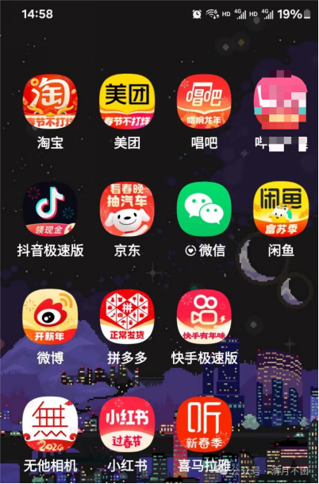

今天就来聊一聊，我们可能最不熟悉的软件，微信。

微信就像命运石之门的男主角一样，看上去是一个平平无奇但内在却激情澎湃的人。

单说皮肤可能没有那么特殊，毕竟手机上还有接近一半的软件并没有换皮肤。那如果我们再看一下，哪个软件的启动页面没有广告呢？

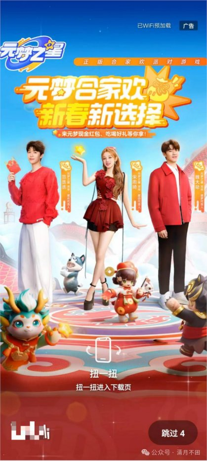

说到广告，大家的悲喜并不相通。高贵的苹果用户和屌丝的安卓用户看到的广告数量就不一样。

因为苹果软件审核的比较严，所以很多软件的苹果版它是 启动页面没有广告的。不过这些软件的安卓版还是有广告，除非你有 VIP，比如我们最爱的网易云音乐。

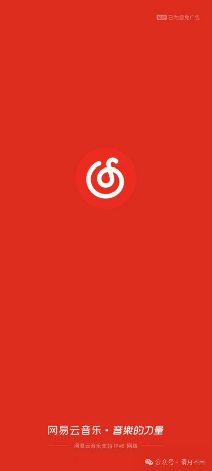

大家可以注意一下这个软件的右上角非常恬不知耻啊，本身给我打个广告就算了，在我充了 VIP 之后，他还要跟我说，因为你是 vip 所以我给你免广告，就是偷偷的打了一个 vip 的广告。

这就很让人窒息，你不充钱他就给你看广告，你充了钱每次启动他就像个收了保护费的红毛，看见你都要吹个口哨说，小子，看在你懂事的份上，这次让你过去。

不过这个启动广告确实也不是每个软件都有，但如果我们再看没有通知栏推送的软件，那就仅剩无几了。还是拿我们最爱的网易云音乐举例，有事没事通知栏要给我弹一下，诶，兄弟，我最近给你找了个歌儿，很适合你听你听听看。

当然还有我们最爱的百度，你下的百度客户端，他每天不在通知栏给你弹一两个逆天新闻，就生怕你和世界脱节。

当然这也不算最特殊的，咱们手机里面还是有一成左右很安静的软件。但我们继续追问，哪个软件开机没有 LOGO 和 slogan 呢？那就几乎是全军覆没了。

不说网易云音乐的力量，京东的多快好省，就连我手机上看片儿的软件。名字是水果的果开头他都要打个 slogan 叫他妈果然好片。

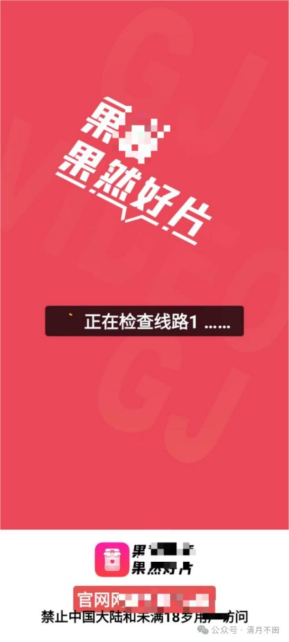

说到这个份上，微信可能就成了你手机里面唯一一个启动没有 LOGO，没有 slogen，没有口号，也不和你宣传企业价值观的软件。大家回忆一下他的启动页是什么？一个叼毛脑袋上顶了个球。

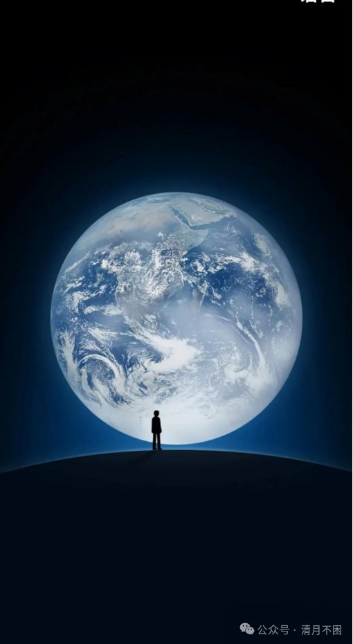

因为微信嘛毕竟是个社交软件，这个叼毛一看就很孤独。人一孤独他就要社交，他就渴望社交。这这个球也是有讲究的，这是人类第一次从外太空拍到地球的照片，美国人拍的，名字叫蓝色弹珠。这个蓝色弹珠跟我们平常看的《新闻联播》的那个球不一样，一般我们看《新闻联播》那个球转着转着中间就会转到中华人民共和国居中。他这个蓝色弹珠是非洲居中的，为什么是非洲呢因为人类的起源地公认的就是非洲。人类在非洲大路上的历史可以追溯到 250 万年前左右。非洲相当于是人类这个物种的摇篮。

在 2017 年的时候，我们国家也拍摄到了第一张属于自己的地球照片，然后在那一天微信团队把这张中国拍的照片换上了微信封面变成了我们熟悉的《新闻联播》的图式。

那天我记得一上网百度头条就是我们中国人有了自己的地球照片，下面的网友纷纷表示中国人的聊天软件就应该用中国人拍的照片，气氛非常团结热闹。但一夜之后第二天微信就又换回美国佬拍的照片了。没有任何公告，没有任何解释，还好当年的舆论氛围不像今年，那个时候辱华这个词还没有今天的热度。

那一年的新冠还没来，我们也都不知道肺和民族感情都很容易被伤害。

当然，由于我并不是中医系民族感情护理专业的学生，所以今天不过多的谈论这个话题。

还是来聊聊兄弟们最爱的游戏。

最近这些年好游戏很多。回想我小的时候，那个时候就只有 4399 和英雄联盟 dnf 等一些网络游戏。

现在越来越多的大型 3a 游戏和独立游戏都像雨后春笋一样冒出来。主播在直播间多次说过，我对 3A 不是很感冒，但是特别爱玩独立游戏。在早期的时候，我们说到独立游戏，我们提到的是他的制作和发行都是独立完成。大家要知道在没有 steam 这种平台之前，你做出来的游戏有没有人帮你发行都是很大的问题，更别谈有没有人买。超市里面的矿泉水是非常暴利的。一个瓶子几分钱，水比瓶子还便宜，加一起要卖你好几块。农夫山泉的老板钟睒睒已经连续三年登顶中国首富，看来卖透明的水比卖白色的粉更舒坦。不过能上超市货架的水都是有名有姓的货，不是你在你家装瓶水就会有人帮你卖，那时候的游戏行业也是这样。小作坊做出来的在别人眼中只是一个 demo，没有人会去帮你发行。后来数字发行慢慢变得成熟了，独立作者才能够发行自己的游戏。行业发展这么些年，独立游戏也变得画面更精致、成本更高昂，到了 2024 年的今天，我们已经很难用发行和成本来区分独立游戏了。

动辄千万投入的独立游戏也并非没有。

那在现在我们谈到独立游戏的时候，这个独立到底是指什么？我想更多的还是独立游戏的内核，也就是独立精神。独立这个词很多时候带着一种浓烈个人色彩，非常主观，还有点不妥协的味道。当我们看到一个罐头游戏的时候，比方说刺客信条、霍格沃茨之遗，你就知道他不是一个独立游戏。我们虽然对什么是独立游戏的定义有歧义，但我们对什么不是独立游戏却非常清楚。当然独立精神也不是游戏界独有的，独立音乐，独立电影大家可能也都听过。独立这个词的诞生是伴随着工业发展而来的。因为工业时代以前，几乎所有作品都是由少数的几个人完成的，油画，雕像，音乐乃至于建筑。当然建筑只包含建筑的设计。我们在这些作品上能够很清晰的看到作者的影子。一些画家喜欢把自己的妻子或母亲偷偷画进给别人的画里。一些雕塑家喜欢在雕塑上签上自己的名字，比如米开朗基罗经典的雕塑圣伤。一些音乐家喜欢在谱子上或者音符里。藏进自己的名字比如巴赫。

也就是说，在工业时代前，一件作品他就是作者本身的投影。而现在我们看见的很多作品都工业化了，它由更大型的团队协作完成，个人的痕迹残留较少。

我们提到千与千寻会想到宫崎骏，但我们提到漫威我们能想到谁呢？或许也有帅哥可以说出他的导演，那我们提到美团和支付宝呢？他们的作者是谁？参与软件制作的秃头码农们，本质上和修长城的劳工们没什么区别。我们只能记住秦始皇和公司老板的名字，对作者却一无所知。但微信就是少有的有独立内核的软件作品，从他的作者张小龙是一个很不一样的人，这点早在他的第一个成名作 Foxmail 就有体现。

刚从华科毕业没多久的张小龙，就因写出了 Foxmail 在圈内小有名气。速度快，体验好的 foxmali 发布没多久就拥有了数百万的用户。成为了当时国内最有名的免费软件之一。这个作品完全由他一个人独立开发，并且没有加入任何的商业模式。巨额的服务器运维成本让张小龙不堪重负。

除 KFC 之外著名全家桶公司 360 的老板周鸿祎劝他要在软件里面加上广告也被他拒绝了。他认为产品是自己创作的艺术品，没人会在艺术品上贴广告。

1998 年还没造车的雷军，那会儿已经是金山的 CEO，29 岁就站在了人生之巅。他非常看好 Foxmail 的潜力，找到了和自己同岁的张小龙，提出了自己的收购意向，口袋空空的张小龙开价十五万。

可惜后来谈收购的时候，金山派来的研发部人员看完这个软件，说这个东西技术上不是很难实现，我们的人一两个月就可以写出来。15 万，没必要，金山取消了这次收购。

2000 年的三月，人民日报刊登了一篇文章标题是《自由软件的饥渴与冲动》，文章认为张小龙“只是一个悲剧人物”，一个无业游民，在用青春挥洒冲动，仅仅几个月之后，Foxmail 被博大收购，价格是 1200 万，张小龙随即出任公司副总裁。

一夜暴富的张小龙在消息宣布的那天晚上，却写了一封伤感的信，“从灵魂到外表，我能数出它每一个细节，每一个典故。在我的心中，它是有灵魂的，因为它的每一段代码，都有我那一刻塑造它时的意识。我突然有了一种想反悔的冲动。”31 岁的张小龙用这笔钱买了辆车，一个人开到了西藏。五年之后，中国互联网迎来高潮，百度在纳斯达克上市，李彦宏登上了华润中国富豪榜。而在博大当副总裁的张小龙又和 Foxmail 一起被打包卖给了腾讯。腾讯在他们团队所在地广州成立了广州研发部，负责邮箱产品的研发。

从 05 年加入腾讯到 08 年三年时间，张小龙把 QQ 邮箱从半死不活的状态打磨成了国内第一的邮箱产品。QQ 邮箱凭借四百多个创新点，拿到了腾讯内部的创新奖。被腾讯内部称为 7 星级产品。2010 年 9 月，QQ 漂流瓶正式上线。

张小龙捕捉到大多数人内心深处的孤独感，这种新奇的社交方式让 qq 邮箱达到了上亿日活。张小龙后来回忆说，漂流瓶的创意源于自己大学时代失败的社交经历。在那个男女比例高达 7:1 的工科院校，孤独是张小龙和室友们的常态。

同年移动互联网浪潮来袭。张小龙认为在移动端会诞生一款原生的即时通讯软件类似于电脑上的 QQ，于是他给马化腾写了一封信，表达了这个看法，并且想承担这个软件的开发。

大家知道腾讯内部一直有一个赛马机制，就是同一个产品，让多个团队一起做，互相竞争，最终赢家拿到腾讯最大的资源。我们所熟悉的王者荣耀就是从赛马机制中跑出来的，在他之前腾讯的另一个爆款手游 moba 是全民超神。全民超神在被王者荣耀击败之后就全面下架了。王者荣耀成了唯一的亲儿子，竞争十分残酷。腾讯内部当时开发移动端即时通讯工具的有三个团队，一个是 QQ 团队，一个是 q 信团队，还有一个就是张小龙的微信团队。

腾讯集团当时的构架是有六大事业群。QQ 作为创始人马化腾的代表作是腾讯公司的立身之本，也是当时六大事业群中，社交网络事业群的王牌项目。那时候几乎没人看得上这个远离腾讯深圳总部的广州小团队。微信刚上线时，42 岁的张小龙在自己的饭否上写下了这么一句话“这么多年了，我还在做通讯工具，这让我相信一个宿命，每一个不善沟通的孩子，都有强大的帮助别人沟通的内在力量。”

我们这个年龄的人可能当时还是用手机 QQ 比较多。所以有时候会觉得很恍惚，不知道微信到底是怎么火起来的。我问我身边很多朋友，是怎么开始使用微信的，他们只说周围的人在用，自己没有办法不去用。微信刚上线的前几个月状况确实不太好。在当时雷军的米聊，还有手 q 的数据都更好一些。

在数据不好的那几个月里，张小龙失眠飙车，看心理学和行为学方面的资料。然后他得出了一个观点，现在人类的社交关系都是建立在人类的社会性上。而最本能的社交来自于对异性的冲动。

比如动物两性中有一性就会长得很漂亮，吸引异性来追求他们。孔雀就是很好的例子。

基于这种想法和移动设备的特性，微信上线了附近的人功能。这个功能刚上线的时候，大量的女性用户在上面更新自己的自拍照片，而男性用户则无时无刻不在刷新附近的人。微信第二次流量爆发是 3.0 版本摇一摇上线，大家知道摇一摇这个动作是很色情的，这是我们还是猿猴时就会的动作。这不是因为我是个擦边主播，职业病犯了，爱有一些色情的联想。这确实是你们细心一点就能发现，当你的微信性别不同的时候，摇一摇的动画是不一样的。

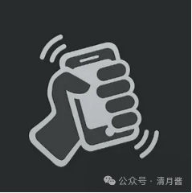

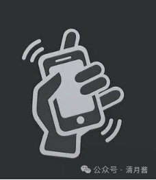

这两幅图大家稍微思考一下，就知道哪一幅是女性用户看到的画面。摇一摇这个功能刚出来的时候，男性摇完之后里面看到的是裸体的维纳斯，女性看到的是大卫。

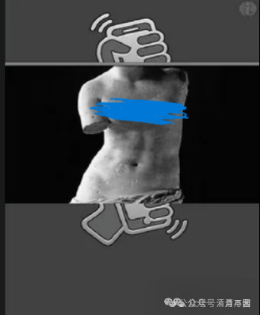

可惜这俩在我们国家并不是一种美的象征。所以现在被迫换成了一朵小红花。如果你们再细心一点，就会发现摇一摇时咔嚓的那一声响声并不是相机的声音，而是来福枪换弹的声音。这源自于张小龙以前爱玩儿射击游戏，换弹的声音，让他感觉很爽。这是他对性和暴力的表达。

腾讯作为模仿鼻祖，马化腾曾建议张小龙把能想到细分场景都加上去，免得别人抄完摇一摇之后加一个小的功能就又创新了。张小龙拒绝了，他说，微创新是永无止境的，摇一摇做到了极简，连一个按钮都没有。极简的东西是没有办法被超越的。让人惋惜的是前几天，摇一摇这个功能取消了，这个经典的互动被放在了新增的听一听里。

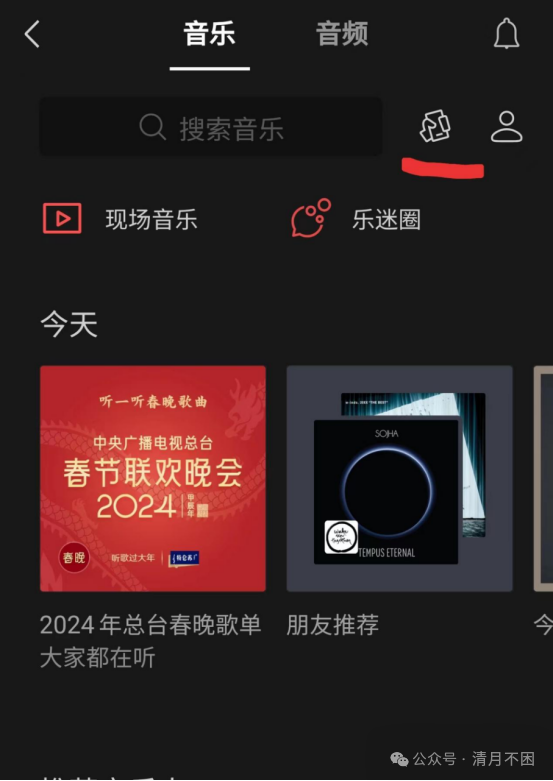

微信 3.0 推出之后，可以说正式击败了 QQ 团队。成了市场第一的移动通讯工具。张小龙把微信的启动页面换成了一个迈克尔杰克逊，并且在旁边写上你说我是错的，那你最好证明你是对的。来回击那些不看好他的人和批评家们

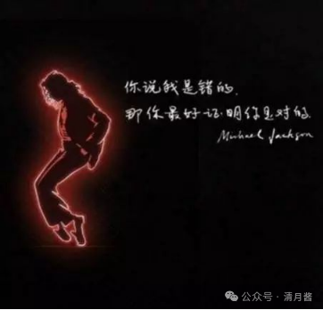

这个迈克尔杰克逊为什么是红色的呢，当时的张小龙想找到一种颜色表达内心的激情。

后来他在自己的车里找到了。汽车发动音乐响起，只有车的信息窗和车灯照射的地方。有一片红色的光晕。用他自己的话说，你不在跑车里听 mj 你不在高速上开 130 迈，你就感受不到那个状态。而用他朋友的话来说，这就是屌丝设计师第一次开跑车的心情。

2012 年微信更新了朋友圈和公众号功能。我和我的朋友大部分都是从这之后开始用上微信的，这一年张小龙在腾讯内部做了一个分享，他从白天一直讲到了晚上 11 点。除去吃饭的时间，也足足有八个半小时。他一改平常沉默的形象，准备了 150 页 PPT。滔滔不绝的分享自己的产品观价值观，最后他精疲力尽的说，我所说的都是错的。

后来张小龙在微信内部谈话中提到他不相信方法论，也不相信成功学，更不相信演讲能给听众带来什么收获。他之所以会出来跟大家分享，是因为他认为听众里有一小部分人可能在未来的某个时间点遇到需要在遵从内心和迎合外界之间做抉择的时候，能够想起张小龙选择了前者。

这年之后，张小龙变得更低调更沉默了，他很少公开露面。张小龙的大学室友回忆说。他们总是喜欢在夜深人静的时候去宿舍外的池塘钓虾。成功之后的张小龙现在更喜欢一个人打高尔夫球。他处理烦心事的方式没变，只是更高级了。

2014 年，腾讯集团在原有的六大事业群之后，成立了一个新的事业群，微信事业群。张小龙出任总裁。2015 年汇丰银行发布了一份报告，微信的市场估值达到 836 亿美金。几乎是同年腾讯市值的一半。相当于在腾讯内部再造了一个腾讯。而张小龙现在的年薪是 3 亿人民币。这个数字是马化腾的十倍。当上了腾讯集团高级副总裁的张小龙。每周被要求要去参加腾讯的例会。

他总是以太早了，起不来为借口不去参会，于是马化腾安排秘书早上喊他起床。张小龙又推脱说广州离深圳太远了，堵车过不去。后来马化腾每周都从派车过去接他。

不爱露脸，不爱社交的张小龙在 2017 年底推出了小程序，以及上线三天日活就破了 1.6 亿的跳一跳。这 1.6 亿的玩家里有三十人成绩达到了三千分，而分数第一的是这个孤僻的理工男——张小龙，他跳到了 6000 多分，在分享自己的经验时他说很多人玩这个游戏会紧张，而自己把它看成一个放松的工具，当你学会利用这个游戏放松，你的分数就能很高。张小龙放松的方式除了玩游戏还有打高尔夫，在跳一跳拿到 6000 分几个月之后，他又在欧巡赛—登喜路林克斯锦标赛赢得职业—业余配对赛高尔夫球的冠军，这是中国业余选手在国际赛事打出的最好成绩。

现在，微信在市场上已经没有了竞争对手，再也没有任何一家互联网公司想要推出一个产品和他竞争。业内很多喜欢微信人说微信很克制，微信很有情怀，但张小龙说：内部我们从来没有说过“情怀”两个字，也从来没有说过我们要克制自己的欲望，因为做一个好的事情并不是克制什么，而是要判断什么样的事情是该做的，什么是对的，什么是对错，这样一系列的判断很理性的过程，而不是靠一个感觉我这样很有情怀就好了。

可见光靠睡几个月青年旅社是救不了那个石家庄人的。

比喜欢微信更多的是讨厌微信的人，用张小龙的话来说。每天有五亿人在吐槽微信，其中还有一亿人想教他做微信。

讨厌的理由很多。比如微信的电脑端就不好用。

张小龙其实最开始是不想做电脑端的。因为他认为微信是手机的原生应用，不需要做 PC 端，后来考虑到大部分人工作时间也有社交需求，手机和电脑之间切换太麻烦才做了电脑端。

但电脑端没办法通过账号密码登录，必须要扫码，而且手机端一旦下线，电脑端也会下线。电脑端的功能也不是很多。

拉出来跟 QQ 比较完全就是被吊打。为什么一个估值几千亿的软件，连个客户端都做不好？张小龙认为微信想做到的沟通是即时的。在微信之前，我们大家经常用 QQ，QQ 有在线和离线。很多人爱挂 QQ 等级。如果当时你有一条文字消息，马上想给你的朋友看到，你首先会想到的是发短信，而不是 QQ。因为你朋友 QQ 可能在线，但他隐身不告诉你，或者你可能会发到一台附近没有人的电脑上。

在我们眼中，电脑和手机都是电子产品。但他不这样想，他认为手机是人手的延伸，甚至可以看成是器官的一部分。就好比很多老司机爱开车，因为他觉得车是他脚的延伸他驾驶起来会感到很舒服。而电脑是外部设备，所以人跟他的状态不够亲密。要扫码才能登上微信，保证了你在使用电脑微信的时候，手机也一定是在旁边的。所以微信没有在线和离线状态的，微信只有在线。他给人一种信任感，这种信任感就是我给一个人发个消息，那他肯定会收到。而且会比其他通讯工具更及时。

如果微信把 PC 端做的很好，跟 QQ 一样，那么用户很有可能不再相信对方能立刻收到消息了。当用户不再有这种安全感时，这是很致命的。所以电脑登的微信实际上只是手机端的一种投射工具，能够把你手机端微信收到的消息显示在屏幕上，能够把你键盘输入的信息传到微信。

所以他传输文件也并不能支持像 QQ 那么大的，特别是当你想用微信群办公的时候会发现它格外不好用。张小龙不希望微信成为一个电脑办公的工具，因为有如此强的触达能力，一旦被用在工作上，会给人很大的压力。你在工作的时候能更方便的使用微信 ，那么你的老板也能更方便的利用微信来使用你。所以他觉得如果你需要一个工具来办公，那你应该找到其他的软件，而不是微信。

这在很多人外国人眼里是不理解的，微信的出海一直不算成功，毕竟国外没有老板在下班后还一直在聊天软件上 CALL 你，给你安排任务的文化，文化的不同，像是一个天然屏障，但它无疑是最符合中国国情的，毕竟我们都知道中国工作群的四大谎言

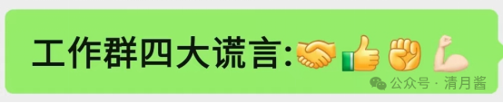

微信群不好用的不止文件功能，在群人数上也极为吝啬，

QQ 的群最多有 2000 人，而微信的群只有 500 人。实际上微信 500 人的群活跃度要比很多 QQ 两千人的群都要多。因为两千人这个基数，你在中间是没有存在感的，一个群里面聊来聊去，最后只有那几个经常发言脸熟的人说话，其他人都成了旁观者。所以微信刚建群的时候，一个群人数低于 100，你可以通过扫码就加入，但是超过了 100 人，你就只能通过更麻烦的邀请才能进入。

群以外的功能也很难用

比如

朋友圈想要发送纯文字就很麻烦

微信的朋友圈点一下，你必须要从图片和视频里面选一个发送。而 QQ 空间，文字，图片和视频都可以随便发。不过其实微信也可以发送纯文字，只要你长按那个拍照按钮。

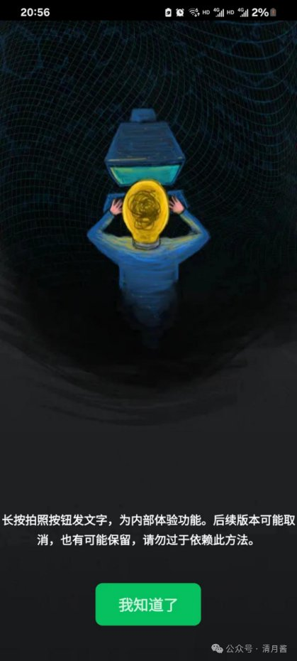

但他们明确的跟你说，不要依赖此方法。因为文字的修辞门槛很低，很多人都能越过这个门槛，这就导致了没有越过门槛的那些人相当尴尬，社交压力会很大。而图片的修饰门槛较高，大家可能都是随手拍，很少有人精修朋友圈照片，大家都在门槛之下，反而都能开心的分享生活。

这就好比你和你朋友十个人，你开马自达，剩下九人开奔驰，你就不愿意和他们一起开车出门，你怕他们来一句，你开马自达，怪不得你塞车。而如果九个人开马自达，一个人开直升机，那么十个人都不会尴尬。朋友圈也不像 QQ 空间一样有分享的功能，因为朋友圈是自己的生活，你不该分享别人的生活到自己的朋友圈。

朋友圈的点赞也很麻烦，是和评论折叠在一起的，而 QQ 空间里这两个按钮是放出来的，事实上放出来之后 QQ 团队在年会上数据会更好看 QQ 空间的用户活跃度，点赞数都会变得更高。但是这打扰了用户观看信息时的体验，而且有时候你很容易误触，翻到翻到不小心给你原本不想点赞的说说点个赞，而你的朋友也会收到这条消息，会让你很尴尬。而提高用户点赞的门槛还有个好处就是不让点赞成为一种胁迫。

Q 空间经常出现那个情况，是你发了条说说，你好友就赞一下。谁没赞？就是关系不够铁。而微信的设计可以让用户保持克制，因为你要多点一下，他设计了一个门槛。尽量的让你你点赞的内容都是你真的觉得值得赞的内容。朋友圈也没有加入滤镜功能。因为他想让用户尽量保持更真实的自己。而且一旦加入滤镜功能之后，用户在翻看朋友圈的时候，从一种滤镜的图片切到另一种滤镜的图片，你的观感会不太好。

朋友圈的评论可见也仅仅只针对共同好友，你也无法看见发布者的赞点数和评论数。这也是为了脱离凑热闹的低级趣味。远离群体同化的恶性循环。而很多人被同化惯了，被群体惯了，他们在群体中寻求存在。所以大家能在朋友圈看到更多真实情感，而不像在微博都是围观别人的苦难和炫耀。

微信不好用的地方还有很多，比如微信的聊天记录并不能够云端保存，如果是 qq，你在上面充了会员，他甚至可以帮你保存两年。

这是因为微信并没有一个中心的服务器去专门存储用户的聊天记录。你的头像，你的朋友圈和你的收藏都是在云端的，但是你们的聊天内容只有在你和对方的手机里有存储。

这个方案从技术上阻止了对隐私的侵犯，不管是腾讯内部的人，还是某个警察，想通过微信服务器查看你的聊天记录都是做不到的。

用户也不会因为账号被盗，聊天记录就被别人看个精光。这是对用户隐私的保护和尊重。说到这，前两天我在淘宝上搜了一下人体工学椅，然后淘宝、京东、百度甚至 b 站都开始给我推人体工学椅的广告。

好像使用用户的数据成了理所当然，用户的浏览数据，搜索数据，都被用来变成赚钱的工具，18 年三月，彼时还位列 BAT 席位之一的百度 CEO 李彦宏在以“新时代的中国”为主题的 2018 中国发展高层论坛上提到

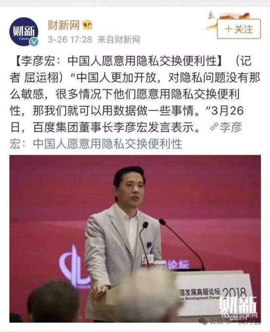

李艳红是北京大学的高材生。说话的语调让我想到了曾经也在北京长居的鲁迅。鲁迅先生也曾说过，中国人是怯懦的。但鲁迅先生没有说过。要用中国人的怯懦来赚钱。听说李老板本科毕业之后去了美国深造。那他的后半句极有可能是借鉴的美国的一位哲学家。乔治索罗斯说过，与其教育傻逼，不如赚他点儿钱。把鲁迅先生的话和索罗斯先生的话合在一起，差不多就是李老板的话。

但由于在美国待的时间较短，他硕士毕业之后工作没多久就毅然决然回国创业。这位哲学家的九阴真经他只学了一半。索罗斯先生还说过一句话，当金钱开始作响，坏话便戛然而止。到了李老板这里是坏话，开始作响。李老板的金钱就戛然而止。在次年 19 年李老板再一次登台演讲的时候，一位热心男子直接拿着矿泉水瓶从李老板头上浇下。要注意李老板这个时候回答他的不是中国话。

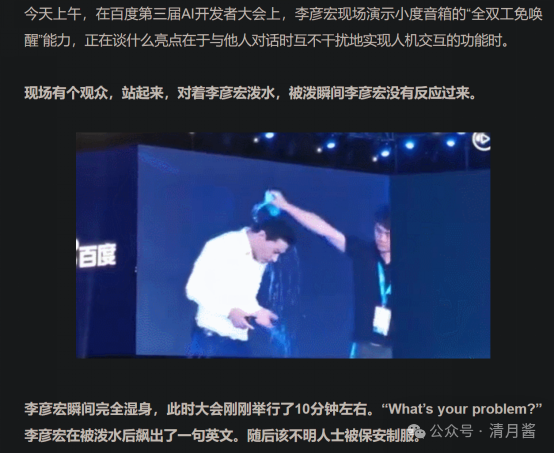

可见李老板在魏则西事件后没少温习另一半九阴真经。

做个微信朋友圈广告投放的朋友可能知道你只能选择投放到某一个地区，某一个性别的用户，这些都是用户的公开数据。不会涉及到用户隐私。所以经常我的朋友在收到奔驰的推送时。会惊讶不已。你看其他软件是很少会给你推送奔驰和劳斯莱斯的。这种对人的尊重不止体现在隐私，也体现在微信的方方面面。比如你在微信上，收到微信团队给你的信息都不会有您这个字。我这里列举几个用户协议，给大家看一下对比。

= =这里好像不能放，大家可以自己搜一下

大家不难看出，即使是同一个公司的产品，QQ 在用户协议里也全是称对方为您。

甚至在微信内部负责支付板块儿的业务是由财富通团队做的。而负责在线。回答的机器人是腾讯通用的。这两个板块儿在乘用户时都是用您。

有时候我去奶茶店，别人会高喊声，欢迎光临。这个光会特意提高腔调，让人感觉很不自然。大家可能也听过各式各样语调特别奇怪的，欢迎光临。这一般是老板把员工进行军事化训练，让他们必须按照这个标准喊，喊的要响亮。

当你用一些传播学的方法去“设计”你的客户时，你实际上就并没有在尊重他，实际上在早上跳操喊口号。对员工进行军事化管理。其实也并没有尊重自己的员工。很多时候老板眼中员工和客户都案板上的鱼.而那些小城市的夫妻店就更现实，你花钱，老板就对你笑脸相迎。你不花钱坐在别人店里，老板就你不顺眼，想方设法赶你走。所以大家都知道，他笑脸相迎的只是你的钱包而不是你的脸。

这里我们可以看看星巴克，当你走进星巴克店的时候，很少会有人主动笑脸相迎，热切的对你嘘寒问暖。基本上都是一副爱买买不买滚的态度。但是不管你是穷人还是富人，不管你穿的差还是穿的好，不管你有没有买咖啡，你在那里坐着基本都不会如果你再细心一点，你会发现他们身上会有一个牌，上面写着他们自己的名字，他们的名字不叫服务员。

另外如果你对他语气不好，让店员不高兴了。按照星巴克内部的规定，他完全可以拒绝为你提供服务。

说到这里我不得不吐槽一下哔哩哔哩的客服系统。B 站的客服不管你说什么话，不管他开不开心，他永远对你都是最尊敬的态度，但是也这有两种解释，第一，他可能想通过某种人工智能来测试中国古话，伸手不打笑脸人的。耐受极限不管他开不开心，他永远都不会帮你解决问题，这个想法很肤浅，还有些不切实际。那么还有第二种更深刻一些的可能：B 站根本就不需要客服，因为他们并不能帮用户解决任何问题，他们设立一个客服岗位可能只是吸纳了一些残疾人来就业，给这些残疾人提供一个体面的工作岗位。

B 战的真相主播不得而知，但关于不使用敬语张小龙的解释是“我们并不需要用一个很尊敬的态度称呼用户，而是应该当朋友一样称呼，所以应该是一种很平等的关系，这个写进我们的产品条约里面去了。后来再也没有人敢在产品中对用户过于尊敬，因为我们一旦对用户过于尊敬，那说明我们可能怀有目的，可能需要骗一点什么东西过来。”

这里大家可以看出，张小龙是非常擅长使用直觉来思考的人，如果一个事他在直觉上认为不好，就会抵触。而对于喜欢的蓝色弹珠，他放在了十亿人每天都会看见的微信封面，他喜欢许巍的歌词，便花钱买下版权，挂在了 QQ 邮箱的入口

而有次在同事家里玩时看上了对方年仅两岁的女孩的画，便也把它挂在了这首歌词同样的位置

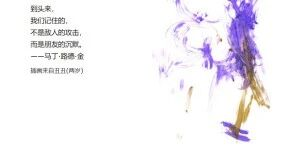

你要问我这幅画哪里好？我不知道

这就像未来的凤凰园凶真问年轻的自己，

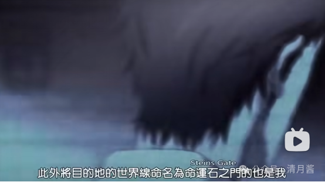

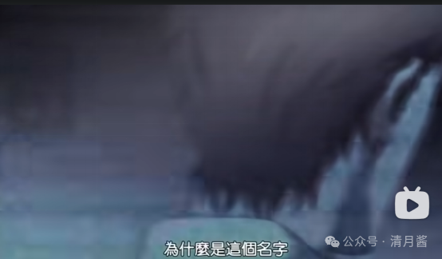

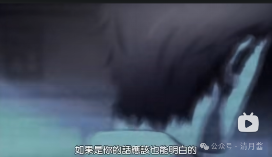

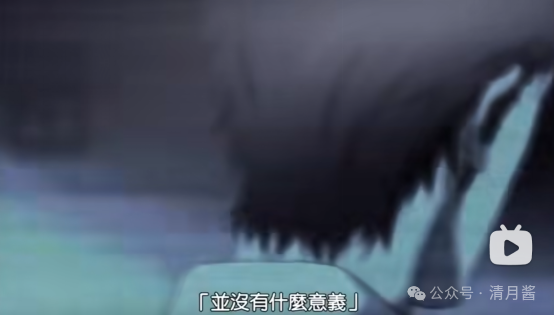

在尊重用户的层面，张小龙自认为是做的最好的：它体现到每一个小点里面，包括我们不发任何系统的推送，我们不去做任何诱导的行为，也包括我们不允许第三方做任何诱导用户的行为，甚至包括我们不想做太多的活动去感动你，然后带来一些流量。

举个例子，现在快到年底了，可能每个产品都会把自己换一个节日的 LOGO，并且帮助你回顾过去一年的生活来感动你，但我们并不想做太多这样的事情。我觉得故意去感动一个人也是挺不尊重他的表现。整体来说，我觉得我们在产品里面要保持特别高的专业度，同时我们希望真正能够把用户当成朋友看待，而不是把他当做一个听从我们驱使的群体，这样都不是太尊重他的表现。

到这里基本也回答了视频标题上的问题。为什么微信的逼格这么高。

能看到这里的用户我估计已经不多了。

不存储用户的聊天记录除了是保护用户的隐私之外，还体现了微信的另一个价值观——去中心化。

而去中心化另一个典型就是公众号，除了用户在注册微信的时候会强制关注腾讯新闻这个公众号之外，微信不会再给用户去推任何一个公众号。大家知道 QQ 上有各种各样的功能小游戏，邮箱，QQ 音乐都在上面能找到。在微信成功之后，据张小龙本人说，内部一个非常多的团队排着队来找微信合作。在公众号上唯一妥协的就是腾讯新闻啊，这里面因为一个新用户，他是完全没有关注任何公众号的，那如果你把你的公众号都取完之后，实际上你公众号这个功能也会关闭。

所以他这里有一个默认公众号的妥协。现在市面上很多软件，哔哩哔哩，抖音，包括以前的今日头条，都有很强大的算法推荐功能。腾讯拥有着中国最大的大数据，最多的用户。最完整的用户画像以及最强大的计算能力。但微信团队从来没有想过要利用强大的算力和庞大的用户数据去喂养出一个超级算法。这是由于张小龙本人对技术乌托邦的强烈不信任感。

在各种各样的反乌托邦作品里，乌托邦都被描述为中心化的代言词。不知道大家看过一部电影没？1984。我非常喜欢的电影，不过在国内是禁片。违规的话题我们先不讲。我们现在看一下微信是怎么分发公众号流量。

这里我要提一下，在前几年 QQ 也是有公众号的，QQ 公众号就是一个中心化的机制他和微信不同的点在于他在每一个分类有一个榜单，比如动漫分类的公众号，新闻方面的公众号，财经方面的公众号，然后把公众号 12345 排名放在那儿，那因为有排行榜，所以这些在榜上的人就会有巨大的流量这类似于淘宝，你把你的商品做到了排名前几，每天的成交就会很高。而微信上你是找不到这种榜单的，因为张小龙认为一旦我们按我们的规则去出一个榜单，把某个公众号定义为好，那么所有人都会朝着我们制定的标准去努力。最终他并不是为了服务用户的价值，而只是让数据更满足于我们的榜单排名。

既没有算法推荐，也没有这种榜单推荐。微信完全靠用户之间的社交分享来分发公众号的流量，一篇文章，你觉得好，你可以发给另一个人，或者发到你们的家庭群，或者发到你的朋友圈，其他人看了点进去，如果也觉得好，就会再关注他。所以实际上整个公众号平台微信只定义什么是不好，而不去定义什么是好。

不好的东西，比如诱导分享标题党或者说违规内容，它会封禁掉，那好的东西呢让用户去定义，用户觉得好的东西他自然就会分享。标题上这个是曾经有一个词叫 UC 震惊部，UC 浏览器在很长一段时间都会给用户推送标题送人听闻的一些新闻，刺激用户的点击。这种情况在公众号上会好很多，因为你看到一个新闻，它是标题的，你点进去之后，它把你骗进来了，但是你会把它分享到朋友有钱给更多的人吗？你会觉得我在朋友圈分享这个东西好像很 low，我不愿意让别人认为我是个傻逼，所以我也不会分享。

当然人也是有缺点的，并没有那么完美。比如说你可能有某一个亲戚特别爱分享一些猎奇的内容，你觉得很差。但是真正能为用户自己负责的只有用户自己。他认为在一个十亿级用户的软件上。不应该有人有权利能够规定用户应该看什么样的内容，而把它包裹在一个信息的茧房里，而且人是会反省自己的，一个人可能一段时间非常爱看猎奇的内容，但是时间久了，他会对这种猎奇的阈值越来越高，慢慢的他会厌倦，也会喜欢上别的内容。

而基于算法的话就会强化这种行为用户喜欢垃圾内容，我就给他推更多，有很多人喜欢垃圾内容，我就再把他推给更多的人。那最后慢慢形成一种潮流，就是说你不知道一些公认的你就变得很 low。以至于现在春晚不跟上几个热点，明星和梗都不敢播。而放弃了把公众号推送给用户的权利，也意味着没有一个公众号的团队可以出高价钱给微信来买到一个好的广告位置，也没有公司其他团队的同事能够用利益交换让微信出让一些资源把他们的公众号推到用户面前，也不会有一个大的领导要求微信团队去强制用户关注某些账号。这和微信不存储用户的聊天记录一样：不作恶和不能作恶意是不一样的。

接下来其实还有一些想聊的，比如视频号，和微信直播的生态是如何围绕去中心化来设计的。但这需要很大的篇幅，大家也不一定感兴趣，所以这期暂时先讲到这里，视频最后呢我想引用张小龙的一句话来结尾，大家下期见。

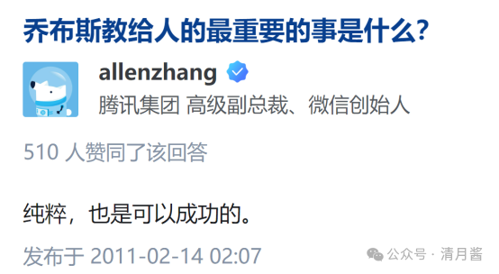

## 相关页面

- [[sources/svwang-wealthy-entrepreneurs-path-dependency-and-waiting]]
- [[sources/lin-crypto-15-human-nature-monetization-models]]
- [[concepts/selfmedia-compound-model]]
- [[concepts/b2c-conversion]]
