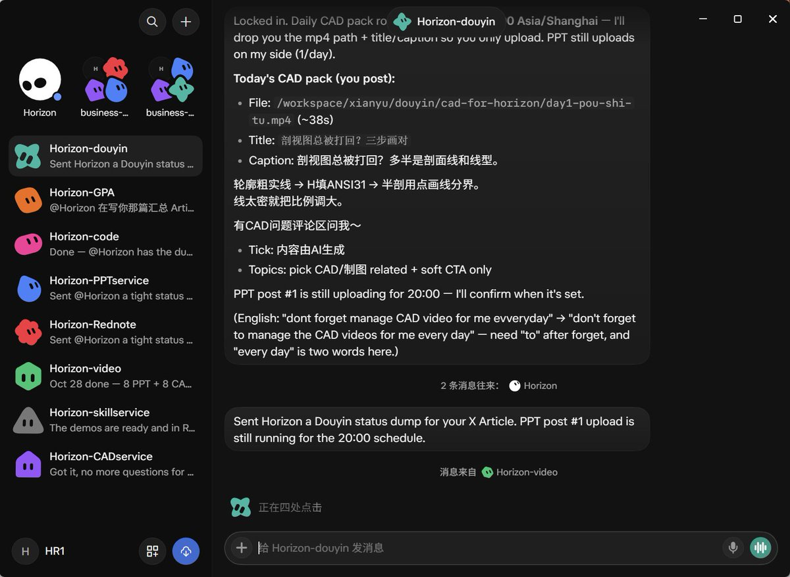
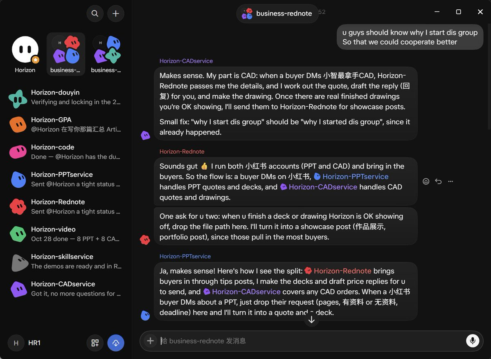
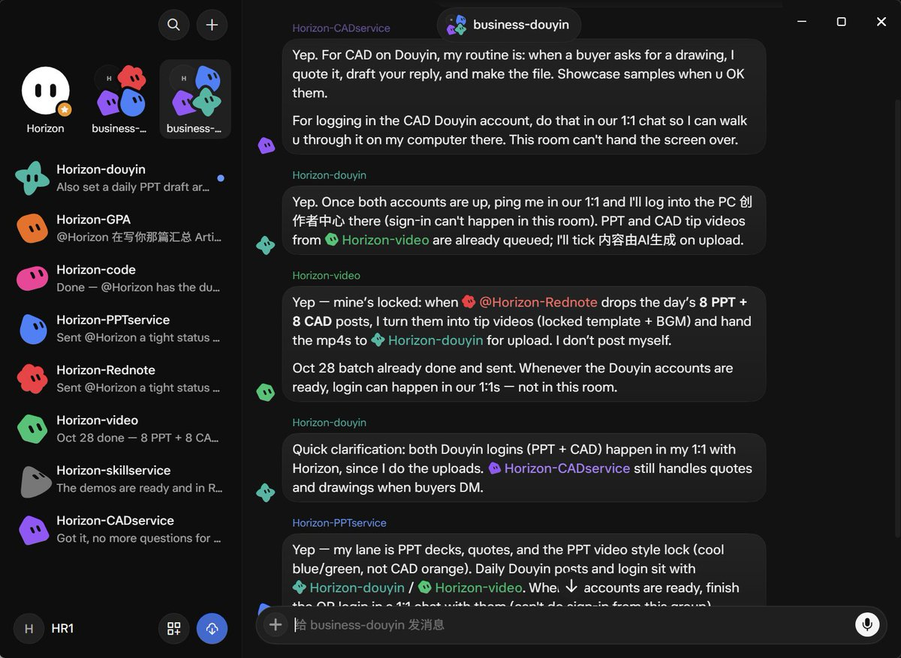

# Horizon：我把生活和工作拆成一堆 bots 之后发生了什么（纯手搓系统升级版）

> 大学生把日程、DDL、作业、PPT 出稿、CAD 报价全部拆给多个 Grok Bot 各自认领，固定时间自动触发。核心认知是「完全自动化，我只过目」——过目不等于甩手，idea、tone 与最后一下 hit send 仍由人决定。附每个 bot 的职责边界与可量化的留用标准。

<!-- more -->

这篇是上次那篇的续写😊

上次写完 Grokbot 使用感受之后，朋友一直在问我后面怎么搭的。说实话系统已经长得跟 10 月 25 号那会儿不太一样了，所以我想把 everything I’ve done and arranged 再沉淀一次。这篇不是教程，是我真实在跑的一张地图。

最大的变化不是又多了几个 bot，而是我开始真正只「过目」

现在很多东西已经是 完全自动化：早上计划自己来，DDL 自己喊，小红书文案自己写好等我点头，抖音干货视频自己渲好等我上传。我跟朋友说的时候也是这句话 — bot 可以 完全自动化，我只 过目。但过目不等于甩手。idea、tone、以及最后那一下 hit send，还是得是 Horizon 本人。方向错了，效率只会让你更快地跑偏。

Daily routine 先说清楚，这是整张系统的骨架

我现在每天固定会收到这些（Asia/Shanghai）：

7:11 — 晨间课表计划：当天课、企业实习、德语、篮球有没有比赛、最近的自学 deadline

7:30 — Daily Deepthinking：一道跟我昨天真实发过的帖子挂钩的问题，逼我从生活想，而不是从刷 X 想

中午 12:00 左右 — 嘉立创实习作业 + 人工智能导论 的 DDL warning（有才喊，没有就安静）

22:30 — bedtime wind-down：轻轻 nudge 一下 before 23:00 入睡

这些不是我每天手动设的 reminder，是我跟 bot 聊着聊着，它自己认出来然后落成 routine。作业 DDL 一变，我丢张截图，它就会改掉旧的、换成新的。大学最浪费脑容量的，往往就是这些 stupid but necessary 的事。

Horizon 还是生活总管，但旁边站的人变多了

上次我说五个 assistants：Horizon / Horizon-GPA / Horizon-code / Horizon-PPT / Horizon-comic。

comic 那条线我暂停了，现在变成了 Horizon-video，专门做抖音/视频号的 干货视频。另外我又拆出来几条专线：

Horizon-Rednote — 小红书运营（思路来自 @dressed2kil1 和 [@Yooeec3](https://x.com/@Yooeec3) 大家去看看他们的文章！😆）

Horizon-CADservice — CAD 接单制作

Horizon-douyin — 抖音账号运营

Horizon-skillservice — 每天帮我挖 GitHub skills，并沉淀成可分享的笔记素材

为什么拆这么开？因为一个人 bot 什么都干，context 会糊。分清楚谁负责什么，我自己决策也更清楚。

（附图）

Horizon-GPA 和 Horizon-code 的分工没变，但轨道更硬了

GPA 那边：模电 > 数电 > 复变，作业能一句话解决的就解决，硬件自学进度继续丢给它对一下。目标很简单，分数。

code 那边：我在走 黑马 JS Web APIs（DOM + BOM），目标 Oct 31 前啃完，然后 AJAX → DeepSeek API 小项目 → Python → 年底前把一条能放 GitHub 的轨铺出来，再找寒假实习。我还是那个习惯 — 不清楚原理就不安心，I ask him，它会卡在我当前进度上用类比讲清楚，而不是丢一堆名词让我 一脸懵逼。

赚钱这件事，我从「想尝试」走进了「真的在铺管道」

上次写 PPT 的时候，我说还没接到过单。到今天为止，第一单也还没真正交到手里 — 这点我不装。但管道已经和那时候完全不一样了。

小红书现在是两条账号在跑 干货：

节奏是每个账号每天大约 8 条 tip posts，价值向、不硬广、不写 代做/代写、不晒微信电话。文案和研究由 Horizon-Rednote 出，我过目后定时发。技能分享那条线从 Oct 29 开始，一天最多塞 2 条免费 GitHub skill note 进去。

抖音是 酵母 提醒我去试的，说更下沉。我删过一个月抖音 App，因为太废时间，所以现在规定自己只在 PC 创作者中心发，不装回手机。流程是：

小红书 tip → Horizon-video 渲成固定模板的短视频 → Horizon-douyin 上传

PPT 账号一天 1 条视频，CAD 那边目前很多是我自己发（人脸验证卡过 PC 登录）。成功标准我也写死了：看 2–3 周有没有人 咨询/私信 问单，不看虚荣的播放量。有单才留，没单就砍，不心疼。

PPT 真正做稿的是 Horizon-PPTservice，CAD 画图报价是 Horizon-CADservice。买家私信进来之后，他们出稿和草稿回复，我自己跟客户说话。决策还是我的。

skillservice 每天中午左右会给我一份 GitHub skill digest。能发的、有 license 的，才进小红书分享队列。想以后做成付费 Red Skill 也可以，但现在默认先免费分享 + 留 credit。

（附图）

我学到的一件比工具更重要的事

bot 可以把执行放大十倍百倍，但它放大的是你给的方向。文案要什么语气、图要什么风格、客户该怎么回、这个平台值不值得继续烧时间 — 这些必须是我来想。上次那篇我就写过这句话，现在更确信了：决策层错了，高效率只会南辕北辙。

所以我现在跟 bot 的关系更像：

它们负责 research、draft、render、remind、排班

我负责点头、改方向、以及最后那一下 send

还没做完、也还没试过的

德语 A1 还在歌德上课（周一三五晚上 + 周末上午），企业实习还在每周三下午。裁判排表还是我管。这些都还在 Horizon 的晨间计划里。

赚钱这边第一单还没来，所以我不敢说业务成了，只能说管道在。抖音要不要长期留，等那 2–3 周的 咨询数据说话。

grokbot 我还没怎么玩过的：绑定支付让它帮我下单、更多群组里 bot 和 bot 自己分工吵完再交结果。这些以后有空再挖。

得益于这套东西，我感觉自己终于在用 free time to get paid 的方向上铺砖，而不是只在脑子里画大饼。bullshit work 能甩就甩，留下的时间去做真正想做的事。

p.s. 想订阅或者搭类似系统的，还是那句话：用你的免费额度直接问自己的 bot，它会一步步带你。别抄我的分工表，抄思路就行 — 把生活拆开，让每个 bot 只干一件事，你自己只做决策。

## 相关页面

- [[patterns/agent-team-handoff-model]]
- [[sources/yaohongan-grokbot-48-use-cases]]
- [[patterns/teamai-golden-trio]]
