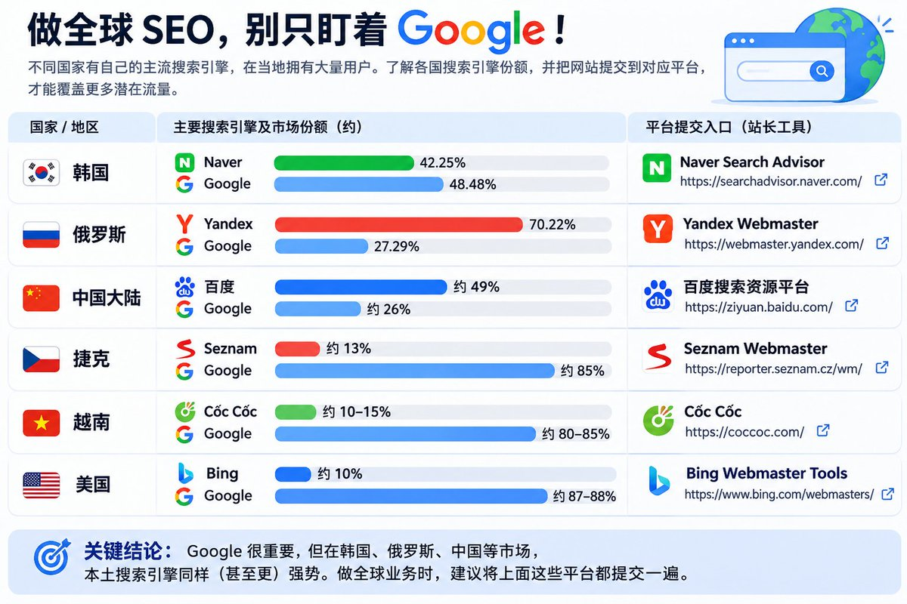

# 如歌：做全球 SEO 别只盯 Google——五个搜索引擎提交入口备忘录

> 上站后别只提交 Google Search Console 就以为搞定收录：韩国 Naver、俄罗斯 Yandex、中国百度、捷克 Seznam、美国及全球 Bing 都顺手提交一遍。这些引擎在当地都有自己的用户群，部分市场甚至比 Google 更强势。**提交不代表一定有流量，但不提交，可能连被发现的机会都少了一次。**

<!-- more -->

兄弟们，上站之后，别只提交 Google Search Console，就以为搞定了搜索引擎收录。

一定要把这几个平台都顺手提交一下，改为备忘录，上站手册，以后别忘了。

要不然可能从一开始就漏掉了一大批海外流量！

🇰🇷 韩国：Naver

https://searchadvisor.naver.com/

🇷🇺 俄罗斯：Yandex

https://webmaster.yandex.com/

🇨🇳 中国：百度

http://ziyuan.baidu.com/?castk=LTE%3D

🇨🇿 捷克：Seznam

https://searchadvisor.naver.com/wm

🇺🇸 美国及全球：Bing

https://www.bing.com/webmasters/about

这些搜索引擎在当地都有自己的用户群体，部分市场甚至比 Google 更强势。

如果你做的是面向全球的 SaaS、工具站，建议顺手把这些平台也提交一遍。

提交不代表一定有流量，但不提交，可能连被发现的机会都少了一次。

做全球 SEO，别只盯着 Google！

建议收藏，建站时挨个提交。🚀

## 相关页面

- [[concepts/open-source-seo-tooling]]
- [[sources/google-seo-ranking-factors-2026]]
