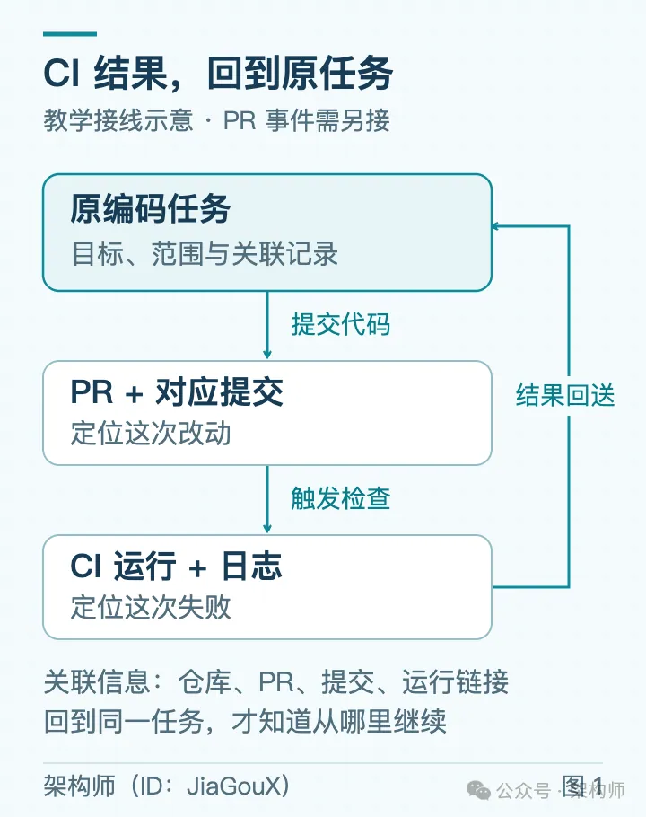
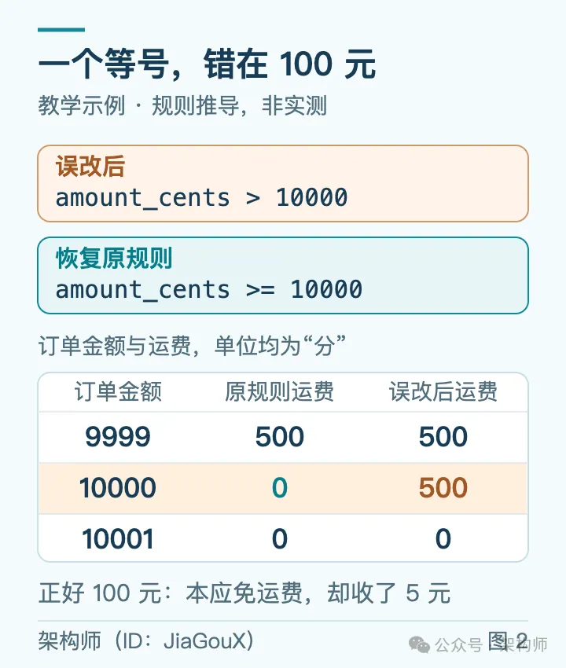
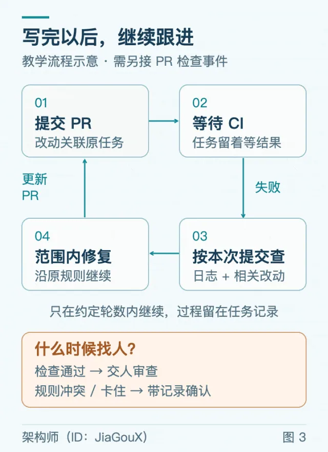

# 若飞：自产自销——如何让 Agent 自己写自己查？（CI Doctor 闭环与自主修复）

> 经常 Vibe Coding 的开发者常有同感：代码交由 Agent 编写后，后半段往往需要人工反复介入——代码提交后 CI 挂了，人工打开测试页找失败日志贴回对话框，催它继续排查；排查完给出分析，人工再催它确认提交改动并去修代码。每走一步都要停下来等你一下。本文基于 GitHub 官方开源的 CI Doctor 模板与真实修复案例（gh-aw #14295 → #14313），深度剖析如何让 Agent 实现「自产自销」：提交代码后自动挂载 CI 失败监听、认准单次提交上下文、按排查习惯深入定位根因、在授权边界内自动提修复 PR 再次跑 CI，直到需要确认规则冲突或人工审查时才找人。

<!-- more -->

相信经常 Vibe Coding 的同学，近期应该深有同感：把任务交给 Agent 以后，后面往往还有不少事要跟。几个项目或者几个任务同时跟进，大脑都有点不够用了。

是的，代码提交了，测试没过，还得你打开检查页面，找到失败的那一步，把日志、截图、报错等贴回会话，然后告诉它继续查。一顿输出猛如虎，它查完了，给出一段分析。你看了一遍，发现还没确认是哪次改动引起的，于是再补一句：“看看这次提交。”

一件事就这样往前走，每走一段，都要回来等你一下。

Agent 已经能读代码、查日志、分析错误，但什么时候开始、去哪里找材料、查完以后怎么继续，这些事还得有人安排。能不能在交任务的时候，就把后面这段也交出去？

> **核心诉求**：代码写完，等测试；测试失败，自己查；问题在约定范围内，就继续修。等到需要确认业务规则、最终审查改动时，再来找人。

换成平时说的 Loop、Goal，就是想让它把这件事跟到底。不过，写好目标之后，还得让检查结果能准确送回原任务，它才知道该接着干了。

刚好，GitHub 有公开的 CI Doctor 模板，也能找到从排查报告走到修复 PR 的真实案例。沿着它们，可以看清这段自动化跟进怎么完整交接出去。

---

## 一、失败就开工：事件驱动的自动排查

CI，也就是提交代码后自动运行测试、构建等检查的流程，本来就在自动做事。Agent 提交代码以后，可能结束了这一轮；几分钟后 CI 才报错，这项工作就又停在了人这里。

这一步可以提前安排好：**约定的检查一失败，就自动启动调查，把这次运行现场一起交过去。**

GitHub 的 CI Doctor 模板采用的就是这个方式。模板默认监听 `main` 分支（或指定分支）上名为 CI 的工作流，一旦失败自动启动 Agent，查日志、代码和相关改动，把发现与建议写回 Issue。

到这里，它接手了排查和报告。要让它继续跟进 PR、修改代码，还需要接上相应的事件和修复流程。

---

## 二、认准这次失败：上下文精确回传

如果自动发给 Agent 的内容只有一句模糊的“CI 失败了，请处理”，它很可能还得回来问：哪个仓库？哪次运行？哪段日志？结果还是要人补材料。

CI Doctor 会把仓库、失败运行的编号和链接、对应的提交 SHA 一起完整交给 Agent。它再沿着这些信息找失败任务、读日志、查代码。

这里要认准**“这次”**：失败的是某次提交，如果排查时读了已经变化的最新代码，分析就可能对不上。

模板还把开发者的排查习惯显式写了进去：
1. 从最早失败的任务和第一条有意义的错误开始排查；
2. 检查相关提交的 Diff；
3. 分清是业务代码、第三方依赖、配置还是网络基础设施出了问题；
4. 给出有证据支持的具体修复建议。

“先看日志”“是不是环境问题”“看看这次改了什么”，这些平时人工要分几轮补充的话，都可以提前内置进去。

如果还想让写代码的 Agent 接着处理，就得**记住 PR 对应哪项编码任务，把提交和 CI 运行关联进去**。否则报告虽然自动生成了，还是得由人找到原来的窗口，贴回去，再说一句“继续”。

*图 1：要接回原任务，先记住 PR、提交与运行的关联（教学接线示意，PR 事件与修复流程需另行接入）*

---

## 三、从报告到 PR：GitHub 真实落地案例

在 GitHub 的官方工具仓库 `github/gh-aw` 里，一份 CI 失败报告就记录了完整的交接过程：

1. **2026 年 2 月**，CI Failure Doctor 自动创建了诊断报告 Issue `#14295`。
2. 出错的是一个检查错误提示的测试：程序输出的引擎名称顺序不稳定，最后一项前还少了一个 `or`，与测试预期断言不一致。
3. 报告完整附上了运行上下文、提交记录、失败测试用例和具体错误日志，同时也记下了一个阻碍：尝试本地复测时，依赖下载遇到 403，没能继续验证。
4. 这条 Issue 随后被自动或手动交给 Copilot。Copilot 提取 Issue 中的线索，提交了修复 PR `#14313`：对引擎列表排序、调整提示格式，并补充相关单测。维护者审查批准后，将 PR 顺利合并。

这里的排查和修复由不同工作流承接。修复任务拿到 Issue 时，日志线索和修改方向已经在里面；维护者也能顺着 PR 找回最初的问题，以及诊断时没能完成的验证。

---

## 四、写完接着查：闭环修复逻辑推演

如果代码最初就是 Agent 写的，能不能连后面的排查与修复一起闭环接住？

假设让 Agent 修改一段运费计算逻辑：
- **原有业务规则**：订单满 100 元免运费，否则收 5 元（金额用“分”表示，100 元即 10000 分）。
- **Agent 改错**：在 PR 中把 `amount_cents >= 10000` 错误改成了 `amount_cents > 10000`。

只差一个等号，恰好 100 元的订单就会被收取运费。如果单元测试覆盖了这个边界值，CI 就会报错。

*图 2：门槛上下都可能正常，正好 100 元才暴露这个错误（教学规则推导说明）*

检查结果送回这项编码任务，Agent 就有明确线索往下查：
- 失败测试针对的正是 100 元订单，期望运费为 0，当前逻辑却返回了 500 分；
- 对照这次提交的 Git Diff 和原有规则，问题迅速锁定在刚改过的比较条件。

到了这里，已经有了明确判断。如果只交回一份报告，人还要再说一句：“那就改吧。”

如果最初任务授权就是“保持运费规则不变，跟进到检查通过”，这次修复便在原任务范围内。它可以自行恢复 `>=`，补查门槛上下的测试情况，直接更新 PR，再等新一轮 CI，**不用在分析完以后停下来等人催**。

*图 3：沿同一任务继续，检查通过后交人审查；规则冲突或卡住时，带记录找人*

在等待 CI 运行的几分钟里，Agent 也不必一直常驻消耗 Token，**任务留置等待异步 Webhook 事件结果即可**。如果连续修复达到约定的重试轮数上限还没好，就带着完整的尝试记录回来，绝不能陷入无休止的死循环。

---

## 五、何时找人：告警收敛与边界原则

事情能够自动闭环，并不意味着人要被持续打扰。很多系统 Agent 每个阶段都来通知：开始运行了、找到日志了、正在分析、测试挂了……手机频繁震动，切回去看一眼又无需人工处理，体验极差。

编排流程时，必须将通知与介入时机严格规约：

1. **常规闭环静默处理**：前面的运费单测错误，若能根据原有规则顺利修好，全过程保留在流水线任务记录中，等到 PR 构建与检查全部绿色通过后，再做一次终结通知交由人工做 Code Review。
2. **规则冲突立即停机请示**：但如果文档写的是“满 100 元免运费”，新传入的需求文档却写“超过 100 元免运费”，Agent 就不该自作主张猜意图，必须停下来问清楚：
   > “100 元订单的测试没过。新需求写‘超过 100 元免运费’，现有代码和测试规则写的是‘满 100 元’。这次要调整免运费门槛吗？相关需求、提交和失败日志已附上，请确认后再继续。”
   
   此时人介入仅需决策业务定义，排查上下文早已齐备。
3. **去重与告警降噪**：CI Doctor 模板同样强调这一点——如果同一根因已有未解决 Issue，仅追加补充信息；若没有可采取行动的新发现，不再重复建单刷屏。

---

## 六、少催一句：从反复交互走向自治交付

不妨在日常工作中，先挑一件经常需要人工催促的事项做自动化闭环改造：
- CI 挂了，总是要人工去复制日志，就先从 **自动拉取日志并定向分析** 开始；
- 收到生产缺陷反馈，总是要人工追问复现步骤，就先让它 **整理代码路径与复现线索**。

跑通一段，再往前和往后串联。

试过之后，回头统计自己在任务周期内开了几次口：哪一次是真的在确认业务规则？哪一次仅仅是无意义地在扮演推进器（说“继续查”“接着改”“再跑一次测试”）？

如果后面这几句话每次都千篇一律，就说明完全可以通过 **事件驱动的回调机制与明确的任务授权边界**，把它们在交出任务时一次性交出去。

**少回来等你一句，Agent 就能替你往前多走一段。**

---

## 参考资料与开源索引

- [GitHub CI Doctor 模板](https://github.com/githubnext/agentics/blob/main/docs/ci-doctor.md)
- [GitHub gh-aw CI Failure 诊断案例 #14295](https://github.com/github/gh-aw/issues/14295)
- [GitHub gh-aw 自动修复 PR #14313](https://github.com/github/gh-aw/pull/14313)
- [数字生命卡兹克：Agent 自动化系统架构思考](https://x.com/Khazix0918/status/2117054043868860521)

---

## 相关页面

- [[sources/criscxuan-deepseek-super-agent-architecture-teardown]]
- [[sources/fanbing-dsh-superagent-engineering-common-sense]]
- [[sources/placela-claude-code-team-code-review-practices]]
- [[concepts/agent-autonomous-pipeline]]
- [[concepts/harness-engineering]]
